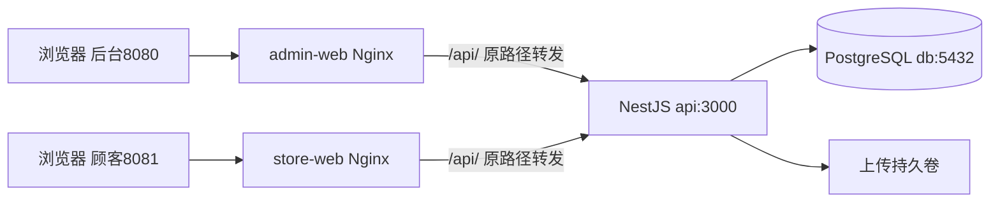

# 板块1：工程、数据库与四容器骨架开发文档

> 实施验收：2026-11-11，M0-01已完成，SW-01～06与CK-01～08全部通过。实际记录见 `docs/verification/M0-01.md`，截图、命令输出与日志关联见 `docs/verification/evidence/M0-01/`。本机容器API使用3001、数据库映射15432，两个静态站为8080/8081；开发API仍为3000。

> 一致性审查：2026-11-10。跨板块约定、修订清单及未交付项见开发进度文档根目录《文档一致性审查记录.md》；本标记不代表软件已实现或测试通过。

| 项目 | 说明 |
|---|---|
| 所属里程碑 | M0：工程可运行 |
| 文档编号 | M0-01 |
| 编写日期 | 2026-11-10 |
| 对应板块 | 开发顺序说明中的板块1，后续编号保持不变 |
| 依据 | 《自营电商项目需求文档_v2.0.md》TD-01～09、TD-13～15、NFR-06、08～10；《自营电商项目开发顺序说明_v2.0.md》板块1 |
| 前置条件 | 板块0已取消为独立开发阶段；直接沿用需求v2.0的业务约定，具体业务设计随对应板块落实 |
| 文档性质 | 设计与验收说明；板块1已于2026-11-11完成实际验收，历史设计约定保留供后续参考 |

## 1. 本板块要完成什么

完成可重复启动、构建和验证的项目骨架：一个NestJS API、两个独立React静态站点、一个PostgreSQL 16数据库。开发人员应能按README从干净环境启动四个服务，并通过Swagger验证API进程与数据库连接。

本板块开发的功能：

1. Monorepo工程管理、严格TypeScript、代码检查、测试及构建入口。
2. API环境变量校验、请求编号、日志、统一响应、异常处理和DTO校验基础。
3. PostgreSQL连接、首个版本迁移及独立测试数据库。
4. 存活与就绪检查API、Swagger页面、OpenAPI文件导出。
5. 后台站和顾客站应用壳、路由、Ant Design、Axios基础封装。
6. 四服务Compose、健康检查、数据库和上传目录持久化、静态站深层路由回退及API反向代理。
7. 快速启动、迁移、验证和常见故障说明。

本板块只制作登录页面外壳，不实现登录、JWT签发、注册、权限和初始化管理员；这些属于板块2。上传业务与私有附件授权属于板块3，本板块只配置存储目录和卷。定时业务属于后续模块，此时只预留调度模块。

完成本板块不等于M0完成，M0还需要板块2～4。

## 2. 工程和版本约定

### 2.1 运行版本

- Node.js：选用Node 24 LTS系列，实施时核实实际可用补丁版本，并在版本文件、Docker镜像和README中固定一致版本。
- pnpm：选用与上述Node兼容的版本，在根package.json的packageManager中记录完整版本。
- PostgreSQL：16系列；Compose使用经验证的16.x镜像标签，交付时记录完整标签或摘要。
- NestJS、Prisma、React、Vite、Ant Design、Turborepo：首次安装时确认兼容性，记录实际完整版本并提交pnpm-lock.yaml。Prisma CLI与客户端保持同版本。
- 使用TypeScript strict，不用浮动latest作为可复现部署依据。

上述是选型基线，不是已经安装或验证的版本清单。首次实现须在README填写实际版本和验证日期。

### 2.2 推荐目录

```text
shop/
  apps/
    api/
      prisma/
        schema.prisma
        migrations/
      src/
        main.ts
        app.module.ts
        common/          # 响应、异常、requestId、校验
        config/          # 环境校验、配置读取
        prisma/          # PrismaModule、PrismaService
        health/          # 本板块两个检查接口
      test/
      package.json
      Dockerfile
    admin-web/
      src/
        app/             # 路由、布局
        pages/           # 首页、登录外壳、404
        services/        # Axios实例
      Dockerfile
    store-web/
      src/
        app/
        pages/
        services/
      Dockerfile
  packages/
    api-client/          # 本板块类型及OpenAPI生成入口
    shared/              # 公开基础类型，不导出Prisma实体
    config/              # tsconfig、ESLint等公共配置
  infra/
    compose.yaml
    nginx/admin.conf
    nginx/store.conf
  docs/
    openapi.json
    verification/M0-01.md
  .env.example
  .gitignore
  pnpm-workspace.yaml
  pnpm-lock.yaml
  turbo.json
  package.json
  README.md
```

建议工作区包名分别为@shop/api、@shop/admin-web、@shop/store-web，其余以@shop/为前缀。后面的命令使用这些包名；若实际命名不同，必须同步全文档与脚本。

### 2.3 根脚本契约

| 命令 | 要执行的内容 | 判定 |
|---|---|---|
| pnpm dev | 启动API和两个Vite开发服务 | 三者均可访问 |
| pnpm lint | turbo run lint | 所有实际源码包检查成功 |
| pnpm typecheck | turbo run typecheck | 后端、两个前端及共享包均通过 |
| pnpm test | turbo run test | 本板块校验、响应、健康检查相关测试通过 |
| pnpm test:integration | API专用数据库集成测试 | 使用PostgreSQL 16真实连接 |
| pnpm build | turbo run build | API与两个前端均生成可部署产物 |
| pnpm db:generate | Prisma客户端生成 | 使用已固定版本 |
| pnpm db:migrate:dev | prisma migrate dev | 仅开发环境使用 |
| pnpm db:migrate:deploy | prisma migrate deploy | Compose及部署环境使用 |
| pnpm db:migrate:status | prisma migrate status | 已提交迁移全部应用 |
| pnpm openapi:export | 导出当前应用的OpenAPI | 更新docs/openapi/openapi.json，不访问业务数据 |

这些脚本须实际写入package.json；不能只在README列命令。持久运行dev不缓存；build声明dist等输出并依赖上游构建。集成测试及数据库命令不使用缓存。普通测试若启用缓存，必须正确声明测试输入，且不得以缓存代替实际数据库验收。

## 3. 环境变量与网络设计

### 3.1 本地开发端口

| 服务 | 宿主机地址 | 容器内部 |
|---|---|---|
| API | http://localhost:3000 | api:3000 |
| 后台Vite | http://localhost:5173 | 开发模式使用宿主机进程 |
| 顾客Vite | http://localhost:5174 | 开发模式使用宿主机进程 |
| 后台静态站 | http://localhost:8080 | admin-web:80 |
| 顾客静态站 | http://localhost:8081 | store-web:80 |
| PostgreSQL | 127.0.0.1:5432（开发需要时映射） | db:5432 |

四服务部署与Vite开发是两种运行方式，不要求同时启动所有前端端口。数据库映射仅供本机开发，不作为浏览器访问路径。

### 3.2 变量清单

| 变量 | 使用位置 | 要求 |
|---|---|---|
| NODE_ENV | API/构建 | development、test或production之一 |
| PORT | API | 默认3000，整数且在有效端口范围 |
| DATABASE_URL | API/Prisma | 必填；容器内主机是db，本机开发主机是localhost |
| TEST_DATABASE_URL | 集成测试 | 必填且与开发库不同，例如数据库名shop_test |
| POSTGRES_DB | db | 示例shop_dev；测试库单独创建 |
| POSTGRES_USER | db | 开发示例shop；部署按实际配置 |
| POSTGRES_PASSWORD | db | 从本地.env注入，不能提交真实值 |
| CORS_ORIGINS | API | 明确允许的两个前端来源；开发与Compose按运行方式配置 |
| UPLOAD_DIR | API | 容器内绝对路径/app/storage/uploads |
| SWAGGER_ENABLED | API | 严格解析true/false，不用Boolean('false') |
| LOG_LEVEL | API | 使用白名单校验 |
| VITE_API_BASE_URL | 两个前端 | /api/v1；仅公开配置 |

JWT密钥在板块2加入并校验。本板块不生成演示token或假登录接口。禁止把DATABASE_URL、数据库密码、JWT密钥设置为VITE_变量或注入前端构建参数。

启动前通过配置校验统一报告缺失变量的名称，不能输出密码值或连接串。无效端口、错误枚举和非法来源均应失败退出。数据库启动较慢时采用有界连接重试，不能无限等待。

### 3.3 请求路径



两个Nginx和Vite代理均保留/api前缀，不能把/api/v1误改成/v1，也不能重复拼成/api/v1/api/v1。浏览器只访问站点地址，不使用http://api:3000这一容器网络地址。

## 4. 本板块数据库表设计

### 4.1 为什么此时不建业务表

本板块只验证数据库基础设施。Employee、Customer、AuthSession、AuditLog等在板块2设计；商品、库存、订单分别随对应板块迁移。不能提前创建一个通用User表混合员工和顾客，或创建一批无实际用途的空业务表。

本板块数据库组成：

| 对象 | 用途 | 是否业务表 |
|---|---|---|
| public schema | 后续业务表默认所在空间 | 否 |
| _prisma_migrations | Prisma记录迁移执行情况 | 否，由Prisma维护 |
| 临时持久化验证表 | 仅验收期间写入标记并检查重启保留 | 否，验证后删除 |

本板块无业务实体关系，因此不画虚构业务ER图。迁移历史不属于业务审计，不能替代后续AuditLog。

### 4.2 首个迁移

建议首个迁移命名为0001_bootstrap，SQL为：

```sql
CREATE SCHEMA IF NOT EXISTS public;
```

这是建立版本迁移链的基础迁移，不新增业务实体。可手动建立符合Prisma目录规范的迁移文件，提交migration_lock.toml并使用migrate deploy验证。不为凑首个迁移创建假商品表或重复维护第二套迁移版本表。

Prisma数据源使用postgresql，连接读取DATABASE_URL。空模型阶段如所选Prisma版本不支持生成客户端，可将验证迁移应用与schema初始化分别完成；为本板块健康检查采用该版本支持的无业务模型客户端配置。若工具链必须有模型才能生成，改用一个明确的基础配置模型前，应说明必要性并更新本文表设计，不静默新增业务表。

### 4.3 _prisma_migrations参考结构

该表由Prisma自动创建和维护，下表仅帮助排障，不手动插入或更新。

| 字段 | PostgreSQL类型 | 说明 |
|---|---|---|
| id | varchar(36)，主键 | 迁移执行标识 |
| checksum | varchar(64) | 迁移文件摘要 |
| migration_name | varchar(255) | 迁移名称 |
| started_at | timestamptz | 开始时间 |
| finished_at | timestamptz，可空 | 成功完成时间 |
| rolled_back_at | timestamptz，可空 | 回滚标记时间 |
| logs | text，可空 | 执行错误信息 |
| applied_steps_count | integer，默认0 | Prisma记录的执行步数 |

以实际固定Prisma版本生成结构为准。已应用迁移不得原地改写；后续变更新增迁移。开发用migrate dev，部署用migrate deploy，不使用db push替代已提交迁移。

### 4.4 数据访问和测试隔离

- PrismaService集中管理客户端生命周期，配置关闭钩子，结束进程时释放连接。
- 健康检查只执行SELECT 1，不读取业务表或输出数据。
- 集成测试通过TEST_DATABASE_URL连接独立库，运行前校验它不等于DATABASE_URL，并校验数据库名符合项目测试命名规则；校验失败立即停止。
- 清库、reset及测试夹具只允许操作测试库。普通pnpm test不能隐式重置开发库。
- 数据库字符编码使用UTF-8；连接及默认时区建议UTC。未来业务时区为Asia/Shanghai，时间字段使用timestamptz，API使用ISO 8601 UTC。

## 5. API公共基础设计

### 5.1 NestJS基础模块

| 模块 | 职责 |
|---|---|
| ConfigModule | 配置读取及启动校验 |
| LoggerModule | nestjs-pino、requestId、脱敏 |
| PrismaModule | 单例数据访问与生命周期 |
| HealthModule | 存活、就绪 |
| Common基础层 | ValidationPipe、异常过滤器、响应包装 |
| ScheduleModule | 注册调度基础；此时没有关单或收货业务任务 |

Controller只接收请求和调用服务，不包含未来跨模块事务。API全局前缀/api/v1。

### 5.2 响应与请求编号

成功响应：

```json
{
  "data": { "status": "ok" },
  "requestId": "9bc421ac-5987-493e-a6cf-73fe46082272"
}
```

错误响应：

```json
{
  "code": "VALIDATION_FAILED",
  "message": "请求参数不合法",
  "details": [{ "field": "page", "message": "page必须为正整数" }],
  "requestId": "9bc421ac-5987-493e-a6cf-73fe46082272"
}
```

响应头统一返回X-Request-Id。首期由服务端为每次请求生成UUID，不信任浏览器提交值；日志、响应体和响应头保持一致。反向代理须保留响应头。未来审计复用该编号，但不能将日志当作审计账本。

| HTTP状态 | code示例 | 使用场景 |
|---|---|---|
| 400 | VALIDATION_FAILED | DTO校验失败 |
| 401 | UNAUTHORIZED | 后续登录失效 |
| 403 | FORBIDDEN | 后续无权限 |
| 404 | NOT_FOUND | 路径或授权范围内资源不存在 |
| 409 | STATE_CONFLICT | 后续状态或并发冲突 |
| 429 | RATE_LIMITED | 后续限流 |
| 500 | INTERNAL_ERROR | 未处理错误 |
| 503 | SERVICE_NOT_READY | 本板块数据库依赖不可用 |

503是健康检查需要的HTTP状态，不改变业务接口原有错误约定。Swagger与JSON导出使用其原生HTML/JSON格式，不套data外壳；普通API只包装一次。

### 5.3 DTO和日志

ValidationPipe启用whitelist、forbidNonWhitelisted与transform；number/boolean转换必须显式定义并校验，不能依赖宽松隐式转换。全局管道只对声明DTO的输入生效，不能声称自动校验所有无DTO接口。

分页公共DTO预留page默认1、pageSize默认20且最大100，排序后续按白名单。用测试控制器或单元测试验证非法值、额外字段和严格布尔转换，不为此发布永久测试API。

日志记录requestId、方法、去除敏感查询值的路径、状态码和耗时；屏蔽Authorization、Cookie、密码、数据库连接串等。此时不记录请求体和完整查询串。500/503响应不得返回SQL、堆栈、内部主机名或原始数据库错误。

## 6. 本板块API设计

### 6.1 接口总表

| 方法 | 路径 | 鉴权 | 成功 | 失败 |
|---|---|---|---|---|
| GET | /api/v1/health/live | 无 | 200，进程可处理HTTP | 进程退出时连接失败 |
| GET | /api/v1/health/ready | 无 | 200，数据库查询成功 | 503，数据库不可用或检查超时 |
| GET | /api/docs | 开发/验收启用时无 | 200，Swagger HTML | 关闭时404 |
| GET | /api/docs-json | 与Swagger开关一致 | 200，原生OpenAPI JSON | 关闭时404 |

两个health接口不接收业务参数、不修改数据，也不要求JWT。Swagger配置显式指定上述页面和JSON路径，避免框架默认路径不同造成说明失效。

### 6.2 GET /api/v1/health/live

用途：判断进程是否能响应HTTP；数据库不可用时仍然返回200，避免把依赖故障误判成进程崩溃。

成功示例：

```json
{
  "data": {
    "status": "ok",
    "service": "shop-api",
    "timestamp": "2026-11-10T02:00:00.000Z"
  },
  "requestId": "9bc421ac-5987-493e-a6cf-73fe46082272"
}
```

字段：status固定ok；service固定shop-api；timestamp为服务器UTC时间；requestId为本次请求编号。无业务表查询。

### 6.3 GET /api/v1/health/ready

用途：判断是否具备服务条件。通过Prisma执行SELECT 1；检查总预算建议2秒，连接/查询设置有界超时，避免仅Promise.race返回后后台查询无限累积。

成功示例：

```json
{
  "data": {
    "status": "ready",
    "checks": { "database": "up" },
    "timestamp": "2026-11-10T02:00:00.000Z"
  },
  "requestId": "01cda1ef-5747-4329-aa4b-8b184d01ae95"
}
```

失败示例，HTTP 503：

```json
{
  "code": "SERVICE_NOT_READY",
  "message": "服务暂未就绪",
  "details": { "database": "unavailable" },
  "requestId": "01cda1ef-5747-4329-aa4b-8b184d01ae95"
}
```

ready查询证明数据库可连接，迁移是否最新由部署前migrate status/deploy单独保证，不能把SELECT 1解释为业务表结构已经正确。

### 6.4 OpenAPI要求

两个接口归入Health标签，设置稳定operationId，例如getLiveness、getReadiness；描述200/503模型、X-Request-Id响应头、示例、UTC时间格式。区分错误响应与成功响应。

Swagger servers使用相对根路径/，接口paths包含完整/api/v1前缀，避免在服务器地址中再次追加该前缀。导出不携带本机真实密码或token。未来Bearer认证在板块2补入，本板块不要求点击Authorize。

## 7. 前端应用壳

### 7.1 页面与功能

| 应用 | 路由 | 本板块行为 |
|---|---|---|
| 后台 | / | 显示项目名称、后台入口说明和登录链接 |
| 后台 | /login | 账号/密码表单外壳，提示登录将在板块2接入，不伪装登录成功 |
| 后台 | 其他路径 | 显示应用404页 |
| 顾客 | / | 显示店铺应用壳和模拟交易说明 |
| 顾客 | /login | 手机号/密码表单外壳，不提交未实现API |
| 顾客 | 其他路径 | 显示应用404页 |

接入Ant Design主题、中文组件文案、React Router和基础布局，建议1366×768验收。页面不展示环境变量、容器名、数据库连接串等实现信息。

### 7.2 Axios约定

baseURL统一/api/v1，配置请求超时，正常解包data并保留requestId以供错误提示和排查。网络失败与服务器返回业务错误分开呈现；不自动重试未来写请求，不自行生成业务幂等键。401/403公共处理预留至板块2。

两个站点均通过Vite开发代理或Nginx生产代理访问API。此时不加入token存储逻辑，不创建假用户状态。

## 8. Docker Compose与构建设计

### 8.1 四个长期运行服务

| 服务 | 核心配置 | 健康检查 |
|---|---|---|
| db | PostgreSQL16、db_data卷、凭据来自.env | pg_isready |
| api | Node多阶段构建、端口3000、DATABASE_URL主机db、uploads_data卷 | 请求容器本机/api/v1/health/ready |
| admin-web | Vite构建后由Nginx提供、8080:80 | 检查站点静态首页 |
| store-web | Vite构建后由Nginx提供、8081:80 | 检查站点静态首页 |

检查命令必须存在于最终镜像：Node镜像可用Node内置HTTP/fetch脚本，Nginx镜像可使用其实际包含的wget；不能假设镜像有curl。设置合理interval、timeout、retries及start_period。

api等待db健康，静态站可等待api健康。depends_on只处理启动条件，运行中数据库掉线由API自身返回503并恢复重连；不能假设Compose自动重启所有依赖。

### 8.2 迁移和启动顺序

根目录执行命令，统一带--env-file .env -f infra/compose.yaml。Compose服务的build.context设置为仓库根目录（相对compose文件为..），Dockerfile路径相对根上下文；环境变量及挂载路径在README明确，避免从不同目录执行产生歧义。

```powershell
Copy-Item .env.example .env
# 按README修改本机.env中的开发密码、端口和连接串。
pnpm install --frozen-lockfile
pnpm db:generate
docker compose --env-file .env -f infra/compose.yaml build
docker compose --env-file .env -f infra/compose.yaml up -d db
# 确认db健康后执行下一条。
docker compose --env-file .env -f infra/compose.yaml run --rm --no-deps api pnpm --filter @shop/api db:migrate:deploy
docker compose --env-file .env -f infra/compose.yaml up -d api admin-web store-web
docker compose --env-file .env -f infra/compose.yaml ps
```

API最终镜像必须包含pnpm、迁移CLI和migrations，并支持覆盖命令执行上述迁移；若采用精简运行镜像，则须提供同源码构建的独立迁移target及匹配命令，不能让README调用镜像中不存在的工具。迁移命令由apps/api/package.json提供，根脚本包装同一入口。

迁移失败时停止后续启动，不在每次API启动时自动migrate dev或重置数据库。本板块无需员工seed；板块2再增加幂等管理员初始化。

### 8.3 静态路由及代理

两个Nginx各自配置：

- /api/优先代理到http://api:3000，保留原请求路径、方法、请求体、查询串和X-Request-Id响应头。
- location /api/内proxy_pass使用不带尾斜杠的http://api:3000，以保留/api/路径。
- /采用try_files $uri $uri/ /index.html，使/login刷新可进入React Router。
- /api/不存在的接口返回API JSON 404，不能落入SPA并返回HTML 200。
- 公开静态资源正常缓存；index.html避免长期强缓存。

### 8.4 持久化

数据库卷挂载到所选PostgreSQL16镜像的数据目录；上传卷挂载/app/storage/uploads，并确认API运行用户可写。本板块不把上传目录映射为公开静态URL，后续私有售后凭证不得因卷配置暴露。

普通重启或docker compose down不加-v应保留数据；down -v会删除命名卷，禁止作为常规启动或验收步骤。数据库卷不等于备份，正式备份恢复方案在板块15完成。

## 9. 推荐开发顺序

1. 建workspace、锁文件、版本记录和公共配置。
2. 建三个应用壳，先验证各自最小构建。
3. 配置PostgreSQL、Prisma与首个迁移；验证独立测试库。
4. 实现配置校验、日志、requestId、响应和异常基础。
5. 实现live/ready及OpenAPI导出，补充相应测试。
6. 完成两个前端路由、Axios和代理。
7. 完成Docker多阶段构建、四服务、持久卷及健康检查。
8. 按下一节依次验证，记录证据并更新README。

每步完成后检查实际结果。不要先做员工表或商品页面，再回头补工程基础。

## 10. Swagger详细测试说明

以下为实际验收采用的操作说明，2026-11-11已逐项执行并通过，证据见验收记录。Swagger适合验证HTTP契约；容器、磁盘持久化和构建检查另见第11节。

### SW-01：打开文档与检查契约

前提：API已启动，SWAGGER_ENABLED=true。

1. 浏览器打开http://localhost:3000/api/docs。
2. 找到Health标签，确认只有live和ready这两个本板块业务API。
3. 展开接口，检查请求方法、路径、响应字段、X-Request-Id说明和ready的503示例。
4. 另开http://localhost:3000/api/docs-json，确认是OpenAPI JSON，有上述paths及响应模型。

预期：页面和JSON均为200，接口地址没有重复/api/v1。无需登录和Authorize。

记录：页面截图、OpenAPI导出文件及实际服务版本。

### SW-02：验证进程存活

1. 展开GET /api/v1/health/live。
2. 点击Try it out，不填写参数，点击Execute。
3. 查看Request URL、Response code、Response body和Response headers。

预期：HTTP 200；data.status=ok；service=shop-api；timestamp为UTC ISO时间；requestId非空且与x-request-id头一致。

再次Execute，新的请求应获得新的requestId。用该编号在API日志中找到同一请求，确认日志没有密码或连接串。

### SW-03：验证数据库就绪

前提：数据库健康且迁移已应用。

1. 展开GET /api/v1/health/ready，点击Try it out→Execute。
2. 检查HTTP 200、data.status=ready、checks.database=up。
3. 确认响应没有数据库账号、版本细节、连接URL和SQL。

该结果仅证明检查时的连接可用；迁移历史仍通过第11节验证。

### SW-04：数据库故障与恢复

前提：只在可中断的本地开发/验收环境执行，API和Swagger已打开。

1. 终端执行：docker compose --env-file .env -f infra/compose.yaml stop db。
2. 在已打开的Swagger中再次执行ready。
3. 执行live。
4. 终端执行：docker compose --env-file .env -f infra/compose.yaml start db。
5. 待db健康，在Swagger中重新执行ready。

预期：数据库停止后ready在有界时间返回503和SERVICE_NOT_READY；live仍200；API不因单次检查退出；数据库恢复后ready重新200。错误体不含原始数据库错误。

记录：故障及恢复各一份响应、耗时和对应日志。不能仅截图Swagger中的503示例冒充真实故障测试。

### SW-05：从两个站点代理访问API

分别在浏览器打开：

- http://localhost:8080/api/docs
- http://localhost:8081/api/docs

在每个站点的Swagger中分别执行live、ready。Request URL应使用当前8080或8081站点地址，路径仍为/api/v1/health/...。

预期：四次调用成功，接口返回JSON；Swagger JSON能经相同代理加载。不因硬编码localhost:3000或api:3000绕过代理。

### SW-06：Swagger开关

1. 设置SWAGGER_ENABLED=false并重建/重启API，使配置真实生效。
2. 浏览器访问/api/docs及/api/docs-json。
3. 通过浏览器或终端直接访问/api/v1/health/live。

预期：文档页面与JSON均404；live仍200。恢复验收配置后再继续后续工作。由于Swagger已关闭，本用例后半段不能在Swagger页面内完成。

## 11. Swagger之外必须执行的检查

### CK-01：干净安装与完整工程检查

从新检出目录准备.env和独立测试库，依次执行：

```powershell
pnpm install --frozen-lockfile
pnpm db:generate
pnpm lint
pnpm typecheck
pnpm test
pnpm test:integration
pnpm build
pnpm openapi:export
```

预期全部退出码0；API和两个前端确实参与检查。空脚本、关闭类型检查或仅检查Markdown不算通过。

### CK-02：配置校验

在临时环境分别设置缺失DATABASE_URL、PORT=abc、SWAGGER_ENABLED=abc后启动API。预期启动失败并指出变量名，不泄露真实值；恢复有效配置后正常启动。

### CK-03：迁移和数据库持久化

1. 对空开发库执行db:migrate:deploy，再执行db:migrate:status，确认0001_bootstrap成功。
2. 再次deploy，无重复迁移或错误；确认_prisma_migrations存在成功记录。
3. 在开发验收库执行下列SQL，写入唯一标记：

```sql
CREATE TABLE public.bootstrap_persistence_probe (
  id integer PRIMARY KEY CHECK (id = 1),
  marker text NOT NULL,
  created_at timestamptz NOT NULL DEFAULT now()
);
INSERT INTO public.bootstrap_persistence_probe(id, marker)
VALUES (1, 'M0-01-persistence-check');
```

4. 重启db及API后查询此表，确认标记仍在；如验证down/up，不使用-v。
5. 验证结束执行DROP TABLE public.bootstrap_persistence_probe，避免留作业务表；记录清理结果。

该表只用于验收库人工验证，不加入正式迁移，不提供API。重复验证前检查其是否已存在，避免误覆盖旧数据。

### CK-04：测试库防误清理

将TEST_DATABASE_URL临时配置成开发库URL，运行集成测试。预期在任何迁移/reset/清理发生前失败退出，开发数据不变。然后恢复独立测试库，正常运行。

### CK-05：DTO、响应与异常自动测试

用单元或测试专用模块覆盖：成功包装一次、400额外字段拒绝、非法数字、严格布尔、404统一格式、500脱敏、requestId头体一致。测试控制器仅存在测试模块，不注册到生产AppModule，也不进入正式OpenAPI。

通过真实PostgreSQL集成测试验证ready的SELECT 1和迁移；故障恢复另按SW-04实测，不能只Mock数据库故障。

### CK-06：两个前端和深层路由

访问8080、8081首页及/login；分别在/login直接刷新，预期200且显示对应登录外壳。访问不存在页面，显示前端404。

分别请求两个站点下/api/v1/not-exist，预期API JSON 404而非index.html。检查控制台无资源路径错误，网络请求没有容器内部域名。

### CK-07：构建产物与卷

检查两个前端dist和静态镜像资源，不含本次配置的真实数据库密码、DATABASE_URL完整值和JWT密钥。使用唯一测试标记进行检索，不能只搜索password单词。

检查API上传挂载点可写：在验收容器内写入一个无敏感内容的临时标记文件，重新创建API容器后确认仍在，再删除标记文件。此项只证明卷可用，不代表上传API、图片验证或私有文件授权已实现。

### CK-08：四服务冷启动

按第8节从未构建状态操作，记录四服务状态、健康结果、迁移结果、两个站点截图。不能只用Vite开发服务器成功代替静态前端镜像验证。

## 12. 常见问题定位

| 现象 | 优先检查 |
|---|---|
| API在容器中连不上数据库 | DATABASE_URL是否错误使用localhost；db是否健康；凭据是否与现有卷一致 |
| 修改.env密码后数据库拒绝连接 | 已有PostgreSQL卷不会随环境变量自动修改用户密码，不直接删卷解决 |
| Swagger可打开但Execute返回404 | servers是否重复前缀；Nginx是否删除/api；实际paths是否匹配 |
| /login刷新404 | 静态站是否配置history回退 |
| 不存在API返回HTML 200 | /api/代理优先级与SPA回退是否混淆 |
| ready永远等待 | 数据库连接及查询超时是否真正有界 |
| db重启后API不能恢复 | 连接池恢复逻辑、客户端生命周期及错误处理 |
| migrate命令在镜像中找不到 | 最终镜像缺pnpm、Prisma CLI或迁移文件 |
| 数据或上传标记丢失 | 实际卷挂载目录、Compose项目名是否变化；是否误用down -v |

## 13. 交付物和完成门槛

### 13.1 交付物

- [x] 三个应用、公共包、完整目录与固定版本记录。
- [x] pnpm-lock.yaml、TypeScript/ESLint配置及实际可运行的根脚本。
- [x] Prisma配置、首个migration及迁移说明。
- [x] 配置校验、日志脱敏、响应、异常、DTO基础与requestId。
- [x] 两个health接口、Swagger与导出的OpenAPI。
- [x] 两个前端应用壳、路由、Ant Design、Axios及代理。
- [x] API与两个前端Dockerfile、四服务Compose、Nginx配置和持久卷。
- [x] .env.example、README、独立测试库及本板块自动测试。
- [x] docs/verification/M0-01.md，逐条登记真实验证结果。

### 13.2 验收记录模板

| 编号 | 结果（待执行/通过/失败） | 环境与版本 | 实际结果及requestId/证据位置 | 遗留问题 |
|---|---|---|---|---|
| SW-01～06 | 逐条填写，不能合并默认为通过 | 记录实际环境 | 截图/响应/日志 | 如实填写 |
| CK-01～08 | 逐条填写，不能合并默认为通过 | 记录实际环境 | 命令、退出码及输出 | 如实填写 |

本表是填写格式，实际验收文件必须把每个编号展开为单独一行。每次验证记录日期、执行人、命令及结果；失败修复后补记复测证据。

### 13.3 完成判定

本板块完成必须同时满足：四服务可冷启动；迁移可重复应用；API能真实查询数据库；数据库不可用时ready失败且live存活；两个静态站深层路由刷新正常；数据和上传卷验证通过；完整工程检查通过；无真实密钥进入前端。

不以Swagger绿色200响应替代构建、持久化和测试隔离检查。暂未实现的登录、上传业务、权限、员工初始化等在交付说明中明确归属后续板块。

## 14. 与后续板块的衔接

| 后续板块 | 复用本板块内容 | 后续新增 |
|---|---|---|
| 板块2 登录、员工与权限 | Prisma、响应、配置、日志、前端登录壳 | 员工/顾客/会话/额外权限/最小审计表、JWT、强制改密、管理员seed及权限测试 |
| 板块3 文件与公共记录 | 上传卷、requestId、OpenAPI | FileAsset、私有附件访问、审计扩展、沟通记录 |
| 板块4 设置、期限与任务 | 基础数据库、调度模块 | 设置版本、任务/历史/期限事件及时间工具 |
| 板块15 集成验收与部署 | 四服务、迁移及README | 全业务验收、性能、备份恢复和最终交付 |

后续新增接口继续使用本板块公共契约。鉴权和审计等业务约束在对应板块完成，不因工程骨架已通过而跳过。
