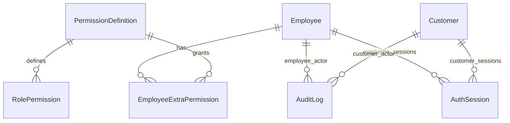

# 板块2：登录、员工与权限开发文档

> 一致性审查：2026-11-10。跨板块约定、修订清单及未交付项见开发进度文档根目录《文档一致性审查记录.md》；本标记不代表软件已实现或测试通过。

| 项目 | 说明 |
|---|---|
| 所属里程碑 | M0：工程可运行 |
| 文档编号 | M0-02 |
| 编写日期 | 2026-11-10 |
| 前置依赖 | 板块1已完成，沿用其工程、响应、requestId、Prisma、Swagger及Compose约定 |
| 对应需求 | FR-01～05、FR-10～14、FR-97；TD-06、10～13、15；NFR-01～02；AC-01、02、17、29的本阶段部分 |
| 范围说明 | 板块0不单独产出；权限码和本板块命令设计在本文落实 |
| 文档状态 | 待实施设计与测试说明，不代表代码已实现或用例已通过 |

## 1. 本板块的目标和边界

实现员工与顾客分离的身份体系、可撤销登录会话、固定三岗位加个人额外权限、员工管理，以及与员工关键写操作同事务的最小审计。

本板块完成后可以演示：初始化管理员→强制改密→创建员工→员工首次改密登录→查询个人权限→给某个员工增加权限→撤销后旧token立即失去相应能力→停用使旧会话失效；顾客可以注册、登录、改昵称和密码、注销。

### 1.1 本期必须开发

| 功能 | 说明 |
|---|---|
| 员工认证 | 账号名/密码登录、当前身份、改密、注销、强制首次改密 |
| 顾客认证 | 手机号/密码注册登录、当前资料、昵称修改、密码修改、注销 |
| 员工管理 | 列表、详情、创建、修改显示名、停用/启用、重置密码、调岗 |
| 权限 | 三岗位固定模板、权限目录、依赖闭包、个人额外授权、实际权限查询 |
| 会话安全 | 每请求检查主体、启停/冻结、会话撤销/过期与tokenVersion；登录域隔离 |
| 最小审计 | 员工创建、启停、重置、调岗、授权及本人改密的事务写入 |
| 并发保护 | 最后可用管理员保护；授权变更与敏感命令的员工主体锁仲裁 |
| 前端 | 两端认证页面、强制改密页、员工管理和权限三栏展示 |

### 1.2 后续接通的内容

- 头像上传在板块3加入FileAsset后接通；本板块返回avatarUrl=null，昵称可编辑。不允许提交任意外部URL作为头像。
- 顾客完整查询与限制/冻结/恢复管理接口、页面在板块7实现；本板块先实现三种状态的认证判定并通过测试夹具验证。
- 真实待办及撤权回池在板块4接入；本板块提供接收事务客户端的资格变更入口，不能提前宣称任务回池已验收。
- 商品、发货、售后等权限先进入固定目录，其业务接口随对应板块开发，不用临时发货接口替代真实业务验收。
- 全店审计查询界面在板块14完成；本板块通过测试库查询及集成测试检查审计。
- 冻结顾客的身份核实代录在板块13接通，不创建绕过售后规则的万能接口。

## 2. 身份、输入与状态规则

### 2.1 主体和状态

| 枚举 | 值 | 含义 |
|---|---|---|
| SubjectType | EMPLOYEE、CUSTOMER | 员工/顾客登录域，JWT与会话均保存 |
| EmployeeRole | SUPER_ADMIN、MERCH_WAREHOUSE、CUSTOMER_SERVICE | 超级管理员、商品与仓储、客服 |
| EmployeeStatus | ACTIVE、DISABLED | 可登录、停用 |
| CustomerStatus | NORMAL、TRADE_RESTRICTED、LOGIN_FROZEN | 正常、只禁止新建订单、禁止登录及旧会话 |

员工不自行注册，初始化之外必须由超级管理员创建。无动态岗位管理、个人拒绝权限、多商家或员工删除接口。

### 2.2 输入约定

以下是本板块落实的默认实现约定，前后端和Swagger必须一致：

| 字段 | 规则 |
|---|---|
| username | 员工账号：4～32位，小写字母开头，后续允许小写字母、数字、下划线；去首尾空白后转小写保存，账号不可改 |
| displayName | 员工显示名：1～40字符，去首尾空白，不能为空 |
| phone | 首期大陆11位手机号，正则^1[3-9][0-9]{9}$，去首尾空白；不声称已短信验证 |
| nickname | 1～40字符，去首尾空白；注册可省略，服务端给出非手机号的默认昵称 |
| password | 8～64个Unicode码点，UTF-8字节数≤72；不trim、不截断；新密码不得等于旧密码 |
| reason | 启停、重置、调岗、授权、修改员工资料的原因：1～500字符，去首尾空白 |
| id | UUID；格式非法400，不存在404 |
| expectedVersion | 员工管理写请求必填，非负整数；与当前version不同返回409并要求刷新 |

密码的字符数与字节数应使用共享规则和服务端权威校验，不能直接依赖JavaScript字符串length或只用普通MaxLength。bcrypt cost默认建议12，记录本机耗时后确定；不记录明文或密码哈希。

## 3. 固定权限设计

### 3.1 计算与授权边界

实际权限=岗位默认权限∪个人额外权限。超级管理员拥有全部目录能力，也必须遵守状态、实物核实、经办人及审计规则。

岗位默认模板由版本化代码与数据库seed固化，不提供增删岗位或编辑模板API。普通岗位额外权限仅来自两个普通岗位的业务权限并集；管理员专属能力一律禁止下放。超级管理员不使用个人额外权限入口。

以下权限码为本项目设计基线；后续新增动作只能补齐同范围的细粒度权限，不能把管理员能力换名下放。

### 3.2 普通岗位权限码表

“仓”指商品与仓储默认拥有；“客”指客服默认拥有。表中每一个码都须有独立目录记录，逗号列出的码分别建记录。全部可额外授予另一个普通岗位，但必须满足依赖。

| 权限码 | 作用 | 默认 | 直接依赖 |
|---|---|---|---|
| category.read | 查看后台分类 | 仓 | 无 |
| category.manage | 新增修改排序删除分类 | 仓 | category.read |
| product.read | 查看后台商品公开及运营资料 | 仓 | category.read |
| product.cost.read | 查看商品及授权订单成本字段 | 仓 | product.read |
| product.manage | 草稿、资料、价格、规格、图片维护 | 仓 | product.read、product.cost.read |
| product.publish | 单项/批量上下架、SKU启停 | 仓 | product.read |
| inventory.read | 余额、来源、流水、预警查询 | 仓 | product.read |
| inventory.adjustment.create | 创建待确认登记、更正登记 | 仓 | inventory.read |
| inventory.adjustment.claim | 领取登记 | 仓 | inventory.read |
| inventory.adjustment.post | 核实并确认入账 | 仓 | inventory.read、inventory.adjustment.claim |
| inventory.adjustment.void | 作废待确认登记 | 仓 | inventory.read、inventory.adjustment.claim |
| inventory.source.manage | 来源行核实数量维护 | 仓 | inventory.read |
| inventory.alert.manage | 设置SKU预警线 | 仓 | inventory.read |
| order.fulfillment.read | 查询履约订单、必要收货信息及业务记录 | 仓 | 无 |
| shipment.claim | 领取发货 | 仓 | order.fulfillment.read |
| shipment.pack | 拣货、打包、运单准备 | 仓 | order.fulfillment.read、shipment.claim |
| shipment.handover | 开始交运、确认交运、核实交运结果 | 仓 | order.fulfillment.read、shipment.claim |
| shipment.tracking.correct | 允许阶段的运单修正 | 仓 | order.fulfillment.read |
| shipment.exception.manage | 登记发货异常、核实齐货 | 仓 | order.fulfillment.read |
| order.physical.check | 未交运备货可售/损耗及位置核实 | 仓 | order.fulfillment.read |
| inventory.order-exception.manage | 待付受损分配、备货损耗记录及阻塞核实 | 仓 | inventory.read、order.fulfillment.read |
| after-sale.inspection.read | 读取退货物流、验收所需单据与证据 | 仓 | order.fulfillment.read |
| after-sale.receipt.record | 登记实物到仓 | 仓 | after-sale.inspection.read |
| after-sale.inspection.confirm | 草稿、异常、正常验收及批准后最终核实 | 仓 | after-sale.inspection.read、inventory.read |
| dashboard.read | 全店经营看板 | 仓 | 无 |
| order.service.read | 服务范围订单、付款退款与客服记录查询 | 客 | 无 |
| communication.service.write | 新增及追加更正客服记录、公开说明 | 客 | order.service.read |
| customer.read | 顾客资料及完整地址簿查询 | 客 | 无 |
| after-sale.service.read | 查询售后及服务材料 | 客 | order.service.read |
| after-sale.review | 审核、拒绝、补材料要求 | 客 | after-sale.service.read |
| after-sale.close | 仅允许阶段的未退款结案 | 客 | after-sale.service.read |
| after-sale.return.follow | 跟进寄回、补寄与物流核实 | 客 | after-sale.service.read |
| after-sale.refund.execute | 执行全额模拟退款 | 客 | after-sale.service.read |
| after-sale.refund.retry | 失败沿用原退款业务重试 | 客 | after-sale.service.read、after-sale.refund.execute |
| shipment.customer-confirm | 登记顾客等待/退款/继续履约意见 | 客 | order.service.read、communication.service.write |
| offline-case.manage | 线下诉求、处理结果及证据记录 | 客 | order.service.read |
| customer.frozen.proxy | 核实身份后代录冻结顾客原单诉求 | 客 | customer.read、after-sale.service.read |

验收确认与登记到仓仍是不同动作；持有核实权限不等于持有退款权限。成本输出必须检查product.cost.read；仓储订单查询不自动获得customer.read。补充材料、物流等顾客本人操作按归属与状态校验，不授予员工权限码给顾客。

所有员工可读取和领取自己合资格的待办，但待办API仍须检查候选业务权限，不能凭一个通用task.claim权限领取任意业务。转交给他人属于管理员专属能力；本人释放也须遵守该阶段规则。

兼岗授权与任务衔接：通俗版“登记发货”在界面展示为明确列项的业务权限组合shipment.claim＋shipment.pack＋shipment.handover＋order.fulfillment.read，管理员确认后提交具体权限码，不新增角色或隐式授予商品/库存权限。完整发货需上述全套资格才可领取SHIPMENT_PROCESS。仅授予shipment.handover时，员工可按HANDOVER_VERIFY资格领取交运核实任务，但不能领取完整发货任务；不宣传其能够独立从拣货到交运。仅运单修正沿独立权限执行。Swagger分别验证完整组合可领取、只交运不能领取完整任务却能处理合法核实任务、未授权同岗员工403。

### 3.3 管理员专属权限码

| 码 | 作用 |
|---|---|
| employee.read | 员工列表、详情和权限目录 |
| employee.create | 创建员工，包括新增管理员 |
| employee.profile.update | 修改员工显示名 |
| employee.status.manage | 员工启停 |
| employee.password.reset | 重置他人密码 |
| employee.role.change | 调岗，包含升降管理员 |
| employee.permission.manage | 个人额外权限设置 |
| customer.status.manage | 顾客限制交易、冻结、恢复 |
| store.setting.manage | 全店设置 |
| audit.read | 全店审计查询 |
| order.unpaid.close | 手动关闭未付款订单 |
| shipment.history.correct | 完成/退款后的历史运单纠错 |
| after-sale.dispute.decide | 争议处理、异常退款批准、受限阶段关闭 |
| deadline.extend | 原因明确的特殊延期 |
| task.transfer | 跨人员转交、显式接手和无人接手协调 |

### 3.4 依赖闭包与撤销算法

1. 新增额外操作时，自动补齐其全部查询/操作依赖；默认已具备的依赖不重复存入额外表。
2. 权限页保存前展示补齐后的最终结果，防止操作者不知情。
3. PUT提交完整期望额外集合。以旧实际集合和新请求为基础，识别被显式移除的额外依赖；先递归删除依赖它的额外操作，再对保留/新增操作求依赖闭包。
4. 若请求同时显式保留某操作又移除其旧额外依赖，按撤销依赖优先，返回removedByDependency供页面提示；不要重新补回导致无法撤权。
5. 新增操作缺少旧集合中从未存在的依赖时，属于新增依赖补齐。前端展示resolvedExtraPermissions及effectivePermissions后保存；服务端始终重算。
6. 默认权限不因撤销额外权限而变化。调岗清空全部额外权限，重新授权须另行提交。
7. 发现未知码或管理员专属码返回400，不能静默忽略。默认已有码作为额外提交可规范化移除并在结果中说明。

依赖图启动/seed时校验无环且每个默认模板已包含所有依赖。业务页面按实际权限显示，API按最新权限执行；不能信任前端传来的权限数组。

## 4. 数据库设计

### 4.1 模型约定与ER图

主键UUID；时间timestamptz；实际物理表使用snake_case并通过Prisma映射。created_at、updated_at由统一实现维护。所有外键禁止级联删除历史主体。本板块新增迁移0002_auth_employee_permission_audit。



AuthSession到员工和顾客是互斥可空外键，须用CHECK保证恰好一个主体。RolePermission.role是固定枚举，不新增可编辑Role表。AuditLog同时支持SYSTEM主体。

### 4.2 Employee（employee）

| 字段 | 类型/约束 | 说明 |
|---|---|---|
| id | uuid PK | 员工ID |
| username | varchar(32) UNIQUE NOT NULL | 已规范化的小写账号 |
| display_name | varchar(40) NOT NULL | 显示名 |
| password_hash | text NOT NULL | bcrypt哈希，仅服务端读取 |
| role | EmployeeRole NOT NULL | 固定三岗位 |
| status | EmployeeStatus NOT NULL DEFAULT ACTIVE | 停用不删除 |
| must_change_password | boolean NOT NULL DEFAULT true | 初始/重置后强制改密 |
| token_version | integer NOT NULL DEFAULT 0 CHECK≥0 | 密码重置等使全部旧token失效 |
| permission_version | integer NOT NULL DEFAULT 0 CHECK≥0 | 授权、调岗变化时递增 |
| version | integer NOT NULL DEFAULT 0 CHECK≥0 | 所有员工管理修改递增，用于乐观并发 |
| last_login_at | timestamptz NULL | 成功登录时间 |
| created_at、updated_at | timestamptz NOT NULL | 生命周期 |

索引：(status,role)、(created_at,id)。username增加格式CHECK，应用也校验。员工DTO不得序列化password_hash、token_version等内部字段。

### 4.3 Customer（customer）

| 字段 | 类型/约束 | 说明 |
|---|---|---|
| id | uuid PK | 顾客ID |
| phone | varchar(11) UNIQUE NOT NULL | 校验手机号格式 |
| password_hash | text NOT NULL | bcrypt哈希 |
| nickname | varchar(40) NOT NULL | 默认不含手机号 |
| status | CustomerStatus NOT NULL DEFAULT NORMAL | 三种状态 |
| token_version | integer NOT NULL DEFAULT 0 CHECK≥0 | 旧会话失效版本 |
| last_login_at | timestamptz NULL | 最近成功登录 |
| created_at、updated_at | timestamptz NOT NULL | 生命周期 |

本板块不添加虚假的avatar_url引用；响应暂为null，板块3新增avatar_asset_id外键。索引：(status,created_at,id)。账号状态在本人DTO可显示；公开商品接口不得暴露顾客资料。

### 4.4 AuthSession（auth_session）

| 字段 | 类型/约束 | 说明 |
|---|---|---|
| id | uuid PK | JWT的sid，对应一条登录会话 |
| subject_type | SubjectType NOT NULL | EMPLOYEE/CUSTOMER |
| employee_id | uuid NULL FK Employee | 员工会话引用 |
| customer_id | uuid NULL FK Customer | 顾客会话引用 |
| token_version | integer NOT NULL CHECK≥0 | 登录时主体版本 |
| expires_at | timestamptz NOT NULL | 默认签发后2小时 |
| revoked_at | timestamptz NULL | 注销、停用、重置等撤销时间 |
| revoke_reason | varchar(64) NULL | LOGOUT、PASSWORD_CHANGED等枚举代码 |
| created_at | timestamptz NOT NULL | 创建时间 |

CHECK：员工类型仅employee_id非空，顾客类型仅customer_id非空；expires_at>created_at，revoked_at为空或≥created_at。索引：(employee_id,expires_at)、(customer_id,expires_at)、expires_at。首期允许多会话，不存JWT原文、不引入refresh token。到期清理只能按保留策略处理，不删除业务审计。

### 4.5 PermissionDefinition、RolePermission、EmployeeExtraPermission

| 表 | 字段 | 约束 |
|---|---|---|
| permission_definition | code varchar(100) PK、name varchar(80)、description text、admin_only boolean、dependencies jsonb | dependencies为码数组，由版本化seed验证存在性、无环；不提供编辑API |
| role_permission | role EmployeeRole、permission_code FK | 联合PK(role,permission_code)，固定模板 |
| employee_extra_permission | employee_id FK、permission_code FK、granted_by_id FK Employee、granted_at timestamptz | 联合PK(employee_id,permission_code)；额外授权只存当前结果 |

依赖JSON仅限内部目录配置，不接收浏览器修改；实际权限和依赖计算统一服务实现。普通员工不能通过直接API写入admin_only码。撤销后的历史通过AuditLog保存，不把删除当前额外关系理解为删除审计。

### 4.6 AuditLog（audit_log）最小结构

| 字段 | 类型/约束 | 说明 |
|---|---|---|
| id | uuid PK | 记录ID |
| actor_type | enum EMPLOYEE/CUSTOMER/SYSTEM | 实际操作者类型 |
| actor_employee_id、actor_customer_id | 可空uuid FK | 与actor_type一致，SYSTEM时均空 |
| action | varchar(100) NOT NULL | 如employee.permission.replace |
| target_type | varchar(80) NOT NULL | Employee/Customer/AuthSession等 |
| target_id | varchar(100) NOT NULL | 业务对象编号 |
| reason | varchar(500) NULL | 管理写命令必填 |
| before_data、after_data | jsonb NULL | 白名单差异，不保存完整实体 |
| request_id | varchar(64) NOT NULL | 与请求日志关联；seed使用独立运行编号 |
| created_at | timestamptz NOT NULL | 写入时间 |

CHECK操作者外键与类型一致；索引：(target_type,target_id,created_at)、(actor_employee_id,created_at)、(action,created_at)、request_id。无修改删除接口。密码只记录passwordChanged=true等标记，不记录新旧密码、哈希、token或完整个人资料。

### 4.7 SystemGuard（system_guard）

| 字段 | 类型/约束 | 说明 |
|---|---|---|
| key | varchar(80) PK | 固定ADMIN_AVAILABILITY |
| created_at | timestamptz NOT NULL | 由迁移或seed幂等建立 |

这是一行稳定的并发锁锚点，不是业务配置或动态审批表。任何可能改变可用管理员集合的命令（创建管理员、启停管理员、升降管理员）及管理员seed，先锁此行，再锁涉及员工。由此串行化“检查剩余管理员→修改”。

### 4.8 必须提交的数据库约束

- username、phone唯一；额外授权及岗位授权联合唯一。
- 主体/会话/审计类型一致性CHECK、版本非负、时间合法。
- 外键完整性，历史主体不物理删除。
- 固定ADMIN_AVAILABILITY行和权限seed版本随工程提交。
- Prisma无法表达的CHECK通过自定义migration SQL加入，必须能在空PostgreSQL16重建，不能只在开发库手改。

## 5. 会话、认证与并发实现

### 5.1 JWT约定

使用固定算法白名单，例如HS256，服务端固定验证issuer=shop-api、audience按员工/顾客域分别为shop-admin或shop-store。载荷仅包括sub、sid、subjectType、tokenVersion、iat、exp、iss、aud，不嵌入手机号、地址或最终权限。

默认2小时，exp与会话expires_at一致，now≥期限即失效。JWT_SECRET从环境注入，至少32字节随机值；示例文件只有占位符。首期不做刷新token，过期重新登录。

每个受保护请求依次检查：签名/算法/issuer/audience/有效期→sid存在→主体类型和sub一致→会话未撤销→会话未过期→主体可用→主体tokenVersion匹配→读取当前角色和额外权限。不要使用token中的旧权限做唯一依据。

员工token访问/store/me等顾客私有接口返回401 TOKEN_SUBJECT_MISMATCH；顾客token访问/admin接口同样401。公开顾客商品接口不因此变成需要登录。

### 5.2 强制改密与注销

must_change_password=true的员工签发真实会话，但只允许GET /admin/me、POST /admin/auth/change-password、POST /auth/logout。其它受保护动作返回403 PASSWORD_CHANGE_REQUIRED，包括员工列表和权限查询。前端立即跳强制改密页，不展示业务菜单。

改密必须验证旧密码；成功将must_change_password=false，token_version加1，撤销该主体全部会话，记录审计；返回成功后重新登录，不静默保留旧token。顾客改密同样撤销全部会话。logout只撤销当前sid，其它设备不自动退出；同一合法签名且已注销sid重复logout可以200返回loggedOut=true，其它接口仍401。过期/签名非法token注销返回401，前端仍清本地状态。

### 5.3 停用、调岗、授权

- 停用：状态变DISABLED、token_version加1、撤销全部会话；启用不恢复旧会话。
- 重置：管理员提交临时密码，写哈希、置must_change_password=true、版本递增、撤销全部会话。API不回显密码。只能重置他人，本人走改密。
- 调岗：清空额外授权、permission_version及version递增，保留会话但下一请求按新角色执行。升/降管理员适用最后管理员保护。
- 授权/撤权：更新当前额外关系、permission_version及version递增，保留会话；下一请求查询新权限。不能为防撤权简单登出该员工，否则无法证明其它仍有权动作继续可用。
- 员工显示名修改使用独立DTO，不接受role/status/password等字段，防止通用PATCH越过专用命令。

### 5.4 事务与锁序

普通敏感命令在Guard后开启事务，按ID升序锁实际操作者与目标员工行（同一行只锁一次），重新核验操作者会话、启停、强制改密及最新权限，再读写目标。涉及顾客时在员工锁后锁顾客，后续业务遵守TD-11继续按订单→商品→SKU等顺序。

影响管理员可用集合的命令额外先取得ADMIN_AVAILABILITY锁；这是管理员集合保护的前置互斥锁，随后仍遵守员工→顾客→业务对象顺序。禁止任何路径持有员工锁后再尝试取得此互斥锁；是否需要它须在事务入口按命令类型确定（启停/调岗可统一先取，避免依赖易变目标角色）。

取得稳定锁后查询修改前后ACTIVE且role=SUPER_ADMIN数量，任何会使其归零的修改返回409 LAST_ADMIN_REQUIRED。must_change_password不影响可用管理员计数，初始管理员可以通过改密恢复业务访问。

员工管理：更新主体、额外权限/会话、写审计、调用事务内资格变更入口一起提交。审计失败回滚全部变更。禁止事务提交后仅发内存事件实现关键回池。

权限竞争按锁顺序裁决：业务先锁员工并合法提交，随后撤权可成功，之前业务保持事实；撤权先提交，后取得锁的业务必须403。撤权提交后的新请求不能使用旧授权。读取权限缓存不能跨请求延迟生效；首期直接查库即可。

登录验证bcrypt可在事务外完成，但创建会话前必须锁主体，重新比较当前哈希/版本/状态，防止密码刚重置或员工刚停用仍签发有效会话。密码修改、注销、停用使用相同主体行锁约定。死锁/可序列化冲突整个命令最多尝试3次，业务校验失败不重试。

### 5.5 任务衔接与seed

建立onEmployeeEligibilityChanged(tx, employeeId, oldEffective, newEffective, reason)内部服务入口。本板块不创建Task；用测试替身验证入口收到同一事务客户端。板块4替换为真实任务回池，与员工修改同事务，并显示管理员待安排提醒。

幂等seed通过ADMIN_AVAILABILITY锁仲裁：目录及模板以代码清单更新；初始化账号从INIT_ADMIN_USERNAME、INIT_ADMIN_PASSWORD读取，只有系统无员工时创建。已有同名初始化账号不得覆盖密码、角色、状态或额外授权；若已有员工但没有可用管理员，初始化停止并报告需要人工恢复，不偷偷重置账号。

首次创建管理员时写SYSTEM审计，并置强制改密。并发seed只能创建一次；重复seed不得重置密码或重复写创建审计。权限清单增减是版本化配置变更，不静默回收现有账号授权；删除码需专门迁移和影响分析。

### 5.6 登录限流与错误

基线：每IP每分钟最多30次认证尝试；每规范化账号+来源IP每5分钟最多5次失败，第6次在窗口内返回429 AUTH_RATE_LIMITED及Retry-After秒数。登录不存在账号与密码错误统一401 INVALID_CREDENTIALS，可使用固定虚拟哈希降低时差泄露。只有密码正确后才给出停用/冻结的统一不可登录提示，不回显个人信息。

单API实例可用有界内存计数并定期清理；重启清零的限制在README说明，多实例上线前改为共享存储，不能声称内存方案跨实例有效。信任代理范围显式配置，不能任意相信客户端X-Forwarded-For。注册另设每IP每分钟5次限流。具体阈值允许通过环境调整并记录验收值。

## 6. API设计与请求示例

所有路径以下省略/api/v1。成功沿用{data,requestId}，新建201、其余成功200；错误采用{code,message,details?,requestId}。JSON未声明字段400。Authorization: Bearer <token>，Swagger配置名为bearerAuth；Authorize输入token本体，由UI添加Bearer。

### 6.1 认证和本人API

| 方法/路径 | 输入 | 成功data | 权限 |
|---|---|---|---|
| POST /admin/auth/login | username、password | accessToken、tokenType=Bearer、expiresAt、mustChangePassword、employee摘要 | 公开，限流 |
| POST /store/auth/register | phone、password、nickname可省略 | id、phone、nickname、status、createdAt | 公开；注册不自动登录 |
| POST /store/auth/login | phone、password | accessToken、tokenType、expiresAt、customer摘要 | 公开，限流 |
| GET /admin/me | 无 | id、username、displayName、role、status、mustChangePassword | 员工；强制改密可用 |
| GET /admin/me/permissions | 无 | role、permissionVersion、defaultPermissions、extraPermissions、effectivePermissions | 员工，完成改密 |
| POST /admin/auth/change-password | oldPassword、newPassword | changed=true、requireLogin=true | 员工；强制改密可用 |
| GET /store/me | 无 | id、phone、nickname、avatarUrl=null、status、createdAt | 顾客本人 |
| PATCH /store/me | nickname | 更新后本人资料 | 顾客本人 |
| POST /store/auth/change-password | oldPassword、newPassword | changed=true、requireLogin=true | 顾客本人 |
| POST /auth/logout | 空对象或无请求体 | loggedOut=true | 当前合法会话，允许已撤销sid幂等退出 |

注册示例：

```json
{"phone":"13800138001","password":"ShopDemo#2026","nickname":"测试顾客甲"}
```

员工登录示例：

```json
{"username":"service_a","password":"TempDemo#2026"}
```

密码只在请求示例中使用虚构值。Swagger password字段标writeOnly和format=password，响应schema不能包含密码或哈希；token只出现在登录结果，不出现在用户详情、审计或日志。

### 6.2 员工管理API

除本人接口外，下列均管理员专属；先校验权限再处理目标，普通员工不能借不同404探查员工是否存在。

| 方法/路径 | 所需码 | 输入 | 成功data |
|---|---|---|---|
| GET /admin/employees | employee.read | page、pageSize、keyword、role、status | items、total、page、pageSize |
| GET /admin/employees/:id | employee.read | UUID路径参数 | 员工资料、version、权限三栏 |
| POST /admin/employees | employee.create | username、displayName、role、initialPassword、reason | 新员工资料，version=0、mustChangePassword=true |
| PATCH /admin/employees/:id/profile | employee.profile.update | displayName、expectedVersion、reason | 更新后员工资料 |
| POST /admin/employees/:id/disable | employee.status.manage | expectedVersion、reason | status、version |
| POST /admin/employees/:id/enable | employee.status.manage | expectedVersion、reason | status、version |
| POST /admin/employees/:id/reset-password | employee.password.reset | temporaryPassword、expectedVersion、reason | id、mustChangePassword=true、version |
| POST /admin/employees/:id/change-role | employee.role.change | role、expectedVersion、reason | role、extraPermissions=[]、version、permissionVersion |
| GET /admin/permissions | employee.read | 无 | 固定目录、管理员标识、依赖、三岗位模板 |
| PUT /admin/employees/:id/extra-permissions | employee.permission.manage | permissions数组、expectedVersion、reason | resolvedExtraPermissions、effectivePermissions、addedByDependency、removedByDependency、version、permissionVersion |

keyword长度最多50，对username/displayName检索，默认createdAt降序+id稳定排序；page默认1、pageSize默认20最大100，role/status严格枚举。列表只返回id、username、displayName、role、status、mustChangePassword、version、createdAt、lastLoginAt，避免逐行权限查询；详情再读取权限。

创建示例：

```json
{
  "username":"service_a",
  "displayName":"客服甲",
  "role":"CUSTOMER_SERVICE",
  "initialPassword":"TempDemo#2026",
  "reason":"新增客服测试账号"
}
```

额外授权示例（expectedVersion必须替换为刚读取值）：

```json
{
  "permissions":["shipment.pack","shipment.handover","shipment.tracking.correct"],
  "expectedVersion":0,
  "reason":"客服甲兼顾完整登记发货和运单修正，明确授予打包与交运"
}
```

服务器自动补齐order.fulfillment.read、shipment.claim；不能同时获得商品库存、顾客账号状态或其它无关权限。依赖结果必须返回给页面。

调岗示例：

```json
{"role":"MERCH_WAREHOUSE","expectedVersion":1,"reason":"调整为商品与仓储岗位"}
```

启停相同状态、设置完全相同的权限或角色，若expectedVersion仍匹配可200返回changed=false，不重复递增/造成功变更审计；旧version请求仍409。不把此规则替代后续下单幂等。客户端响应丢失先刷新详情核实，再决定是否重提。

### 6.3 错误码

| HTTP | code | 含义 |
|---|---|---|
| 400 | VALIDATION_FAILED | 格式、超字节密码、未声明字段等 |
| 400 | PERMISSION_NOT_GRANTABLE | 未知或管理员专属额外权限 |
| 400 | EXTRA_PERMISSION_NOT_APPLICABLE | 目标是超级管理员 |
| 400 | SELF_PASSWORD_RESET_NOT_ALLOWED | 本人须走改密 |
| 401 | INVALID_CREDENTIALS | 用户名/手机号或密码错误 |
| 401 | TOKEN_INVALID / TOKEN_EXPIRED / SESSION_REVOKED | token/会话无效 |
| 401 | TOKEN_SUBJECT_MISMATCH / ACCOUNT_UNAVAILABLE | 登录域错误或主体不可用 |
| 403 | PASSWORD_CHANGE_REQUIRED / FORBIDDEN | 强制改密或权限不足 |
| 404 | EMPLOYEE_NOT_FOUND | 有权操作者查询不存在员工 |
| 409 | USERNAME_EXISTS / PHONE_EXISTS | 唯一约束冲突，包括并发创建 |
| 409 | VERSION_CONFLICT | 页面数据过期，刷新后确认 |
| 409 | LAST_ADMIN_REQUIRED | 操作会导致没有可用管理员 |
| 429 | AUTH_RATE_LIMITED | 超过认证限额 |

错误不能返回SQL、Prisma异常原文或堆栈。唯一约束异常映射409，不把并发重复注册变成500。

## 7. 页面和前后端联调

| 页面 | 本板块要求 |
|---|---|
| 后台登录 | 账号密码、必填校验、失败提示、提交loading；不保存密码 |
| 强制改密 | 旧/新/确认密码，前端和服务端规则一致；成功清token回登录 |
| 员工列表 | 搜索、角色状态筛选、分页、创建入口，管理动作按权限 |
| 员工详情/编辑 | 基础资料与独立启停/重置/调岗弹窗，危险操作填原因 |
| 个人权限 | 默认权限只读；额外权限可选；最终权限合并预览；依赖增加/级联撤销说明 |
| 顾客注册登录 | 手机号密码，不显示短信验证码；提示未验证手机号所有权 |
| 顾客个人资料 | 昵称编辑、默认头像、改密、注销；头像上传待板块3 |

员工和顾客token使用不同sessionStorage键，仅在对应站点的Axios实例发送，不使用localStorage存密码。token存内存+sessionStorage，关闭标签页不保证退出所有设备。401清本地身份并登录，403普通无权刷新权限且保留仍合法会话，PASSWORD_CHANGE_REQUIRED转改密；避免403→权限接口403造成无限刷新循环。

后端返回version，编辑弹窗保留打开时值。409刷新详情并提示重新确认，不能自动覆盖他人修改。导航和按钮隐藏只是体验，测试必须直接请求验证API拒绝。新创建账号的临时密码由管理员录入，通过项目演示约定的线下渠道交付，不写进列表、日志和审计。

## 8. 开发顺序与命令落账表

1. 提交表、CHECK、索引与固定目录迁移；独立测试库验证。
2. 先完成appendAudit(tx, payload)，验证抛错导致整个事务回滚。
3. 实现权限目录、依赖解析和seed，随后初始化首管理员。
4. 实现bcrypt、JWT、会话、登录域、强制改密、认证Guard与最新权限Guard。
5. 实现员工管理，加入锁、version、最后管理员保护及事务审计。
6. 实现顾客注册登录/改资料/改密与账号状态检查。
7. 接前端页面，配置Bearer Swagger并导出契约。
8. 按第9～10节验证，更新README、.env.example和验收记录。

| 命令 | 前置/锁 | 状态与数据变化 | 审计/后续 |
|---|---|---|---|
| 初始化管理员 | 稳定锁、无员工 | 创建ACTIVE超级管理员、强制改密 | SYSTEM创建记录 |
| 员工创建 | 管理员当前有权；创建管理员先稳定锁 | 创建员工、无额外权限 | employee.create；无Task |
| 停用/启用 | 稳定锁→员工锁；version | 状态/version；停用撤销会话 | employee.disable/enable；资格变更入口 |
| 重置密码 | 操作者/目标锁；非本人 | 新哈希、强制改密、tokenVersion、撤销全部会话 | employee.password.reset；不存密码 |
| 调岗 | 稳定锁→员工锁 | role、清额外、版本 | employee.role.change；资格变更入口 |
| 替换额外权限 | 员工锁 | 依赖解析、替换集合、版本 | employee.permission.replace；资格变更入口 |
| 本人改密 | 主体锁、旧密码 | 新哈希、tokenVersion、撤销会话 | employee/customer.password.change |
| 注销 | 主体锁→会话 | 当前sid撤销 | auth.logout，仅首次变更写记录 |
| 顾客注册/改昵称 | 唯一约束/顾客锁 | 新顾客/昵称 | customer.register/profile.update，敏感字段白名单 |

登录会话创建与last_login_at更新同事务；登录成功可记auth.login摘要审计，失败走脱敏技术日志。本板块资金和库存均不变，不创建假的发货/售后任务。

## 9. Swagger详细测试说明

全部用例当前为待执行。地址沿用http://localhost:3000/api/docs，也验证8080/8081代理。每条记录请求、HTTP状态、响应、requestId；token和明文密码不要放公开截图。

### SW-01：首管理员登录与强制改密

前提：空测试环境执行migrate deploy及管理员seed，环境配置虚构的初始化账号密码。

1. POST /admin/auth/login填写初始化账号密码，Execute，预期200且mustChangePassword=true。
2. 复制accessToken到右上Authorize的bearerAuth中，点击Authorize后关闭对话框。
3. GET /admin/me预期200；GET /admin/employees预期403 PASSWORD_CHANGE_REQUIRED。
4. POST /admin/auth/change-password提交oldPassword和不同的newPassword，预期200及requireLogin=true。
5. 用旧token访问/admin/me，预期401；用新密码重新登录并更新Authorize，预期mustChangePassword=false。
6. GET /admin/me/permissions，核实超级管理员权限。

必须验证强制改密限制在后端真实生效，不能只检查前端跳转。

### SW-02：创建两名同岗客服

使用已改密管理员token，POST /admin/employees分别创建service_a和service_b，显示名客服甲/乙，role=CUSTOMER_SERVICE；记录id及version。

预期两次201、初始额外权限为空、mustChangePassword=true；用相同username再次创建返回409 USERNAME_EXISTS。传入passwordHash、status等未声明字段返回400。

分别用两人账号登录→Authorize→修改初始密码→新密码再登录，保存各自token供后续替换。GET /admin/me/permissions，两者默认权限相同，均无shipment.handover。

### SW-03：普通员工和跨登录域访问

1. Authorize客服甲token，GET /admin/employees、POST /admin/employees均403。
2. 直接执行员工启停或额外授权接口，预期403，目标未改变。
3. 使用此员工token请求GET /store/me，预期401 TOKEN_SUBJECT_MISMATCH。
4. SW-10取得顾客token后访问/admin/me，预期401登录域错误，访问/admin/employees不能成功。

Swagger全局Authorize一次只使用一个token，每次更换后确认Request headers中的Authorization，避免把管理员token误当普通员工结果。

### SW-04：个人额外授权与依赖补齐

1. 切回管理员，GET客服甲详情，取得最新version。
2. PUT甲的extra-permissions，按第6节授权示例提交，替换expectedVersion。
3. 预期200，resolvedExtraPermissions包含显式选择的shipment.pack、shipment.handover、shipment.tracking.correct及依赖order.fulfillment.read、shipment.claim，addedByDependency列出自动补齐项。
4. 切回甲原token（不重新登录），GET /admin/me/permissions，预期立即出现新额外权限。
5. 切乙token查询本人权限，仍无上述额外权限。
6. 管理员尝试额外授予employee.permission.manage或customer.status.manage，预期400 PERMISSION_NOT_GRANTABLE且甲权限不变。

当前仅验证授权与隔离；真实交运403/成功在板块10使用该业务接口验收，不能以权限查询等同交运功能已实现。

### SW-05：撤销依赖与保留有效会话

前提：甲已有SW-04额外权限。

1. 管理员读取最新version；提交完整permissions，移除order.fulfillment.read，但仍列出旧shipment.handover、shipment.claim、shipment.tracking.correct。
2. 预期200，相关操作被级联移除并列入removedByDependency；默认客服权限完整保留。
3. 甲使用原token读取/admin/me及权限，仍200且不再含交运额外权限。
4. 再次提交permissions=[]、最新version和reason，清空所有额外权限，甲仍能使用默认权限范围。

这一用例验证依赖删除优先于自动补齐；若依赖被自动补回则失败。真实撤销业务动作的403在对应板块补测。

### SW-06：调岗清空额外权限

给甲重新增加shipment.tracking.correct后，读取最新version，再POST change-role改为MERCH_WAREHOUSE。

预期额外权限全部清空；甲原token查询权限显示新岗位默认权限，customer.read和after-sale.review不再默认拥有。记录审计中的旧岗位、新岗位和清空的授权，不冒记为员工自己改岗。

### SW-07：重置密码及全部会话失效

让乙用新密码登录两次，得到两个不同sid对应的token。管理员用最新version对乙reset-password，输入temporaryPassword与reason。

预期200不回显密码；两个旧token请求/admin/me都401；旧密码登录401；临时密码登录200且mustChangePassword=true。改密后再登录才可业务访问。管理员重置自己密码请求400 SELF_PASSWORD_RESET_NOT_ALLOWED。

### SW-08：停用、启用与版本冲突

1. 管理员读取乙version，POST disable；旧token访问/admin/me返回401，登录不可用。
2. 用停用前旧expectedVersion发enable，预期409 VERSION_CONFLICT。
3. 刷新详情，使用当前version发enable，预期200。
4. 原token仍401；正确密码新登录可用，仍须遵守mustChangePassword。
5. PATCH profile只改displayName；尝试附带role或status返回400。

### SW-09：最后管理员保护（串行）

在仅一名ACTIVE超级管理员的隔离环境，用其token获取自身version，依次尝试disable自己、change-role降为客服。

预期都409 LAST_ADMIN_REQUIRED；账号、会话、role与version无变化，仍能读取/admin/me。创建并完成改密的第二管理员后可停用其中一人，但始终保留至少一名ACTIVE超级管理员。并发情况见IT-02。

### SW-10：顾客完整认证和昵称修改

1. POST /store/auth/register提交第6节示例，预期201；重复手机号409。
2. POST /store/auth/login取得token并Authorize。
3. GET /store/me预期本人资料、avatarUrl=null，无哈希/员工权限。
4. PATCH /store/me提交{"nickname":"顾客甲新昵称"}，预期200；附带status或phone返回400。
5. POST /store/auth/change-password提交旧新密码，预期200；旧token再访问401，旧密码登录401，新密码登录200。

注册不返回accessToken、不发送短信、不显示“手机号已验证”。

### SW-11：退出与多会话

同一顾客登录两次，保存token A/B。Authorize A，POST /auth/logout预期200；A请求/store/me返回401；再次带同一未过期合法A执行logout可200；B访问/store/me仍200。不能实现为清除浏览器token但服务端会话仍有效。

### SW-12：输入边界和限流

分别测试：不足8字符密码、超过64码点、字符数达标但UTF-8超过72字节的密码；非法手机号；分页page=0、pageSize=101；未知role；缺少reason/expectedVersion。

预期400且错误含字段名、不回显密码。无效凭据返回统一401。调整为测试阈值或按真实阈值连续提交错误登录，失败窗口第6次预期429及Retry-After；更换到未受限账号/IP组合按规则验证，不能把全站永久封禁当限流。

限流自动化见IT-07；Swagger手动请求只能提供基本证据，不用于并发压力证明。

### SW-13：会话期限与公开文档

测试环境将JWT_TTL_SECONDS设为较短值并使JWT exp和session expires_at一致。登录后先请求本人接口200，到期后请求401 TOKEN_EXPIRED，不修改生产系统时间。

检查Swagger：员工/顾客路由的Bearer和主体说明、强制改密、所有409/401/403响应、输入限制、writeOnly密码、requestId头齐全；没有/admin/auth/register、动态角色编辑或修改任意status接口。

## 10. 必须通过自动化或数据库验证的测试

Swagger手动操作不能证明事务回滚或并发正确性，以下全部使用PostgreSQL16独立测试库，不提供生产故障注入API。

### IT-01：审计失败整单回滚（AC-29）

在集成测试中替换appendAudit实现，使其在同事务中抛错，分别执行创建、启停、重置、调岗、授权。

预期命令失败；员工字段、额外权限、版本、会话撤销均不发生半提交；无成功审计。密码重置失败后旧密码及旧会话仍合法，临时密码不能登录。故障解除后重试正常。资格变更入口同样失败回滚。

### IT-02：并发停用/降级最后管理员（AC-01）

准备两个ACTIVE管理员，由各自或独立合资格管理员请求并发停用/降级这两人，使用同步屏障从不同数据库连接同时发起，至少覆盖停用+停用、调岗+调岗、停用+调岗。

预期不能共同导致0名ACTIVE超级管理员，失败请求409或因操作者已失效401/403；不把特定哪人成功作为唯一结果。检查稳定锁和全部相关路径，包含并发seed及启用操作。

### IT-03：撤权与敏感命令仲裁（AC-02、29）

本阶段用“管理员降岗与其正在执行创建员工命令”验证真实敏感API：

- 创建命令先持有操作者锁，降岗等待：合法创建可先成功，随后降岗提交，历史创建不撤销。
- 降岗先提交：其后创建命令取得锁时必须因最新权限失败。

用测试屏障控制两种顺序，不仅依靠随机Promise.all。普通岗位额外业务权限的相同竞态，在发货/退款模块接入后补测；本板块权限解析单元测试不能替代该验收。

### IT-04：会话与登录竞态

覆盖登录校验密码后同时重置/停用、改密与旧会话写请求、冻结与登录、同sid重复注销。预期不会在状态变更后签发仍可用的旧版本会话，事务内再次检查生效。

### IT-05：唯一约束与依赖算法

并发相同手机号注册/相同username创建：只有一条主体记录，另一个409。验证权限图无环、默认模板依赖完整、未知码拒绝、额外联合唯一、移除依赖级联、调岗清空、不改同岗他人。

### IT-06：顾客三状态基础（AC-17部分）

通过隔离测试夹具在事务内修改顾客状态，并按最终冻结命令约定撤销会话/递增tokenVersion，不用Swagger直接修改数据库字段。

NORMAL正常；TRADE_RESTRICTED可登录及读取/改资料；LOGIN_FROZEN不能登录，旧token也被认证检查拒绝。限制交易能支付旧单、不能新建单，须到板块8～9真实订单API再验收。板块7状态管理命令须复用这些规则并加审计，不能以夹具代替实际功能。

### IT-07：密码、token、限流与脱敏

检验bcrypt哈希不等于明文；旧密码错误拒绝；JWT签名/算法/audience/sub/sid伪造拒绝；会话主体FK/CHECK约束真实有效；令牌过期边界now=expiresAt拒绝；响应/日志/审计不含真实测试密码、哈希、token原文或密钥。

用可控时钟验证限流窗口与Retry-After，多账号计数和清理；验证超72字节Unicode密码，不允许bcrypt静默截断；两个不同前64字符之后的密码不能因输入截断被等同。

### IT-08：seed与迁移复现

空库迁移→seed→记录管理员哈希及数量→再次seed，确认账号密码/状态不被覆盖、无重复创建审计。并发seed仅一名初始化管理员。已有员工但无可用管理员时seed明确失败，不修改旧账号。所有约束在空库迁移重建后存在。

### IT-09：前端、构建与后续回归

两端注册/登录/改密/注销端到端；强制改密不可绕过；员工三栏权限和依赖提示；403不误登出仍合法会话；401清状态；409不静默覆盖；跨站token不串用。

执行pnpm lint、pnpm typecheck、pnpm test、pnpm test:integration、pnpm build、pnpm openapi:export，并回归板块1健康检查/Compose冷启动。检查两个前端dist没有JWT_SECRET、初始化密码或数据库凭据。板块4接入后追加真实任务回池的同事务验证。

## 11. 验收追踪与交付

### 11.1 需求追踪

| 业务模块/规则 | 对应需求 | 本文验证 | 后续补验 |
|---|---|---|---|
| 三岗位、单人额外授权 | FR-01～03，AC-01 | SW-02～06、IT-05 | 板块10真实发货授权 |
| 停用/调岗即时生效 | FR-04，AC-02 | SW-06～08、IT-03～04 | 板块4任务回池 |
| 初始化和最后管理员 | FR-05，AC-01 | SW-01、09、IT-02、08 | 业务接手仍遵守领取规则 |
| 顾客注册资料改密 | FR-10～11 | SW-10～12、IT-05、07、09 | 板块3头像 |
| 账号状态与冻结代录 | FR-12～14，AC-17 | SW-03、IT-06基础 | 板块7状态命令，8～9旧单支付，13代录 |
| JWT撤销、限流、隔离 | TD-06，NFR-01～02 | SW-07～08、10～13、IT-04、07 | 后续每个新业务接口复用 |
| 审计与权限并发 | FR-97、TD-11，AC-29 | IT-01～03 | 板块3扩展，14审计查询 |

不能把AC-02、17等含后续业务的整条用例提前标为通过；本阶段只登记已覆盖部分。

### 11.2 交付清单

- [ ] 本板块迁移、CHECK/索引、固定三岗位/权限目录seed与初始化管理员seed。
- [ ] 员工、顾客、会话、权限解析、bcrypt/JWT、Guard和事务审计服务。
- [ ] 管理员稳定锁、主体锁、version冲突及事务内最新权限重验。
- [ ] 本文列出的认证、本人及员工管理API，Swagger与API客户端类型同步。
- [ ] 后台登录/改密/员工与授权页面，顾客注册登录/昵称改密页面。
- [ ] .env.example补JWT_SECRET、JWT_TTL_SECONDS、初始化管理员与限流配置；README说明幂等seed及强制改密。
- [ ] SW-01～13、IT-01～09逐项验收证据，失败问题及复测记录。
- [ ] docs/verification/M0-02.md，记录版本、执行日期、命令、状态码、requestId与截图位置。
- [ ] 板块4、7、10、13的补验项明确留在追踪表，不写成已完成。

### 11.3 完成门槛

本板块完成需要：账号流程可演示；员工无法自行注册；三岗位与额外授权边界正确；旧会话撤销和最新权限校验生效；强制改密不能绕过；密码不泄露；最后管理员并发保护和审计回滚测试通过；前端及完整工程检查通过。

这些是实现后的验收标准。本文仅交付开发设计，不把文档生成、Swagger示例或手动单次成功当作代码正确性的证明。
