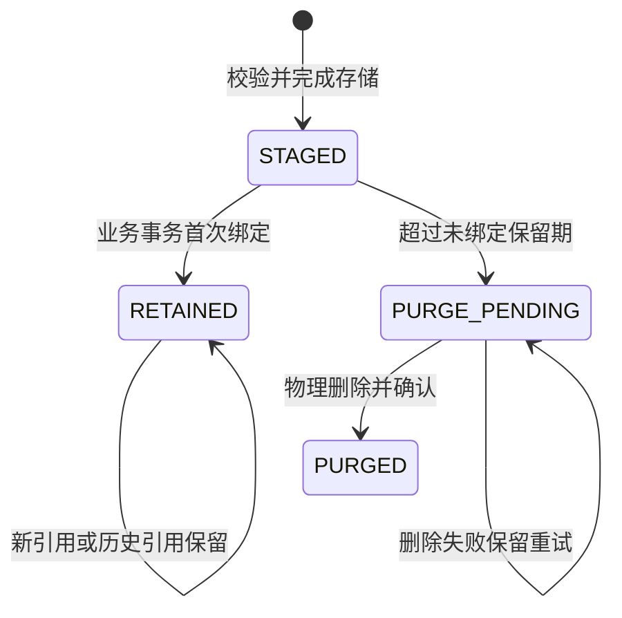
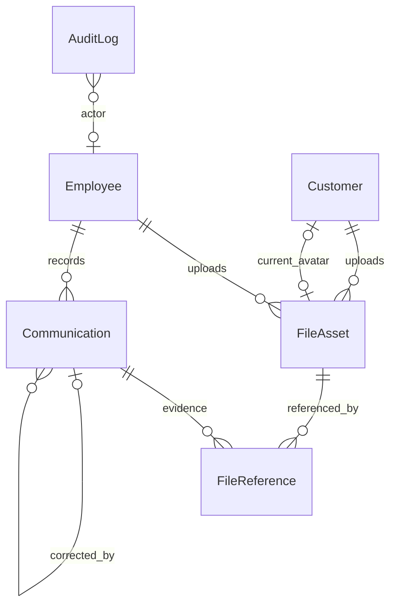

# 板块3：文件、审计与公共接口契约开发文档

> 一致性审查：2026-11-10。跨板块约定、修订清单及未交付项见开发进度文档根目录《文档一致性审查记录.md》；本标记不代表软件已实现或测试通过。

| 项目 | 说明 |
|---|---|
| 所属里程碑 | M0：工程可运行 |
| 文档编号 | M0-03 |
| 编写日期 | 2026-11-10 |
| 前置依赖 | 板块1工程与四容器骨架、板块2登录/会话/权限/最小审计 |
| 需求依据 | FR-11、27、55、71、97～98；TD-05、10～15；NFR-02～03、07、09；AC-11、16、19、29的相关部分 |
| 目标 | 建立可复用的文件、业务记录、事务审计和接口基础，接通顾客头像 |
| 文档状态 | 2026-11-13步骤1～5基础、记录、文件、头像及公共工具/契约生成已实现；步骤5定向248普通、86数据库、7组浏览器及相关检查/构建/漂移通过，OpenAPI27操作、25个JSON调用器。全量、Docker和完成说明仍待收尾，CI未在GitHub运行；实际结果见docs/verification/M0-03.md，不代表板块已验收 |

## 1. 本板块要开发什么

### 1.1 实际交付范围

1. 图片上传、真实格式与大小检查、随机存储路径、持久化、清理与读取。
2. FileAsset及业务引用表；公开商品图/头像和私有凭证的隔离。
3. 顾客头像上传绑定与移除，接通板块2预留功能。
4. 文件授权服务：检查上传人、用途、业务关联、读取者身份与字段可见范围。
5. 扩展已有appendAudit事务服务和状态历史基础；回归板块2全部员工写命令。
6. Communication追加式沟通记录模型与服务、内部/公开投影、更正引用；后续业务接口契约。
7. 统一分页/错误码/请求指纹/幂等键工具、OpenAPI导出和前端客户端生成。
8. 前端上传组件、私有图片鉴权预览、错误与requestId显示。

### 1.2 依赖尚未建立时如何处理

此时没有商品、订单、售后、库存登记表，不提前建假业务单，不发布“随意指定关联ID”的通用绑定API。

| 能力 | 本板块实现并验收 | 后续真实业务接通 |
|---|---|---|
| 顾客头像 | 上传、绑定本人、公开读取、更换与移除 | 无业务依赖 |
| 商品图 | 员工上传、草稿所有权校验；绑定适配器接口 | 板块5真实商品编辑/上架 |
| 私有售后图 | 顾客上传待绑定、本人读取、他人拒绝 | 板块11材料版本、5张上限及售后归属 |
| 库存/实物凭证 | 有权限员工上传待绑定 | 板块6库存、10交运、12验收 |
| 业务沟通 | 建表、追加服务、公开/内部投影、测试模块验证 | 板块8订单查询，10业务记录，11售后 |
| 业务状态历史 | 通用写入服务、表与回滚测试 | 各业务第一次实现状态命令时接入 |

未接入的业务适配器默认拒绝，不允许因为业务表尚不存在而跳过归属检查。Swagger只承诺当前可调用的头像、上传/读取和基础API；沟通接口作为后续契约列出，未就绪前不注册正式路由。

## 2. 与前两板块的衔接

| 已有能力 | 本板块处理方式 |
|---|---|
| Prisma事务、迁移和持久卷 | 新增0003_files_communication_history迁移；继续使用API上传卷 |
| JWT、主体类型、会话及权限 | 直接复用，不创建第二套文件登录token |
| AuditLog、appendAudit(tx,...) | 扩展对象类型和动作白名单，不重复建审计表 |
| requestId、统一响应、异常过滤器 | 保留既有外壳，文件二进制明确排除JSON包装 |
| /store/me、PATCH /store/me | 返回可用avatarUrl；昵称PATCH不接收avatarUrl，头像走专用命令 |
| 权限目录 | 文件按用途依赖已有业务权限，不新增可绕过业务授权的file.admin万能码 |
| pnpm openapi:export、api-client | 补齐实际生成脚本与CI漂移检查，不只放空目录 |

本板块新增的头像表字段/API属于板块2的已约定补齐。不要原地修改已应用的0002迁移，应新增迁移。若实际代码命名与文档不同，先记录映射后统一引用。

## 3. 文件规则与用途权限

### 3.1 格式、尺寸及上传限制

- 支持JPEG、PNG、WebP；拒绝SVG、GIF、PDF和其它格式。本期附件均为图片。
- 每次POST /files只上传1个file，最大5MiB（5×1024×1024字节）；为空、超限、多文件或未知multipart字段拒绝。
- 文件扩展名和客户端Content-Type不作为真实类型依据。先读魔数，再用已固定版本的解码器实际解码；截断、损坏或解码失败拒绝。
- 补充实现限制：最大宽/高各10000像素、总像素≤4000万、拒绝动画WebP/APNG；在解码器层设置像素和资源限制，先检查元信息再完整解码。
- 通过校验后重新编码为对应允许格式，移除EXIF等非必要元数据，不保留原始可执行混合内容。记录输出实际格式、大小及摘要；原始输入通过大小限制后，输出也不得超过5MiB。
- 商品轮播图最多10张、售后当前有效凭证最多5张等业务数量上限在业务提交时再次校验；上传接口一次一张不能代替整单数量限制。
- 上传限流基线：每主体每分钟20次，并设可配置的临时未绑定文件配额（建议每主体100张）；超额429。单实例内存限流限制沿用板块2说明，配额用数据库统计/主体锁保证。

图片参数为落实资源约束的技术补充，后续若调整须同步前后端和Swagger。成本凭证、内部备注截图都必须使用私有用途，不能误归商品图。

### 3.2 用途目录

| purpose | 允许上传者 | 上传时要求 | 绑定目标/公开策略 |
|---|---|---|---|
| CUSTOMER_AVATAR | 正常或限制交易的顾客本人 | 有效顾客会话 | 绑定本人头像后PUBLIC |
| PRODUCT_IMAGE | 员工 | product.manage | 绑定经校验的商品展示引用后PUBLIC；未绑定不可匿名读 |
| AFTER_SALE_EVIDENCE | 顾客或代录员工 | 顾客有效会话；员工customer.frozen.proxy | 绑定所属售后材料版本后始终PRIVATE |
| INVENTORY_EVIDENCE | 员工 | inventory.adjustment.create或inventory.source.manage | 库存来源/登记，PRIVATE |
| FULFILLMENT_EVIDENCE | 员工 | shipment.exception.manage或order.physical.check | 发货/实物核实，PRIVATE |
| INSPECTION_EVIDENCE | 员工 | after-sale.inspection.confirm或after-sale.receipt.record | PRIVATE；RETURN_RECEIPT绑定到仓需after-sale.receipt.record，RETURN_INSPECTION绑定验收需after-sale.inspection.confirm；两owner随板块12注册 |
| COMMUNICATION_EVIDENCE | 员工 | communication.service.write或offline-case.manage | 沟通/线下记录，PRIVATE且按可见级别读取 |

权限只有上传入口资格，不能替代绑定时对具体业务单的权限、经办人及状态校验。客服核实寄回/关闭、身份核实和线下协作内部凭据统一用COMMUNICATION_EVIDENCE；AFTER_SALE_RETURN_VERIFICATION等具体owner解析器随所属业务迁移注册。仅获after-sale.return.follow/close额外权限、没有上述上传用途权限的员工可提交无图核实；需要图时由管理员显式授予communication.service.write及其查询依赖，不能默默扩大权限。

后续Swagger联验必须覆盖默认客服上传/绑定内部核实图成功，顾客及无用途权限员工被拒绝；仅receipt.record额外授权员工可上传到仓图并绑定本人当前到仓任务，但不能绑定最终验收记录。顾客不能通过填写purpose=PRODUCT_IMAGE上传公开图；员工不能用顾客头像用途绕开商品权限。冻结顾客旧token不能上传，代录员工须在真实业务提交时记录身份核实来源。

### 3.3 文件生命周期



补充默认：未绑定文件24小时后可清理，逾期文件不得新绑定；绑定时同时检查state和expiresAt。已绑定/历史引用文件本期不自动清理，不因商品下架、头像更换、售后替换材料而删除旧文件。

公开性独立于state：STAGED固定PRIVATE；头像或商品公开用途首次有效绑定时才可PUBLIC；私有证据永远不因审核通过而变PUBLIC。旧头像URL如已公开，首期仍可读取历史图；页面须说明头像用于公开展示，不能上传售后凭证。后续隐私删除需单独流程，不能承诺“移除头像即销毁所有旧链接”。

## 4. 数据库表与关系设计

### 4.1 核心ER图



图中业务引用为逻辑关系，具体物理外键见字段表。Order/AfterSale等尚不存在，不在本次迁移中引用不存在的表。

### 4.2 FileAsset（file_asset）

| 字段 | 类型/约束 | 说明 |
|---|---|---|
| id | uuid PK | 外部使用的文件ID，不透露磁盘位置 |
| uploader_type | EMPLOYEE/CUSTOMER | 上传人类型 |
| uploader_employee_id / uploader_customer_id | uuid可空FK | 恰好一个，与类型一致 |
| purpose | 固定用途枚举 | 创建后不可改用途 |
| state | STAGED/RETAINED/PURGE_PENDING/PURGED | 生命周期 |
| visibility | PRIVATE/PUBLIC | 由服务端按用途和绑定控制 |
| storage_key | varchar(255) UNIQUE | 随机相对路径，不能由浏览器指定 |
| original_name | varchar(200) | 只作脱敏展示，不参与磁盘路径和响应头拼接 |
| mime_type | varchar(32) | 解码后的image/jpeg、image/png、image/webp |
| byte_size | integer CHECK 1～5242880 | 最终存储大小 |
| width、height | integer正数 | 解码尺寸，并验证总像素 |
| sha256 | char(64) | 最终内容摘要，非唯一，不跨用户自动去重 |
| expires_at | timestamptz NULL | STAGED到期时间；绑定后清空 |
| created_at | timestamptz NOT NULL | 上传成功时间 |
| purge_started_at、purged_at | timestamptz NULL | 清理跟踪 |
| version | integer≥0 DEFAULT 0 | 清理/绑定条件更新 |

CHECK主体互斥；PRIVATE/PUBLIC与purpose匹配：仅CUSTOMER_AVATAR、PRODUCT_IMAGE可PUBLIC；STAGED必须PRIVATE且expires_at非空；RETAINED必须expires_at为空。索引：(state,expires_at,id)、(uploader_customer_id,state)、(uploader_employee_id,state)。禁止响应storage_key和sha256等内部字段。

### 4.3 FileReference（file_reference）

| 字段 | 类型/约束 | 说明 |
|---|---|---|
| id | uuid PK | 引用ID |
| file_asset_id | uuid FK FileAsset | 对应图片 |
| owner_type | CUSTOMER_AVATAR/PRODUCT/AFTER_SALE_MATERIAL/INVENTORY_ADJUSTMENT/INVENTORY_SOURCE/FULFILLMENT_CHECK/RETURN_RECEIPT/RETURN_INSPECTION/COMMUNICATION/OFFLINE_CASE | 引用业务类型白名单，包含到仓与验收两个独立类型 |
| owner_id | uuid | 业务记录或材料版本ID |
| slot | varchar(50) | avatar/main/gallery/evidence等固定槽位 |
| audience | PUBLIC/CUSTOMER_VISIBLE/INTERNAL | 此次引用允许展示范围 |
| created_by_type、created_by_employee_id、created_by_customer_id | 类型及可空FK | 实际绑定人，按主体约束 |
| created_at | timestamptz | 建立时间 |

唯一：(file_asset_id,owner_type,owner_id,slot)；索引：(owner_type,owner_id)。历史引用只增不删，不提供客户端任意创建接口。

owner_id是多态逻辑外键，数据库无法单靠该列验证所有业务表，不能把它当已有外键保证。业务命令必须在同事务锁定真实目标、验证存在/归属/状态，然后建立引用；各模块提供白名单解析器，未注册类型拒绝。头像现阶段可通过Customer的真实FK和服务校验双重保证；后续优先使用各领域的真实附件关联FK补强，不能允许“随便存在一个owner_id就算合法”。

同一私有文件原则上只绑定同一业务聚合及其材料历史版本，不允许跨顾客/跨订单复用；跨版本引用须验证聚合相同。上传人不是永久读取通行证，绑定后读取跟随业务授权。

### 4.4 Customer扩展

新增avatar_asset_id uuid NULL FK FileAsset，ON DELETE RESTRICT。更新头像同时写Customer、FileReference、FileAsset状态和审计。引用必须是本人上传且purpose=CUSTOMER_AVATAR的可用图片，不能指向他人图片或私有凭证。

现有/store/me响应avatarUrl从null变为相对地址/api/v1/files/{id}/content；无头像仍null。不是向顾客开放storage_key或任意avatarUrl写入。

### 4.5 Communication（communication）

| 字段 | 类型/约束 | 说明 |
|---|---|---|
| id | uuid PK | 沟通记录ID |
| scope_type | ORDER/AFTER_SALE | 关联业务类型 |
| scope_id | uuid | 必须由对应解析器验证真实单据 |
| author_employee_id | uuid FK Employee | 实际记录员工，不让客户端指定 |
| channel | PHONE/EXTERNAL_MESSAGE/IN_PERSON/OTHER | 系统外沟通渠道，无系统聊天 |
| occurred_at | timestamptz | 实际沟通时间，不晚于服务端时间5分钟以上 |
| result | text | 内部沟通结果，1～4000字符 |
| next_step | varchar(1000) NULL | 内部下一步 |
| public_text | varchar(2000) NULL | 顾客可见说明，独立字段，不自动复制result |
| corrects_id | uuid NULL FK Communication | 新记录指出更正对象，必须同一scope |
| correction_reason | varchar(500) NULL | 更正必填 |
| request_id | varchar(64) | 与事务日志关联 |
| created_at | timestamptz | 录入时间 |

CHECK：corrects_id与correction_reason一致；索引：(scope_type,scope_id,created_at,id)、(author_employee_id,created_at)。scope也是逻辑关联，同事务业务解析器验证；业务表建立前不开放写入口。

记录只追加，不PUT/PATCH/DELETE。更正追加新记录并保留旧记录，链路不能成环（新记录只引用已存在同scope记录）。前台展示公开说明及“已更正”关系，不泄露内部result、next_step或员工ID。附件通过FileReference绑定；public_text为空时不允许存在CUSTOMER_VISIBLE的该条沟通附件。

### 4.6 BusinessStateHistory（business_state_history）

| 字段 | 类型/约束 | 说明 |
|---|---|---|
| id | uuid PK | 历史ID |
| aggregate_type、aggregate_id | 固定枚举+uuid | ORDER、FULFILLMENT、AFTER_SALE等业务聚合 |
| dimension | varchar(50) | 主状态/履约阶段等，不混为一个status |
| command_key | varchar(150) | 业务命令动作键，不使用requestId代替幂等键 |
| from_state、to_state | varchar(80)可空/非空 | 合法迁移由对应领域校验 |
| actor_type、actor_employee_id、actor_customer_id | 类型及可空FK | 支持SYSTEM，约束同AuditLog |
| reason、public_text | 内部原因/公开说明 | 分开存，白名单投影 |
| request_id、created_at | varchar(64)、timestamptz | 追踪 |

唯一：(aggregate_type,aggregate_id,dimension,command_key)；索引：(aggregate_type,aggregate_id,created_at,id)。本表不取代付款、退款尝试、库存流水及任务历史，各业务事实仍须独立表。没有任意写状态历史的公开API。

### 4.7 AuditLog扩展与迁移约束

复用板块2字段，不新建AuditLog副本。本板块新增动作如file.upload、customer.avatar.change、communication.append/correct。审计payload由各动作白名单构造，不把完整HTTP请求体或完整Prisma实体放入before_data/after_data。

audit、state history、communication和已绑定文件引用无普通修改删除接口。文件清理只针对无引用STAGED，不能删审计。新CHECK、FK、索引和头像字段全部进入0003迁移；在PostgreSQL16空库及已有板块2数据上各验证一次。

## 5. 文件存储、授权与一致性

### 5.1 存储流程

1. 认证、检查用途权限、主体未绑定配额及限流后接收受限流式上传，不先无限读取到内存。
2. 将原始内容写上传卷tmp目录的随机临时文件；限制字节、解码像素、格式及动画。
3. 重编码并计算输出摘要。最终storage_key由服务端随机UUID生成，可使用日期子目录，不使用原文件名、手机号或订单号。
4. 在同一卷内原子rename到最终位置，保证后续读取完整文件；路径resolve后校验仍在配置根目录，拒绝路径穿越、非法符号链接和非普通文件。
5. 开事务锁上传主体、复核最新身份/权限和数据库配额，写STAGED FileAsset及file.upload审计。失败回滚并删除最终文件；补偿删除失败记录不敏感日志，留给孤儿扫描。
6. 只有磁盘和数据库成功才201。数据库失败不返回可用文件ID。

文件系统与数据库不是同一个事务，不能宣称完全原子。崩溃留下的临时文件/无元数据孤儿，使用保守清理脚本处理（建议超过24小时，先核对storage_key未被数据库引用）；数据库已有记录但文件缺失时返回可控错误、报警，不伪造成功。孤儿扫描和清理只处理固定目录普通文件，不跟随链接、不删除历史引用。

本板块默认用单API实例处理本地上传卷；未来增加API副本前须确认共享持久卷一致。上传目录不通过Nginx或Nest静态目录直接公开。

### 5.2 业务绑定内部接口

```typescript
bindFiles(tx, actor, {
  ownerType, ownerId, slot, fileIds, audience, commandKey
}): Promise<FileReferenceResult[]>
```

该接口是服务内部调用，不是可让浏览器随意指定ownerType的HTTP API。上层先按TD-11锁员工→顾客→订单→商品→库存→附属记录，最后按fileId升序锁文件；清理进程只锁文件，不反向获取主体/业务锁。

绑定事务检查：真实业务存在/归属、当事人权限及经办人、用途匹配、上传人/代录人合法、未过期未清理、未跨聚合复用、有效图片数量、重复fileId、audience允许范围。失败全部回滚，不留下半数引用；相同命令键和相同引用重试不重复建立。

### 5.3 读取授权矩阵

| 文件情况 | 读取规则 |
|---|---|
| 已有效公开的商品图/头像 | 无需登录，可只返回文件内容，不返回元数据 |
| STAGED私有图 | 仅上传主体本人，且会话有效、文件未过期；员工还须有当前用途资格 |
| 已绑定售后材料 | 顾客必须属于该订单/售后；员工依据客服/验收等业务权限及证据用途读取 |
| 库存内部凭证 | inventory.read及具体关联业务权限，顾客不可读 |
| 内部沟通附件 | 仅有对应服务业务权限的员工；仓储有订单履约查询也不能因此读取客服内部附件 |
| 顾客可见沟通附件 | 本单顾客或授权员工；必须由合法CUSTOMER_VISIBLE引用提供 |
| 不存在、无权、PURGED文件 | 统一404 FILE_NOT_FOUND |
| 元数据存在但存储丢失 | 有权请求返回503 FILE_STORAGE_UNAVAILABLE；无权请求仍404 |

私有文件不能只检查“已登录”或“知道UUID”。绑定后上传者若失去业务资格，不因当年上传过而继续读取。售后旧材料版本按原业务归属可读，不按“当前材料是否还选中”删除历史。

状态已下架的商品历史图可继续读取，符合历史订单图片保留要求；不得利用商品下架删文件使旧订单图片丢失。

### 5.4 二进制响应与浏览器展示

GET /files/:id/content返回图片字节，不包装成{data,...}。设置真实Content-Type、Content-Length、X-Content-Type-Options:nosniff、X-Request-Id，文件名使用服务端安全固定名。

私有响应Cache-Control: private,no-store，Vary: Authorization，不使用公共CDN缓存；公开图片使用合理public缓存，文件内容不可原地替换，不同内容不同ID。前端公开图可用img src；私有图用Axios携带Authorization获取Blob→URL.createObjectURL展示→组件卸载/替换时revokeObjectURL。不得把JWT放查询串或公开URL。私有失败返回JSON错误，而不是伪装成图片200。

CORS暴露X-Request-Id等必要响应头，来源继续限定两个站点；Blob客户端不得把错误JSON直接当图片显示。

### 5.5 清理竞争与保留

实际前置代码尚无ScheduleModule；本板块在文件清理步骤接入最小调度能力，供后续板块4复用。每次分页选取过期STAGED，锁文件后检查无引用，标PURGE_PENDING并提交，再删除磁盘，最后标PURGED。物理删除失败保留PURGE_PENDING和重试日志；不把失败标成成功。

绑定只允许未过期STAGED或合法同聚合RETAINED；PURGE_PENDING永不能新绑定。并发时谁先锁定按规则胜出；已到期即使扫描尚未运行也不可绑定。任何RETAINED/有引用文件不得进入清理。运维脚本不得直接删除整个uploads目录。

## 6. 事务审计、沟通与状态历史

### 6.1 内部服务契约

| 方法 | 要求 |
|---|---|
| appendAudit(tx, payload)；payload包含actor | 必须传上层事务客户端；构造允许字段；失败向上抛出 |
| appendStateHistory(tx, actor, transition) | 同业务状态事务写入，验证动作键；领域服务负责迁移合法性 |
| appendCommunication(tx, {identity,token}, input) | 锁业务、权限/经办人校验、追加记录、绑定附件、审计同事务 |
| readPublicCommunication(tx, {identity,token}, scope, pagination?) | 先确认顾客归属，再数据库选择公开字段，不序列化后仅删几个字段 |
| authorizeFileRead(actorOrAnonymous, fileId) | 查用途/引用及业务范围，默认拒绝未注册适配器 |

不要在服务内部偷偷新建独立Prisma事务，导致外层回滚后审计仍成功。不要以HTTP响应后的日志拦截器、EventEmitter或后台队列作为唯一业务审计。

已有员工创建、调岗、授权、启停、密码重置仍必须使用同一appendAudit接口。扩展后执行板块2审计失败回滚回归。

### 6.2 沟通字段与更正

- result、next_step是内部资料；public_text为经办人单独填写的对外说明，默认空，不由内部记录自动生成。
- 顾客投影仅含id、publicText、occurredAt、createdAt、可见附件和必要的更正关系，不含员工账号、电话、内部结论或完整原实体。
- 仓储只看履约/验收所需业务记录，不能因为order.fulfillment.read就读全部客服Communication。
- 更正新增一条记录，corrects_id指旧记录；私有更正不能抹去旧公开说明。若原记录对顾客公开，更正也应给出非空public_text说明，以免只在内部改结论。
- 上传证据不等于同意售后；沟通中写“退款”不改变退款状态，也不生成库存流水。
- 用户自由文字不当HTML执行，展示转义，首期用纯文本。

## 7. 公共接口与幂等基础

### 7.1 分页和错误约定

复用板块1、2成功/错误外壳。列表data={items,total,page,pageSize}，默认page=1、pageSize=20最大100；排序白名单并追加id稳定次序；分页查询和总数应使用一致筛选范围。

| HTTP/code | 本板块场景 |
|---|---|
| 400 VALIDATION_FAILED | 未声明字段、非法purpose/UUID/文本/重复fileId |
| 400 FILE_TYPE_NOT_ALLOWED / FILE_INVALID_IMAGE | 类型不支持/解码损坏 |
| 400 FILE_DIMENSIONS_EXCEEDED / FILE_ANIMATION_NOT_ALLOWED | 像素/动画限制 |
| 401既有认证码、403 FORBIDDEN | 无有效主体/无用途操作权限 |
| 404 FILE_NOT_FOUND / BUSINESS_NOT_FOUND | 文件无权或不存在；授权范围内业务不可见 |
| 409 FILE_NOT_BINDABLE / FILE_PURPOSE_MISMATCH | 文件过期、清理中、跨聚合或用途不匹配 |
| 409 IDEMPOTENCY_PAYLOAD_CONFLICT | 相同键不同规范化载荷，供后续业务 |
| 413 FILE_TOO_LARGE | 上传超过5MiB；代理与API格式见下节 |
| 429 UPLOAD_RATE_LIMITED / STAGED_FILE_QUOTA_EXCEEDED | 频率或未绑定配额 |
| 503 FILE_STORAGE_UNAVAILABLE / BUSINESS_MODULE_NOT_READY | 存储依赖异常/内部未接入适配器 |

未就绪正式业务路由不注册，返回常规404；BUSINESS_MODULE_NOT_READY仅用于内部/测试适配器报错，不建设假的业务成功API。

### 7.2 请求指纹工具

本板块只建立工具及测试，不提前建订单幂等表或在所有POST上套一个万能中间件。

- Idempotency-Key基线：16～128位ASCII字母数字及-、_；订单等需要幂等的命令以后明确必填，不自动给每次网络重试换键。
- fingerprint=SHA-256(规范化后的命令名+版本+主体类型/ID+验证后的业务载荷)。业务字段由命令白名单提供，包含quoteId、地址和数量等会改变语义的字段。
- 对象键稳定排序；金额/数量必须验证为有界整数；拒绝NaN/Infinity/BigInt直接JSON序列化；时间先按接口规范化；不加入token、requestId等瞬时值。
- 数组是否排序取决于命令语义：有序列表保留顺序；集合先拒绝重复并按明确规则排序。不得全局排序数组导致不同图片顺序等语义丢失。
- 文件绑定指纹使用fileId及语义顺序，不使用文件路径或原始二进制。
- key与业务主体+动作共同命名空间，两个顾客不能共享结果。成功记录保留、执行中仲裁、事务结果重放在板块8实现。

头像设置不要求业务幂等键：锁本人后同一avatarAssetId已当前生效返回changed=false，不重复引用与审计；重复上传会产生不同文件ID，未绑定按策略清理。

### 7.3 OpenAPI与客户端生成

1. 完善Swagger DTO，明确multipart、二进制、错误、Bearer、用途权限和私有图片读取。
2. pnpm openapi:export沿用实际路径docs/openapi/openapi.json，排序/清除非确定性字段，内容不得含token/真实数据。
3. 新增pnpm api-client:generate，使用固定版本工具生成packages/api-client/src/generated，提交工具配置及生成代码。
4. JSON接口生成类型与调用器；multipart手写薄封装传FormData，不手动设置缺boundary的Content-Type；二进制封装responseType=blob。
5. CI重新生成并检查差异，避免后端DTO已变前端仍使用旧类型；不把Prisma实体直接导出前端。
6. 时间ISO UTC、单笔金额number分、未来统计金额十进制字符串等需求继续沿用，不能生成JSON BigInt。

## 8. API设计

下列路径省略/api/v1。除GET内容公开场景外须有效会话；强制改密员工不允许上传/读取私有图，仍先完成板块2改密流程。

### 8.1 当前必须开放的接口

| 方法/路径 | 输入 | 成功data/响应 | 说明 |
|---|---|---|---|
| POST /files | multipart：file、purpose | 201：id、purpose、state、visibility、mimeType、byteSize、width、height、expiresAt、contentUrl | 用途权限见第3节；不接受ownerId、visibility、storageKey |
| GET /files/:id | UUID路径参数 | 200：与上传类似的安全元数据 | 需认证与文件业务授权，即使公开图也不匿名暴露上传人 |
| GET /files/:id/content | UUID，无业务体 | 200二进制，错误JSON | 可匿名读取合法PUBLIC，否则业务鉴权 |
| PUT /store/me/avatar | {fileId} | 200：avatarAssetId、avatarUrl、changed | 顾客本人，绑定本人已上传头像 |
| DELETE /store/me/avatar | 无请求体 | 200：avatarAssetId=null、avatarUrl=null、changed | 清当前头像，不删历史图 |
| GET /store/me | 沿用 | 原资料+真实avatarUrl | 不改变原昵称/密码接口规则 |

元数据只返回允许公开的文件属性，不能包含storageKey、上传人ID、原始敏感文件名或业务内部引用。文件响应不返回输入的原始路径。

头像绑定示例：

```json
{"fileId":"f7ca2e71-40a4-4f09-afad-45241a7a27da"}
```

上传成功示例，expiresAt为上传成功后24小时：

```json
{
  "data": {
    "id":"f7ca2e71-40a4-4f09-afad-45241a7a27da",
    "purpose":"CUSTOMER_AVATAR",
    "state":"STAGED",
    "visibility":"PRIVATE",
    "mimeType":"image/png",
    "byteSize":32000,
    "width":400,
    "height":400,
    "expiresAt":"2026-11-11T02:00:00.000Z",
    "contentUrl":"/api/v1/files/f7ca2e71-40a4-4f09-afad-45241a7a27da/content"
  },
  "requestId":"74acba79-7dc2-4d3f-a283-bc0b386f7e44"
}
```

contentUrl不是签名免鉴权URL，STAGED仍需Bearer。头像绑定事务失败，Customer与FileReference不变，图片保持STAGED（没有被清理的前提下）。

### 8.2 后续沟通API契约（本阶段不注册正式路由）

| 方法/路径 | 权限/查询 | 行为 |
|---|---|---|
| POST /admin/communications | communication.service.write；业务归属、经办人 | scopeType、scopeId、channel、occurredAt、result、nextStep?、publicText?、attachments?；追加记录 |
| POST /admin/communications/:id/corrections | 同上 | 同scope、correctionReason和新内容，追加更正，不覆盖 |
| GET /admin/communications | scopeType、scopeId、page、pageSize | 先权限和业务范围校验，再返回内部授权字段 |
| GET /store/orders/:id/communications | 顾客本人 | 仅本单公开说明和允许附件，分页 |

attachments示例：[{fileId, audience}]，audience只能INTERNAL或CUSTOMER_VISIBLE，最多5张（本板块补充的沟通单次限制）。同一私有图片不能同时重复列出不同audience；一旦建立顾客可见引用，不能靠新增内部引用撤销已公开的历史。

沟通请求示例（订单模块接入后使用）：

```json
{
  "scopeType":"ORDER",
  "scopeId":"2949bcc2-52d8-4e8b-8446-dfb01c11496d",
  "channel":"PHONE",
  "occurredAt":"2026-11-10T02:00:00.000Z",
  "result":"已电话联系顾客，确认愿意等待补货。",
  "nextStep":"转仓储核实齐货。",
  "publicText":"已收到您的等待补货意见，后续处理结果将在订单详情更新。",
  "attachments":[]
}
```

通信记录不能自动解除发货阻塞；“顾客同意继续”须调用对应业务命令，核验仓储齐货等条件。这些API接入时须在OpenAPI标记真实可用，并补Swagger现场测试，不展示未实现成功示例冒充能力。

## 9. 前端与代理改动

### 9.1 上传组件

封装ImageUploader：accept仅提示JPEG/PNG/WebP，前端预检大小、数量、重复文件；最终规则由服务端验证。显示上传中/成功/失败/重试，成功只返回fileId及预览资料，不自行绑定业务。

业务提交失败保留已上传fileId供用户重新确认，避免每次提交重传；若已过期，提示重新上传。组件收到多图上限，例如商品10、售后5，不统一写死成所有业务5。

顾客资料接通头像：选图→上传CUSTOMER_AVATAR→PUT绑定→刷新/store/me。移除调用DELETE，不直接删除文件。后台公共组件支持私有Blob预览，离开页面释放对象URL。

### 9.2 Nginx与请求限制

两个Nginx设置足够的multipart请求体上限，建议6MiB，使合法5MiB图片加multipart开销能通过。API仍精确限制单文件5MiB。

超过代理6MiB时可能先被Nginx拒绝；配置统一JSON 413错误页并标明requestId在代理侧生成/传递策略，或明确代理层错误由Axios统一转换为“请求体过大”。不得承诺所有代理413都拥有API生成的requestId。API收到的超5MiB请求返回标准FILE_TOO_LARGE错误和requestId。

后端全局响应拦截器须识别StreamableFile/原生流，不能把图片包装JSON。日志不记录multipart内容、图片base64、Authorization或完整业务说明。读私有图失败不能反复无限重试。

## 10. Swagger详细测试

以下用例在实现后执行。准备顾客甲/乙、客服甲、商品与仓储甲，全部完成初始改密。图片夹具包括正常JPEG/PNG/WebP、超过5MiB文件、SVG、改名假PNG、损坏PNG、超像素图片和动画图；夹具只用虚构内容。

地址：http://localhost:3000/api/docs。点击Authorize输入token本体；每次切换身份检查实际Authorization请求头。

### SW-01：上传本人头像

1. 以顾客甲登录并Authorize。
2. 展开POST /files，Try it out；purpose选择CUSTOMER_AVATAR，file选择正常PNG，Execute。
3. 预期201，记录fileId、contentUrl、expiresAt及requestId；state=STAGED、visibility=PRIVATE，类型和尺寸正确。
4. GET /files/:id使用刚才fileId，预期安全元数据200，无storageKey和上传人信息。
5. GET /files/:id/content，带甲token可200。Swagger若只显示二进制下载入口，下载检查图片即可，不要求在Swagger内直接渲染。

### SW-02：绑定、更换、移除头像

1. 以甲token PUT /store/me/avatar提交SW-01 fileId，预期200及真实avatarUrl。
2. GET /store/me核实头像；重复PUT同一fileId，changed=false，不产生重复引用/审计。
3. 点击Authorize清空token，在浏览器打开该contentUrl，预期图片200，不能从磁盘路径读取。
4. 重新登录甲，上传另一张头像并绑定，/store/me只显示新图；旧图仍保留。
5. DELETE /store/me/avatar，预期avatarUrl=null；重复删除changed=false。头像移除不等于删掉旧历史图片。

### SW-03：未绑定图隔离

甲上传一张AFTER_SALE_EVIDENCE或未绑定头像，记录ID。以甲访问内容200；清token匿名访问404；换乙token访问同ID的元数据和内容均404；换成随机不存在UUID亦404。

甲图片一旦在后续绑定真实私有业务，须改按业务授权，不能永久只凭上传人放行。此部分真实绑定在SW-L01补验。

### SW-04：用途权限与禁止客户端改公开性

顾客甲上传PRODUCT_IMAGE预期403；客服无额外商品权限时上传PRODUCT_IMAGE也403；商品与仓储上传PRODUCT_IMAGE可201但未绑定仍PRIVATE。

multipart附加visibility=PUBLIC、ownerId、storageKey等未知字段应400；不能通过指定用途把售后证据改为公开。必须认证且符合用途权限后才接收文件，验证无token401。

### SW-05：格式与资源限制

逐个上传：JPEG/PNG/WebP正常成功；SVG或TXT改名.png返回400 FILE_TYPE_NOT_ALLOWED/FILE_INVALID_IMAGE；真实魔数但损坏文件返回400；超像素图、动画图按对应码400；单文件超过5MiB返回413 FILE_TOO_LARGE；file为空、多file、未知字段400。

不能只上传文件扩展名正确就判通过。检验响应中不包含原始文件内容和敏感文件名。

### SW-06：绑定所有权、用途和到期

1. 甲上传头像，乙PUT甲fileId，预期404 FILE_NOT_FOUND，不泄露是否存在。
2. 甲上传AFTER_SALE_EVIDENCE后用作头像，预期409 FILE_PURPOSE_MISMATCH。
3. 测试环境通过可控时钟使一张STAGED头像过期，再PUT，预期409 FILE_NOT_BINDABLE；不得仅等待清理扫描才拒绝。
4. 失败后甲原头像不变，错误requestId可关联日志。

到期场景由隔离测试夹具设置，不在生产API增加“修改到期时间”参数；完整竞争另见IT-04。

### SW-07：图片响应及代理

在8080与8081各通过Swagger上传/读取合法用途图片。检查Request URL保留/api/v1；内容响应为image/*，有nosniff与X-Request-Id，图片不被JSON包装。

私有图Cache-Control含private,no-store且需Bearer；公开头像无token可读取。模拟无权读取时响应404 JSON，前端不能把JSON错误渲染成图片。另用浏览器检查Blob预览无token查询串。

### SW-08：限流与会话失效

按测试配置短窗口连续上传触发429，检查Retry-After；配额到达后拒绝继续创建STAGED。换正常主体按规则仍可上传。

保留某员工上传token，由管理员停用后再次上传预期401；另用仅通过个人额外授权获得该用途权限的员工，撤销这项额外权限后旧token上传预期403，其仍有权接口保持可用；岗位默认权限不能单独撤销。强制改密员工上传应403 PASSWORD_CHANGE_REQUIRED。

### SW-L01：私有业务附件补验（后续板块）

板块11有真实订单/售后后：甲提交售后绑定图→乙访问404→甲读取历史及当前材料图200→客服有服务权限读取200→仅仓储履约权限不能读内部客服证据→具体验收证据按验收权限开放。当前材料5张上限在业务提交时检查，替换仍保留旧版本。

需额外验证客服撤权后旧token不可读取超范围图片，冻结甲后旧token失效，由合资格员工按代录规则处理。此用例不在本阶段标通过。

### SW-L02：追加沟通及公开投影补验（后续板块）

真实订单接入后以客服追加一条result内部说明+publicText公开说明，顾客只看到publicText及允许附件；更正API新增记录并保留旧记录，顾客看到公开更正关系；仓储不可读内部客服记录。尝试PATCH/DELETE旧记录失败，篡改authorEmployeeId等未声明字段400。

publicText为空附CUSTOMER_VISIBLE附件应400；沟通写“退款成功”不能改变实际订单/退款状态。验收截图需同时展示API事实，避免文字代替业务结果。

## 11. 自动化、数据库和文件系统验证

### IT-01：真实格式、重编码和路径

在真实临时目录测试魔数伪造、截断、动画、EXIF去除、像素上限、文件大小、输出格式。传入../../等原始文件名、Windows反斜杠、绝对路径等，不得逃出上传根目录；上传名不作为storage_key。模拟链接/非普通文件，清理和读取拒绝越界。

### IT-02：文件与数据库失败补偿

注入磁盘写入/rename失败、数据库写入失败、审计失败。预期无成功响应，无已绑定业务半提交；允许出现的孤儿文件可被保守扫描发现并清理。模拟元数据存在但内容缺失，有权请求503、无权404，不输出绝对路径。

### IT-03：业务与审计同事务

重复板块2员工创建/启停/重置/调岗/授权审计失败回滚测试。新增头像绑定事务在插引用/审计中途抛错，头像、文件状态、引用均回滚。

Communication用测试专用scope适配器和PostgreSQL夹具验证记录、附件、审计/历史同事务，测试适配器不得注册生产AppModule。未注册真实业务适配器默认拒绝，不能造成功业务记录。

### IT-04：清理、绑定与并发

用同步屏障分别让绑定先锁文件、清理先锁文件，验证不出现业务引用已成功但图片被清理；过期但未扫描不可绑定。清理标记后物理删除失败可重试，不误删RETAINED。多进程扫描不重复破坏文件状态。

并发上传同一主体的最后剩余配额不突破上限；两个头像绑定命令按顾客锁串行，当前avatar_asset_id最终只指向一个真实文件，两个历史引用均合法保留。

### IT-05：授权矩阵和投影

覆盖匿名、甲、乙、客服、仓储、撤权员工、冻结顾客、管理员。用测试解析器模拟业务范围，并验证后续真实解析器接入要求。公开图不暴露元数据；内部结果、员工账号、storage_key、token不进入顾客DTO或附件链接。

绑定同聚合材料版本可复用合法图，跨顾客/跨订单拒绝；未知ownerType拒绝。普通读取不能只凭文件上传人绕过已绑定业务授权。

### IT-06：指纹与幂等工具

对象键不同顺序同语义生成相同摘要；数量/quoteId/地址/图片顺序改变生成不同摘要；主体/动作不同隔离。拒绝重复集合元素、非法数字和超限键；requestId/token改变不影响业务指纹。并发订单结果重放在板块8另验，本板块不能把哈希工具通过当作幂等事务已实现。

### IT-07：约束与迁移

PostgreSQL16验证主体互斥、用途与公开性CHECK、字节尺寸范围、唯一引用、头像FK、corrects_id FK及业务范围服务检查。空库迁移与板块2已有数据升级均成功，旧账号和密码不变。多态owner_id并无通用数据库FK，应专门测试适配器不能省略。

### IT-08：前端与契约生成

上传失败/重试、5MiB提示、私有Blob鉴权、组件卸载释放URL、401/403/404/413/429处理、头像更新端到端。Swagger multipart和二进制模型正确；openapi导出→客户端生成→typecheck通过，再生成无意外差异。

### IT-09：工程与持久化回归

执行pnpm lint、pnpm typecheck、pnpm test、pnpm test:integration、pnpm build、pnpm openapi:export、pnpm api-client:generate，保存退出码及输出。

四容器启动后真实上传头像，重建API容器再读取相同文件200，数据库引用仍在；两个静态站深层路由正常。对测试密码/token/地址标记扫描日志、审计和前端dist，确认没有敏感数据。只在独立测试库及测试上传根目录做清理实验。

## 12. Agent执行说明与建议开发顺序

### 12.1 可交给Agent的执行指令

> 请实现板块3。先阅读需求v2.0、板块1/2/3文档及当前仓库，核对已有AuditLog、认证Guard、权限目录、Prisma迁移、上传卷、Axios和OpenAPI脚本。复用已有公共模块，完成本板块迁移、FileAsset/引用/沟通/状态历史服务、文件上传与读取、头像绑定、公开/私有权限、事务审计回归、前端组件及测试。尚未建立的订单/售后业务仅实现默认拒绝的适配器契约和测试专用夹具，不开放假业务成功接口，不新增在线聊天。发现设计冲突时说明依据并同步文档。完成后报告真实命令、结果、未完成项和后续补验，不将Swagger示例或未执行用例当通过。

### 12.2 具体推进顺序

1. 核对板块2代码与本文权限映射，补依赖差异记录。
2. 新增迁移、真实约束和头像FK；先跑数据库测试。
3. 扩展事务审计、状态历史及沟通投影工具，回归旧员工命令。
4. 实现受限上传、图片识别重编码、磁盘补偿、元数据及读取授权。
5. 实现内部绑定和清理竞争规则，接通头像真实业务。
6. 完成Swagger、客户端生成、上传组件与Blob预览。
7. 实施当前SW/IT，真实未接入的SW-L保留待补验。
8. 更新README、.env.example、OpenAPI和验收追踪。

### 12.3 实现前衔接检查

- [x] 现有AuditLog和appendAudit支持同一事务客户端，没有独立提交；步骤2新增记录/审计失败回滚已验证。
- [x] /store/me不接收任意头像URL；头像专用命令复用本人及文件校验，步骤4已定向验证。
- [x] 员工强制改密、停用、撤权在文件接口复用，步骤3已定向验证，没有另建跳过会话的读取Guard。
- [x] API以UID1000写持久卷、真实公开/私有图片跨重建保留；两代理返回图片流及JSON413，静态目录无旁路，见最终独立Docker证据。
- [x] 权限码沿用板块2目录，本期文件/记录不扩展成本、顾客资料或内部备注；真实商品/订单/售后范围解析仍须后续接入和补验。
- [x] 实际包名、固定openapi-typescript7.13.0、独立TypeScript5.9.3工具工作区及测试库/临时上传目录与工程一致；收尾三镜像冻结安装与构建通过。

## 13. 交付与验收追踪

| 规则 | 对应需求 | 本阶段验证 | 后续补验 |
|---|---|---|---|
| 真实图片、大小及历史保留 | FR-27、NFR-03 | SW-01～07、IT-01～04、09 | 板块5商品历史图、11材料版本 |
| 顾客头像 | FR-11 | SW-01～02、06、IT-03、08 | 无 |
| 私有附件隔离 | AC-19、FR-98 | SW-03～04、07～08、IT-05 | SW-L01真实订单/售后 |
| 追加沟通与公开说明 | FR-55、98 | IT-03、05、07 | SW-L02，板块8/10/11 |
| 事务审计 | FR-97、TD-11、AC-29 | IT-02～03，板块2回归 | 后续业务每个命令接入 |
| 请求指纹和API契约 | TD-13～15、NFR-09 | IT-06、08 | 板块8订单幂等落库 |

### 13.1 交付清单

- [x] 0003迁移及CHECK/FK/索引，隔离空库与已有板块2数据升级验证通过；后续已按用户确认应用到开发库，旧数据保护与本机登录修复见M0-03补充记录。
- [x] 图片上传/存储/读取/内部绑定/清理及默认拒绝的业务授权解析器基础；真实订单/商品等待后续接入，收尾真实头像/私有图Docker持久化通过。
- [x] 顾客头像API与页面，公开URL和私有Blob预览组件；步骤4相关95普通/140数据库/7组浏览器通过，尚未计入板块全量/Docker验收。
- [x] 扩展AuditLog、Communication、BusinessStateHistory及事务服务；步骤3接通沟通附件内部绑定，真实订单/售后scope仍待对应板块，默认拒绝。
- [x] 公共分页/错误/指纹工具、OpenAPI与25个JSON客户端生成脚本、本机漂移检查及仓库根CI文件；远程CI尚未运行。
- [x] 当前正式API、DTO示例、README与文件限制配置已同步；收尾Swagger浏览器自动化、真实HTTP及代理部署通过，人工逐条点击未执行。
- [x] docs/verification/M0-03.md最终验收逐项映射SW-01～08、IT-01～09，保留真实环境、状态码/编号、失败与复验；SW-L01～02单列待补验。
- [x] 完整工程与Compose真实文件持久化证据已归档；数据库全量首轮唯一失败经受影响58项定向复验通过，不把首轮退出1改写为全绿。

2026-11-13本期范围已验收，见[最终验收](../../../docs/verification/M0-03.md#module3-final-acceptance)及[开发完成说明](../开发完成说明/板块3_开发完成说明.md)。普通测试556项通过；数据库988项首轮987通过、1项测试同步问题，修正后受影响文件58项通过；独立四服务15组/133次HTTP请求通过。Git仍main、HEAD53598a6，板块3未提交；旧容器未替换。

### 13.2 完成判定

本板块必须证明：允许图片可上传且跨容器重建保留；伪装/超限/越权被拒绝；顾客头像闭环可用；私有文件无静态公开旁路；审计失败能回滚已有员工及头像命令；清理不会删已绑定文件；契约生成和前端构建通过。

未开发真实商品、订单和售后时，只对当前基础及头像验收，不能声称全项目附件权限、售后5张材料限制和订单幂等已通过。下一份板块4将复用本板块事务基础，实施配置、期限与任务内核。

