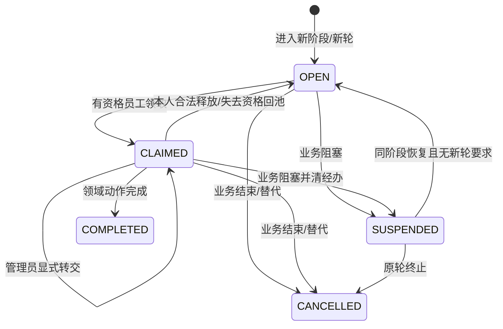
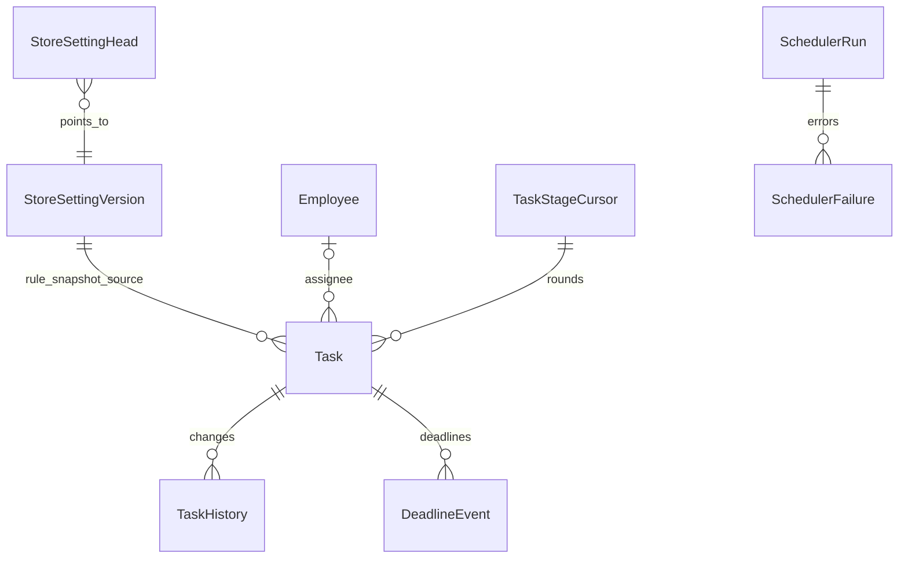

# 板块4：全店配置、期限与任务内核开发文档

> 一致性审查：2026-11-10。跨板块约定、修订清单及未交付项见开发进度文档根目录《文档一致性审查记录.md》；本标记不代表软件已实现或测试通过。

| 项目 | 说明 |
|---|---|
| 所属里程碑 | M0：工程可运行 |
| 文档编号 | M0-04 |
| 编写日期 | 2026-11-10 |
| 前置依赖 | 板块1～3已完成；沿用认证、权限码、事务审计、上传与接口契约 |
| 需求依据 | FR-04、54、73、90～94、97；BR-05；TD-07、10～15；AC-02、15～16、20、26、28的相关部分 |
| 本板块目标 | 配置可版本化，期限可计算/追溯，任务可原子领取/交接/回池，调度可重入，建立暂停计时内核 |
| 文档状态 | 开发设计与待执行测试，不代表功能已实现；M0完成需板块1～4均实际验收 |

## 1. 开发范围与完成结果

### 1.1 本板块必须完成

1. 管理员全店设置：固定运费、包邮、退货地址、客服电话与各阶段期限。
2. 设置版本与并发更新保护；规则快照不回写旧阶段。
3. 北京时间自然日/工作日算法、UTC存储、截止等号和延期事件。
4. Task、TaskHistory、DeadlineEvent及阶段轮次控制；查询、领取、释放、管理员转交。
5. 员工停用、撤权、调岗后，对失去资格的未完成任务同步回池，与员工命令同事务。
6. 超期扫描框架、多实例重入保护、失败记录与重启补扫。
7. BR-05多重阻塞暂停/恢复计时服务及测试适配器。
8. 全店设置页、我的待办/岗位池、管理员待安排列表；顾客页面展示服务联系方式。

### 1.2 业务尚未建立时的边界

| 能力 | 现在交付 | 后续接通 |
|---|---|---|
| 设置与公共联系方式 | 正式API及页面，可真实验证 | 各业务按时点引用设置 |
| Task内核 | 正式表/服务/API；没有业务时显示空列表 | 库存、发货、售后命令生成真实任务 |
| 撤权回池 | 真实事务逻辑，隔离夹具验证 | 后续真实各阶段任务回归 |
| 暂停计时 | 纯规则服务及事务适配器契约，隔离测试 | 板块8订单字段，10交运，11售后 |
| 调度 | 真实任务超期扫描和执行记录 | 板块9关单、10收货/交运核实 |

不在演示库插入假订单制造业务成功；生产AppModule无测试造任务接口。此时我的待办为空是正确结果，不能把空列表当作领取并发已通过。

不引入工作流平台、动态审批图、消息中间件、短信、实时推送或聊天。配置处理期限不等于支持任意变更业务流程。

## 2. 与前三板块的衔接检查

| 既有设计 | 本板块落地方式 |
|---|---|
| onEmployeeEligibilityChanged(tx,...) | 替换测试替身为真实回池，沿用同一事务客户端 |
| 固定三岗位+个人额外权限 | 候选资格按最新实际权限计算，不按岗位名字硬编码 |
| task.transfer、deadline.extend、store.setting.manage | 均管理员专属；不能通过额外权限下放 |
| appendAudit、BusinessStateHistory | 所有设置/领取/交接/延期同事务审计；任务明细使用TaskHistory |
| ScheduleModule | 增加真实扫描器，避免重复注册多个本地定时器 |
| requestId与错误外壳 | 不变；SYSTEM扫描使用独立运行编号，不能冒用员工 |
| FileAsset | 本板块设置不新增附件上传需求；退货地址是文本快照 |
| api-client与OpenAPI | 增量生成类型，不手写第二套后端DTO镜像 |

迁移采用0004_store_settings_tasks_deadlines，不能修改已应用迁移。订单表、OrderBlock及TimerPause的真实FK随板块8建立，本文先给完整目标设计和接入约束。

## 3. 全店设置业务设计

### 3.1 配置内容与默认值

金额为整数分，不接受浮点元。运费/包邮具体数值原需求没有强制指定，下面1000/9900分是本项目开发默认值，管理员可改；不将通俗版示例当强制经营规则。

| 配置字段 | 默认/输入规则 | 使用时点 |
|---|---|---|
| shippingFeeCents | 1000；0～1000000整数 | 预览使用现值，建单快照 |
| freeShippingEnabled | true；严格boolean | 预览与下单 |
| freeShippingThresholdCents | 9900；0～100000000整数 | 商品金额达门槛包邮；0即全店包邮 |
| returnAddress | receiver、phone、province、city、district、detail均必填 | 同意退货时快照 |
| serviceContact | phone必填、serviceHours可填 | 顾客站可公开显示，不暴露私人内部信息 |
| paymentMinutes | 30；1～1440整数 | 下单固化付款截止 |
| autoReceiptDays | 10自然日；1～365整数 | 实际交运生成基础收货截止 |
| afterSaleWindowDays | 7自然日；1～365整数 | 完成订单固化申请窗口 |
| reviewWorkdays | 2工作日；1～30整数 | 首次/补材料后审核阶段 |
| supplementDays | 7自然日；1～90整数 | 每轮要求补材料 |
| returnShipDays | 7自然日；1～90整数 | 同意退货及需重新寄回的明确新阶段 |
| inspectionWorkdays | 2工作日；1～30整数 | 实际收包进入验收 |
| refundWorkdays | 1工作日；1～30整数 | 仅退款条件满足/最终验收完成 |

地址、联系人、服务电话无业务强制默认。设置seed从开发环境显式提供虚构资料，部署必须管理员核实；资料缺失则设置保持未就绪，不使用随机个人电话或假地址。可展示维护联系方式占位，但不能把未就绪地址用于同意退货。

文本长度：receiver 1～40、地区各1～50、detail 1～200、serviceHours 0～100；电话允许国际前缀、数字及常见空格/连字符，总长3～30并统一规范化，收货地址验证与后续业务一致。所有设置修改填写1～500字reason。

上限是实现容量基线；如需调整须同步DTO、数据库CHECK、Swagger与文档，不能放松金额需求上限。

### 3.2 版本规则

每次有效修改生成不可变StoreSettingVersion快照，单行StoreSettingHead指向当前版本。保存时携带expectedVersion，事务锁Head，重验管理员权限，版本匹配后新增快照、更新指针、追加审计。同内容提交返回changed=false，不造无意义版本；过期version仍409。

修改全局设置只影响之后的新阶段：已建单付款截止、已进入审核的dueAt、已同意退货的地址、已发货基础截止都不回算。下单时价格/运费报价冲突按板块8规则处理，不因“旧报价曾看过设置”就永久使用旧费率。

退款期限开始条件未满足时不提前起算：仅退款审核同意但交运未知/实物版本未核实，不生成已到期的退款阶段来代替核实阶段。

退货规则快照：同意退货时保存地址；补寄沿用该售后原批准地址，除非有显式可追溯的业务决定，不静默改成新全店地址。

### 3.3 查询与公开边界

GET /admin/settings仅超级管理员可读完整配置，普通员工通过具体业务单的授权快照执行工作，不自动拥有全店设置读取权。

GET /store/contact公开，仅返回servicePhone、serviceHours及settingsVersion，不返回退货地址、管理员信息或所有内部期限。顾客退货地址只在自己的已同意退货售后详情展示。运费策略由结算API提供，不让顾客自己计算最终金额。

## 4. 时间、期限与延期规则

### 4.1 时间算法

使用可注入Clock获取服务器时间；业务计算使用Asia/Shanghai，数据库timestamptz、API ISO 8601 UTC，页面转换北京时间。禁止依赖操作系统默认时区或浏览器本地时间计算截止。

- 分钟：起点时刻加N×60秒。
- 自然日：北京时间日历加N日，保留时分秒和毫秒。
- 工作日：从起点后逐日推进，周一至周五才计数，保留本地时分；不接法定节假日/调休。
- 到期：now≥dueAt，等号属于已到期。付款到期和售后申请窗口等原业务判定不能只依赖扫描器。
- 不支持0天期限；所有单位在DTO/快照明确，不混用工作日和自然日。

| 北京时间起点 | 规则 | 北京时间结果 |
|---|---|---|
| 2026-11-13周五10:00 | +1工作日 | 2026-11-16周一10:00 |
| 2026-11-14周六10:00 | +1工作日 | 2026-11-16周一10:00 |
| 2026-11-15周日10:00 | +2工作日 | 2026-11-17周二10:00 |
| 2026-11-13周五10:00 | +2自然日 | 2026-11-15周日10:00 |
| 2026-11-10 23:50 | +30分钟 | 2026-11-11 00:20 |

计算函数输出UTC，比如北京时间2026-11-16 10:00对应2026-11-16T02:00:00.000Z。后台展示同时标时区说明，不能把02:00当北京时间。

### 4.2 阶段期限快照

任务创建存startedAt、originalDueAt、dueAt、ruleSnapshot及settingsVersionId。ruleSnapshot至少包括规则代码、单位、数量、Asia/Shanghai、算法版本。originalDueAt不可修改，dueAt仅由合法延期命令改变。

不是每个待办都有需求规定的自动SLA：待发货、实物核实、发货异常沟通没有明确默认时限，dueAt允许null，不凭空加“24小时必须发货”等新业务要求。管理员可对未指定SLA的人工跟进任务首次设置合理dueAt并留痕（DEADLINE_ASSIGNED），不伪称修改全局设置。

外部动作等待与员工任务区分：补材料/寄回由顾客操作，员工任务负责跟进；顾客不成为Task.assigneeId。进入外部等待阶段时记录其截止，跟进任务引用同一阶段规则，不能给顾客创建员工登录权限。

### 4.3 延期边界

管理员deadline.extend只能延长人工处理/跟进阶段的dueAt，新dueAt必须晚于当前dueAt和当前时间；无dueAt时走首次指定。必须填写原因，expectedVersion防并发覆盖。

本通用任务延期接口不能修改付款截止、常规售后新申请窗口、自动收货基础倒计时，也不能更改实物交运事实。特殊超期售后按线下工单处理，不通过延长任务偷偷重新开放已过窗口。外部等待延期需由对应领域适配器同步合法业务截止，不能只改列表显示；不支持该阶段延期则409。

延期不增加任务round、不改变原经办人、不删除旧逾期事件。任务接口返回isCurrentlyOverdue和hasEverOverdue：延期后前者可false，后者仍true。旧截止已过但扫描尚未运行时，延期/完成事务先写原截止的逾期事件，再变更，避免隐藏历史。

## 5. 任务阶段、状态和经办规则

### 5.1 业务阶段目录

阶段定义由代码固化，不提供动态工作流编辑。下表requiredPermissions为全部满足，若有替代权限必须在阶段定义显式列出，不能客户端指定。超级管理员具备全部能力但也必须显式领取/转交。

| stage | 聚合 | 候选权限（全部） | 默认期限/含义 |
|---|---|---|---|
| INVENTORY_POST | INVENTORY_ADJUSTMENT | inventory.read、inventory.adjustment.claim、inventory.adjustment.post | 无默认SLA |
| INVENTORY_RECONCILE | INVENTORY_ADJUSTMENT | inventory.read、inventory.adjustment.post（含其既有依赖） | 板块6接入入账不足/真实差异核实，无新增SLA |
| SHIPMENT_PROCESS | ORDER | order.fulfillment.read、shipment.claim、shipment.pack、shipment.handover | 无默认SLA，完整发货经办 |
| HANDOVER_VERIFY | ORDER | order.fulfillment.read、shipment.handover | 交运未决跟进，不凭超时认定未交运 |
| PHYSICAL_VERIFY | ORDER | order.fulfillment.read、order.physical.check | 无默认SLA |
| STOCK_EXCEPTION_VERIFY | ORDER | inventory.read、inventory.order-exception.manage | 无默认SLA |
| SHIPMENT_EXCEPTION_VERIFY | ORDER | order.fulfillment.read、shipment.exception.manage | 无默认SLA |
| CUSTOMER_CONTACT | ORDER | order.service.read、shipment.customer-confirm | 无默认SLA，和仓储任务可并行 |
| AFTER_SALE_REVIEW | AFTER_SALE | after-sale.service.read、after-sale.review | 2工作日 |
| SUPPLEMENT_FOLLOW | AFTER_SALE | after-sale.service.read、after-sale.review | 顾客补材料7自然日截止跟进 |
| RETURN_FOLLOW | AFTER_SALE | after-sale.service.read、after-sale.return.follow | 同意寄回7自然日截止跟进 |
| RETURN_RECEIVE | AFTER_SALE | after-sale.inspection.read、after-sale.receipt.record | 等包裹，无新增运输SLA |
| RETURN_INSPECT | AFTER_SALE | after-sale.inspection.read、inventory.read、after-sale.inspection.confirm | 实际到货2工作日 |
| INSPECTION_EXCEPTION_CONTACT | AFTER_SALE | after-sale.service.read、after-sale.return.follow | 无默认SLA |
| REFUND_PROCESS | AFTER_SALE | after-sale.service.read、after-sale.refund.execute | 条件满足后1工作日；失败留同轮任务 |
| ADMIN_DISPUTE | AFTER_SALE；板块13扩展OFFLINE_CASE | after-sale.dispute.decide | 管理员处理，不新增默认SLA |
| ADMIN_STOCK_REVIEW | ORDER | task.transfer | 板块8＋9接入未知库存管理员协调，无新增SLA；关单另需order.unpaid.close |
| PROXY_INPUT | ORDER | customer.frozen.proxy、customer.read、after-sale.service.read | 板块13接入，核实上下文一次输入，无新增SLA |
| OFFLINE_FOLLOW | OFFLINE_CASE | offline-case.manage、order.service.read | 板块13接入线下跟进，无新增SLA |
| CUSTODY_EXECUTE | CUSTODY_ARRANGEMENT | after-sale.inspection.read、after-sale.inspection.confirm | 板块13接入实际保管/寄还，无新增SLA |

失败退款动作另需after-sale.refund.retry，当前经办人若没有重试权限不得执行，任务资格应在进入失败阶段时更新为含retry的候选集合并回池不合资格人员（不新增轮次、不重置原到期）。阶段资格变化与业务状态同事务。

全流程SHIPMENT_PROCESS需要完整操作权限，避免只获“改运单”权限者抢领完整打包任务。仅shipment.handover者可按既有HANDOVER_VERIFY处理合法核实；首期不另增交包专用阶段，独立完成正常发货必须显式授予板块2“登记发货”组合。未来如拆分正常发货任务，须先补齐阶段与交接设计，不可实施时自行拆分；不得因为本阶段目录含全套资格而自动补给员工全套发货权限。运单独立修正不要求领取整个发货任务，按领域自己的权限/经办规则校验。

### 5.2 状态与有效唯一

Task.status：OPEN（待领取）、CLAIMED（已领取）、SUSPENDED（暂停）、COMPLETED（本环节完成）、CANCELLED（因业务取消/替代结束）。OPEN/CLAIMED/SUSPENDED都是有效任务，同业务同stage最多一条。



暂停清经办并留历史，不能让暂停任务继续业务动作。售后结案后重新领取发货是需求规定的阶段重入，须结束原轮并新建round，不把SUSPENDED简单改CLAIMED恢复原经办。交运未知保留核实任务，不能回池成普通待发货掩盖事实。

### 5.3 轮次与幂等

- 唯一轮次：(businessType,businessId,stage,round)。首次round=1。
- 阶段进入命令有entryKey，为同业务同stage的唯一语义动作键；重复同entryKey返回原任务（即使它后来完成），不增加轮次。
- 真正阶段重入使用新的entryKey，先结束旧有效任务，再在同一事务递增round建新任务；经办人=null，重新计算新阶段期限。
- 释放/转交/回池不增round，不重置dueAt。
- 补材料后重新审核、补寄后再次验收、售后结束后重新发货都需新轮。退款失败重试仍原退款业务与当前任务，不用造新轮隐藏超期。
- 定时扫描只能记超期和跟进信息，不能以“每扫描一次”生成新任务。

## 6. 数据库表设计

### 6.1 ER图



业务关联ID在本阶段为逻辑关系；库存/订单/售后模块必须提供真实适配器验证，不能声称已有通用外键。此阶段不建假Order。

### 6.2 StoreSettingHead / StoreSettingVersion

| 表 | 字段/约束 | 说明 |
|---|---|---|
| store_setting_head | id smallint PK CHECK id=1；current_version_id uuid可空FK；version integer≥0 | 单店唯一稳定行，版本修改锁锚点；初始可未配置 |
| store_setting_version | id uuid PK；version_number integer UNIQUE>0；created_by_employee_id uuid可空FK；reason varchar(500)；created_at timestamptz | 不可变历史，SYSTEM初始化时员工空并记录系统审计 |
| 同上运费 | shipping_fee_cents integer CHECK 0～1000000；free_shipping_enabled boolean；free_shipping_threshold_cents integer CHECK 0～100000000 | 禁用包邮仍保存门槛，不参与计算 |
| 同上地址/联系 | return_receiver、return_phone、return_province/city/district、return_detail、service_phone、service_hours | 按第3节验证，完整版本不得缺必填项 |
| 同上期限 | payment_minutes、auto_receipt_days、after_sale_window_days、review_workdays、supplement_days、return_ship_days、inspection_workdays、refund_workdays integer | 各字段CHECK范围与第3节一致 |

Head版本与当前Version编号由同事务保持一致；如尚未设置，current_version_id=null、version=0。完整配置由管理员首次PUT生成版本1；seed可在显式提供完整虚构配置时幂等建初版，不覆盖已有设置。无配置的业务读设置返回409 STORE_NOT_CONFIGURED，公开联系方式返回configured=false及空联系方式，不填假地址。

### 6.3 TaskStageCursor（task_stage_cursor）

| 字段 | 类型/约束 | 说明 |
|---|---|---|
| id | uuid PK | 游标 |
| business_type、business_id、stage | 固定枚举、uuid、阶段枚举 | 三者联合唯一 |
| last_round | integer CHECK≥0 | 最新轮次；以真实进入命令递增 |
| created_at、updated_at | timestamptz | 生命周期 |

先锁业务父记录再upsert/锁游标，不能无锁SELECT max(round)+1。游标不是工作流引擎，只用于跨历史轮次的稳定仲裁。

### 6.4 Task（task）

| 字段 | 类型/约束 | 说明 |
|---|---|---|
| id | uuid PK | 任务ID |
| cursor_id | uuid FK | 对应业务环节游标 |
| business_type、business_id、stage | 同游标 | 冗余字段须服务保证一致，可使用复合FK加强 |
| round | integer CHECK>0 | 当前轮次 |
| entry_key | varchar(150) NOT NULL | 同一次阶段进入的语义键 |
| required_permissions | jsonb字符串数组 | 固定阶段定义生成的资格快照，非浏览器输入 |
| status | TaskStatus | OPEN/CLAIMED/SUSPENDED/COMPLETED/CANCELLED |
| assignee_id | uuid NULL FK Employee | CLAIMED必须非空，其它状态为空 |
| started_at | timestamptz | 此轮起算时刻 |
| original_due_at、due_at | timestamptz NULL | 原截止不可改，当前截止可合法延长 |
| settings_version_id | uuid NULL FK StoreSettingVersion | 未规定SLA可空 |
| rule_snapshot | jsonb | 算法/单位/数量/规则来源 |
| ever_overdue | boolean DEFAULT false | 历史曾逾期，不能延期后清零 |
| first_overdue_at | timestamptz NULL | 首次截止事实，不是扫描时刻 |
| closed_at | timestamptz NULL | 完成/取消时刻 |
| reassign_needed | boolean DEFAULT false | 因资格变化等回池需管理员关注 |
| version | integer CHECK≥0 DEFAULT 0 | 领取/转交/延期等并发控制 |
| created_at、updated_at | timestamptz | 生命周期 |

唯一：(business_type,business_id,stage,round)、(business_type,business_id,stage,entry_key)。部分唯一索引：(business_type,business_id,stage) WHERE status IN ('OPEN','CLAIMED','SUSPENDED')。Prisma不支持部分索引时提交自定义SQL。

CHECK经办人与状态一致、结束时间与终结状态一致、due_at≥started_at（非空时）。索引：(assignee_id,status,due_at,id)、(status,due_at,id)、(reassign_needed,status)、(business_type,business_id)。资格JSON不直接做全表权限过滤：先用固定stage目录缩小候选，再分页查询并服务端复核，保证total不包含无权任务，避免查一页后简单删几条导致分页错误。

### 6.4.1 TaskBusinessSource：同阶段多来源契约

板块4冻结接口，板块8＋9随真实ORDER业务在0008迁移落表；板块4使用隔离测试适配器，不对不存在的Order/AfterSale建立假FK。后续板块复用同表，不重复造各自的来源表。

task_business_source：id UUID PK、task_id真实FK RESTRICT、source_type固定枚举、source_id UUID、status ACTIVE/RESOLVED/CANCELLED、created_at、resolved_at可空、resolution_command_key可空。UNIQUE(task_id,source_type,source_id)；索引(task_id,status)。CHECK ACTIVE时resolved_at为空，终结时非空。source_type/source_id是明确的多态引用，注册表按类型解析真实实体并核对其业务父对象；不宣称单列普通FK可引用多张表，禁止任意浏览器指定类型绕过校验。实际来源类型随真实业务迁移添加并补归属集成测试。

所有来源增减先锁共同业务父记录，再按TaskStageCursor→Task→TaskBusinessSource稳定次序处理；同阶段新增来源复用现存有效Task，新一轮才建新Task。完成一来源只更新该来源；有ACTIVE来源就不结束共享任务，不解除其它OrderBlock。最后来源结束才按阶段业务规则结束任务；业务终结可逐项取消属于该业务的来源，不误取消结案后仍须执行的实物保管任务。来源结束的动作键/历史/审计与领域变更同事务。

IT要求：两个异常共用一阶段任务，依次/并发结束各自来源仅一次结束任务；同来源重试不新增关联；跨订单绑定拒绝；事务中途失败来源、任务、阻塞一起回滚。

### 6.5 TaskHistory（task_history）

id uuid PK、task_id FK、action枚举（CREATED/CLAIMED/RELEASED/TRANSFERRED/QUALIFICATION_LOST/SUSPENDED/RESUMED/COMPLETED/CANCELLED/DEADLINE_CHANGED）、actor_type/actor_employee_id（SYSTEM允许空员工）、from_assignee_id/to_assignee_id、before_status/after_status、reason、command_key、request_id、created_at。

唯一：(task_id,action,command_key)，索引(task_id,created_at,id)。记录只追加。任何成功任务写命令同时追加审计，历史显示实际操作者，不冒记接收人为转交人。

### 6.6 DeadlineEvent（deadline_event）

| 字段 | 类型/约束 | 说明 |
|---|---|---|
| id、task_id | uuid PK/FK | 本板块只关联Task |
| event_type | OVERDUE/EXTENDED/DEADLINE_ASSIGNED | 不可变事件 |
| deadline_at | timestamptz | 本次事件对应旧/到期截止 |
| new_due_at | timestamptz NULL | 延期/首次指定的新截止 |
| occurred_at | timestamptz | 超期事件取事实截止，延期取实际操作时间 |
| detected_at | timestamptz | 何时扫描/命令发现 |
| actor_type、actor_employee_id | SYSTEM/EMPLOYEE及可空FK | 实际来源 |
| reason、command_key、request_id | 文本/唯一语义键/追踪 | 延期必填原因 |

唯一(task_id,event_type,command_key)；另建(task_id,deadline_at) WHERE event_type='OVERDUE'部分唯一索引。延期后的新dueAt再次到期可产生新的OVERDUE，但同一截止重复扫描只能一条。

付款/收货/售后申请窗口未来存各自业务字段，不伪装成人工Task；需要统一事件查询时在对应迁移扩展带真实FK的领域期限事件，不随意复用不存在的taskId。

### 6.7 SchedulerRun / SchedulerFailure

scheduler_run：id uuid PK、job_name varchar(80)、instance_id varchar(100)、started_at/finished_at、status RUNNING/SUCCEEDED/PARTIAL_FAILED/FAILED/ABANDONED、scanned_count/changed_count/failed_count非负、request_id。索引(job_name,started_at)。

scheduler_failure：id uuid PK、run_id FK、task_id可空FK、error_code、sanitized_message、occurred_at。不得存完整地址/token/SQL。进程崩溃遗留RUNNING由恢复扫描按保守阈值标ABANDONED，不当作成功；失败记录保留并展示运维日志，不能因run存在就跳过未来补扫。

## 7. 事务、权限与操作规则

### 7.1 领取、释放、转交

领取条件：员工ACTIVE、已改密、当前资格满足阶段权限、业务适配器允许、Task.status=OPEN且version匹配。锁后改CLAIMED并设置本人；同人对同一已领取任务重试可返回changed=false（仅在version/请求语义一致的约定下），他人领取409 TASK_ALREADY_CLAIMED。

释放由当前经办人发起，须业务适配器允许安全交接；例如交运进行中不能直接释放掩盖包裹位置。改OPEN、清经办、保留round/dueAt，历史写实际原因。业务未能确认安全交接时返回409 TASK_RELEASE_BLOCKED。

转交仅管理员task.transfer；目标须ACTIVE、已完成改密、具备当前资格，任务非终结且可交接。OPEN可指派给目标，CLAIMED可显式转交；SUSPENDED不能通过转交偷偷恢复，应先合法解除业务暂停。管理员接手自己也走同一规则，不直接跳过经办校验。

仅管理员专属延期/争议阶段不会出现在普通岗位池。读取任务不等于拥有完整业务单资料，详情中的业务摘要由适配器按order.fulfillment.read/order.service.read等字段范围裁剪。

### 7.2 与撤权/停用的锁仲裁

统一顺序：涉及管理员集合时先板块2稳定锁→涉及的员工主体按ID升序→顾客（如需）→已有订单/商品/库存等TD-11顺序→阶段游标/任务/其它附属记录。不得先锁任务后反向锁员工。

领取/转交在事务外只读定位候选业务和当前经办，再按顺序锁员工及业务；锁定任务后复查候选关系，如经办已变化导致需补锁更小ID员工，回滚整命令重新定位，不在持锁中逆序补锁。

onEmployeeEligibilityChanged在员工修改同事务中，锁目标员工后取得其未完成已领取任务候选集，按业务父记录稳定顺序获取领域锁，再锁游标/任务，重新判断资格：

- 仍满足所需权限则保留当前任务，不因撤销无关额外权限强制回池。
- 停用或失去资格则CLAIMED→OPEN，清assignee、reassign_needed=true，追加TaskHistory、审计；round/dueAt不变。
- 无已领取任务或任务已终结不修改。已完成业务事实绝不回滚。
- 同事务审计/任务更新失败，员工启停/权限更改也回滚。

领取同样先锁目标员工，因此不会在撤权扫描之后悄悄新增一个旧权限领取。多任务回池必须先合并全部候选的LockPlan，再分层锁全部顾客ID→全部已有订单ID→全部商品ID→全部SKU/余额ID→全部来源行ID→附属/游标/任务，每层内部升序；不按“订单1及其SKU全部锁完，再处理订单2”循环，否则会在持SKU1时反向取Order2。任务适配器先只读返回父对象锁集合，取得完整上游锁后才执行资格回池；候选变化导致需补取上游锁则整体回滚重新定位，最多3次。需要多个员工主体的命令也在进入业务锁前一次按ID升序锁完，不在领域回调中补员工锁。不能事务提交后只靠内存事件补做。

IT补验：同员工同时领取不同顾客的发货/售后/库存任务，撤权与另一员工处理其中订单并发，记录实际锁顺序及整体重试；不出现一部分任务回池而权限事务提交、另一部分遗留旧资格。

当前任务量以小店基线处理，记录大批回池耗时；不擅自异步化关键交接。未来若必须分批处理，需另行设计“先禁止执行、持久化回池队列”的一致性方案。

### 7.3 完成、取消和阶段进入

无通用POST /tasks/:id/complete/cancel，也无PATCH status。完成由真实业务命令在同事务完成：检查权限/经办人/领域前提→更新业务→完成当前任务→新建后续任务→期限/历史/审计。

系统自动动作使用SYSTEM主体和领域允许条件，不冒用员工领取。顾客补材料等命令按本人归属执行，完成跟进阶段并创建新审核轮，不要求顾客持员工任务权限。

## 8. 暂停与恢复计时内核

### 8.1 本阶段内部接口

实现不依赖具体Order ORM模型的规则函数及事务端口：addBlock(tx, orderContext, source)、releaseBlock(tx, source)、recordActualHandover(tx, actualTime)、finishOrderTimer(tx, terminalState)。调用者必须已按TD-11锁订单，端口不能内部另开事务。

本板块用测试专用仓储验证状态和算式，不注册任意新增/解除阻塞HTTP接口。板块8新增真实订单与下面两张表后接入，板块10确认交运时启用，板块11售后产生/解除阻塞。

### 8.2 后续落库目标设计（板块8迁移，不在0004建假外键）

| 表/字段 | 约束/作用 |
|---|---|
| Order.auto_receipt_due_at、actual_handover_at | timestamptz可空；有实际交运事实才能启动，暂停时生效dueAt置空 |
| OrderBlock | id、order_id FK、type、source_type/source_id、active、created_at、released_at、release_command_key；同来源同类型最多一条有效阻塞 |
| TimerPause | id、order_id FK、cycle_no、status ACTIVE/RESUMED/TERMINATED、paused_at、remaining_ms bigint≥0、base_due_at、resumed_at、新截止、end_reason |
| 唯一约束 | (order_id,cycle_no)唯一；每订单最多一个ACTIVE暂停周期；阻塞解除动作键防重复 |

阻塞类型沿用需求AFTER_SALE、SHIPMENT_EXCEPTION、HANDOVER_UNCERTAIN、ADDRESS_REQUEST、STOCK_EXCEPTION。暂停周期和OrderBlock关联需可追溯来源；可以一周期多阻塞，不为每个阻塞重复冻结。

### 8.3 精确算法

1. 只有SHIPPED且未完成/未退款的订单有收货倒计时。
2. 无阻塞交运：基础dueAt=实际交运北京时间+设置快照autoReceiptDays；补录交运按真实时间算，不用录入时间冒充。
3. 第一个有效阻塞：remaining=max(生效dueAt−当前暂停时刻,0)，创建ACTIVE周期，清生效dueAt。
4. 同周期继续添加阻塞，只关联来源，不修改remaining/pausedAt；重复添加相同来源不重复。
5. 部分解除时仍有阻塞：继续暂停，不计算未来生效dueAt。
6. 最后阻塞解除：newDueAt=实际最后解除时刻+max(remaining,3自然日时长)，周期标RESUMED。按Asia/Shanghai该三日为72小时，规则函数仍明确采用本地自然日语义。
7. 后续再次真正暂停建新周期；同一解除动作重试返回原结果，不重复延长。
8. COMPLETED不降回SHIPPED，REFUNDED不恢复；终结时周期标TERMINATED而非RESUMED。
9. 交运未知无计时。售后暂停期间补录已交运事实，先按真实交运时刻建立基础截止，再在当前核实时刻冻结当前剩余时长；若已过则remaining=0，最后解除仍至少3天。

### 8.4 必须能手算的例子

订单原截止11月20日10:00，11月18日10:00第一个阻塞生效，剩余2天；11月19日另一个阻塞加入。11月20日售后解除但发货异常仍在，不生成截止。直到11月25日10:00最后阻塞解除，新截止为11月28日10:00，而不是11月23日或沿用旧截止。

若冻结剩余5天，最后解除后保留5天；若0天保留3天；已完成订单仍已完成，不重开收货。三天最小恢复保护是需求固定下限，不放入可缩短的全局设置。

## 9. 定时扫描设计

### 9.1 当前扫描任务

job_name=task-overdue-scan，默认每分钟运行，批量建议100条。查询有效Task且dueAt≤当前时间，按dueAt/id稳定扫描；SUSPENDED也可记录人工处理已逾期事实，除非领域规则明确任务期限另有暂停语义，不能自动把所有dueAt往后推。

使用短事务逐条或小批处理，锁后重读状态与截止，插OVERDUE唯一事件，设置ever_overdue/first_overdue_at；不改业务状态、不自动拒绝/关闭、不新增任务轮次。首次扫描晚5天也按真实dueAt记录发生时间，detectedAt为现在。

避免每次只扫最早100个已标记任务导致后面永远扫不到：筛选当前dueAt尚无OVERDUE事件的行，配合稳定游标/分页；延期产生新dueAt后可再次进入扫描。

### 9.2 多实例、失败与恢复

不依赖本地内存布尔锁保证全局唯一；数据库行锁、条件更新和唯一事件负责重入。批量抢占使用SKIP LOCKED时，也必须遵守业务父记录先于任务的领域锁序，不能持任务锁再取订单。首期可只读候选ID，再按标准顺序逐条锁定执行。

每轮写SchedulerRun，各条失败写SchedulerFailure，不因一条失败丢掉整批；失败与下一轮重扫兼容。业务/事件事务失败回滚后，失败记录用独立诊断事务写入（明确它不是成功业务审计）。

进程重启扫描所有未处理到期事实，不仅扫描“上次运行之后新到期”的记录。无任务时正常成功并计数0，不创造测试任务。关单、自动收货和交运5分钟核实的真实调度分别在板块9/10接入，不在本板块调用空实现伪报成功。

## 10. API设计

以下路径省略/api/v1；成功/错误及Bearer沿用前文。expectedVersion为当前资源版本，管理动作reason必填1～500字符。所有任务接口检查最新资格、业务适配器与授权范围。

### 10.1 设置API

| 方法/路径 | 权限 | 输入 | 返回data |
|---|---|---|---|
| GET /admin/settings | store.setting.manage | 无 | configured、version、currentSetting；未配置version=0 |
| PUT /admin/settings | store.setting.manage | 完整配置+expectedVersion+reason | version、settingVersionId、changed、配置 |
| GET /admin/settings/versions | store.setting.manage | page/pageSize | 版本摘要分页，不泄露密码 |
| GET /admin/settings/versions/:id | store.setting.manage | UUID | 不可变版本与修改原因 |
| GET /store/contact | 公开 | 无 | configured、servicePhone、serviceHours、settingsVersion |

PUT采用完整替换，缺必填字段400，不能接收createdBy、versionId等服务端字段。示例值仅演示，不得直接作为真实经营地址：

```json
{
  "expectedVersion":0,
  "reason":"初始化开发演示店铺设置",
  "shippingFeeCents":1000,
  "freeShippingEnabled":true,
  "freeShippingThresholdCents":9900,
  "returnAddress":{
    "receiver":"演示收件人",
    "phone":"010-00000000",
    "province":"演示省",
    "city":"演示市",
    "district":"演示区",
    "detail":"仅用于本地开发的虚构退货地址"
  },
  "serviceContact":{"phone":"010-00000000","serviceHours":"周一至周五09:00—18:00"},
  "deadlines":{
    "paymentMinutes":30,
    "autoReceiptDays":10,
    "afterSaleWindowDays":7,
    "reviewWorkdays":2,
    "supplementDays":7,
    "returnShipDays":7,
    "inspectionWorkdays":2,
    "refundWorkdays":1
  }
}
```

### 10.2 任务API

| 方法/路径 | 输入 | 行为 |
|---|---|---|
| GET /admin/tasks | view=mine/pool/reassign、stage/status、businessType/businessId、overdue、page/pageSize | mine仅本人；pool为本人当前合资格OPEN；reassign仅task.transfer管理员且reassignNeeded=true |
| GET /admin/tasks/summary | 无 | 本人未完成、合资格待领、当前逾期、历史曾逾期；管理员额外待安排数，说明卡片可能重叠 |
| GET /admin/tasks/:id | UUID | 任务、轮次、期限快照、当前经办、可执行动作、裁剪后业务摘要 |
| GET /admin/tasks/:id/history | page/pageSize | 按业务读取权及原/当前经办范围授权；失去处理资格但仍有该业务读取权者可查必要历史，不能仅凭旧经办越权；不可借历史读全店审计 |
| POST /admin/tasks/:id/claim | expectedVersion | 原子领取本人 |
| POST /admin/tasks/:id/release | expectedVersion、reason | 本人合法释放，保留轮次与截止 |
| POST /admin/tasks/:id/transfer | targetEmployeeId、expectedVersion、reason | 管理员转交/指派，目标须合资格 |
| POST /admin/tasks/:id/extend-deadline | newDueAt、expectedVersion、reason | 管理员延期/首次指定，领域适配器允许才可执行 |

领取示例：{"expectedVersion":0}。转交示例：

```json
{
  "targetEmployeeId":"41bfde89-28ad-4121-ab10-593f4637e688",
  "expectedVersion":1,
  "reason":"原经办人交班，转交合资格员工"
}
```

截止使用ISO UTC，例{"newDueAt":"2026-11-20T02:00:00.000Z","expectedVersion":2,"reason":"补充资料需进一步核实"}，必须晚于实际当前截止和现在，示例日期不是可无限复制的有效输入。

GET /tasks/:id/history采用统一时间线分页：data={items,total,page,pageSize}，items为kind=TASK_CHANGE或DEADLINE_EVENT的判别联合；公共字段id、kind、occurredAt，按occurredAt降序、kind/id稳定排序。TASK_CHANGE返回action、状态/经办变更和允许显示的原因；DEADLINE_EVENT返回eventType、deadlineAt、newDueAt、detectedAt及原因。两类记录使用同一业务授权范围，不把员工账号或内部业务内容直接投影给无权者。首次指定截止的DEADLINE_ASSIGNED事件，其deadlineAt取新指定值、newDueAt取同值，表达“此前无截止”；不能伪造一个旧截止。任务详情返回最近期限事件摘要，完整记录查询本时间线。

任务返回至少：id、businessType/id、stage、round、status、assignee摘要、requiredPermissions、startedAt、originalDueAt、dueAt、isCurrentlyOverdue、hasEverOverdue、reassignNeeded、version、allowedActions。allowedActions只供UI，不代替提交时检查。状态终结/暂停时公开查询仍按范围裁剪。

### 10.3 错误码

| HTTP/code | 场景 |
|---|---|
| 400 VALIDATION_FAILED | 金额/天数越界、boolean非布尔、日期格式错、未知字段 |
| 401/403既有认证码 | 会话失效、强制改密、无管理员专属权限 |
| 404 TASK_NOT_FOUND | 不存在或当前无权查看该任务，不泄露他人业务 |
| 409 VERSION_CONFLICT | 配置/任务版本已改变 |
| 409 STORE_NOT_CONFIGURED | 业务需要完整设置但尚未初始化 |
| 409 TASK_ALREADY_CLAIMED / TASK_NOT_OPEN | 他人已领/暂停或终结不能领 |
| 409 TASK_NOT_ASSIGNEE / TASK_RELEASE_BLOCKED | 不是经办/当前业务不能释放 |
| 409 TARGET_NOT_ELIGIBLE | 转交目标已停用、未改密或缺资格 |
| 409 DEADLINE_EXTENSION_NOT_ALLOWED | 终结任务/不支持阶段/新截止不合法 |

不添加任意创建Task、指定任意候选权限、完成/关闭Task、改订单状态、清空所有阻塞的公开接口。SchedulerRun本阶段通过日志/数据库验收，不先建设通用调度控制台。

## 11. 前端页面与交互

- 全店设置：分运费、退货地址、服务联系、期限四组，显示单位“分/元显示”“自然日/工作日”；以整数分提交，转换函数严格验证小数位。显示当前版本、修改原因及历史入口。
- 保存冲突409刷新服务端版本并让管理员重新确认，不能自动覆盖。普通员工无设置菜单，直接API也403。
- 我的待办/岗位池：阶段、业务号、轮次、经办、截止与超期标签；筛选分页，进入业务详情由真实适配器给安全链接。
- 无业务数据时显示“暂无待办”，不造假任务。进入页面/点击刷新/操作成功后刷新摘要；不要求WebSocket、短信或系统聊天。
- 已逾期后延期：当前超期提示可消失，但“曾逾期”与延期记录保留。倒计时根据服务端时间校准，仅作为展示。
- 转交弹窗目标列表只取管理员可访问的员工列表，并提示资格；服务端最终校验，不能仅靠下拉框过滤。
- 顾客站顶部/公共布局显示/store/contact可用电话与服务时间，无在线聊天入口；未配置时明确联系方式维护中。

## 12. Swagger详细测试与隔离夹具

### 12.1 测试环境说明

设置API可在真实开发环境验证。任务业务尚不存在时，正式列表应为空；领取/重入等使用专用测试应用：独立端口3001、TEST_DATABASE_URL、测试专用业务适配器及夹具，生产AppModule不导入该模块。测试进程启动时校验NODE_ENV=test、测试库名和数据库URL与开发库不同，不满足即退出。

测试应用仍调用同一真实Task服务、Guard、PostgreSQL和审计，不Mock这些核心；只替代尚不存在的订单/售后领域适配器。Swagger地址http://localhost:3001/api/docs，README提供实际启动脚本pnpm --filter @shop/api test:tasks:serve及初始化夹具命令；测试fixture命令走脚本，不增加生产造任务HTTP接口。

夹具约定：仓储甲/乙、客服甲/乙均ACTIVE且已改密；可复用板块2测试账号。准备OPEN任务T1（仓储资格，无默认SLA）、审核任务T2（客服资格，已到期）、CLAIMED任务T3（分配客服甲，资格含一项仅额外授权的能力）、有阻塞不可释放任务T4。所有ID由夹具输出，不硬编码不存在UUID。

测试数据只证明内核，不算真实订单/售后链路通过，后续SW-L项补验。

### SW-01：设置初始化及权限

1. 管理员Authorize后GET /admin/settings，空环境预期configured=false、version=0。
2. PUT填写第10节完整示例（expectedVersion按实际读取），预期200、版本1。
3. GET当前与版本详情，核对金额、期限、地址及原因。
4. 切客服/仓储token直接GET/PUT/admin/settings，预期403；页面隐藏不是验收替代。
5. 清token访问/store/contact，预期仅公开电话/服务时间，不返回退货地址或期限全量。

### SW-02：输入边界与版本冲突

提交shippingFeeCents=-1、1000001、浮点数；包邮门槛超100000000；期限0或超上限；freeShippingEnabled="false"字符串；缺地址/未知字段，均400。

用同一expectedVersion连续保存两份不同配置，第一成功后第二409。再读取当前版本提交同内容，changed=false且不新增历史；禁用包邮后门槛仍保存，但结算是否生效在板块8验收。

### SW-03：旧任务期限不随配置变化

在隔离测试应用准备使用设置版本A生成的T2，GET记录settingsVersion、ruleSnapshot和dueAt。管理员改审核期限成3工作日产生版本B，再GET旧T2，dueAt保持原值。

通过夹具调用真实阶段进入服务新建另一测试阶段，确认使用版本B和新期限；不用Swagger任意创建业务任务。正式环境的真实新阶段在后续补验。

### SW-04：任务查询与领取

以仓储甲Authorize，GET tasks?view=pool找到T1，检查round=1、assignee=null、version；POST claim带当前version，预期CLAIMED且经办为甲。

仓储乙请求同任务领取，预期409或已过期version冲突，不能也成功；客服无资格查询T1详情应404。甲重复语义一致的领取不能新增一条历史或round。GET mine能看到T1。

### SW-05：释放与管理员转交

甲释放T1并填写原因，变OPEN、经办清空，round/dueAt不变；管理员按最新version转交给合资格仓储乙，状态CLAIMED。普通客服/仓储调用transfer预期403。

管理员转给缺资格客服、停用员工或未完成改密员工，409 TARGET_NOT_ELIGIBLE；旧经办不能继续处理。T4尝试release返回TASK_RELEASE_BLOCKED，不能靠释放跳过交运核实。

### SW-06：撤权回池与岗位池提示

使用T3：管理员撤销客服甲用于该任务资格的一项个人额外权限（不是不可删除的默认权限）。

预期同一员工授权事务成功后，T3变OPEN、assignee=null、reassignNeeded=true；round/dueAt不变，历史记录QUALIFICATION_LOST。管理员view=reassign能查到，甲原token不再能处理该任务，但本人资料和其它合法能力仍可用。

分别追加停用、调岗场景；撤销无关额外权限时仍合资格任务不回池。是否同事务不能仅靠页面判断，见IT-03。

### SW-07：超期扫描重入

使用已到期T2，运行实际任务扫描器或等待一分钟，在详情和history/deadline信息中看到当前超期及历史事件。连续执行两轮扫描，同一taskId+dueAt只有一条OVERDUE，round不变、业务不自动拒绝。

在数据库记录SchedulerRun计数及requestId，不能仅截图前端倒计时为负数就认定扫描通过。任务详情返回最近期限事件摘要，完整历史通过第10节规定的history统一时间线查询；核对kind=DEADLINE_EVENT的OVERDUE仅一条。

### SW-08：延期与旧逾期保留

管理员对T2提交晚于当前dueAt/当前时间的newDueAt、expectedVersion和reason。预期200，originalDueAt不变、dueAt变新值、round不变、hasEverOverdue=true，isCurrentlyOverdue按现在重新算。

普通员工延期403；终结任务或更早截止409。原截止已过但扫描未跑的夹具，直接延期仍必须留下旧OVERDUE。再次到新截止扫描生成新截止事件，旧事件仍在。

### SW-09：首次指定截止与无数据页面

无SLA且允许人工指定的T1，在隔离环境新轮/未终结夹具上由管理员指定首次dueAt，记DEADLINE_ASSIGNED，originalDueAt保持原始null并明确首次人工设定来源，不伪称旧全局规则。

生产开发应用无真实任务时mine/pool/summary均200且为空/0，页面空态正常；不从测试应用导入假订单填满工作台。

### SW-L01：真实任务阶段重入补验

板块11补材料两轮、板块12补寄两轮，逐次检查新round、经办重置、期限新快照；同一entryKey重试不加轮。售后结案后重新领取发货为新轮，未知交运仍保留核实阶段，不能显示普通待发货。

### SW-L02：真实暂停与撤权闭环补验

板块10～11准备真实已发订单，多阻塞逐个解除：中间无生效截止，最后解除按实际解除时间加max(剩余,3天)；已完成不降级、退款不恢复。再用真实员工敏感API并发撤权，验证任务和业务锁仲裁，不以测试适配器通过替代整个AC验收。

## 13. 自动化与数据库验证

### IT-01：时间与边界

参数化测试第4节全部例子，加跨月/跨年、周末起算、闰年、UTC序列化、now=deadline到期、服务器/浏览器不同时区。注入Clock，不改宿主机时间，不以长sleep等待几天。

### IT-02：领取/转交/轮次并发

PostgreSQL16、不同连接和同步屏障，20名合资格员工抢一个OPEN任务只有一人成功；其余409，只有一条有效领取历史。并发相同entryKey进入仅一任务/一轮；不同entryKey真实重入先结束旧轮再建新轮，部分唯一索引有效。

释放/转交/重复扫描不增加round；跨阶段可同时存在仓储核实和客服沟通两个任务，但同stage仅一个有效。CLAIMED经办非空等CHECK真实拒绝非法数据。

### IT-03：员工变更与回池同事务

注入TaskHistory或审计写入失败，执行撤权/停用/调岗：员工状态/额外权限/版本、会话撤销、任务经办和历史全部回滚。正常再执行全部一起成功。

屏障控制领取先锁员工与撤权先提交两种顺序，保证撤权后无新旧资格领取。转交目标同时停用、原经办变化、多个业务任务回池场景遵守锁序，不能只测单任务无竞争成功。

### IT-04：设置快照与延期

并发两个管理员同expectedVersion修改只有一个有效新版本；旧任务/历史地址/付款快照在相关业务接入后不变。延期发生在未扫描的旧截止之后仍记旧逾期；原始截止不可变；当前超期与历史超期分开。

配置缺失、严格boolean、金额整数与范围、默认值、无SLA任务null截止覆盖。首次指定期限不回填伪造originalDueAt。

### IT-05：BR-05纯规则与事务端口

测试剩余0/2/5天、多重阻塞、部分解除后再等5天、重复添加/解除、再次暂停新周期、完成/退款终结、交运未知、实际交运补录已过去10天。检查最后解除才生成新截止、至少3天、不重复延长。

本阶段事务测试端口必须和规则一起保存/回滚，测试实现不进生产模块；板块8真实Order/OrderBlock/TimerPause迁移后重跑数据库集成，板块10～11真实流程再验。

### IT-06：扫描恢复与饥饿避免

两个实例同时扫描同任务截止仅一OVERDUE；准备超过100条到期任务，前100条已扫描不阻塞后续。中途一条故障不影响其余，失败重扫可恢复；停机跨多个截止后补扫；崩溃遗留RUNNING不算成功。

任务完成/延期与扫描并发按锁后最新状态判断，防止给已不存在的旧截止造重复事件；业务在截止后完成仍留真实历史逾期。扫描不能自动造任务、拒绝售后、确认未知交运。

### IT-07：权限范围与字段

普通员工不得读完整设置/管理员待安排列表；mine不含他人任务；pool只含真正合资格且OPEN的任务，分页total与筛选一致；只看任务摘要不获取完整地址簿/成本/客服内部备注。

客户端伪造requiredPermissions、round、assigneeId、actorId、status、业务归属均拒绝。管理员也不能跳过领取/释放安全性/领域延期限制。

### IT-08：前端与完整工程

设置表单单位和整数分转换、409刷新、列表空态、领取竞争提示、转交/延期原因、历史逾期保留、公共联系方式与无聊天入口端到端验证。

执行pnpm lint、pnpm typecheck、pnpm test、pnpm test:integration、pnpm build、pnpm openapi:export、pnpm api-client:generate；回归板块1四容器/健康、板块2账号/审计与板块3私有文件。生产构建不包含测试任务适配器、测试造数命令自动执行或测试库凭据。

## 14. Agent执行说明和推进顺序

### 14.1 可直接使用的指令

> 请实现板块4。先阅读需求v2.0、板块1～4文档和实际代码，核对权限码、onEmployeeEligibilityChanged事务入口、审计、ScheduleModule与客户端生成。完成设置版本、时间工具、Task/轮次/历史/期限事件、领取释放转交延期、撤权同步回池、超期扫描与BR-05暂停规则内核。生产环境不创建假订单或假任务；尚无业务的适配器默认拒绝，测试夹具仅在独立test应用/数据库运行。管理员集合锁及TD-11员工→业务→任务锁序必须一致。完成相应页面、Swagger、真实PostgreSQL测试，并报告执行证据、未完成项和后续补验；不得用单次200或Mock替代并发、回滚和真实业务验收。

### 14.2 建议顺序

1. 检查既有接口/权限/锁序，记录与本设计差异。
2. 实现Clock、工作日/自然日和边界测试。
3. 实现设置迁移/版本化API/页面和公开联系方式。
4. 实现Task游标、唯一约束、阶段定义与进入服务。
5. 实现查询领取/释放/转交/延期，接事务历史审计。
6. 接真实onEmployeeEligibilityChanged，做回滚与竞争测试。
7. 实现超期扫描及运行失败记录，测试多实例和补扫。
8. 实现BR-05规则服务与订单端口，明确后续落库迁移。
9. 接工作台和生成契约，完成SW/IT与前序回归。

### 14.3 必须先确认的衔接项

- [ ] 不重复建AuditLog，不把关键回池放事务后内存事件。
- [ ] Head和阶段游标稳定行已建立，唯一部分索引进入迁移。
- [ ] 所有任务操作先锁员工/业务，再锁任务；无反向补锁。
- [ ] 普通额外授权不会改变管理员专属设置/转交/延期边界。
- [ ] 不给顾客创建员工任务经办人，外部等待与内部跟进分清。
- [ ] 无SLA保持null，不擅自新增发货/运输期限。
- [ ] 生产正式路由不出现随意创建/完成任务或清空阻塞接口。

## 15. 交付、追踪与完成门槛

| 规则 | 需求/验收 | 当前验证 | 后续补验 |
|---|---|---|---|
| 设置版本/历史截止不变 | FR-91、94，AC-16 | SW-01～03、IT-04 | 订单/退货真实快照 |
| 工作日、截止等号 | FR-90 | IT-01 | 支付/售后每个领域复用 |
| 领取/转交/资格即时回池 | FR-04、92～93，AC-02 | SW-04～06、IT-02～03 | 真实各业务任务 |
| 阶段轮次和有效唯一 | FR-92，AC-26 | IT-02 | SW-L01 |
| 扫描重入/停机补扫 | TD-07、NFR-06，AC-20 | SW-07、IT-06 | 关单/收货扫描 |
| 延期保留逾期 | FR-91 | SW-08～09、IT-04 | 外部等待领域截止同步 |
| 最后阻塞解除恢复 | BR-05，AC-15、28 | IT-05规则与端口 | SW-L02真实订单 |

### 15.1 交付清单

- [ ] 0004迁移、表/约束/索引、设置Head及固定阶段定义。
- [ ] 时间工具、配置版本与公开联系方式API、后台设置页。
- [ ] Task进入/轮次/领取/释放/转交/延期及真实回池。
- [ ] TaskHistory、DeadlineEvent、事务审计及失败回滚。
- [ ] 超期扫描、SchedulerRun/Failure、多实例重入和补扫。
- [ ] BR-05规则与事务端口、后续OrderBlock/TimerPause目标设计。
- [ ] 我的待办/岗位池/管理员待安排、客户端与OpenAPI更新。
- [ ] 隔离test应用/夹具及真实PostgreSQL测试，不进入生产模块。
- [ ] docs/verification/M0-04.md：SW-01～09、IT-01～08逐条记日期、版本、执行人、响应/命令、退出码、requestId、证据、问题及复测；SW-L01～02单列待补验。

### 15.2 M0完成判断

板块4完成要求：设置与页面可用；期限算法及规则快照正确；任务并发唯一/轮次/延期/回池真实数据库测试通过；员工变更与任务/审计同事务；扫描重入和恢复正确；暂停内核按BR-05通过；完整工程检查及前序回归通过。

只有板块1～4均已实际实现并有验收证据，才可称M0工程可运行完成。文档齐全、测试应用通过或空列表200不代表完整电商业务已实现。下一里程碑M1从板块5分类、商品与前台浏览开始。

