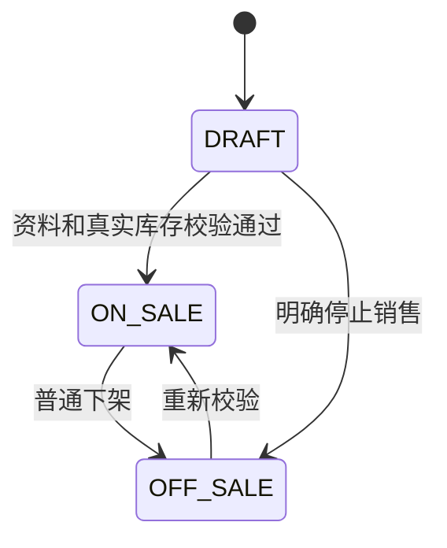
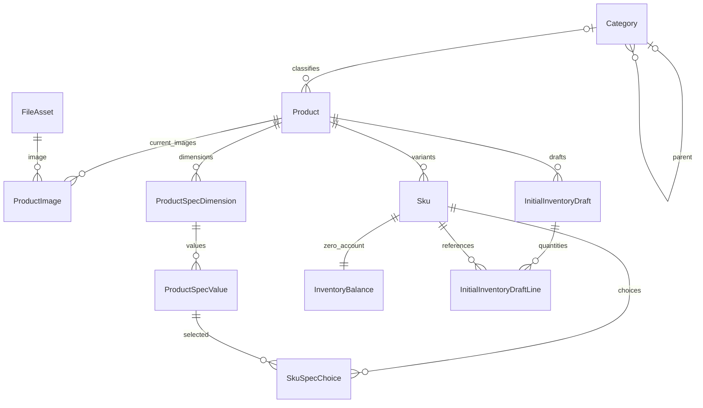

# 板块5：分类、商品与前台浏览开发文档

> 一致性审查：2026-11-10。跨板块约定、修订清单及未交付项见开发进度文档根目录《文档一致性审查记录.md》；本标记不代表软件已实现或测试通过。

| 项目 | 说明 |
|---|---|
| 所属里程碑 | M1：商品可售 |
| 文档编号 | M1-05 |
| 编写日期 | 2026-11-10 |
| 前置依赖 | 板块1～4已实现并验收；板块0不再作为独立阶段 |
| 需求依据 | FR-20～27、30、32、46、97；TD-01～05、10～15；AC-03、16、19、30相关部分 |
| 本板块目标 | 分类树、多规格商品、草稿及销售状态、零值库存账户、初始数量草稿、真实商品图绑定和顾客商品浏览 |
| 文档性质 | 待实施设计和验收说明；完成文档不代表代码完成 |

## 1. 目标、功能和边界

### 1.1 本板块要开发的功能

| 模块 | 功能 |
|---|---|
| 分类 | 最多三级、新增修改排序、移动整棵子树、防环、删除保护、父级包含后代筛选 |
| 商品主体SPU | 名称、品牌文本、纯文本介绍、分类、主图、轮播图、草稿保存、后台筛选 |
| SKU | 默认单SKU、最多3维规格组合、唯一编码/组合、售价成本、启停、批量填值 |
| 商品状态 | 草稿/上架/下架、归档、批量上下架逐项结果、历史实体不物理删除 |
| 图片 | 复用板块3上传和FileReference，绑定真实商品与当前图片关系，保留旧引用 |
| 库存衔接 | 每SKU建立A=0/R=0账户；初始库存只保存非记账草稿 |
| 顾客端 | 分类入口、名称搜索、分类含后代筛选、价格/销量排序、详情、SKU选择、缺货提示 |
| 正确性 | 权限裁剪、事务审计、唯一约束、分类与商品并发锁、版本冲突 |

### 1.2 必须明确的阶段终点

本板块没有到货入账功能，所有正式新SKU库存为0；商品不能因为表单填写“初始库存10”就变成可售10。正式开发环境的上架正例与“有库存可购买”完整演示在板块6真实确认入账后验收。

本板块可以通过隔离测试库夹具建立正库存，验证上架/公开查询逻辑，但夹具不是库存交付；不能在演示库手工改余额冒充到货功能。

本板块无购物车、建单、支付、库存登记接口、品牌管理系统、独立分类启停、营销装修。商品页的加购入口在板块7接通，现阶段不显示虚假的成功提示。库存预警维护和流水页面在板块6完成。

## 2. 前置衔接与权限

### 2.1 必须复用的能力

- Prisma、迁移、UTC/北京时间、整数分金额与严格DTO。
- Employee最新会话/权限检查、expectedVersion、事务主体锁和AuditLog。
- 板块3PRODUCT_IMAGE上传、bindFiles(tx,...)、公开内容读取及历史引用保留。
- 板块4SystemGuard思路和任务内核；本板块不为普通编辑创建无需求的审批任务。
- OpenAPI与api-client生成、Axios、分页/错误处理和上传组件。

新增迁移0005_categories_products_skus_inventory_accounts，不改前四板块已应用迁移。扩展SystemGuard增加CATEGORY_TREE稳定行，不创建第二套全局锁表。

### 2.2 操作权限

| 操作 | 权限码 | 默认岗位 |
|---|---|---|
| 查询分类、分类维护 | category.read / category.manage | 商品与仓储、超级管理员 |
| 后台商品查询 | product.read | 同上 |
| 商品/授权订单成本字段 | product.cost.read | 同上 |
| 商品资料、规格、售价成本、商品图及初始数量草稿 | product.manage及其既有依赖 | 同上 |
| 上下架、SKU启停、归档 | product.publish，归档同时要求product.manage | 同上 |
| 库存R/暂停原因等后台库存详情 | inventory.read | 同上 |
| 顾客公开浏览 | 无登录要求 | 所有人 |

客服默认不能访问后台分类商品API；个人额外授权后只开放相应能力。product.read可读取公开可售A及运营资料，但无product.cost.read不返回成本，无inventory.read不返回R及内部库存异常明细。操作权限不自动扩大到顾客资料、退款或全店设置。

## 3. 分类树设计

### 3.1 业务规则

1. 顶层depth=1，最大3层；parentId=null表示根。可关联任意有效分类，不强制商品只能放叶子。
2. 名称去首尾空白、1～50字符，保留用户显示文字；nameKey使用同一规范化函数（Unicode NFC+trim+小写，不合并中间空格），用于同父唯一。
3. sortOrder为0～1000000整数，排序sortOrder升序、nameKey、id稳定次序。iconKey可空，使用前端内置图标白名单，不上传HTML/SVG图标、不接受任意脚本/URL。
4. 父级不能是自身/后代；移动需要校验整个子树的新深度，而不仅目标节点。整棵子树路径和depth同事务更新。
5. 有有效子分类或任何未物理删除的关联商品时不允许删除；归档商品仍是关联商品，必须先明确迁移分类，不能为删除分类抹去历史商品。
6. 分类删除为软删除deletedAt，后续不能关联；路径保留历史。商品/SKU本期无物理删除API。
7. 前台分类树保留有公开商品的节点及必要祖先；父分类筛选包含其所有有效后代。只含缺货但仍上架商品的分类也可显示。

### 3.2 路径、移动与并发

pathIds为从根到自身的UUID数组，例如[服装ID,上衣ID,T恤ID]，depth等于数组长度。移动节点子树高度h（含自身时高度1），新父深度d（根视为0），要求d+h≤3。

所有分类写命令先锁员工，随后锁SystemGuard.CATEGORY_TREE，再锁相关商品（如涉及），最后分类附属记录。商品新建/改分类、上架时也在商品锁之前取同一个分类树锁，避免删除/移动与引用同时发生。读可用一次SQL/同一事务快照拿树，不逐节点查询。

移动时对整个子树重算pathIds和depth；任意更新/审计失败整体回滚。并发两个移动不能共同造环；根分类同名也由数据库唯一索引保证。

## 4. 商品、规格和状态规则

### 4.1 SPU字段与草稿

名称1～120字符，brand可空最多80，description为纯文本最多20000；分类、主图、售价可暂缺。新建至少提供工作名称以便后台查找，但不要求草稿一次填完所有销售资料。

商品只有DRAFT、ON_SALE、OFF_SALE三个销售状态，另有archivedAt表示归档。归档命令会下架并保留记录，本期不提供恢复归档入口；不把归档当删除。

上架要求：名称、有效分类、主图；至少一个启用且售价有效、A>0且未暂停新购的SKU；所有将公开售卖的启用SKU都必须有有效售价。成本可空，不以必须填成本作为隐式上架门槛。

ON_SALE之后卖到缺货可保持展示，但不可新购买；不因A=0定时自动下架。所有SKU停用或采购暂停导致无可购项时也可保持展示与不可购提示；价格显示从有效启用且有价SKU计算，无此SKU时priceFromCents=null、purchasable=false，不显示0元。

### 4.2 默认SKU和规格容量

- 单规格商品也有一条默认SKU，signature固定DEFAULT，规格维度为空。
- 多规格最多3个维度、每维最多20个有效值，所有有效组合最多200个SKU。生成前先算笛卡尔积，超过200直接400，不先生成8000行再截断。
- 规格名1～30字符、同商品nameKey唯一；值1～30字符、同维nameKey唯一；维度/值保留固定UUID，不能把显示名当唯一身份。
- 组合签名对dimensionId/valueId按dimensionId排序后规范化并计算SHA-256，同一SPU唯一；前台选择顺序不影响同一组合身份。
- skuCode 1～64，规范化为大写，允许A-Z、0-9、-、_，全库唯一；未填时服务端生成不含顾客信息的代码，唯一冲突重试有限次数。
- 售价可空仅限未销售草稿；非空1～1000000分。成本可空或0～1000000分；数量整数，不用浮点元。

### 4.3 生成、追加与已有SKU保护

组合预览只计算不写库，保存方案才创建真实SKU和零库存账户。相同组合重提应复用原SKU，不能每次换ID生成一批新库存账户。

模式：APPEND在固定现有维度结构下增加值/组合并保留旧SKU；REBUILD仅允许没有任何业务引用的规格方案整体替换，且该商品所有SKU A/R=0、无已转库存草稿或待入账关联。存在来源登记、流水、订单、售后、初始草稿转换等任何业务引用即禁止REBUILD。

保护规则：

1. 一旦有业务引用，禁止改写已有组合的维度/值归属及显示含义；允许新增独立SKU，停用旧SKU，改普通商品资料/现行价格，不改历史快照。
2. 本期不提供SKU物理删除接口。无引用REBUILD时旧组合停用并标retiredAt；保留原SKU/账户；完全相同组合优先复用，不能突破同SPU签名唯一。
3. retiredAt表示不可再作为当前方案启用，普通disabled的SKU可重新启用。容量计数只统计当前未retired组合，历史SKU保留不计入当前200上限。
4. 从默认SKU切到多规格属于REBUILD，须通过同样无引用检查；已有销售的单SKU不能把DEFAULT偷换成黑色L等意义。
5. 不在业务未建时无条件返回“没有引用”：引用检查服务现在检查本模块/初始草稿，库存/订单模块首次接入时必须注册真实引用检查；测试明确覆盖后续适配器接入。

“新增SKU”不等于放开已有维度随意改名；已有交易后改规格含义需保留旧实体并设计新商品/新方案，不能覆盖旧订单。

### 4.4 上下架、停用与旧订单



归档为独立标记，任何状态归档后禁止再上架。上架商品保存资料时必须仍满足销售资料完整性（不能清主图/分类/启用SKU售价），否则409要求先下架。自然缺货不适用“编辑导致无库存则拒绝”的错误判断；普通编辑不因已经卖光而强制下架。

普通下架、SKU停用、归档只禁止新加购/新建单；已有有效待付订单仍按快照支付，已有履约/售后继续。质量问题或实物受损另走关联订单异常，不把普通下架当作取消旧单。

批量上下架每项单独事务，逐项返回成功/失败及错误码，不能一个失败导致整批信息不明。全局请求401/403先拒绝，不把无权伪装成部分失败200。

## 5. 数据库表设计

### 5.1 ER图



### 5.2 Category（category）

id uuid PK；parent_id uuid可空自FK RESTRICT；name varchar(50)、name_key varchar(100)；icon_key varchar(50)可空；sort_order integer CHECK 0～1000000 DEFAULT 0；depth smallint CHECK 1～3；path_ids uuid[]；version integer≥0 DEFAULT 0；deleted_at、created_at、updated_at。

CHECK depth=array_length(path_ids,1)、path最后元素等于id；父子路径一致、防环和整个子树深度由分类树锁内服务验证，不能声称CHECK能跨表自动保证。

同父有效名称唯一用两个部分索引：根节点UNIQUE(name_key) WHERE parent_id IS NULL AND deleted_at IS NULL；子节点UNIQUE(parent_id,name_key) WHERE parent_id IS NOT NULL AND deleted_at IS NULL。避免PostgreSQL NULL语义使根重名通过。索引(parent_id,sort_order,id)，必要时对path_ids做GIN索引，先验证查询计划。

### 5.3 Product（product）

| 字段 | 类型/约束 | 说明 |
|---|---|---|
| id | uuid PK | SPU |
| product_code | varchar(64) UNIQUE | 服务端生成商品编号，非SKU编号 |
| name、brand、description | varchar(120)/varchar(80)可空/text可空 | 纯文本 |
| category_id | uuid NULL FK Category RESTRICT | 草稿可空 |
| status | DRAFT/ON_SALE/OFF_SALE | 默认DRAFT |
| archived_at | timestamptz NULL | 非空禁止公开查询和上架 |
| paid_sales_count | bigint CHECK≥0 DEFAULT 0 | 板块9成功支付累计件数；API以字符串返回 |
| version | integer CHECK≥0 DEFAULT 0 | 所有商品/方案/图片/SKU写命令统一递增 |
| created_by_id、updated_by_id | uuid FK Employee | 实际员工 |
| created_at、updated_at | timestamptz | 生命周期 |

索引(status,archived_at,created_at,id)、category_id；名称检索先用参数化ILIKE，10万商品等规模优化须测计划后另迁移索引，不提前承诺性能。

### 5.4 ProductImage（product_image）

id uuid PK；product_id FK；asset_id FK FileAsset；slot MAIN/GALLERY；sort_order integer 0～9；created_at。当前主图最多1（部分唯一product_id WHERE slot='MAIN'），轮播顺序UNIQUE(product_id,slot,sort_order)，同一slot同asset唯一。MAIN固定sort_order=0。

轮播最多10张由锁商品后同事务检查；主图不占轮播10张限额，可与一张轮播用同图。同表存当前展示关系；替换可删除旧的“当前关系”行，但板块3FileReference历史绝不能跟着删。每次产品变更记录历史引用和审计。

### 5.5 ProductSpecDimension / ProductSpecValue

| 表 | 字段 | 约束 |
|---|---|---|
| product_spec_dimension | id、product_id FK、name/name_key、sort_order 0～2、retired_at、created_at | 当前(product_id,name_key)/(product_id,sort_order)部分唯一；最多3在商品锁下检查 |
| product_spec_value | id、dimension_id FK、name/name_key、sort_order 0～19、retired_at、created_at | 当前(dimension_id,name_key)/(dimension_id,sort_order)部分唯一；每维最多20 |

历史维度/值不物理删除；已有引用不得改变语义。Schema保证外键，当前数量/组合兼容由服务和商品锁保证。

### 5.6 Sku / SkuSpecChoice

| 表/字段 | 类型/约束 | 说明 |
|---|---|---|
| sku.id、product_id | uuid PK/FK | SKU及归属 |
| sku.code | varchar(64) UNIQUE | 大写规范化 |
| sku.combination_signature | varchar(64) | DEFAULT或64位摘要；UNIQUE(product_id,signature) |
| sku.price_cents | integer NULL CHECK非空时1～1000000 | 草稿可空 |
| sku.cost_cents | integer NULL CHECK非空时0～1000000 | 可空，权限控制 |
| sku.enabled | boolean DEFAULT true | 草稿启用不代表允许售卖，上架时补校验 |
| sku.retired_at | timestamptz NULL | 旧方案保留且不能再启用 |
| sku.created_at、updated_at | timestamptz | 不另设客户端独立版本，统一product.version |
| sku_spec_choice | sku_id、dimension_id、value_id FK | PK(sku_id,dimension_id)，每维恰好一值 |

建立value_id+dimension_id复合FK（值表增加对应唯一）保证值属于该维；跨商品SKU与维度同属SPU须使用复合外键或锁内服务校验并集成测试。不能只相信客户端提交的specIds。

### 5.7 InventoryBalance（inventory_balance）零账户

sku_id uuid PK/FK RESTRICT；available integer NOT NULL DEFAULT 0 CHECK≥0；reserved integer NOT NULL DEFAULT 0 CHECK≥0；warning_threshold integer DEFAULT 10 CHECK≥0；purchase_blocked boolean DEFAULT false；version integer≥0 DEFAULT 0；created_at/updated_at。

本板块新增SKU与该零账户同事务创建。商品/SKU DTO永远不接受available/reserved更新。板块6复用此表增加库存命令和流水，不另建同名余额、不重置旧账户。

数量使用PostgreSQL INTEGER，自动/人工库存动作在板块6统一校验整数及溢出。公开A是当前available，R不属于公开字段。A+R不是完整仓库总量。

### 5.8 InitialInventoryDraft / InitialInventoryDraftLine

| 表 | 字段 | 说明 |
|---|---|---|
| initial_inventory_draft | id uuid PK、product_id FK、conversion_key uuid UNIQUE、status EDITABLE/CONVERTED/VOID、version≥0、created_by_id FK、created_at/updated_at | 商品侧非记账数量草稿；conversion_key创建后固定 |
| initial_inventory_draft_line | draft_id FK、sku_id FK、quantity integer CHECK 0～2147483647 | PK(draft_id,sku_id)，SKU必须属于该商品 |

同商品最多一个EDITABLE草稿，用部分唯一索引保证。保存草稿只改这两表，不写InventoryBalance、InventoryLedger、Task或“已入账”审计。

CONVERTED关联真实InventoryAdjustment的FK随板块6迁移新增，本板块不放一个不存在外键的假adjustmentId；转换服务在板块6实现并通过conversion_key唯一约束防重复。同来源同批货最终还要校验来源净入账，conversion_key不能替代来源去重。

EDITABLE可修改或原因作废；CONVERTED不能改/重转/作废，去真实登记处理。转换前需核实来源、凭据和SKU数量，不能仅凭商品表单数量直接入账。REBUILD前存在非零EDITABLE草稿须先明确作废或清空，不悄悄把数量分配给新SKU。

## 6. 文件绑定、事务与并发

### 6.1 商品图片

上传沿用POST /files purpose=PRODUCT_IMAGE，需要product.manage。保存图片命令锁员工→必要分类树→商品→SKU/余额（如需）→FileAsset按ID→引用，调用板块3bindFiles，验证员工上传及用途、未过期、同商品/授权复用规则。

本期只允许本人上传的STAGED图，或已属于同商品的合法RETAINED图用于改排序/主图；不直接拿其它员工未绑定文件或跨商品图ID复用。跨商品复用可重新上传新资产，避免扩展既有绑定边界。

绑定后可PUBLIC，但不意味着商品已上架；知道图片URL可看图，不可通过/store/products看到草稿详情。公开商品图片不得含成本凭证或私有材料；已公开历史图不因后续下架消失。

### 6.2 写命令锁序

Guard后事务内再检查操作者最新会话与权限。需分类稳定的命令：员工→CATEGORY_TREE→商品按ID→SKU/余额按ID→附属/文件。新建无既有商品，锁分类后插入商品与SKU账户。无需分类锁的价格/启停更新可跳过分类锁，但持商品锁后不能再补取它。

分类删除/商品分类编辑共用树锁；上架/下架/改价/SKU启停与板块8建单共用商品行锁。未来建单先取得商品锁才读取销售状态/价格并做快照。未来支付不重新按当前商品上架状态校验旧单。

商品version统一管理：资料、图片、规格、SKU批量价格/启停、归档均检查expectedVersion并递增；同事务状态历史commandKey可由动作名+商品ID+提交后的version组成，重试先按版本和实际结果核实，不能以requestId代替语义动作键。保存相同规范内容changed=false，不造重复成功变更审计。SKU表不接受绕开商品版本的更新入口。

金额、SKU账户、图片引用、状态历史、审计任何一步失败整命令回滚。文件物理保存与DB仍沿用板块3补偿语义，不谎称磁盘也在数据库事务里。

### 6.3 历史快照衔接

本板块不建订单表。板块8必须在订单行保存商品名称/图片ID或稳定URL/编码/规格文字/单价/成本等快照，并保留文件引用；后续改商品资料不能回写历史订单。

“历史保护已验证”需有真实订单后再验收；现在可测不可变旧文件引用及SKU实体保护，不用手造一个JSON对象当完整AC-16通过。

## 7. API设计

路径省略/api/v1；Bearer/统一外壳沿用前文。新建201，其余成功200；DELETE分类/作废草稿仍返回JSON结果。原因字段reason 1～500字用于删除、移动、上下架、归档、停用、重建及草稿作废；普通编辑可填修改说明并审计。

### 7.1 分类API

| 方法/路径 | 权限 | 请求/返回 |
|---|---|---|
| GET /admin/categories/tree | category.read | 当前有效完整树，depth/pathIds/version |
| POST /admin/categories | category.manage | name、parentId可空、iconKey可空、sortOrder；返回节点 |
| PATCH /admin/categories/:id | category.manage | name/iconKey/sortOrder、expectedVersion；不接parentId |
| POST /admin/categories/:id/move | category.manage | parentId可空、expectedVersion、reason；返回受影响节点数量及新路径 |
| DELETE /admin/categories/:id | category.manage | JSON {expectedVersion,reason}；删除保护后软删除 |
| GET /store/categories | 公开 | 含公开商品节点及必要祖先的树，不含内部字段 |

版本移动时目标父节点与整个树均在锁内重验；不能只凭请求中的父depth判断。删除body在Swagger/客户端显式建模，若代理不支持DELETE body可实施时统一改专用POST delete命令并同步契约，不混用两套。

### 7.2 商品主体与状态API

| 方法/路径 | 权限 | 请求/返回 |
|---|---|---|
| GET /admin/products | product.read | page/pageSize、keyword、categoryId、status、archived、minPriceCents/maxPriceCents |
| GET /admin/products/:id | product.read | 当前资料、SKU、授权字段、product.version、初始数量草稿摘要 |
| POST /admin/products | product.manage | name、brand?、description?、categoryId?；建DRAFT、默认SKU与零账户 |
| PATCH /admin/products/:id | product.manage | name/brand/description/categoryId、expectedVersion；不接status/库存 |
| PUT /admin/products/:id/images | product.manage | mainImageId可空、galleryImageIds有序≤10、expectedVersion |
| POST /admin/products/:id/publish | product.publish | expectedVersion、reason；锁后完整校验 |
| POST /admin/products/:id/unpublish | product.publish | expectedVersion、reason |
| POST /admin/products/:id/archive | product.publish+product.manage | expectedVersion、reason；下架并归档 |
| POST /admin/products/batch-status | product.publish | action=PUBLISH/UNPUBLISH、items[{id,expectedVersion}]≤100、reason |

批量拒绝重复ID，每项事务，200 data={items:[{id,success,version?,code?,message?}]}；不存在/版本冲突按项返回，身份/权限错误整请求401/403。不发布任意PATCH status或DELETE product/SKU接口。

后台商品筛选价格按启用未retired且非空售价SKU计算minPrice，范围边界包含等号；只有空价草稿不匹配数值价格区间。categoryId后台/前台都包含后代，默认精确名称检索不是品牌系统。

### 7.3 规格/SKU和初始数量API

| 方法/路径 | 输入 | 说明 |
|---|---|---|
| POST /admin/products/:id/sku-combinations/preview | dimensions[{id或clientKey二选一,name,values[{id或clientKey二选一,name}]}] | product.manage；返回组合/容量/复用建议，不写任何表 |
| PUT /admin/products/:id/sku-scheme | mode APPEND/REBUILD、dimensions、expectedVersion、reason | 锁内重算方案，返回SKU与新productVersion；创建零账户 |
| PATCH /admin/products/:id/skus/:skuId | code?、priceCents?、costCents?、expectedVersion | product.manage；所属验证；null规则明确 |
| POST /admin/products/:id/skus/batch-fill | skuIds≤200、priceCents?/costCents?、expectedVersion | 同商品一次事务，全部成功或回滚 |
| POST /admin/products/:id/skus/:skuId/set-enabled | enabled boolean、expectedVersion、reason | product.publish；retired不能启用，ON_SALE启用须有有效价格 |
| GET /admin/products/:id/initial-inventory-draft | 无 | product.manage；当前草稿或null |
| PUT /admin/products/:id/initial-inventory-draft | lines[{skuId,quantity}]、expectedProductVersion、expectedDraftVersion可空 | product.manage；无草稿expectedDraftVersion=null，存在则必须匹配 |
| POST /admin/products/:id/initial-inventory-draft/void | expectedProductVersion、expectedDraftVersion、reason | 仅EDITABLE作废，不改余额 |

规格预览与保存的dimensions每项字段为id?、clientKey?、name、values，每个value为id?、clientKey?、name；id与clientKey必须且只能提供一个，服务端拒绝同时为空或同时提供。规格方案中已存维度/值用其ID，新维度/值使用各自请求内唯一clientKey（UUID）；预览无持久化ID，正式保存按clientKey映射生成真实UUID。预览请求与保存请求使用同一结构，保存返回clientKey→id映射；signature最终以持久化ID算，不能把预览临时签名直接当数据库唯一事实。

APPEND必须携带现有维度/值且不改变已有含义；省略不表示删除。REBUILD保护失败409。生成的SKU编码自动分配，价格/成本后续批量填。未提供字段保持原值，显式null表示清空且必须满足草稿/历史引用规则；启用销售/已有业务引用SKU不能清空售价。

初始草稿quantity不受订单1～99限制，它是库存声明数量；必须为有界非负整数。保存后product.version和draft.version一致更新并返回，不允许只校验草稿版本绕过方案变更。

### 7.4 顾客公开API与字段

| 方法/路径 | 参数 | 返回 |
|---|---|---|
| GET /store/products | page默认1、pageSize默认20最大100、keyword≤50、categoryId、sort | 当前ON_SALE且未归档列表 |
| GET /store/products/:id | UUID | 上架商品详情、有效启用SKU、公开库存A、可购提示 |

sort白名单NEWEST、PRICE_ASC、PRICE_DESC、SALES_DESC；默认NEWEST，稳定追加id。价格排序按启用未retired有价SKU最低售价，null永远排最后；销量按paidSalesCount，板块9接通前真实值为0，按id稳定次序，不伪造“热销”。

列表DTO：id、name、brand、mainImageUrl、priceFromCents可空、availableQuantity、paidSalesCount十进制字符串、purchasable。详情追加description、galleryImageUrls、category公开路径、specDimensions、skus（id/code/规格/priceCents/available/purchasable）。不返回costCents、reserved、库存来源/流水、员工ID、权限、内部原因。

availableQuantity为当前公开有效SKU的A之和；SQL SUM使用BIGINT，若超过JS安全整数范围API以十进制字符串表达，建议本项目公开汇总数量统一字符串、单SKUavailable仍number，Swagger和前端类型明确。SKU purchase_blocked时仍可显示账面A，但purchasable=false，公开原因仅“暂不可购买”，不披露损耗内部信息。

purchasable=ON_SALE且未归档且SKU启用未retired且价格有效且A>0且未purchase_blocked。列表是否可购按存在此SKU计算；购物车/建单以后仍服务端重验，不把本次查询当预留。

详情下架/归档/不存在返回404 PRODUCT_NOT_FOUND，不能通过UUID获取草稿。停用SKU不在公开详情可选项中；某维旧值只有停用SKU使用时不输出可选项，避免选择永远不存在的组合。

### 7.5 请求示例

新建草稿：

```json
{"name":"演示纯棉T恤","brand":"Demo","description":"仅用于开发演示的纯文本介绍","categoryId":null}
```

新方案保存（先以当前商品版本执行无引用REBUILD）：

```json
{
  "mode":"REBUILD",
  "expectedVersion":0,
  "reason":"建立颜色尺码多规格方案",
  "dimensions":[
    {"clientKey":"0a36b769-fc06-430b-870f-bdc8e69e05a3","name":"颜色","values":[
      {"clientKey":"3e704ea8-98e3-4ef7-8f57-e539b7ee789a","name":"黑色"},
      {"clientKey":"fd51c80d-b649-4f8f-95e1-110dcf2ba586","name":"白色"}
    ]},
    {"clientKey":"66d19d6e-8db2-49ac-863a-8c4979690cdf","name":"尺码","values":[
      {"clientKey":"f7e7ae41-3744-428a-88a7-9c86676638d3","name":"S"},
      {"clientKey":"98333ed8-045d-49e7-b2b8-92c82b0aa0e2","name":"M"},
      {"clientKey":"396009d8-49d8-4b70-83b9-d5455f715264","name":"L"}
    ]}
  ]
}
```

预期6个当前组合，原DEFAULT保留为retired。实际expectedVersion必须读当前值，示例0不保证复制即成功。重复请求响应丢失后先读详情核实版本/组合，不用同一旧version重建。

### 7.6 错误码

| HTTP/code | 场景 |
|---|---|
| 400 VALIDATION_FAILED | 未声明库存字段、金额/规格/数量格式或边界不合法 |
| 400 SKU_COMBINATION_LIMIT | 维度/值/组合超限 |
| 401/403既有错误 | 无会话、强制改密、无操作权限 |
| 404 CATEGORY_NOT_FOUND / PRODUCT_NOT_FOUND / SKU_NOT_FOUND | 不存在/无公开可见性/不属于该商品 |
| 409 VERSION_CONFLICT | 分类/商品/草稿版本过期 |
| 409 CATEGORY_NAME_EXISTS / CATEGORY_IN_USE | 同父重名/有子分类或商品 |
| 409 CATEGORY_CYCLE / CATEGORY_DEPTH_EXCEEDED | 成环/子树越界 |
| 409 SKU_CODE_EXISTS / SKU_COMBINATION_EXISTS | 唯一冲突 |
| 409 PRODUCT_NOT_PUBLISHABLE | 上架必要条件不满足，details列失败字段但不暴露无权成本 |
| 409 PRODUCT_ARCHIVED / PRODUCT_MUST_UNPUBLISH | 已归档/销售中修改破坏必要资料 |
| 409 SKU_SCHEME_REFERENCED / SKU_PRICE_REQUIRED | 方案有引用/不能清空售价 |
| 409 INITIAL_DRAFT_NOT_EDITABLE | 已转换或作废，不可改 |

商品仅因零库存不能上架应返回PRODUCT_NOT_PUBLISHABLE并明确“可售库存不足，请完成库存登记确认”，不能提示用户去数据库改余额。

## 8. 开发步骤与命令落账

1. 建分类/商品/规格/SKU/零账户/初始草稿迁移，真实约束及CATEGORY_TREE行。
2. 实现分类树锁、名称规范化、移动子树和删除保护，先跑并发测试。
3. 实现草稿与默认SKU同事务创建，字段权限投影。
4. 实现组合预览/保存、保护策略、批量填价，零账户不可覆盖。
5. 注册板块3真实PRODUCT文件引用解析器，接图片绑定和历史保留。
6. 实现上下架/归档/启停与批量逐项结果。
7. 实现公开列表/详情/父级筛选/稳定排序，后台前台页面联调。
8. 实现非记账初始数量草稿，给板块6保留转换契约。
9. 执行Swagger、PostgreSQL/端到端与工程检查，记录后续补验。

| 命令 | 业务变化 | 库存变化 | 历史/审计 |
|---|---|---|---|
| 新建商品/新SKU | DRAFT/新组合 | 仅创建A=0/R=0账户 | product.create/sku.scheme.save |
| 保存初始数量草稿 | 草稿数量 | 无 | initial-inventory-draft.save，标明未入账 |
| 上/下架、启停、归档 | 销售状态或标记 | 无 | 同事务状态历史与审计 |
| 改售价/成本/图片 | 当前资料 | 无 | 白名单差异、历史文件引用 |
| 分类移动/删除 | 子树路径/软删除 | 无 | 受影响摘要、原因、操作者 |

本板块不会增加库存流水或付款销量。paidSalesCount未来在成功支付同事务增加，重复支付不能重复销量；退款不倒扣累计支付销量。

## 9. 前端开发要求

### 9.1 后台

- 分类树：三级限制提示、名称图标排序、移动父级选择排除自身/后代，服务器最终校验。显示阻止删除的原因。
- 商品列表：名称/分类/状态/价格、缺货提示、主图、最低价、批量上下架逐项结果。
- 商品编辑：基础资料、图片、规格、SKU表、初始数量草稿分区；保存草稿不伪装上架。
- SKU矩阵：最多3维、组合数量预估、批量填写售价成本/初始数量；金额前端以元展示，用严格整数分转换提交。
- 初始库存文案明确“数量草稿，确认库存登记后才生效”，不能显示为可售余额。转换入口板块6后接通，当前不做按钮点完假成功。
- 主图/轮播复用ImageUploader与PRODUCT_IMAGE，排序即数组语义，不把全局指纹工具自动排序图片数组。
- 修改version冲突409刷新并重新确认，不自动覆盖其他员工；草稿页未提交内容可本地暂存但不得存敏感密码。

### 9.2 顾客端

商品列表/分类/搜索/价格销量排序，详情图片与纯文本介绍，选择完整SKU后展示对应售价与A；不存在的规格组合不可选择。缺货、暂停新购、停用都不能假加购成功。

不输出成本，即使用户用开发者工具看网络JSON也不存在成本字段。销量接口真实0时不填随机数；金额null显示“暂无可售规格”，不显示免费。

公开图片按板块3URL读取；退货凭证不能混入商品轮播。电脑端1366×768基本可用，正常处理加载中、空列表、404、失败重试。

## 10. Swagger详细测试

### 10.1 环境和夹具

常规开发环境：分类/草稿/方案/零账户/图片/上架拒绝都可真实测试。上架正例和缺货公开展示在独立PostgreSQL测试库夹具验证（可沿用test专用应用3001）；生产AppModule无“加库存”调试接口。

隔离夹具明确建立商品库存数值仅用于验证规则，不能把它计为库存入账已实现。真实M1验收须板块6通过合法登记入账再重跑SW-L01。

准备已改密仓储甲/乙、客服甲、管理员；使用Swagger http://localhost:3000/api/docs，隔离夹具用3001。每次Authorize切身份核对真实Header，记录ID/version/requestId，不截图真实密码/token。

### SW-01：分类三级、同父重名和删除

仓储甲POST根“服装”→子“上衣”→孙“T恤”，GET tree验证depth/pathIds。新增第四级400/409按契约CATEGORY_DEPTH_EXCEEDED；同父重名409，根同名也409，不同父同名允许。

删除有子分类的根409 CATEGORY_IN_USE；后续商品关联“T恤”后删除该分类也409。修改name/sortOrder用最新version，旧version409。

### SW-02：子树移动、防环和深度

准备一个含子节点的二级分类，尝试移到另一个二级分类下：根节点本身新depth可能3，但子节点将4，应整单409。尝试移动到自身/后代409 CATEGORY_CYCLE。

合法把子树移到根后，GET tree逐个检查所有后代pathIds/depth同步变更；给非叶子父分类关联商品允许，不得偷偷强制叶子。

### SW-03：新商品、默认SKU与零账户

POST /admin/products按第7节草稿示例，预期201：DRAFT、有默认SKU、available=0、reserved=0（需inventory.read）、成本可空。GET详情取得product.version。

PATCH附带available=10/reserved=10/status=ON_SALE，应400未声明字段；没有直接修改余额接口。只存初始数量草稿后仍是0。

### SW-04：组合预览与6个SKU保存

先POST sku-combinations/preview传颜色2×尺码3，预期6组合且商品version/数据库SKU数不变。

用相同结构加mode=REBUILD、expectedVersion、reason保存，预期6当前SKU与6个零账户，原DEFAULT为retired；记录映射ID。批量填priceCents=9900、costCents=5000，所有金额为整数分。

用其它商品valueId/重复同维选值/重复SKU编码保存应失败；维度4、每维21、组合>200直接拒绝，不悄悄截断。重复保存同组合不新建重复SKU账户。

### SW-05：金额、空价和批量原子性

售价0/负数/1000001、成本负数/1000001、浮点99.9均400；售价1、1000000及成本0/空按规则允许。

草稿未被业务引用时可清空售价；隔离已被引用SKU清空售价409。batch-fill含不属于商品的SKU，整批失败且其它SKU价格不变。写cost需要product.manage及其成本权限依赖，不允许只读用户改成本。

### SW-06：真实商品图片绑定

仓储甲POST /files purpose=PRODUCT_IMAGE上传主图和轮播图，然后PUT images提交fileId。预期绑定后可公开读取，但DRAFT商品/store/products/:id仍404。

第11张轮播提交400，重复galleryId拒绝，私有售后凭证当商品图409；他人未绑定图不能绑定。替换主图后旧FileReference/文件仍在，当前详情只展示新主图。

### SW-07：上架前置条件与隔离正例

逐步缺主图、缺有效分类、SKU无售价、全部0库存，POST publish均409 PRODUCT_NOT_PUBLISHABLE，details准确。

独立测试应用准备合法资料+真实测试库A>0的夹具，上架200；公开详情200且选SKU正确，成本和R不存在。夹具余额不是本板块库存功能证据。ON_SALE编辑试图清主图/分类/启用SKU售价409，不破坏销售资料。

### SW-08：公开筛选、排序和缺货

隔离环境准备父分类/多个后代公开商品，以及一件缺货仍ON_SALE商品。GET /store/products按父categoryId包含后代商品；名称搜索正确，PRICE_ASC/DESC按最低有效SKU价格排序，SALES_DESC当前为真实0则稳定id排序。

DRAFT/OFF_SALE/archived均不出公开列表，详情404；缺货ON_SALE仍可看且purchasable=false。检查priceFromCents=null时无0元，公开字段无cost/reserved/员工资料。

### SW-09：上下架、启停、归档与批量结果

单项下架后公开详情404，后台及SKU/余额/历史文件保留；重新上架需再校验。停用SKU不再公开可选，retiredSKU不能重新启用。归档使商品下架且不可再上架。

batch-status提交一件可上架、一件缺主图、一件旧version，返回每项success/code/message；成功项真实提交，失败项无半状态；普通客服整请求403，不能逐项伪装成功。

### SW-10：初始数量草稿不入账

仓储PUT initial-inventory-draft提交6个SKU数量，记录draftId/conversionKey/version；再GET商品和账户，A/R仍0，Task/流水无新增。更新必须product与draft两个当前version。

超界数量/重复skuId/别的商品skuId拒绝；非零EDITABLE草稿未明确作废就REBUILD应409。作废填原因后只改草稿，不扣库存；实际转换在板块6补验。

### SW-11：权限、成本与版本

客服甲访问后台商品/分类API403，公开浏览200。给其仅满足product.read及依赖的额外权限后后台能看非成本字段，但costCents不应出现；没有inventory.read不返回R。不得为测试只读成本隔离误授product.manage（其依赖会自动带成本）。

仓储甲/乙读取同version，甲改名成功后乙旧version改价409；页面刷新再确认。停用员工旧token写商品401，撤销额外管理权限403；无关合法能力仍可用。

### SW-L01：板块6真实入账后的商品可售

通过真实库存来源/登记/确认让A增加，再上架→公开选择SKU，完整重跑SW-07～09正例。初始草稿同conversionKey重试只生成一张待确认登记，未确认不增A，确认只一次，同来源不得同时算初始化和到货。

### SW-L02：订单快照与下架竞态补验

板块8～9真实下单后改名/价/图/地址设置，旧订单保持快照。下架与建单并发按商品锁提交顺序，只允许合法新单结果；普通下架/停用后未过期旧单仍可支付，质量/受损异常另行拦截。不能提前把整条AC-16/30标通过。

## 11. 自动化与数据库验证

### IT-01：分类树与唯一约束

PostgreSQL16验证根/子同名部分唯一索引、防环、移动子树整体深度、删除有商品/子分类拒绝。不同连接屏障并发两个移动不成环；移动与新增子分类、删除与商品关联同时发生仍有效。

### IT-02：组合、实体保护和账户

生成3维合法组合、>200提前拒绝、clientKey映射、维/值跨商品引用、顺序不同同签名、同SKUCode并发仅一条。重复方案不重复账户；REBUILD有库存/草稿转换/业务引用拒绝，无引用旧SKU仍保留实体和余额账户。

后续引用检查适配器未注册时不能忽略已存在领域引用；模块启动/集成契约测试明确已安装领域必须注册检查器，防止后续订单模块上线却仍返回“零引用”。

### IT-03：事务审计与文件回滚

在创建默认SKU/账户、保存多SKU方案、图片绑定、分类子树更新、publish审计中注入失败，所有数据/版本/引用/状态历史一起回滚。物理文件孤儿按板块3补偿，不删除已有历史图。

### IT-04：金额、查询和字段

数据库CHECK拒绝越界售价/成本/负A/R，DTO拒绝浮点；成本空与0区分。公开SELECT白名单不泄漏成本、R、员工、内部原因；多SKU聚合不N+1，汇总BIGINT序列化为约定字符串。价格排序null最后且分页稳定，父分类后代范围正确。

### IT-05：权限竞争与版本

员工撤权先提交后商品写命令403；命令先锁员工合法提交后撤权保留历史；同version并发编辑只能一份生效。上/下架、改价、SKU启停共用商品锁，为后续建单并发补验保留测试入口，不能只写前端按钮隐藏测试。

### IT-06：库存草稿和模块衔接

保存初始草稿不写余额/流水/任务；两个编辑同商品只有一份EDITABLE；作废不改库存；已CONVERTED不可改的状态保护用测试夹具验证，板块6真实转换后重跑。

InventoryBalance零账户复用迁移：板块6不得覆盖已有账户。初始草稿与真实登记FK、来源净入账在后续落库，当前不能写假登记ID。

### IT-07：前端与工程回归

后台分类移动、6SKU矩阵、批量填价、图片排序、草稿/上架错误、409刷新、公开缺货/排序/404端到端。正式演示若无入账保持无法上架，不造假。

执行pnpm lint、pnpm typecheck、pnpm test、pnpm test:integration、pnpm build、pnpm openapi:export、pnpm api-client:generate，并回归前四板块账号、私有文件、配置、任务事务。Compose冷启动/迁移成功，商品图重建API容器后仍可读。

## 12. Agent执行说明与衔接检查

### 12.1 可直接交给Agent的任务

> 请实现板块5。先阅读需求v2.0、板块1～5文档与当前仓库，复用权限、事务审计、FileAsset绑定、配置和客户端生成。完成分类树及CATEGORY_TREE锁、商品草稿/多规格SKU/零库存账户/非记账初始数量草稿、上下架启停归档、商品图、后台页面与顾客公开浏览。库存登记尚未实现，不直接写正余额或用假上架成功绕过规则；正例只在隔离测试夹具验证，真实可售在板块6补验。已有SKU/文件/订单快照保护和TD-11锁序必须遵守。补齐数据库约束、OpenAPI、并发/回滚/字段权限测试，报告真实命令和结果，保留后续验收项，发现冲突同步设计。

### 12.2 实施前检查

- [x] 固定权限码复用，无新增客服默认商品管理或成本读取。
- [x] CATEGORY_TREE稳定行在正确锁序中，不先锁商品再反向锁树。
- [x] 文件真实PRODUCT解析器接入，商品图公开不等于商品详情公开。
- [x] InventoryBalance字段和板块6目标一致，商品DTO无库存覆盖入口。
- [x] 默认SKU、多规格历史和REBUILD保护一致，组合不重复建账户。
- [x] 规格clientKey到持久化UUID映射在Swagger/生成客户端明确。
- [x] ON_SALE无价不显示0元，公开字段无成本/R。
- [x] 初始数量草稿转换契约和后续订单引用检查已登记待接入。

## 13. 验收追踪与交付门槛

| 需求/规则 | 当前验证 | 后续补验 |
|---|---|---|
| FR-20分类，AC-03/30 | SW-01～02、IT-01 | 真实建单与分类并发回归 |
| FR-21～24商品/SKU | SW-03～07、IT-02～04 | SW-L01真实库存上架 |
| FR-25历史与下架 | SW-06、09、IT-02～03 | SW-L02订单快照及旧单支付 |
| FR-26筛选/排序 | SW-08、IT-04、07 | 板块9真实支付销量 |
| FR-27文件 | SW-06、IT-03、07 | 订单行历史图片引用 |
| FR-23/30/32初始草稿 | SW-10、IT-06 | 板块6转换、来源与入账 |
| AC-19字段权限 | SW-11、IT-04～05 | 后续订单DTO成本裁剪 |

### 13.1 交付清单

- [x] 0005迁移、分类树部分唯一索引、SKU组合/FK、零库存账户和草稿约束。
- [x] 分类/商品/规格/图片/状态/初始草稿API与事务审计。
- [x] 后台分类树/商品列表编辑/SKU矩阵，前台分类商品列表详情。
- [x] 商品图片真实业务绑定、当前与历史引用分离。
- [x] OpenAPI、生成客户端、README及测试夹具说明。
- [x] docs/verification/M1-05.md：SW-01～11、IT-01～07逐项记录日期、环境、命令/响应、requestId、证据、遗留问题；SW-L01～02保持待补验。

2026-11-13本期范围已完成并验收。756普通通过；1394集成首轮1393通过/1环境失败后原12项局部复验通过；商品20项和迁移升级1项另有定向证据，不重复累加。45段浏览器、六工作区类型、Lint/构建/契约、26组Docker/188HTTP及常用四服务4组最终验收通过。0005已非破坏性应用，原20表既有行、旧账号/.env/迁移和原DB容器/两卷保持。开发库保留两件带图服装草稿及独立仓储账号，A/R均0，不伪造上架。

详见[完成说明](../开发完成说明/板块5_开发完成说明.md)、[实施记录](../../../docs/design/M1-05.md)及[逐项验收](../../../docs/verification/M1-05.md)。未暂存、提交或运行远程CI；SW-L01～02仍待后续真实业务补验，未开始板块6。

### 13.2 完成标准

本板块完成指分类、商品资料和页面成立、SKU/账户/草稿边界正确、约束与事务权限测试通过；真实可售正例明确待板块6入账。不得把测试库正余额夹具、没有异常的单次Swagger请求或文档已生成当作M1交付完成。

M1最终完成还需板块6库存来源/确认入账及真实商品上架浏览演示。下一份文档为板块6库存入账与记账内核。

### 13.3 板块6补验（2026-11-14）

SW-L01已通过：复用原两商品、SKU/零账户及数量草稿，经真实来源核实、同conversionKey转换、同人领取确认，8当前SKU各A12/R0，共96，正式上架并在本机/Docker公开选择SKU。API重建后账务、文件及会话保持，M1商品可售完成。详见[M1-06验收](../../../docs/verification/M1-06.md)。上文2026-11-13零库存/未提交/CI结论为历史快照；板块5已提交，前置契约CI已核实成功，当轮板块6未提交。SW-L02在该时点待8＋9，下节记录最新补验。

### 13.4 板块8＋9补验（2026-11-14）

SW-L02已通过真实订单快照、改名/价/图/地址及设置后旧单不变、下架与建单真实锁竞争、普通下架/SKU停用旧单付款和受损另行拦截。正式订单SKU引用保护、订单历史图片引用及支付销量已接通。证据见[M1-05补验记录](../../../docs/verification/M1-05.md)和[M2-08-09验收](../../../docs/verification/M2-08-09.md)，不重复累计历史用例。当前原外套黑L经正式演示付款净减1，全店A95/R0，原服装与图片保持；发货售后仍按所属板块补验。

