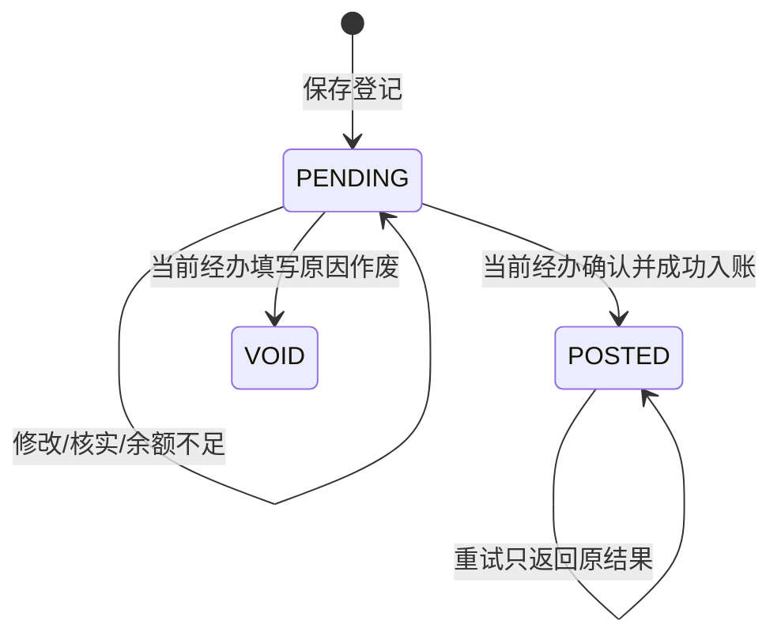
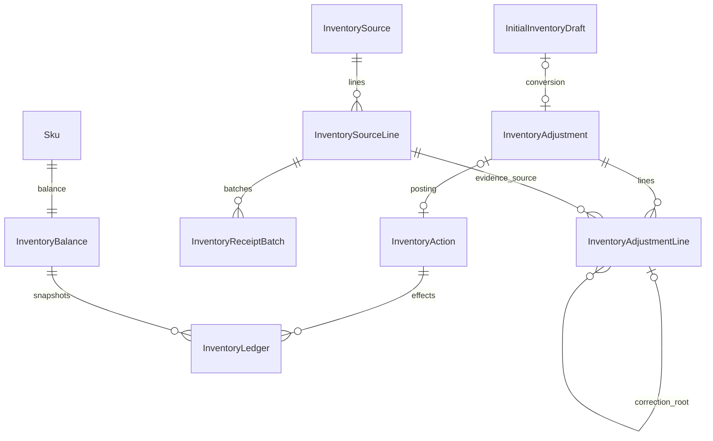

# 板块6：库存入账与记账内核开发文档

> 一致性审查：2026-11-10。跨板块约定、修订清单及未交付项见开发进度文档根目录《文档一致性审查记录.md》；本标记不代表软件已实现或测试通过。

| 项目 | 说明 |
|---|---|
| 所属里程碑 | M1：商品可售 |
| 文档编号 | M1-06 |
| 编写日期 | 2026-11-10 |
| 前置依赖 | 板块1～5实际完成；复用板块5InventoryBalance及InitialInventoryDraft |
| 需求依据 | FR-23、30～37、35、64、75～80、92～93、97；BR-03～04、06～07；TD-10～15；AC-04～05、10、12～13、20～25相关部分 |
| 交付目标 | 可追溯人工入账、来源批次防重、更正与流水、统一自动记账内核；合法入账后完成真实商品上架 |
| 状态 | 2026-11-14本期范围已验收；SW-01～10、IT-01～09及板块5 SW-L01完成；本板块SW-L01～02待后续真实领域 |

## 1. 开发内容和阶段边界

### 1.1 现在必须实现

1. 来源凭据、来源行核实数量、实际到货批次；初始化和到货使用同一来源去重机制。
2. 库存登记创建/编辑/领取/确认/作废，允许同人登记确认；未确认不改变库存。
3. 人工类型：INITIALIZATION、ARRIVAL、AVAILABLE_LOSS、CORRECTION，不开放退货/取消释放等自动业务类型的手工入口。
4. 复用A/R余额，原子数量条件更新，动作幂等、库存流水、事务审计与任务交接。
5. 已入账不可改；引用原单另做差额更正，来源累计净入账与非负约束同步维护。
6. 板块5初始数量草稿转换真实待确认登记，conversionKey防重复；转换不等于入账。
7. 余额/低库存/来源/登记/流水页面、SKU预警线，私有凭证绑定。
8. 库存异常及暂停新购基础、受损待付与已付款备货核实的内部规则/适配器。
9. 下单预占、支付扣R、取消安全释放、退货及未交运退款回补的统一事务内核与隔离数据库测试。

### 1.2 不能提前宣称完成的事项

订单尚未存在，不能在生产建立假Order或提供任意指定orderId修改R的接口。自动记账规则现在实现并用测试适配器验算，真实接入依赖：

| 规则 | 真实接通板块 |
|---|---|
| 预占、订单行与受损分配关联 | 板块8 |
| 支付阻塞、取消/超时净释放、支付与异常竞争 | 板块9，必须在支付模块验收前完成 |
| 已付款备货/交运事实核实 | 板块10、12 |
| 退货最终验收回补、异常批准、退款失败重试 | 板块12 |
| 跨岗位完整异常页面、争议物品去向 | 板块13；不作为核心保护延期理由 |

本板块结束可以真实演示：商品数量草稿→来源核实→转换待确认→领取并确认入账→A增加且有流水→商品上架→顾客浏览可售SKU。仍不做采购订单、供应商系统、多仓或完整盘点总账。

## 2. 术语、不变量与权限

### 2.1 数量含义

A=available：能分给新订单的数量；R=reserved：未付款订单占用。付款后货物进入订单备货，不属于R；A+R不是完整仓库总量，不能加上已付款备货后再叫“可售库存”。

- A、R始终非负且≤2147483647；输入数量为整数，不套用订单单行1～99上限。
- 所有加减在SQL用BIGINT计算并检查最终INTEGER边界；不允许PostgreSQL溢出后向用户只报500。
- 已付款备货损耗不再减A。未付款占用损耗不直接改R，只能关联受影响订单并安全关闭/恢复。
- 每一成功库存动作有唯一业务键、指纹、动作结果和流水；与业务单/状态/任务/审计同事务。
- 同一来源同一批货不能同时算初始化和新到货；自动退货回补不能再人工入库。

### 2.2 权限矩阵

| 操作 | 权限 | 默认岗位 |
|---|---|---|
| 余额/来源/登记/流水查询 | inventory.read | 商品与仓储、超级管理员 |
| 创建登记、更正 | inventory.adjustment.create | 同上 |
| 领取 | inventory.adjustment.claim及任务阶段资格 | 同上 |
| 确认入账 | inventory.adjustment.post，且当前经办 | 同上 |
| 作废待确认 | inventory.adjustment.void，且当前经办 | 同上 |
| 来源及核实数量维护 | inventory.source.manage | 同上 |
| 设置预警线 | inventory.alert.manage | 同上 |
| 订单受损分配与实物异常 | inventory.order-exception.manage及对应订单查询/核实权限 | 同上，真实订单接入后 |
| 异常沟通与关闭未付单 | 客服仅沟通；管理员order.unpaid.close | 不能因库存异常给客服自动增加关单权限 |

额外授权继续遵守板块2依赖；读成本仍须product.cost.read。inventory.read不等于查看顾客完整地址簿、审核退款或全店审计。客户端不可指定入账人、操作者或流水数值。

## 3. 来源、批次与更正规则

### 3.1 来源凭据

来源结构不是采购系统，仅说明货/损耗的证据来源：外部凭据标识或内部来源号、来源行、SKU、核实数量、照片/说明。

外部来源去重键采用sourceNamespace+normalizedReference。namespace为人工填写的稳定来源范围（例如相同供货方/同类凭据代码），无需新增供应商表；normalize统一NFC、trim、ASCII大写，不任意删除中间符号。相同实际凭据必须复用来源，换文件名不能算新来源。系统不能凭图片自动证明两张不同编号实为同一批货，人员须核实，异常留审计。

来源类型RECEIPT（初始化/到货）或LOSS（内部可售损耗）。内部损耗无外部号时服务器生成内部编号，仍须reason和至少一项有效证据（说明或图片），不能只写“调整”。

一来源可多行，lineKey同来源唯一，每行固定SKU和verifiedQuantity；跨SKU不能共用同一行累计。批次batchKey表示实际到货批次，同来源行+batchKey只能被一条正式入账根明细占用。

### 3.2 分批与净入账

例：来源行核实总量100。第一批B001入40，第二批B002入60允许；相同B001换登记编号再入40拒绝；累计想入110拒绝。

来源行netPostedQuantity表示已入账收货根明细及其更正的净总量，始终0≤净量≤verifiedQuantity。可售损耗不会减少该来源已收到多少的事实，因此不减少RECEIPT来源净量，也不能借损耗“腾出来源额度”把同货重新入账。

调低verifiedQuantity不能低于当前netPostedQuantity；要纠正已记错的收货量，先做合法负差额更正，再修改来源核实总量。数量提高必须有新核实依据、原因和审计，不让客户端为了绕过超量随意改。

待确认登记不占来源累计，允许同批多个草稿，但确认只有一个根明细获批次唯一占用；其余409明确关联已入账单，不偷偷改成新批号。

### 3.3 更正边界

更正必须引用原POSTED根明细，填写实际差额与原因、证据；不得修改原流水，不删除批次占用。更正只引用最初的初始化/到货/可售损耗根明细，不层层引用更正单形成难追溯链。

| 原根类型 | 更正差额含义 | 约束 |
|---|---|---|
| INITIALIZATION/ARRIVAL | signedDeltaA为正确收货量与当前该根净量的差 | 原根累计净量≥0；同来源行净量≤核实总量；负差额要求A足够 |
| AVAILABLE_LOSS | signedDeltaA修正损耗，正数是退回多扣损耗、负数是追加实际损耗 | 原根累计deltaA不得变成正数，不能把损耗更正当新到货；仍有证据和数量边界 |

例如到货原+20，发现应为15，更正-5；再次发现应为18，针对同根更正+3。来源净量依次20→15→18，批次唯一占用始终保留，不因净量归零重新允许另一根用同批。

到货更正-5但A只有2（其余已占用/分配）时拒绝强扣，登记保持PENDING，进入待核实任务。不能直接减少R或取消别人订单来凑数。更正成功才更改来源净量和余额。

自动动作（退货/未交运退款/关闭释放/支付）不能用人工CORRECTION撤销；原业务异常走其领域命令和审计。本期不支持最终验收撤销冲正，不能用库存更正掩盖BR-07限制。

## 4. 登记单、经办与初始草稿转换

### 4.1 登记状态



POSTED/VOID不可编辑；POSTED不可作废。创建登记时生成INVENTORY_POST待办OPEN，创建者不因创建就自动成为经办；同一人可以随后领取并确认，不增加跨岗审批。

编辑：未领取时仅创建者且有create权限可编辑；已领取仅当前经办且有create权限可编辑。编辑改变version但不换round/dueAt；来源、SKU等基础关系一旦POSTED不可改。其他员工接手用板块4claim/transfer，不单改备注。

确认/作废同时检查Task与登记当前经办；非经办409。任务资格沿用INVENTORY_POST的读/claim/post完整集合，细分仅有void权限的人不能据此领取整套入账任务，管理员需安排合资格经办，不自动扩大员工授权。

### 4.2 入账不足与异常待办

余额不足、来源超量等确认失败不发生任何入账/来源累计/成功流水。可预期核实问题返回409；为了保留跟进，应用在同一命令事务中把合法“待核实结果”持久化后提交，再由HTTP层返回409，不能事务抛错后宣称任务仍已保存。

新增固定任务阶段INVENTORY_RECONCILE，businessType=INVENTORY_ADJUSTMENT，候选inventory.read+inventory.adjustment.post，无新增默认SLA；原INVENTORY_POST暂停并清经办，核实待办OPEN，管理员可查reassignNeeded。管理员协调实物/来源/订单后通过专用resolve-check命令验证问题实际已解决，完成核实任务，原入账环节结束旧轮并建新OPEN轮；不因备注写“已处理”直接增减库存。

来源唯一冲突等不可修复的重复单可直接让经办原因作废，不一定制造核实任务；INVENTORY_RECONCILE只用于需要真实调查的不足/不明差异。任务状态与业务checkRequired同事务，审计失败全部回滚。

### 4.3 初始数量草稿转换

沿用板块5conversion_key：

1. 锁员工→商品→SKU/余额→来源行→初始草稿/任务，重验product/draft版本。
2. 提交sourceId、每个非零SKU对应sourceLineId和batchKey、证据及reason；数量从草稿读取，不相信客户端改数量。
3. 创建类型INITIALIZATION的PENDING登记，绑定凭证，建立OPEN入账任务，写审计；写draft.adjustment_id真实FK并置CONVERTED，同事务。
4. conversionKey唯一关联一张登记；同键同指纹重试先查已有结果，返回原登记，即使草稿版本已变化；同键异映射/批次/来源409。转换指纹包含草稿ID、首次转换的数量快照及来源/批次映射，不包含expectedProductVersion、expectedDraftVersion或requestId；重放读取已保存数量快照，不能因为已转换版本递增误判异载荷。
5. quantity=0行不生成入账明细；全零草稿409 INITIAL_DRAFT_EMPTY，不造空登记。
6. 转换本身A/R不变，之后领取/确认才加A。

转换后原登记VOID，原草稿仍CONVERTED且不能重转；需要纠正时创建新的数量草稿/登记，仍受同来源批次防重。初始库存不是“每SKU一生只能一次”，是该批初始货的明确记账类型，实际不重复计货靠来源/批次约束。

## 5. 数据库设计

### 5.1 ER图



新增0006_inventory_sources_adjustments_ledger迁移，复用inventory_balance，不重置A/R。所有历史FK RESTRICT，不物理删除已引用来源、SKU、登记、动作或流水。

### 5.2 InventoryBalance扩展

沿用sku_id、available、reserved、warning_threshold、purchase_blocked、version。补CHECK warning_threshold≤2147483647；所有更新版本递增。purchase_blocked为有效库存暂停记录的派生缓存，不能只改boolean就解除所有不同来源异常。

本板块新增InventoryPurchaseBlock：id uuid PK、sku_id FK、source_type/ source_id、reason_code、active boolean、created_at/released_at、created_by_employee_id可空FK、version≥0；同sku+source_type+source_id有效记录部分唯一。暂存不明实物/待付受损可建多来源阻塞，只有最后一项合法解除才令purchase_blocked=false。公开端只显示不可购，不返回内部凭据。

### 5.3 InventorySource / InventorySourceLine

| 表 | 字段 | 约束 |
|---|---|---|
| inventory_source | id uuid PK、source_type RECEIPT/LOSS、namespace varchar(80)、reference varchar(100)、normalized_reference varchar(150)、note varchar(2000)可空、version≥0、created_by_id FK、created_at/updated_at | UNIQUE(namespace,normalized_reference)，类型创建后固定 |
| inventory_source_line | id uuid PK、source_id FK、line_key varchar(64)、sku_id FK、verified_quantity integer>0、net_posted_quantity integer≥0 DEFAULT 0、version≥0、created_at/updated_at | UNIQUE(source_id,line_key)，净量≤核实量；SKU一经被登记引用不可换 |

LOSS来源行verified_quantity指核实损耗数量，其净已记损耗量由负A根及更正换算为正数统计，不能与RECEIPT的收货量相加。loss源累计不得超核实损耗量；将损耗更正减少时同步减该LOSS来源净量，但绝不释放RECEIPT批次额度。

来源图片通过FileReference的INVENTORY_SOURCE关联，真实适配器校验权限；note/凭证至少一项。手工改核实数必须expectedVersion、reason、旧/新数审计，不能直接编辑net_posted_quantity。

### 5.4 InventoryAdjustment / InventoryAdjustmentLine

| 表/字段 | 类型/约束 | 说明 |
|---|---|---|
| adjustment.id、number | uuid PK、varchar(64) UNIQUE | 外显编号独立 |
| type | INITIALIZATION/ARRIVAL/AVAILABLE_LOSS/CORRECTION | 自动动作不在此枚举 |
| status | PENDING/POSTED/VOID | 状态命令控制 |
| reason、evidence_note | varchar(500)、varchar(2000)可空 | 证据说明，不写完整顾客信息 |
| created_by_id、posted_by_id、voided_by_id | 员工FK，后两者可空 | 经办以Task为权威，不维护第二个易漂移owner字段 |
| posted_at、voided_at、created_at、updated_at | timestamptz | 状态时间约束 |
| version | integer≥0 DEFAULT 0 | 编辑/确认/作废/核实变化递增 |
| conversion_key、conversion_fingerprint | uuid UNIQUE可空、char(64)可空 | 初始草稿转换结果重放 |
| check_required、check_reason_code | boolean DEFAULT false、可空代码 | 待核实，不等于已扣库存 |
| line.id、adjustment_id、sku_id | uuid PK/FK | 明细 |
| line.source_line_id | uuid FK | 归属来源行，与SKU对应 |
| line.batch_key | varchar(80)可空 | 初始化/到货必填，规范化 |
| line.quantity | integer可空 CHECK>0 | 非更正根数量 |
| line.signed_delta_a | integer可空 CHECK非0且范围[-2147483647,2147483647] | 更正差额，非更正服务端推导 |
| line.root_line_id | uuid可空自FK | CORRECTION必填，指非更正POSTED根 |

普通根deltaA：初始化/到货=quantity，损耗=-quantity。更正quantity为空，signed_delta_a必填；所有人工明细deltaR=0，不接受客户端deltaR。

同单禁止重复同SKU+来源行+批次/根目标；单次最多100行（本板块容量补充），多SKU一次确认原子。CHECK按type的跨表条件由服务/约束触发策略共同验证；不能声称line表CHECK自动读父单type，可在line冗余type并复合FK或用服务+集成测试落实。

### 5.5 InventoryReceiptBatch（inventory_receipt_batch）

id uuid PK、source_line_id FK、batch_key规范化varchar(80)、root_adjustment_line_id uuid UNIQUE FK、created_at；UNIQUE(source_line_id,batch_key)。只在POSTED事务首次根入账时插入，不在PENDING占用。

更正永远沿用原批次占用，不新建批次表记录；即使更正净量归零仍不删除。来源批次防重与actionKey防重是两道不同约束，两者都要实现。

### 5.6 InventoryAction（inventory_action）

| 字段 | 类型/约束 | 说明 |
|---|---|---|
| id | uuid PK | 一次成功库存业务动作 |
| business_type、business_id、action_type | 固定白名单枚举/uuid/动作枚举 | ADJUSTMENT/ORDER/PAYMENT/RETURN_INSPECTION/REFUND等 |
| action_key | varchar(180) UNIQUE | 例如ADJUSTMENT:{id}:POST；由服务端生成 |
| request_fingerprint | char(64) | 规范化语义载荷摘要 |
| adjustment_id | uuid可空UNIQUE FK | 人工入账动作对应登记 |
| result_summary | jsonb | 白名单成功结果/流水ID，不存token或敏感地址 |
| actor_type、actor_employee_id、actor_customer_id | 类型和可空FK | 支持SYSTEM，主体互斥CHECK |
| request_id、created_at | varchar(64)、timestamptz | 追踪 |

只有成功动作落库；事务失败整条回滚，不留永久执行中占位。唯一键冲突须让事务回滚后重读原动作，或使用ON CONFLICT等不使PostgreSQL事务进入abort的方式；不能捕获唯一异常后继续在已中止事务写余额。

先验证身份/所属业务读取权，再查actionKey同指纹成功结果；同指纹返回原事实和业务当前状态，不再记账；异指纹409 INVENTORY_ACTION_CONFLICT。业务状态变化后的重复调用不重新执行首次资格/数量逻辑来误扣，但无权者不能通过猜actionKey获取结果。

### 5.7 InventoryLedger（inventory_ledger）

id uuid PK；action_id FK；sku_id FK；sequence integer>0；event_type；before_a/before_r/after_a/after_r integer≥0；delta_a/delta_r integer；quantity_released、quantity_damaged integer可空非负；source_line_id/root_adjustment_line_id可空FK；business_type/id/number；reason；actor_type/actor_employee_id/actor_customer_id；request_id；created_at。

唯一(action_id,sku_id,sequence)，索引(sku_id,created_at,id)、(business_type,business_id)、(event_type,created_at)、source_line_id。CHECK以BIGINT验证after-before=delta、before/after在INTEGER范围。受损关闭净deltaA=q-d，deltaR=-q，gross释放q/损耗d分别保存，避免临时先+A=q导致溢出或暴露坏货。

允许已付款备货损耗A/R都0的事实流水，但必须有订单行损耗和有效版本事实关联；不靠零流水代替订单实物模型。RETURNS/REFUND回补动作键分别绑定最终验收或未交运退款，不能同批两个路径都加回。

### 5.8 初始草稿真实FK与异常记录

initial_inventory_draft新增adjustment_id uuid可空UNIQUE FK InventoryAdjustment。CHECK CONVERTED时非空，其它状态为空；与conversionKey一致由转换服务和测试保证。已存在EDITABLE草稿无损升级。

本板块以InventoryAdjustment.check_required+InventoryPurchaseBlock记录现有异常基础；未来订单行受损量、paymentBlocked、physicalVersion、核实记录afterSaleId等在板块8/12对应迁移建立真实FK。不要现在加无意义orderId字段让任意请求绕过库存事实。

## 6. 统一库存记账内核

### 6.1 内部服务契约

```typescript
executeInventoryAction(tx, actor, {
  businessType, businessId, actionType, actionKey,
  fingerprintPayload, effects, reason
}): Promise<InventoryActionResult>
```

仅内部领域调用，浏览器不能直接传effects/deltaA/deltaR/actionKey。tx必须来自上层业务事务；库存服务不自己提交、不开独立事务、不在业务提交后补流水。

| 内部命令 | A/R变化 | 上层必须提供的事实 |
|---|---|---|
| postAdjustment | 根/更正deltaA，R不变 | PENDING、当前经办、来源批次/核实量、证据 |
| reserveForOrder | A−q、R+q | 新建合法订单、最新商品/库存、q整数 |
| consumeReservation | A不变、R−q | 唯一成功支付、期限内、无该订单受损付款阻塞 |
| closeUnpaid | A+q−d、R−q | 订单仍待付、受损d已核实；未知不得释放 |
| recordPaidPreparationLoss | A/R不变 | 已付款订单行损耗、失效旧核实、实物版本递增 |
| allocateReplacement | A−x、R不变 | 板块8＋9已核实缺失/损耗、现有可售实物分配给原未交订单，x≤当前未补齐量；动作/分配记录/版本失效同事务 |
| restockUnshippedRefund | A+s、R不变 | 退款成功同事务、未交运、无未决动作、当前核实版本、逐行s+损耗=q |
| restockFinalInspection | A+s、R不变 | 正常最终验收或异常批准后的最终实物核实；逐行可售≤实收≤应退 |

零回补契约：restockFinalInspection和成功未交运退款的可售总量s=0时，允许effects=[]，仍写唯一InventoryAction、规范化事实指纹和零影响结果摘要，不更新余额、不生成+0回补流水。最终验收/退款事实、任务与审计照常同事务提交；相同actionKey重放不重复动作。此例外仅适用真实回补命令，不允许人工到货/初始化以空明细入账。recordPaidPreparationLoss仍保留既定零差额实物损耗事实流水，不被本例外替换。IT补验：全不可售退货、未交运s=0/d=q、同key100次重放和审计失败回滚。

退款失败不执行未交运回补；退货退款回补在最终验收，不等待退款成功，退款失败重试不再回补。已交运仅退款A/R不变，不建立伪退货入库。

### 6.2 原子扣减与溢出

在已按顺序锁定库存行后仍采用有条件更新，核对影响行数；禁止读值后无条件写回。例reserve需available≥q且reserved+q≤INT_MAX；close需reserved≥q且available+q−d在范围；多SKU任意一行失败整个订单/登记回滚。

余额更新、InventoryAction、Ledger、来源累计、登记状态、任务、历史、审计全部同一事务。0影响行数映射库存不足/边界冲突，不继续写成功记录。

### 6.3 锁序与来源更正

TD-11：员工→顾客→分类树（如需）→已有订单按ID→商品按ID→SKU/余额按ID→来源行按ID→登记根明细/任务/其它附属，FileAsset在需要时按既有文件锁顺序放后。新建订单无既有订单锁，商品/库存后插新订单。

来源更新、入账、初始转换均在取得来源行锁前确定并锁相关SKU；来源行修改SKU被引用后禁止，避免不断变化的锁集合。多源多SKU按ID排序。更正先确定根/来源/商品/库存集合，锁后复核，不持来源行再反向锁SKU。

批次唯一插入、来源净量条件增减、余额更新和根引用都同事务；跨行根净量由锁定根行后求已POSTED根+更正流水，不能并发两个更正共同超过可纠正额度。源行净量与流水可复算，定期对账查询不直接改余额“修好”。

死锁/Serializable冲突整个命令最多尝试3次，沿用相同语义键；库存不足、来源超量、版本冲突不盲目重试。

## 7. 受损库存与暂停新购规则

### 7.1 可售量不足

可售损耗必须人工登记AVAILABLE_LOSS后确认A−q；若A不足，保留PENDING待核实，不改R/不允许A负数。发现实物不明可建立对应InventoryPurchaseBlock，停止新建单；解除须有实物核实及相关登记/异常已解决，不是用户自己随意toggle。

新增内部命令openInventoryBlock/resolveInventoryBlock，HTTP只通过登记核实命令触发；不提供任意PUT purchaseBlocked=false。多来源只解除当前源，不能清空其它暂停。

### 7.2 待付款占用受损（板块8～9真实接入）

1. 先确定候选订单，再按员工/顾客→订单→商品→库存顺序锁定；锁后核对关联，候选变化回滚重试。
2. 为受影响订单逐行确认占用q及受损d，0≤d≤q；暂停该SKU新购、标记该订单付款阻塞，不能一律禁付所有旧单。
3. d未知先保守阻止候选订单付款和自动释放，保留到期待核实，管理员协调。原付款期限不延长。
4. 核实d后关闭：在同一事务A+=q−d、R−=q，记录释放及损耗事实；不能先释放q提交，再扣d。
5. 补齐后解除该订单付款阻塞仍要检查原截止，到期只能关闭不能补付。
6. 异常先提交则支付ORDER_STOCK_BLOCKED；支付先提交则转已付款备货损耗，不再扣A/R。

数例：A=8/R=2，q=2/d=1，关闭后A=9/R=0；正常d=0则A=10/R=0。未知d不能猜0直接释放。

### 7.3 已付款备货与核实版本（板块12真实接入）

买2已支付时A已分配，不再因备货损坏减A。记录损耗1、核实可售1，未交运全额退款成功只回补1；失败不回补。核实绑定afterSaleId、订单行和physicalVersion；损耗/移动/更正先使旧核实失效并递增版本，退款重试必须重验，旧核实返回PHYSICAL_CHECK_STALE。

退款先成功后发生损耗，对回补后的可售货走AVAILABLE_LOSS；不能再当原订单备货损耗扣一次。售后关闭/重申请不能复用旧核实。退货最终验收已回补或已经退款尝试后不能靠库存更正绕过BR-07直接关闭售后。

## 8. API设计

路径省略/api/v1；所有后台接口使用板块2认证与最新权限。expectedVersion按目标资源区分，上传凭证复用POST /files purpose=INVENTORY_EVIDENCE及INVENTORY_SOURCE/ADJUSTMENT真实引用解析器。

### 8.1 余额、预警与流水

| 方法/路径 | 权限 | 输入与返回 |
|---|---|---|
| GET /admin/inventory | inventory.read | page/pageSize、keyword、skuId、lowStock、purchaseBlocked；余额列表 |
| GET /admin/inventory/:skuId | inventory.read | SKU余额、预警、有效暂停摘要；成本另查权限 |
| PUT /admin/inventory/:skuId/warning-threshold | inventory.alert.manage | threshold、expectedVersion、reason；只改预警，不写数量流水 |
| GET /admin/inventory/ledger | inventory.read | skuId、eventType、businessNumber、from/to、actorEmployeeId、page/pageSize |
| GET /admin/inventory/actions/:id | inventory.read+关联业务权限 | 成功动作及流水，按业务范围裁剪 |

静态路由/ledger、/sources、/adjustments、/actions必须先于同前缀/:skuId注册，或使用互不冲突的Controller路径；UUID管道仅校验已匹配参数，不会让错误匹配自动回退到静态路由。用真实HTTP测试所有静态路径200/合法鉴权结果及非法UUID400，避免/ledger被/:skuId错误吞掉。lowStock严格布尔，A≤threshold包含等号；默认threshold=10。汇总数量/差额SQL用BIGINT，API聚合用十进制字符串；单SKU数量number。

### 8.2 来源API

| 方法/路径 | 权限 | 请求/行为 |
|---|---|---|
| GET /admin/inventory/sources | inventory.read | 类型、凭据关键字分页 |
| GET /admin/inventory/sources/:id | inventory.read | 来源行、核实总量/净量、批次及证据 |
| POST /admin/inventory/sources | inventory.source.manage | sourceType、namespace、reference可空（内部号）、note、evidenceFileIds、lines[{lineKey,skuId,verifiedQuantity}] |
| POST /admin/inventory/sources/:id/lines | inventory.source.manage | 新lineKey、skuId、verifiedQuantity、expectedSourceVersion、reason |
| PUT /admin/inventory/source-lines/:id/verified-quantity | inventory.source.manage | verifiedQuantity、expectedVersion、reason、evidenceFileIds可选；不可低于净已记量 |

已有来源/来源行不提供删除；sourceType/SKU/唯一凭据身份被引用后不可改。凭据填错需保留旧记录、明确作废未用单并创建正确来源，不靠改名把已入账来源“洗成新货”。

### 8.3 登记、转换与任务

| 方法/路径 | 请求 | 权限/说明 |
|---|---|---|
| GET /admin/inventory/adjustments | 状态/类型/编号/经办/时间分页 | inventory.read |
| GET /admin/inventory/adjustments/:id | 无 | 明细、来源、Task、动作/流水及核实结果 |
| POST /admin/inventory/adjustments | type、reason、evidenceNote?、evidenceFileIds?、lines | create；创建PENDING与OPEN任务 |
| PATCH /admin/inventory/adjustments/:id | lines/原因/证据、expectedVersion | create且符合编辑经办规则；只PENDING |
| POST /admin/inventory/adjustments/:id/claim | expectedVersion、expectedTaskVersion | claim且阶段合资格；复用TaskService，不双重领取 |
| POST /admin/inventory/adjustments/:id/post | expectedVersion、expectedTaskVersion | post且当前经办；成功记录重试按原结果返回 |
| POST /admin/inventory/adjustments/:id/void | expectedVersion、expectedTaskVersion、reason | void且经办；终止待办 |
| POST /admin/inventory/adjustments/:id/corrections | reason、evidenceNote/图片、lines[{rootLineId,signedDeltaA}] | create；新CORRECTION PENDING，根必须属于路径原单 |
| POST /admin/products/:id/initial-inventory-draft/convert | expectedProductVersion、expectedDraftVersion、sourceId、mappings[{skuId,sourceLineId,batchKey}]、reason、evidenceNote?/图片 | create+product.manage；返回原/新登记、converted、changed |
| POST /admin/inventory/adjustments/:id/resolve-check | expectedVersion、expectedTaskVersion、reason、evidenceNote/图片 | post且核实任务经办；校验问题已解，重新进入入账新轮 |

当checkRequired=true时，detail明确返回当前INVENTORY_RECONCILE任务及其taskVersion；resolve-check使用该任务，经办核实完成后返回新INVENTORY_POST任务ID/version。此时如确认登记应作废，由核实任务当前经办且具有void权限者执行void，同时结束该登记所有有效任务；不能要求领取已经SUSPENDED的旧入账任务。

post/claim/void明确同时校验当前任务版本，响应返回adjustmentVersion和taskVersion；和通用Task API操作同一任务，不建另一套状态。post已成功的合法重复请求先查原POSTED动作，同指纹返回原结果，不因旧expectedVersion再扣库存；若仍PENDING则按当前版本/经办严格校验。post载荷的语义是“确认该登记内容版本”，fingerprint包含首次提交登记内容版本，expectedTaskVersion只用于并发前置，不作为内容指纹。

重复POST创建登记不是自动幂等，前端禁重复点击；即便建了两个相同批次PENDING，最终来源批次唯一仍只能入一次。需要安全重试创建可在实现时添加明确命令幂等记录，不能宣称所有POST天然幂等。

### 8.4 请求示例与预期

来源，先用真实SKU替换示例UUID：

```json
{
  "sourceType":"RECEIPT",
  "namespace":"DEMO-DELIVERY",
  "reference":"DN-20261110-001",
  "note":"开发演示到货凭据，核实合计100件",
  "evidenceFileIds":[],
  "lines":[{"lineKey":"1","skuId":"8150119b-cf9a-4bbd-9b36-1702a39166a0","verifiedQuantity":100}]
}
```

到货登记（一次40件）：

```json
{
  "type":"ARRIVAL",
  "reason":"第一批实到40件，已核实款式数量",
  "evidenceNote":"原送货凭据及实收核实结果见关联来源",
  "evidenceFileIds":[],
  "lines":[{
    "skuId":"8150119b-cf9a-4bbd-9b36-1702a39166a0",
    "sourceLineId":"3ad5a507-67c9-4665-b035-ebd93dd1e44c",
    "batchKey":"B001",
    "quantity":40
  }]
}
```

损耗登记使用type=AVAILABLE_LOSS及LOSS来源行，quantity为正的损耗件数，不能传signedDeltaR或负quantity。更正通过专用corrections接口传signedDeltaA，不让通用ARRIVAL请求带负数。

### 8.5 错误码

| HTTP/code | 场景 |
|---|---|
| 400 VALIDATION_FAILED | 数量非整数/超界、未知字段、缺原因、重复明细等 |
| 401/403既有码 | 无有效会话、强制改密、无权限 |
| 404 INVENTORY_NOT_FOUND / SOURCE_NOT_FOUND / ADJUSTMENT_NOT_FOUND | 不存在或不可见 |
| 409 VERSION_CONFLICT / TASK_NOT_ASSIGNEE | 数据过期/不是经办 |
| 409 ADJUSTMENT_NOT_PENDING | 已入账/作废不可改；成功入账重放另按动作返回 |
| 409 SOURCE_BATCH_ALREADY_POSTED | 同源同批已入账，details给授权范围内原单号 |
| 409 SOURCE_QUANTITY_EXCEEDED | 来源净累计超过核实量 |
| 409 SOURCE_QUANTITY_BELOW_POSTED | 核实数不能小于已记净量 |
| 409 STOCK_INSUFFICIENT / INVENTORY_LIMIT_EXCEEDED | 余额不足/结果溢出 |
| 409 CORRECTION_NOT_ALLOWED | 自动业务/更正链/原根净量不合法 |
| 409 INVENTORY_ACTION_CONFLICT / INITIAL_CONVERSION_CONFLICT | 同动作/转换键不同语义 |
| 409 INITIAL_DRAFT_EMPTY / INITIAL_DRAFT_NOT_EDITABLE | 全零或不可改草稿 |
| 409 INVENTORY_CHECK_REQUIRED / INVENTORY_CHECK_UNRESOLVED | 等待真实核实/问题未解决 |

外部API没有任意deltaA/deltaR、setBalance、直接POST return-restock等危险入口。尚无订单/售后的接口不注册假成功路由，内部缺领域适配器默认拒绝。

## 9. 前端与实施步骤

### 9.1 页面

- 库存余额：SKU/规格、A、R、预警线、低库存、暂停新购。明确不称“仓库总库存”。
- 来源详情：来源行核实量、净已记量、各批次及原单/更正链，私有凭证需Bearer Blob预览。
- 登记编辑：类型、实际数量/更正差额、来源行/批次、原因证据，显示待确认不生效。
- 确认入账：先领取，核对前后数量预估但提交后以服务器结果为准；loading/409刷新；同一员工可创建并领取确认。
- POSTED详情只读，显示确认人/时间/动作/流水，更正入口创建新单，不提供直接作废或编辑。
- 初始草稿页新增“生成库存登记”，转换后跳原单；重复请求返回原单。不能按钮显示“库存已添加”直到确认成功。
- 流水按类型/单号/人员/时间筛选，展现before/delta/after及损耗解释；修正保留原值。
- 待核实问题通过Task进入，客服只沟通无库存按钮；暂停解除须真实核实，不做万能开关。

### 9.2 推荐开发顺序

1. 衔接板块5余额/草稿，提交来源/登记/动作/流水及FK迁移。
2. 实现统一动作幂等、原子余额和流水，先做PostgreSQL回滚/并发测试。
3. 来源/来源行/批次/净量与更正根锁；验证分批与重复。
4. 创建/领取/编辑/确认/作废与任务、事务审计、私有凭证。
5. 初始草稿转换及重复结果重放。
6. 库存预警、流水/来源/登记页面及待核实/暂停基础。
7. 自动记账和受损规则的内部适配器、隔离真实数据库测试。
8. 合法入账→商品上架→公开浏览，完成M1真实演示。
9. 导出契约、客户端、全量检查和验收记录，登记未来订单/售后补验。

## 10. Swagger详细测试

### 10.1 准备

http://localhost:3000/api/docs，准备已改密仓储甲/乙、客服、管理员；板块5真实DRAFT商品及零账户SKU；完整设置/图片/售价，库存证据使用虚构内容。

流程中的所有ID/version由刚执行响应取得，不把示例UUID直接当真实数据。每次更换Authorize核对身份；保存响应码/requestId/数据库查询证据，不公开token或密码。

### SW-01：来源创建和唯一身份

仓储POST来源核实100件，预期201、净量0；GET来源详情正确。相同namespace+规范凭据再次创建409，不因文件名不同放行；不同来源行同SKU允许，但每行SKU固定。

verifiedQuantity非整数/0/超INTEGER拒绝；凭据/说明/图片规则正确，无证据说明拒绝。客服直接创建403。

### SW-02：待确认、同人领取与入账

按示例创建B001到货40，预期PENDING、Task OPEN、A/R仍0。创建者claim后post，预期POSTED、A=40/R=0、来源净量40、有动作和流水、任务完成。

检查库存流水0→40、实际确认人、单号和requestId；创建者可自己核实确认，不需要第二岗审批。未领取直接post409，非经办post409。

### SW-03：重复确认与同批换单

对同POSTED登记用原成功请求重放，预期返回原动作和流水，A仍40、来源净40。另建同来源行+B001登记40并领取确认，409 SOURCE_BATCH_ALREADY_POSTED，A仍40且新单无成功流水。

同动作异内容不得当成功重放；重复100次/并发见IT-02。不能只验证前端禁按钮。

### SW-04：分批、来源上限与核实数量

同来源B002入60允许，累计A=100/净100；B003再1失败SOURCE_QUANTITY_EXCEEDED。把核实总数改成99失败SOURCE_QUANTITY_BELOW_POSTED；真实补充核实到110需原因证据，改后不同真实批次才可追加，不能偷改原批号。

确认失败无半余额/来源增加；界面逐项说明是来源超量，不提示直接改库存。

### SW-05：待确认编辑/作废及已入账只读

新PENDING登记可按当前version编辑，余额不变；领取后只有经办编辑，管理员接手必须转交。作废填写原因，任务取消、余额仍不变。

对POSTED调用PATCH/void均409，旧流水不被覆盖；对VOID再次post409。改R/传deltaR字段400。

### SW-06：收货更正与原批次保留

另准备根到货20并入账，创建corrections的signedDeltaA=-5→领取确认，余额和源净量各减5，原+20流水仍在。再以同根+3→净18，所有更正关系可追溯。

更正到原根净量负数拒绝；想对更正单再次更正拒绝；根净量归零后同批新根仍拒绝。服务应直接指原根，不让用户修改旧数量。

### SW-07：可售损耗与不足待核实

用LOSS来源确认可售损耗2，A减2、R不变、RECEIPT源净量不变。对该损耗根更正+1归还多扣1可行，更正到累计正值拒绝。

A不足时确认损耗/负收货更正，返回409并按核实规则保留PENDING、checkRequired及核实待办（合法持久化错误结果），A/R不变。试图resolve-check仅写“好了”但余额/证据未满足仍409，不伪造库存。

### SW-08：初始草稿转换与防重复

在另一零余额商品录初始数量草稿，创建对应RECEIPT来源；convert提交SKU→sourceLine/batch映射。预期CONVERTED+adjustmentId，真实登记PENDING，A仍0。

同conversionKey同请求重复返回原登记；换sourceLine/batch重试409 INITIAL_CONVERSION_CONFLICT。领取post后A增加，不能再把同批按ARRIVAL入一次。全零草稿拒绝；转完原草稿不能编辑。

### SW-09：预警、暂停与读取权限

A=10、threshold=10低库存命中，改threshold=9不命中；只改预警不写数量流水，记录设置审计。客服无授权查询库存403；仅product.read的员工不能看到R/来源内部资料。

测试库存异常导致有效暂停时，顾客商品显示账面A但不可新购；有两条暂停来源只解除一条，仍不可购。正式业务尚未生成相应暂停时使用隔离测试适配器验证，不提供随意清空boolean的接口。

### SW-10：真实入账到商品上架

通过SW-02/08合法入账后，商品资料/主图/分类/售价完整，POST publish成功；GET /store/products及详情可看到SKU真实A、正确价格，成本/R不存在。重建API容器后商品/文件/余额/流水仍保留。

这是M1真实可售验收，替代板块5隔离正余额夹具；不需要提前实现购物车和支付。

### SW-L01：真实下单/支付/受损关闭补验

板块8～9：A=10，买2→A8/R2；支付→A8/R0；正常未付关闭释放一次。受损q2/d1关闭净A+1/R−2；未知d不付款也不盲目释放，核实后补扫。支付与异常登记分别控制先后顺序，结果符合规则，不因SKU暂停禁付无关旧单。

### SW-L02：退款/验收与核实版本补验

板块12：未交运核实可售1/损耗1，退款失败不回补，成功只+1；核实后损耗使旧版本失效。退货少件不部分回补，最终验收或批准后最终核实只加可售量一次；退款重试不再加。最终验收回补或退款尝试后，不允许任意关闭售后。

## 11. 必须执行的自动化与数据库验证

### IT-01：约束、边界与迁移

PostgreSQL16空库迁移及板块5已有草稿升级；A/R不重置。检查源批唯一、动作唯一、草稿FK、来源净量CHECK、账前后等式、数量0/负/INT_MAX边界。最大量加法溢出返回业务冲突，且余额/流水不半提交。

### IT-02：幂等与并发100次

同登记post串行重试100次+并发100次只一个成功动作/一次库存变化，其余合法重放或明确执行中冲突后可重试；同业务同动作不同指纹冲突。不同登记引用同批只一根入账，不同批并发不能共同超过来源总量。

采用不同数据库连接和屏障，不用纯Mock证明数据库唯一。原响应丢失后可取原单/动作结果，不重新增加余额。

### IT-03：事务失败完整回滚

流水、来源累计、任务完成、审计、图片引用任一注入失败：登记仍PENDING、余额/来源不变、无成功动作/流水、任务领取保持事务前事实。初始转换失败草稿仍EDITABLE且无孤立登记。

可预期待核实结果分支测试“提交核实状态然后HTTP409”的设计；意外数据库失败分支全部回滚，不把两种错误混为一谈。

### IT-04：更正链与根净量

并发两个负收货更正不能合计使根净量/源净量负；可售不足不能扣R；损耗更正不能净变成收入。更正原批归零后批次仍被占用。自动订单/验收/退款动作无人工更正入口。对账SQL按根+更正可复算源净与余额流水。

### IT-05：自动库存动作内核

独立测试应用使用真实PostgreSQL余额/动作/流水，测试适配器只替代尚不存在的订单/售后父记录，不导入生产模块。覆盖预占、扣R、关闭、A/R边界、多SKU失败全部回滚、相同动作重复。

q/d受损关闭以净效应记账，无中间可售释放；已付款损耗不重复扣A。受损未知拒绝释放。真实订单行关联与支付阻塞在SW-L01补验，不能把内核算式通过等同AC-23整条通过。

### IT-06：回补时点与版本

在测试适配器检验未交运退款失败不回补/成功回补s、已发仅退款无回补、最终验收回补s与退款分离；同验收/退款业务重复不加；0≤s≤实收≤应退。核实版本过期、错售后ID、未决交运拒绝。

真实physicalVersion/afterSaleId/FK在板块8/12迁移接入后重跑；禁止测试适配器不检查任何父事实就接受任意deltaA。

### IT-07：任务、锁和权限竞争

同单两人抢领只有一人，经办撤权回池且原post403；任务/登记版本一致。post先锁员工合法提交与撤权先提交两种顺序；多SKU/源行/更正根锁序正确，无锁来源后逆序锁库存。

不足进入核实轮→解决→新INVENTORY_POST轮，幂等重试不多造轮次；不明异常解除一项不清其它purchaseBlock。只上传凭证不等于有post权限。

### IT-08：字段、文件与端到端

库存凭证PRIVATE，未授权顾客/客服附件404；公开商品不返回来源/R/成本。前端登记状态、差额符号、低库存边界、重复点击与409刷新、初始草稿转单/入账状态正确。

完整端到端合法到货→确认→上架→顾客浏览；不得直接写A。真实文件和数据容器重建保留。

### IT-09：完整工程与对账

执行pnpm lint、pnpm typecheck、pnpm test、pnpm test:integration、pnpm build、pnpm openapi:export、pnpm api-client:generate；回归前五板块。

保存样本期初0+所有delta=期末A/R、各来源净量=其根+更正、各批次唯一动作结果；对账不平应定位事务/重复问题，不提供“强行覆盖余额”修复按钮。聚合SQL BIGINT在API用字符串，不直接JSON BigInt。

## 12. Agent执行说明与衔接检查

### 12.1 可直接使用的任务

> 请实现板块6。先阅读需求v2.0、板块1～6文档和当前仓库，复用InventoryBalance、初始数量草稿、Task、事务审计及FileAsset。完成来源/来源行/批次、待确认登记与领取确认作废、更正根与来源净量、动作幂等/原子库存/流水、初始草稿真实转换、预警与异常核实页面。订单/支付/售后尚未建立时只通过默认拒绝的领域适配器与隔离真实数据库测试验证自动记账内核，不公开任意改A/R API、不造假业务成功。严格执行TD-11锁序、同源批防重和受损关闭净释放，核实版本及回补时点按BR-03～04。完成合法入账后真实上架浏览，并报告实际验证、未完成项及板块8/9/12补验；不把内核测试当全业务验收通过。

### 12.2 实施前必查

- [x] 复用板块5零余额账户，不重复建表/重置数据；product DTO仍不可改A/R。
- [x] 初始草稿conversionKey+真实FK，与来源批次防重是不同约束。
- [x] 同一人可创建领取确认，无新增跨岗位审批。
- [x] 人工更正只能合法根，原流水/批次永久保留，自动回补不能人工再入一次。
- [x] 每动作/多SKU/源量/Task/审计同事务，不用响应后事件补关键账。
- [x] 先员工/订单/商品/余额再来源/附属，复杂候选变化回滚重试。
- [x] 受损待付不直接减R、不盲目释放，已付损耗不再次减A。
- [x] 未交运退款成功回补与退货最终验收回补时点明确分开。
- [x] 未接入订单/售后引用与版本检查已登记未来必做，不用空实现假通过。

## 13. 追踪、交付与M1完成门槛

| 规则 | 关联需求/验收 | 当前证据 | 后续补验 |
|---|---|---|---|
| 来源/批次/更正防重 | FR-31～34，AC-04 | SW-01～08、IT-01～04 | 后续初始化/实际到货回归 |
| A/R与统一内核 | BR-03、TD-10～12，AC-05 | IT-01～05 | SW-L01真实下单支付 |
| 受损占用付款及安全关闭 | FR-35，AC-21、23 | IT-05、07内核 | 板块8关联、9真实拦截，13页面 |
| 核实版本/回补 | FR-36、78，BR-04，AC-10、24 | IT-06规则 | 板块12真实核实/退款 |
| 验收不重复、关闭限制 | AC-12～13、25，BR-07 | 禁人工入口、IT-06 | 板块12最终验收/退款/关闭 |
| 真实商品可售 | FR-23～24，板块5 SW-L01 | SW-10、IT-08 | 购买闭环在M2 |
| 权限/事务/历史 | FR-37、97，AC-19、20、29相关 | IT-03、07～09 | 后续业务同标准回归 |

### 13.1 交付清单

- [x] 0006迁移、来源/批次/动作/流水/登记与真实草稿FK及约束。
- [x] 事务库存命令、来源累计/更正根校验、动作重放/原子数量保护。
- [x] 登记创建编辑领取确认作废、更正、初始转换、异常核实与任务。
- [x] 库存余额/来源/登记/流水/预警页面和私有证据。
- [x] OpenAPI/客户端/README、隔离测试适配器及数据库对账查询。
- [x] docs/verification/M1-06.md逐项记录SW-01～10、IT-01～09的环境、日期、执行人、命令/状态码、requestId、证据与失败复测；SW-L01～02保持待补验。

### 13.2 完成判定

板块6完成需证明：未确认不生效；同人可确认；同单同源同批不能重复；分批不超核实量；更正保留原事实且A/R不负不溢出；失败事务不半记账；自动内核与受损规则测试正确；初始转换不重复；真实入账后商品能上架浏览。

M1只有板块5、6均实际通过并有完整合法入账演示才能标完成。M2将依次实施板块7、合并板块8+9及板块10；订单/支付/售后真实并发及回补仍须在对应阶段验收，不因M1完成而免测。

### 13.3 实际交付（2026-11-14）

提交补充：用户在验收后已明确授权提交并推送板块6；下文未提交状态为授权前快照，Git/CI以实际记录为准，原始验证证据保留。

本期范围完成，M1商品可售完成。0006/8表/20操作、原8SKU各12正式入账，两商品上架；同组镜像部署常用四服务，原DB容器及两卷保持。无新增成员，已有账号和密码保持。本轮未暂存/提交，不开始板块7。

756普通及1417集成独立用例均有通过证据；集成首轮1194通过/3失败/220未执行，随后受影响套件定向通过，未再次全量重跑。Docker首轮中断后库存与运行尾项续验通过，首轮现场保留。逐项场景、命令、状态码/requestId、失败与复验见[验收记录](../../../docs/verification/M1-06.md)；操作与边界见[完成说明](../开发完成说明/板块6_开发完成说明.md)。勾选只表示本期交付及后续接入点已登记，不表示本板块SW-L01～02真实业务已通过。

