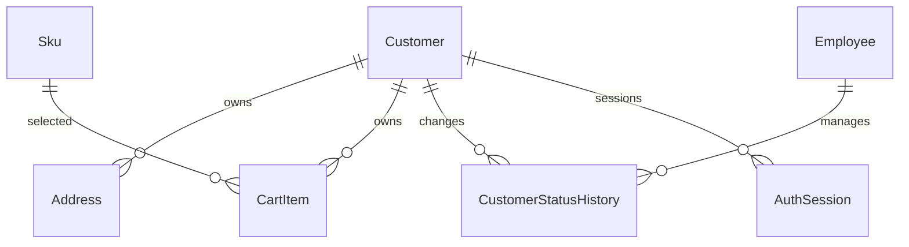

# 板块7：顾客资料、地址、购物车与账号限制开发文档

> 一致性审查：2026-11-10。跨板块约定、修订清单及未交付项见开发进度文档根目录《文档一致性审查记录.md》；本标记不代表软件已实现或测试通过。

| 项目 | 说明 |
|---|---|
| 所属里程碑 | M2：购买闭环 |
| 文档编号 | M2-07 |
| 编写日期 | 2026-11-10 |
| 前置依赖 | 板块2身份、板块3头像/文件、板块5商品/SKU、板块6真实库存；沿用板块1/4公共基础 |
| 对应需求 | FR-10～14、25、40～41、45～46、95、97～98；TD-06、10～15；AC-16～19、29相关部分 |
| 目标 | 顾客查询和账号限制可用；本人地址与购物车可用，具备并发/归属保护并衔接下单 |
| 状态 | 2026-11-14本期范围已实现、验收并部署；真实订单/支付/退款衔接按SW-L后续补验 |

## 1. 本板块开发范围

### 1.1 需要完成的功能

| 模块 | 要开发的内容 |
|---|---|
| 顾客后台 | 按手机号/昵称/状态/注册时间查找、分页、详情、完整地址簿、注册/最近登录时间 |
| 顾客账号管理 | 管理员限制交易、冻结登录、恢复正常；原因、状态历史、事务审计 |
| 顾客个人资料 | 复用已有昵称/头像/密码功能，补状态提示，不重复开发认证 |
| 地址簿 | 新增、编辑、删除、设默认、最多20条、最多1条默认、并发保护 |
| 购物车 | 登录后加入、同SKU合并、数量/勾选修改、删除/批量删除、实时失效/不足提示 |
| 权限与并发 | 本人归属、员工资料权限、冻结会话失效、原子合并、版本冲突 |
| 下单衔接 | 不占库存、选中清单不是报价、下单时按购买量扣购物车、不改旧订单地址 |
| 净消费 | 定义并实现聚合服务端口，订单模块接入后按完成/全额退款事实计算 |

### 1.2 本阶段不做

不提供真实下单/支付、订单地址直接修改、客服代替顾客付款、顾客密码后台查看/重置、短信验证、在线聊天。后台客服可以查询地址簿，但不能代替顾客任意修改地址；冻结顾客旧单代录售后在板块13接通。

没有真实订单时不提供假订单列表。后台顾客详情显示订单能力待接通；净消费返回availability=NOT_READY、amountCents=null，不把未实现聚合默认为0。板块8有真实Order后接入真实空集可返回0，板块10/12有完成/退款数据后复核完整口径。

本阶段可以演示：顾客注册登录→看真实可售商品→加入购物车→改数量/勾选→管理地址→客服查询顾客→管理员限制/冻结/恢复。不能据此宣称M2购买闭环已完成。

## 2. 前序衔接与权限边界

### 2.1 复用与新增

| 已有模块 | 本板块处理 |
|---|---|
| Customer、AuthSession、JWT | 复用主体和三状态，新增状态版本字段与状态历史，不建第二张User |
| /store/me、头像、改密、注销 | 沿用路径和规则，不通过本板块通用PATCH开放phone/status/passwordHash |
| customer.read | 客服/超级管理员查询完整资料和地址；仓储默认没有 |
| customer.status.manage | 超级管理员专属，不下放给普通员工 |
| 产品公开服务及InventoryBalance | 复用当前状态/售价/A/暂停新购校验，不读成本到购物车DTO |
| appendAudit、业务锁、requestId | 状态、地址、购物车关键成功写操作同事务写白名单审计 |
| OpenAPI/api-client/Axios | 增量生成、401/403/409沿用处理 |

新增0007_customer_status_addresses_cart迁移。客户phone仍不可通过资料PATCH修改，本期不做手机号更换/验证流程。

### 2.2 读取边界

- /store/**私有接口从认证主体取得customerId，不接受客户端指定其它customerId。
- 客服有customer.read可查询完整地址簿，但仅在相应后台API；不因此获得账号状态管理或库存/成本权限。
- 仓储在后续履约订单读取必要收货快照，不等于可以打开顾客管理和完整地址簿。
- 顾客不能查询其它顾客地址/购物车，统一404而非返回“存在但无权”。员工token也不能冒充顾客使用/store私有接口。
- 账号状态管理既检查管理员Guard，也在事务取得员工/顾客锁后再核验最新权限，审计失败状态和会话撤销一并回滚。

## 3. 顾客状态与资料规则

### 3.1 状态语义

| 状态 | 登录与旧token | 地址/资料/购物车 | 新下单 | 旧单支付/收货/售后 |
|---|---|---|---|---|
| NORMAL | 允许 | 允许本人操作 | 后续按商品库存等校验 | 按原单规则 |
| TRADE_RESTRICTED | 允许，不撤销原会话 | 允许；加购不等于下单 | 禁止首次新建订单 | 期限内有效旧单可支付，原流程仍可处理 |
| LOGIN_FROZEN | 新登录拒绝、旧token失效 | 顾客不能登录操作 | 禁止 | 不取消旧单；合资格客服核实代录按板块13规则 |

“限制交易只阻止新下单”不能扩大成禁止购物车/改昵称/地址，也不能替代订单安全关单。冻结不会自动关闭未付款订单或退款，定时任务仍按订单真实规则处理。

本板块采用一个明确状态枚举，不引入“冻结且限制”的隐藏叠加状态。恢复接口恢复NORMAL；若希望冻结后改为限制交易，管理员显式执行restrict-trade并保留历史。所有不同状态间转换允许管理员依规则执行，不能普通客服操作。

### 3.2 状态版本和会话

Customer新增status_version integer≥0，专用于后台状态变更的expectedVersion；昵称、地址、购物车变化不递增status_version，避免无关编辑制造管理冲突。

进入LOGIN_FROZEN：在顾客锁内status更改、status_version+1、token_version+1、撤销全部AuthSession、追加CustomerStatusHistory及审计。离开冻结不恢复任何旧会话；需要新登录。

NORMAL↔TRADE_RESTRICTED不递增token_version、不撤销会话；下一次请求读取实时状态。冻结改为TRADE_RESTRICTED也只允许新登录，原冻结前token继续失效。同状态、匹配版本的请求返回changed=false不重复撤销/造历史；旧expectedVersion仍409。

### 3.3 资料和累计净消费

后台列表：id、phoneMasked、nickname、status、statusVersion、createdAt、lastLoginAt。完整手机号/头像/地址在有customer.read的详情返回；不要把密码哈希、token_version、会话token或内部权限返回。

累计净消费=sum(当前主状态COMPLETED且未全额退款订单的成功实付)。未收货已支付不计，完成后全额退款扣回，取消/关闭不计；与累计支付销量/看板净收款不同。金额聚合SQL BIGINT，API使用十进制整数字符串。

接口端口CustomerConsumptionReader：未安装订单模块返回NOT_READY；安装后必须有真实查询器，不能留空实现永远0。比如完成实付9900与20000，另一已付未完成5000，则累计29900；9900那单完成后退款，变20000。

客户订单列表在板块8通过/admin/orders?customerId等授权入口接入；customer.read本身不能绕过order.service.read读取全部付款/退款资料。详情页可显示订单入口，但无相应权限时不展示订单敏感内容。

## 4. 地址簿设计

### 4.1 字段与输入

| 字段 | 规则 |
|---|---|
| receiver | 1～40字符、trim后非空 |
| phone | 3～30字符，允许数字、国际前缀及常见空格/连字符，统一规范化；不声称已验证号码 |
| province、city、district | 各1～50字符，必填；首期文本地区，不依赖外部行政区服务 |
| detail | 1～200字符，必填，不执行HTML |
| isDefault | 严格boolean，默认false |
| expectedVersion | 编辑/删除/设默认时必填当前地址版本 |

地区文本不是自动配送/运费区域规则，运费仍全店固定。每顾客最多20条，删除后可再新增。首条地址不隐式设默认，只有明确isDefault=true才设置；无默认时结算要求用户选择。

### 4.2 默认地址和并发

所有地址写命令先锁Customer父行，再检查count<20或当前地址版本。不能先count再无锁插入。默认地址用部分唯一索引UNIQUE(customer_id) WHERE is_default=true保证最多一条。

切换默认时同事务先清旧默认并递增旧行version，再设新默认并递增新行version；原本就是默认且版本匹配返回changed=false。更新某地址isDefault=false只清它自己，不自动给另一地址设默认。删除默认后允许没有默认，不随便挑一条代替。

设置默认或地址修改与后台冻结共用Customer锁：冻结先提交则后续本人写请求401；已合法先提交的地址修改保留，不回滚历史。

### 4.3 删除与历史订单

本期地址簿允许物理删除本人地址。后续订单以完整收货快照为权威，订单如留sourceAddressId必须可空并ON DELETE SET NULL，不能级联删除订单，也不能删除地址导致旧订单地址消失。

地址簿修改只影响未来选择，不回写旧订单。未付款改错地址取消重下；已付未交运按暂停/核实/退款重下；已交运线下协调，后续不能复用本地址PATCH偷偷改订单快照。

## 5. 购物车业务规则

### 5.1 行、数量和勾选

- 购物车必须登录，同顾客同SKU唯一；不同颜色/尺码是不同SKU，不能只按SPU合并。
- 每行quantity为1～99整数，加入时quantity表示新增件数；PATCH数量表示替换成指定总件数，语义必须在Swagger区分。
- 首次加入selected默认true，已存在行再加购保留原selected，不突然把用户取消勾选的项目选回来。
- 加购按当前商品ON_SALE、未归档、SKU启用未retired、有有效价、未暂停新购及合并后数量≤A校验；不合格409，不悄悄少加。
- 加购/改数量不留货、不写InventoryAction/Ledger，不减A、不增R；查询之后库存可能变化，建单再次验证。
- 当前库存不足/下架/停用的旧行仍保留显示失效，不自动删除；允许减少数量、取消勾选、删除。失效时不允许增加数量或从未选状态变为选中，避免当作可结算。
- 商品可售时改数量仍检查目标≤A；库存后来降到低于原数量时，向下调整但仍高于A可以保留为“仍不足”以便用户整理，不能结算；增加则拒绝。
- 同一请求新增两次不会自然被系统识别为一次：POST加购是增量写，本板块不宣称网络重试幂等。响应丢失先刷新购物车确认，不让Axios自动重试POST；并发不同合法加购必须正确累计。

### 5.2 实时投影与报价边界

CartItem不保存权威商品单价/库存；GET时批量联查当前商品/SKU/余额/主图。返回unitPriceCents、available、quantity、selected、validity、purchasable、lineAmountCents可空、version。

validity枚举VALID、PRODUCT_UNAVAILABLE、SKU_DISABLED、PRICE_UNAVAILABLE、OUT_OF_STOCK、STOCK_INSUFFICIENT、PURCHASE_BLOCKED；存在多项问题返回统一优先级和可读提示，不泄露损耗/成本原因。

选中失效行仍在列表并明确标阻止结算，不能静默跳过后用户误以为全部买到。后续结算预览必须对本次提交清单整体重新校验。

本板块不把购物车页小计叫“最终应付”：页面商品金额仅供展示，不含服务端运费/报价有效期。单行price×quantity用安全整数；总览有无效选中行时selectedSubtotalCents=null、canCheckout=false，并返回invalidSelectedCount，不能把缺价项当0。

### 5.3 版本、并发和后续扣减

CartItem.id是独立UUID，version用于修改/勾选/删除冲突；删除后重加同SKU产生新ID，旧id请求404，避免版本重新从0后误改新行。

顾客所有购物车写先锁Customer，然后按需商品→SKU/余额→CartItem，遵守TD-11。POST同SKU加购在父锁内读当前数量并条件累加，数据库联合唯一兜底；不能先读后无锁写造成丢数量。

批量勾选/删除最多100个本人的itemId（补充请求容量），拒绝重复ID，任意一项不属于本人整请求404并回滚；不自动忽略他人ID。批量勾选返回各行新version，调用方之后使用当前值。

板块8下单同事务从购物车扣购买数量：原5买2后留3，不整行删；并发加购新增数量不能丢。若当前数量已少于本次确认购买量，返回409 CART_CHANGED并要求重新确认（订单不得半建）。取消订单不自动把旧数量恢复购物车。

不能把本板块selected状态当下单授权；建单载荷固定SKU/数量/报价/地址和幂等键，服务端按本人归属校验。网络重试下单不生成新键。

## 6. 数据库设计

### 6.1 ER图与迁移



新增0007迁移，复用Customer/AuthSession/头像资产；不复制商品库存表。外键删除行为明确，既有账号/密码/头像不能被seed重置。

### 6.2 Customer扩展

| 字段 | 类型/约束 | 说明 |
|---|---|---|
| status_version | integer≥0 DEFAULT 0 | 仅状态管理递增 |
| 既有status | NORMAL/TRADE_RESTRICTED/LOGIN_FROZEN | 沿用板块2 |
| 既有token_version | integer≥0 | 冻结/改密使会话失效 |
| 既有avatar_asset_id等 | 既有FK | 本板块不重复添加 |

索引(status,created_at,id)、(created_at,id)；手机号UNIQUE继续支持精确查询。默认列表稳定createdAt降序/id。昵称模糊检索参数化，不能拼接SQL。

### 6.3 CustomerStatusHistory（customer_status_history）

id uuid PK；customer_id FK RESTRICT；from_status/to_status；from_version/to_version；reason varchar(500)必填；actor_employee_id FK RESTRICT；request_id；created_at。UNIQUE(customer_id,to_version)，CHECK from_status<>to_status且to_version=from_version+1。

同状态changed=false不造记录；状态历史和AuditLog同事务。历史不允许修改/删除。记录账号状态变化，不记录密码、全部地址、token或身份核实原件。

### 6.4 Address（address）

| 字段 | 类型/约束 | 说明 |
|---|---|---|
| id | uuid PK | 地址ID |
| customer_id | uuid FK Customer RESTRICT | 仅本人 |
| receiver | varchar(40)非空 | 姓名 |
| phone | varchar(30)非空 | 收货电话 |
| province、city、district | varchar(50)各非空 | 地区文本 |
| detail | varchar(200)非空 | 详细地址 |
| is_default | boolean DEFAULT false | 最多一个 |
| version | integer≥0 DEFAULT 0 | 修改/默认切换递增 |
| created_at、updated_at | timestamptz | 时间 |

索引(customer_id,is_default,created_at,id)，部分唯一(customer_id) WHERE is_default=true。20条上限是跨行不变量，父行锁内检查，不能声称单行CHECK保证。地址无任何订单状态字段，不能通过更新它改变订单。

### 6.5 CartItem（cart_item）

| 字段 | 类型/约束 | 说明 |
|---|---|---|
| id | uuid PK | 一次购物车行生命周期 |
| customer_id | uuid FK Customer RESTRICT | 所属顾客 |
| sku_id | uuid FK Sku RESTRICT | SKU历史实体保留 |
| quantity | integer CHECK 1～99 | 购物车当前数量 |
| selected | boolean DEFAULT true | 顾客勾选 |
| version | integer≥0 DEFAULT 0 | 每次有效变更递增 |
| created_at、updated_at | timestamptz | 时间 |

UNIQUE(customer_id,sku_id)，索引(customer_id,updated_at,id)。不存成本、权威销售价、可售量或预占库存。商品软下架不删除CartItem，查询时给失效提示。

本板块无CartReservedStock/购物车锁库存表，也无伪Order。无需为顾客地址操作建员工Task。

## 7. 事务、审计与一致性

### 7.1 锁顺序

管理员限制/冻结：员工主体（含操作者最新权限）→目标Customer→会话/状态历史/审计。顾客本人地址写：Customer→Address。购物车加购/改数量：Customer→Product→Sku/InventoryBalance→CartItem。删除/取消勾选无需商品锁可跳过，但不得持CartItem后再反向锁Customer。

顾客登录、冻结、改密共用Customer锁并在签发/执行前核验版本状态。冻结先提交的新请求401；购物车/地址命令先合法提交则保留事实，不因后续冻结撤销。后台读敏感资料在事务/查询入口读取最新员工权限；后续关键业务仍必须事务内重验。

### 7.2 审计字段白名单

状态管理记录旧/新状态、原因、statusVersion、实际员工；冻结同时撤销会话并审计。地址写可记录addressId、动作、changedFields、是否默认，不写完整姓名/电话/详细地址快照到技术日志或审计。

购物车记录SKU/quantity/selected变化，必要字段均为本人业务，不保存价格成本或全实体。顾客profile沿用板块2审计，不重复生成两条同语义成功记录。所有写操作如审计失败须回滚数据；普通读请求不为每张图片制造业务审计。

### 7.3 历史与统计

地址簿不是订单地址快照，CartItem不是订单行。订单来源地址FK使用SET NULL的设计在板块8加入，订单商品/收货/金额快照不回连当前字段展示历史。

累计净消费不做随付款递增的Customer余额字段，优先真实订单聚合；需要缓存时必须有一致性设计和重算途径，本期不提前引入。

## 8. API设计

以下省略/api/v1；鉴权、data/requestId外壳、400/401/403/404/409等沿用。JSON未声明字段拒绝；ISO UTC传输；新地址/新购物车行201，已有购物车行合并200，Swagger标两种成功响应。

### 8.1 后台顾客和状态API

| 方法/路径 | 权限 | 参数/返回 |
|---|---|---|
| GET /admin/customers | customer.read | page/pageSize、phone精确、nickname模糊、status、registeredFrom/To；列表字段见第3节 |
| GET /admin/customers/:id | customer.read | 顾客详情、statusVersion、头像/最近登录；无密码和会话原文 |
| GET /admin/customers/:id/addresses | customer.read | 本顾客当前地址簿最多20，无修改入口 |
| GET /admin/customers/:id/consumption | customer.read | availability、amountCents字符串或null、currency=CNY、asOf、definitionVersion |
| GET /admin/customers/:id/status-history | customer.read | 分页状态历史；不等于全店审计 |
| POST /admin/customers/:id/restrict-trade | customer.status.manage | expectedVersion、reason；目标TRADE_RESTRICTED |
| POST /admin/customers/:id/freeze-login | customer.status.manage | expectedVersion、reason；撤销全部会话 |
| POST /admin/customers/:id/restore | customer.status.manage | expectedVersion、reason；目标NORMAL |

时间筛选[from,to)半开区间，注册时间from<to；分页默认20最大100，reason 1～500字符。没有通用PATCH /customers/:id/status或后台改顾客密码的接口。

未安装订单模块消费响应示例：

```json
{
  "data":{
    "availability":"NOT_READY",
    "amountCents":null,
    "currency":"CNY",
    "asOf":"2026-11-10T02:00:00.000Z",
    "definitionVersion":"completed-unrefunded-v1"
  },
  "requestId":"4ee12e51-28a1-40bc-8b5c-f1a7cd16f52d"
}
```

安装真实查询器后availability=AVAILABLE、无满足订单返回amountCents="0"。如安装模块但查询失败返回503统计暂不可用，不伪装NOT_READY或0。

### 8.2 地址API

| 方法/路径 | 请求 | 说明 |
|---|---|---|
| GET /store/addresses | 无 | data.items为本人地址全部≤20，默认优先再createdAt/id；不是无限分页列表 |
| GET /store/addresses/:id | UUID | 仅本人，不属本人404 |
| POST /store/addresses | receiver/phone/province/city/district/detail/isDefault? | 锁Customer检查数量≤20，201 |
| PATCH /store/addresses/:id | 上述可编辑字段+expectedVersion | 至少一项实际业务字段；不可改customerId |
| POST /store/addresses/:id/set-default | expectedVersion | 原子清旧设新 |
| DELETE /store/addresses/:id | JSON {expectedVersion} | 本人删除，JSON data={deleted:true,id} |

DELETE body沿用前文约定，客户端/Swagger明确建模；若工程统一采用POST delete，需同步所有契约而非两套并存。删除/改默认后响应返回affectedAddresses[{id,version,isDefault}]（已删项单独列deletedId），便于前端更新；客户端仍可刷新完整地址簿。

地址示例（全部为虚构资料）：

```json
{
  "receiver":"演示收件人",
  "phone":"010-00000000",
  "province":"演示省",
  "city":"演示市",
  "district":"演示区",
  "detail":"开发环境虚构地址1号",
  "isDefault":true
}
```

### 8.3 购物车API

| 方法/路径 | 请求/查询 | 行为 |
|---|---|---|
| GET /store/cart | page/pageSize | 本人行分页，批量联查当前商品/库存，summary按本人整个购物车选中集合计算 |
| POST /store/cart/items | {skuId,quantity} | 新增件数，合并同SKU；新行201/已有200 |
| PATCH /store/cart/items/:id | {quantity?,selected?,expectedVersion} | quantity替换总件数；至少一个业务字段 |
| DELETE /store/cart/items/:id | {expectedVersion} | 删除本人指定行 |
| POST /store/cart/selection | {items:[{id,expectedVersion}],selected} | ≤100行批量勾选，全体合法才提交 |
| POST /store/cart/items/batch-delete | {items:[{id,expectedVersion}]} | ≤100行批量删除，全体合法才提交 |

POST合并示例：

```json
{"skuId":"8150119b-cf9a-4bbd-9b36-1702a39166a0","quantity":2}
```

修改示例：

```json
{"quantity":3,"selected":true,"expectedVersion":0}
```

selected=true对已失效行拒绝，selected=false始终允许本人合法整理；若请求同时减少到合法数量并勾选，按最终目标状态一起校验。

GET data={items,total,page,pageSize,summary}；summary至少totalItemCount、selectedItemCount、invalidSelectedCount、selectedSubtotalCents（整数字符串或null）、canCheckout。summary是当前商品金额展示，不包含运费，不是结算报价。若整个购物车没有选中行，subtotal="0"且canCheckout=false。

列表每行公开商品信息白名单，失效SKU仍可显示其历史名称/规格/主图以便识别，但不通过此接口开放当前草稿完整描述或成本；原商品/SKU软归档仍有实体可读。截图/日志不带顾客完整资料。

### 8.4 错误码

| HTTP/code | 场景 |
|---|---|---|
| 400 VALIDATION_FAILED | 未声明字段、数量非整数/1～99外、非法布尔、缺版本等 |
| 401既有TOKEN/SESSION/ACCOUNT码 | 无会话、冻结、登录域不符 |
| 403 FORBIDDEN | 员工无customer.read/状态管理权限 |
| 404 CUSTOMER_NOT_FOUND / ADDRESS_NOT_FOUND / CART_ITEM_NOT_FOUND | 不存在或私有归属不符 |
| 409 VERSION_CONFLICT | 状态/地址/购物车行版本过期 |
| 409 ADDRESS_LIMIT_REACHED | 已20条，不能继续新增 |
| 409 PRODUCT_UNAVAILABLE / SKU_UNAVAILABLE | 新加购商品下架/归档/停用等 |
| 409 PRICE_UNAVAILABLE / PURCHASE_BLOCKED | 缺有效价/暂停新购 |
| 409 CART_QUANTITY_LIMIT / STOCK_INSUFFICIENT | 合并后>99/增加数量超当前A |
| 409 CART_ITEM_INVALID | 试图选中失效项 |
| 409 CART_CHANGED | 后续建单购物车数量已改变，重新确认 |
| 503 CUSTOMER_CONSUMPTION_UNAVAILABLE | 真实统计查询器运行异常 |

TRADE_RESTRICTED的新建单拒绝码CUSTOMER_TRADE_RESTRICTED在板块8实现；本阶段不虚构下单API。冻结错误使用板块2统一账户不可用语义，不能泄露密码或身份核实证据。

## 9. 页面与交互要求

### 9.1 后台

顾客列表/详情显示注册/最近登录、状态、头像、地址簿、消费统计可用状态。客服只读资料；超级管理员可限制/冻结/恢复，弹窗明确影响及原因：限制只禁止新单、冻结使所有旧会话失效但不取消历史订单。

无customer.read的仓储不展示顾客管理菜单，直接API403；有订单履约权限时只能在订单详情看到该次收货信息。详情页净消费未接通显示“统计待接通”，不显示“已消费0元”掩盖缺失能力。

### 9.2 顾客端

地址列表/新增/编辑/删除/默认，展示20条计数；删除默认后无默认提示，不能默认拿第一条当已选地址。购物车按SKU展示图片规格单价/A/数量/勾选，失效提示和整理操作可用。

批量操作超过100项需前端分批且每批显示真实结果，不能声称所有购物车全体原子；单批内部全体原子。默认列表分页时summary针对整个车，勾选当前页与全部含义明确，不把只勾选当前页说成全选全部。

改数量防抖只做体验，提交携带最新version；409刷新并让用户确认，不用自动重发旧增量。加购响应丢失提示先查看购物车，不自动POST再加。网络错误/401/413等沿用公共处理。

限制交易用户显示新单限制说明，但仍可管理资料、地址和购物车。冻结后401清token回登录；提示联系公开服务电话，不能引导绕过冻结操作。

## 10. 建议开发顺序与命令落账

1. 核对Customer/会话/头像现状，新增statusVersion/状态历史迁移。
2. 实现后台顾客只读查询与字段投影，消费端口明确NOT_READY。
3. 实现三种状态命令及登录竞态/会话撤销回归。
4. 地址表、Customer锁、20条/默认唯一、归属及版本。
5. CartItem表、增量/替换语义、原子合并、实时投影及失效规则。
6. 前后台页面、商品详情加购入口（板块5原暂未开放入口现接通）。
7. OpenAPI和客户端生成，Swagger/真实数据库/端到端测试。
8. 登记板块8～12的订单快照、支付旧单、消费口径及冻结代录补验。

| 命令 | 数据变化 | 库存/订单变化 | 事务记录 |
|---|---|---|---|
| 限制交易/恢复 | Customer.status/statusVersion | 无；不取消旧单 | 状态历史+AuditLog |
| 冻结登录 | 状态/版本、tokenVersion、全部会话撤销 | 无自动关单/退款 | 状态历史+AuditLog |
| 地址新增修改/删除/默认 | 本人Address/版本 | 不改旧单快照 | 白名单审计 |
| 加购/改量/勾选/删除 | 本人CartItem/版本 | A/R不变，无库存流水 | 白名单审计 |
| 净消费查询 | 无写入 | 未来真实订单聚合 | 只读，不伪造余额 |

## 11. Swagger详细测试

### 11.1 准备

正式开发API http://localhost:3000/api/docs；顾客甲/乙、客服、仓储、管理员均可登录且员工已完成改密。通过板块6真实入账建立上架SKU A=10，另一个下架/停用SKU用于失效测试。

响应中的customerId/addressId/itemId/version都用实际结果，不直接复制示例UUID。每次Authorize切换身份核对请求Header，记录HTTP状态、requestId及必要数据库证据，不截图真实token/密码。

### SW-01：后台查询与字段权限

客服GET /admin/customers按甲手机号/昵称查找，分页total和注册时间筛选正确；详情含甲资料、地址、状态版本，不含哈希/会话。

仓储默认访问同接口403；顾客token访问/admin接口401登录域错误；客服访问restrict-trade/freeze/restore全部403。只给仓储order.fulfillment.read不能因此读取顾客完整地址簿。

### SW-02：新增、编辑、默认与删除

甲POST两条地址，第一isDefault=true，第二false；GET仅甲地址，默认优先。把第二set-default，第一自动false且version更新，数据库最多一条默认。

PATCH第二detail用当前version成功，旧version重复修改409；DELETE默认后剩余地址不自动设默认。重复GET验证没有默认是允许状态，不是假装第一条仍为默认。

### SW-03：20条与归属

甲创建到20条后第21条409 ADDRESS_LIMIT_REACHED；删一条再创建成功。乙GET/PATCH/DELETE甲地址均404，不能知道甲地址内容；请求里加customerId字段400。

并发突破上限和默认竞争不能靠手工串行证明，见IT-02。

### SW-04：购物车加入、合并和库存不变

甲POST同SKU quantity=2，再加quantity=3：同一itemId行最终5，而不是两行；A仍10/R不变，无InventoryAction/Ledger。

PATCH quantity=4表示总数4，不是再加4；取消selected后再次POST加1，最终5且仍selected=false。GET当前价格来自商品现值，不包含成本/R。

### SW-05：数量/状态与实时不足

quantity=0/100/小数、selected="false"字符串400；合并后>99返回CART_QUANTITY_LIMIT；库存10时尝试新增后总数11返回STOCK_INSUFFICIENT，不静默加到10。

保留行数量5后，按真实库存登记AVAILABLE_LOSS使A降为3，GET行显示STOCK_INSUFFICIENT/阻止结算但不删除。减至4可保留仍不足，减至3恢复有效。购物车修改不改A。

### SW-06：商品失效与勾选整理

仓储正常下架商品/停用SKU，甲已有购物车行仍可见失效。再次增量加购409、未选中行试图selected=true409；selected=false和删除允许。

选中行如果之后失效，GET summary.invalidSelectedCount>0、subtotal=null、canCheckout=false，不默默漏掉失效商品。恢复销售且库存足够后GET自动重新计算有效性，不靠前端本地改状态。

### SW-07：批量原子性与版本

甲准备两行，POST selection带各当前版本全选/取消，返回新version；一项旧version整批409且另一项不变。混入乙itemId或不存在ID整批404，不能删掉甲合法行后才报错。

DELETE后重新加入同SKU产生新itemId，旧ID PATCH404；重复ID/超过100项400。单项/批量删除均不增加库存。

### SW-08：限制交易不撤销会话

管理员GET甲statusVersion，POST restrict-trade填expectedVersion/reason。甲原token GET /store/me、地址、购物车仍200，能改昵称/地址/购物车；登录仍允许。

statusHistory含实际管理员、旧/新状态和原因，tokenVersion不变。新单拒绝与旧单支付在SW-L01验，不为本阶段增假接口。

### SW-09：冻结、恢复和全部旧会话

甲登录两次取A/B两个token；管理员freeze-login。两者读取本人资料/地址/购物车均401，新登录也拒绝；旧地址/购物车数据仍在，不触发库存变化。

管理员restore后甲新登录成功；A/B旧token仍401。再测冻结→restrict-trade，允许新登录但状态仍限制新单，旧冻结会话不复活。旧statusVersion管理请求409。

### SW-10：昵称头像回归与消费未接通

甲昵称、头像、旧密码验证改密沿用板块2/3，改密后全部旧会话失效；资料PATCH附status/phone/passwordHash400。

客服调用consumption：未安装订单模块明确NOT_READY/null，页面不装成0；后台地址只读，没有客服帮改地址入口。已安装真实订单模块时按实际返回AVAILABLE，不能强行保留NOT_READY绕过实现。

### SW-L01：下单、旧单支付、地址快照

板块8～9：限制交易用户不能首次建新单，但可期限内支付旧有效单；相同成功建单键重试即使后来被限制仍返回原单。冻结本人不能操作，系统定时关单仍按规则。

下单购物车5件买2留3；并发加购数量保留，取消不恢复旧购物车。旧订单收货快照不随地址簿编辑/删除/默认变化，错误地址按取消重下/退款重下处理。

### SW-L02：累计净消费与冻结旧单代录

板块10～12：完成9900+20000、未完成已付5000，净消费29900；9900完成后全额退款则20000。退款失败不提前扣净消费，统计金额字符串，可手算复核。

板块13冻结顾客由合资格客服核实身份代录原单售后/材料/物流，来源/经办留痕且不跳过期限、验收、退款；不因冻结丢失原单责任。

## 12. 自动化、数据库与端到端验证

### IT-01：状态事务和登录竞态

注入状态历史/审计/会话撤销失败，冻结事务全部回滚，旧状态/版本/会话保持原事实。同步屏障覆盖冻结先锁Customer与登录先通过密码校验后等待两种顺序，不能签发冻结后仍可用的旧会话。

NORMAL/TRADE_RESTRICTED变换不登出；离开冻结不复活旧sid；同状态无重复成功记录。管理员撤权与状态命令竞争按员工锁仲裁。

### IT-02：地址跨行约束

真实PostgreSQL16，不同连接并发创建：19条时两个请求最多一条成功，第21条拒绝，数据库最终≤20。父锁在读count之前实际取得；不能只因乐观版本偶然挡住就声称上限实现。

两个地址同时设默认最多一条；切默认使旧行version递增，旧页面编辑冲突。删除默认可无默认；乙猜ID任何读写404，无半变更。

### IT-03：购物车原子合并和版本

相同顾客SKU并发quantity=1多个请求，在库存/99边界内应累计正确且只有一行；超过A/99的请求明确失败，不能丢更新或超量。不同SKU不误合并。

PATCH同version仅一个有效更新；批量混合无权ID/旧version全部回滚；删除重建旧id不命中新行。响应丢失不自动重发增量POST，前端提示/刷新正确。

### IT-04：不预占与动态有效性

所有购物车操作前后A/R/InventoryAction/Ledger不变。商品价格改变、下架、停用、归档、A降低、purchaseBlocked改变后GET即时投影，不能依赖写入时缓存价格/库存。

选中失效项summary不可静默排除，分页summary范围覆盖全车，安全整数与BIGINT字符串处理正确。公开DTO不返回成本、R或私有图片。

### IT-05：数据归属、脱敏和审计回滚

顾客地址/购物车customerId均从session取得，伪造拒绝；员工不同权限边界、顾客冻结token、查询权限撤销生效。日志/AuditLog没有完整地址、手机号、密码/token。

地址/默认/购物车任一审计中途失败，所有行及version回滚。用户地址删除不影响已存在订单快照的真实FK/SET NULL测试在板块8补齐。

### IT-06：下单与统计端口契约

本阶段测试CustomerConsumptionReader未安装/已安装/查询失败三种分支；已安装必须注册真实实现，不能悄悄返回0。用测试专用查询器验证COMPLETED未退款口径和字符串类型，真实Order集成见SW-L02。

购物车扣购买量内部契约用同事务测试端口验证，生产未建单前不开放接口。后续订单命令必须锁同Customer并重验购物车数量，补真实并发加购/下单不丢数量的测试。

### IT-07：前端与完整工程

顾客注册登录→地址默认→真实商品加购/勾选/不足整理；客服查询、管理员限制/冻结/恢复；无权限隐藏按钮并直接API拒绝；409不自动覆盖，401清状态，统计NOT_READY正确呈现。

执行pnpm lint、pnpm typecheck、pnpm test、pnpm test:integration、pnpm build、pnpm openapi:export、pnpm api-client:generate，回归板块1～6。空库与旧库迁移均成功，容器重建账号/地址/购物车保留，前端dist无密钥。

## 13. Agent执行说明与衔接检查

### 13.1 可直接使用的任务

> 请实现开发顺序板块7。先阅读需求v2.0及板块1～7文档和当前仓库，复用Customer/AuthSession/头像、权限、商品库存查询与事务审计。完成顾客后台只读资料/地址/状态历史与管理员限制冻结恢复、本人地址20条及默认唯一、购物车同SKU合并/数量勾选/失效提示/批量原子操作。购物车不留货，限制交易只禁止新建单，冻结撤销全部会话不取消旧单；所有私有对象按本人归属查。订单尚未建立时消费端口明确NOT_READY而非伪0，不造假订单和支付接口。完成迁移、页面、Swagger、PostgreSQL并发/回滚和端到端测试，记录板块8～13补验，报告真实命令结果和未完成项。

### 13.2 开始实施前确认

- [x] 不重复注册登录/头像接口，不在通用PATCH开放手机号/状态/哈希。
- [x] customer.read与customer.status.manage分开，仓储履约信息不升级成完整顾客资料。
- [x] 状态version与tokenVersion用途分开，限制不登出、冻结恢复不复活旧会话。
- [x] 所有地址/购物车写先锁Customer，默认唯一/20条/同SKU合并有真实数据库保护。
- [x] quantity增加与替换语义明确，POST失败无自动重试，多余购买量不丢。
- [x] 失效选中行不静默过滤，页面小计不是结算最终应付。
- [x] 后续订单地址FK可空SET NULL、完整快照、购物车按量扣减已登记接入。
- [x] 净消费未实现明确NOT_READY；已装订单模块不允许用空查询器伪0。

## 14. 验收追踪和交付门槛

| 规则 | 关联需求 | 当前验证 | 后续补验 |
|---|---|---|---|
| 顾客资料与岗位边界 | FR-95、AC-19 | SW-01、10、IT-05 | 真实订单履约字段 |
| 限制/冻结/恢复 | FR-12～14、AC-17 | SW-08～09、IT-01 | SW-L01旧单支付、SW-L02代录 |
| 地址20条与默认唯一 | FR-41 | SW-02～03、IT-02 | 地址不改旧单快照 |
| 购物车不占库存、实时有效性 | FR-40 | SW-04～07、IT-03～04 | 板块8结算/建单再验 |
| 买多少扣多少、不误删新增加购 | FR-45 | IT-06端口 | SW-L01真实订单并发 |
| 净消费 | FR-95、AC-18 | SW-10、IT-06契约 | SW-L02完成/退款口径 |
| 事务、审计和最新权限 | TD-11、FR-97 | IT-01、05、07 | 其余敏感命令持续回归 |

### 14.1 交付清单

- [x] 0007迁移、状态版本/历史、Address默认部分唯一、CartItem联合唯一/数量约束。
- [x] 后台顾客查询与管理员状态命令，真实会话撤销/状态审计。
- [x] 本人地址、购物车及批量接口，稳定字段投影/版本和错误码。
- [x] 顾客地址/购物车/状态提示、后台资料与状态管理页面。
- [x] 净消费查询端口、模块注册检查及NOT_READY展示，后续补验清单。
- [x] OpenAPI/客户端/README与真实PostgreSQL测试数据。
- [x] docs/verification/M2-07.md：SW-01～10、IT-01～07逐项记录日期、环境、命令/响应、requestId、证据与复测；SW-L01～02待补验。

### 14.2 完成标准

本板块完成需要顾客后台/状态管理、地址和购物车真实可用；权限边界、冻结旧会话、默认唯一/20条、并发合并、失效提示、不占库存及事务审计测试通过；工程检查和前序回归通过。

M2尚需下一份合并文档“板块8＋9：报价、下单、模拟支付与关单”及板块10发货收货。不能因为顾客能加购、Agent已生成代码或本份文档完成就宣布购买闭环已完成。

## 15. 本轮实际交付（2026-11-14）

0007/后台顾客查询和状态、本人的地址与购物车、双端页面、内部扣减与消费端口已实现；105操作/103JSON调用器。756普通、1467数据库独立用例均有通过证据（全量失败后仅5套件85项定向复验，未再次全量重跑），工程及最终独占Docker专项7组115HTTP/通用尾项6组36HTTP通过。常用四服务已更新同组最终镜像，仅增量迁移。场景、失败处理、日期和退出码见[本轮验收](../../../docs/verification/M2-07.md)，使用与边界见[完成说明](../开发完成说明/板块7_开发完成说明.md)。

2153原行、旧迁移、配置和原账号保持；两款服装A96/R0、DB及上传卷保留。发现Docker卷缺一张原头像，仅从本机摘要一致的原件补齐该物理文件，没有改头像绑定。无新增成员，已有账号和密码保持不变；私有交付被Git/Docker排除。本轮未暂存/提交/推送或执行远程CI，交付后停止，不开始8＋9。
