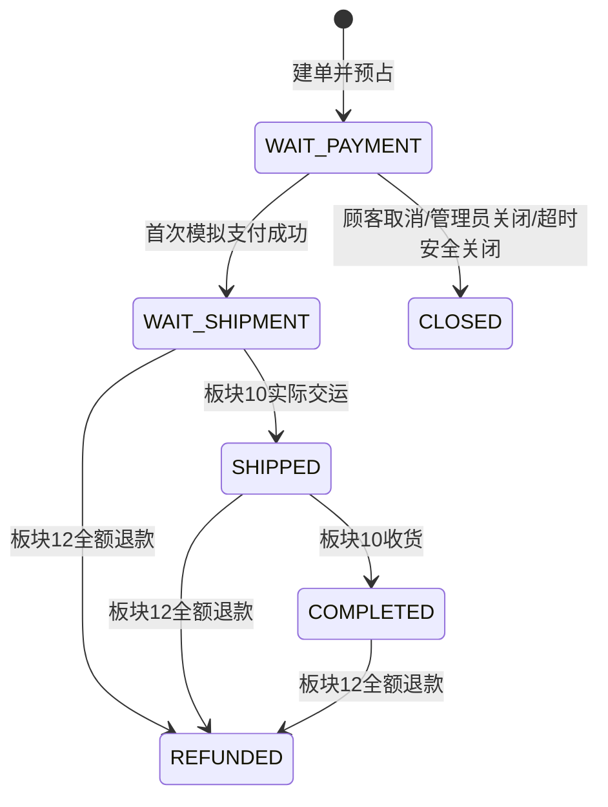
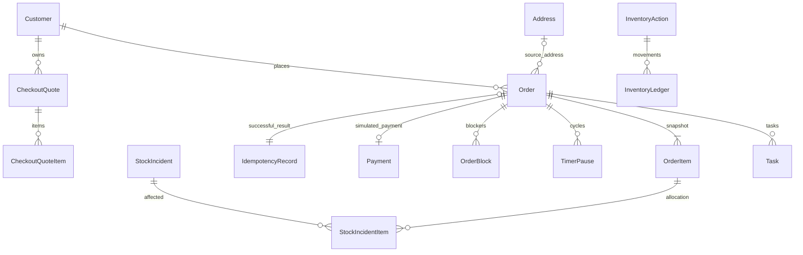

# 板块8＋9：报价、下单、模拟支付与关单开发文档

> 一致性审查：2026-11-10。跨板块约定、修订清单及未交付项见开发进度文档根目录《文档一致性审查记录.md》；本标记不代表软件已实现或测试通过。

| 项目 | 说明 |
|---|---|
| 所属里程碑 | M2：购买闭环 |
| 文档编号 | M2-08-09 |
| 编写日期 | 2026-11-10 |
| 对应开发板块 | 板块8报价/建单与板块9模拟支付/取消/超时关单，合为一份，分两阶段实施 |
| 依赖 | 板块1～7实际完成；复用库存事务命令、设置/期限/Task、顾客/购物车、文件/审计 |
| 需求依据 | FR-12、25、35、40～53、60、90～98；BR-01～05；TD-07、10～15；AC-05～07、16～17、20～21、23、27、29～30相关部分 |
| 目标 | 服务器报价→幂等建单占用→模拟支付扣R/取消安全释放，订单、账、任务和历史保持一致 |
| 文档性质 | 2026-11-14本期范围已验收并部署；实际证据见docs/verification/M2-08-09.md，SW-L01～02仍待后续 |

## 1. 合并原因、实施阶段与交付边界

两个板块共用订单、快照、库存占用和并发仲裁。合并后按以下顺序开发，不能跳过前阶段直接做支付按钮：

| 阶段 | 本次要实现 | 可演示结果 |
|---|---|---|
| A：原板块8 | 报价、订单/行快照、幂等记录、A/R预占、购物车按量扣减、订单查询、真实库存异常关联 | 顾客确认报价并生成唯一待付款订单 |
| B：原板块9 | 模拟支付、销量、发货任务、取消/管理员关单/超时、受损付款拦截与净释放、多实例扫描 | 一笔订单合法付款或关闭，库存不重复变化 |

阶段B完整通过前，不对外宣称支付可用；受损待付库存不是板块13才补的优化。板块13完善跨岗页面，不能作为省略支付保护的理由。

本次不实现发货、确认收货、售后/退款、真实支付网关、余额、短信或地址内改址。所有支付页面和确认结果写明“模拟交易，不发生真实资金流转”。订单状态模型预留后续值，但未实现动作不发布假成功接口。

## 2. 与前七板块的衔接

| 既有模块 | 本次必须如何复用 |
|---|---|
| Customer/状态/会话 | 每请求及关键事务内核验；限制只禁止首次新建订单；冻结拒绝旧token |
| Address | 建单固化完整快照；sourceAddressId可空FK，删除地址SET NULL，不回写订单 |
| CartItem | 以固定购买清单按量扣减，保留新增加购数量；取消不恢复购物车 |
| StoreSettingVersion | 报价读取现配置、建单快照运费规则与付款时限，旧单不受新设置影响 |
| InventoryBalance/Action/Ledger | 不另写余额逻辑；reserve/consume/close动作与订单同事务 |
| InventoryPurchaseBlock | 新购按有效SKU暂停校验；不因SKU暂停一律禁付所有旧订单 |
| Task与阶段轮次 | 支付成功新建SHIPMENT_PROCESS OPEN；取消关闭相关有效任务留历史 |
| FileAsset/FileReference | 订单图引用真实稳定图片并保留；读取旧单图片不依赖当前商品上架 |
| BusinessStateHistory/Communication/AuditLog | 状态变化及成功账务同事务；订单沟通真实适配器接通 |
| CustomerConsumptionReader | 注册真实订单聚合；无完成单可返回AVAILABLE/0，不再NOT_READY |
| Request指纹/OpenAPI/api-client | 使用命令白名单规范化，不用requestId作为幂等键 |

实际新增0008_orders_quotes_idempotency_blocks（10表）、0009_payments_stock_issues（6表）和0010_order_snapshot_file_reference。0010修正旧文件公开引用CHECK对ORDER_ITEM/snapshot的遗漏；0001～0007及已应用迁移均未改写。完整A/B文档是一份；本轮没有Git暂存、提交、推送或合并授权。

## 3. 金额、数量、时间和状态

### 3.1 统一边界

人民币单币种，所有单笔金额为整数分number；售价1～1000000、成本可空或0～1000000、运费0～1000000、包邮门槛0～100000000、订单应付≤100000000。订单1～100行，每行1～99整数，同SKU在一单只一行，输入重复SKU拒绝，不能靠重复行绕过数量上限。

商品总额=Σ当前确认单价×数量；运费按商品总额是否达门槛计算，不把成本或运费计入门槛。关闭包邮则固定运费；开启且门槛0全店包邮。所有乘加使用安全整数校验，SQL聚合BIGINT在API统计以字符串传输。

时间ISO UTC存储/传输，Asia/Shanghai显示；报价默认5分钟有效，付款默认30分钟以建单时设置快照为准，now≥截止即到期。报价不留货、付款期限不因页面刷新或异常跟进延长。

### 3.2 订单主状态及本次命令



售后中是附加筛选，不增一个订单主状态；履约阶段、OrderBlock、库存付款阻塞独立存储。WAIT_SHIPMENT不是订单最终终态。CLOSED不再支付/发货，REFUNDED也不重新支付；已有成功支付的重试仅返回支付事实与订单当前状态。

## 4. 报价与结算确认设计

### 4.1 本次支持的购买来源

首期下单从本人购物车确认，preview提交addressId与items[{cartItemId,skuId,quantity}]；数量可不超过当前购物车数量，不要求买掉整行。购物车selected只帮助前端选清单，不作为后端默认购买全部的依据。

不额外增加“匿名购买/直接购买”流程；将来需要直接购买应明确扩展sourceType和幂等指纹，不能现在接受任意他人购物车ID。

preview：核验身份/本人地址/行归属、商品/价格/A/暂停新购、数量和总额，读取设置生成CheckoutQuote，返回serverTime、expiresAt、商品金额、运费、合计、收货摘要、逐行说明。可序列化一致快照或短读事务确保同一报价内价格/设置一致，但不锁货。

### 4.2 建单重新确认什么

首次建单在锁内确认：

1. 本人NORMAL，TRADE_RESTRICTED拒绝首次新单，冻结认证已拒绝。
2. quote属于本人，载荷与quote确认清单一致且未到期。
3. Address仍属本人且内容/版本与报价一致，已修改/删除需重新选址及报价。
4. 商品ON_SALE未归档、SKU启用未retired、有有效价，库存A足够且无新购暂停。
5. 当前售价/运费结算结果与quote一致；价格任何方向变化均重新确认，不自动按较高或较低价完成。
6. 购物车当前数量足够本次购买量，cartItemId/SKU关系不变。新增加购导致quantity更大可按原购买量扣；被删/减到不足返回CART_CHANGED。

成本变化不要求顾客重新确认售价，但订单保存建单时最新成本；商品名称/介绍/图片一般更新不要求价格确认，快照使用锁内最新资料。地址内容变化属于ADDRESS_CHANGED，不能悄悄使用新地址。

设置新版本若只改服务电话，不把它当价格变化；比较实际参与运费的规则及金额摘要。付款期限在建单时取当前规则快照。批次中有效包邮规则改变，即使运费金额碰巧相同也返回PRICE_CHANGED要求确认新运费规则，避免规则快照不明。

### 4.3 报价冲突响应

QUOTE_EXPIRED、PRICE_CHANGED、ADDRESS_CHANGED返回409，details包含reason、需要确认的字段，以及可生成时的新quote完整预览。不满足库存/地址/账号资格时可以只返回明确问题及需重选项，不伪造可下单报价。

用户重新确认新quote后生成新的Idempotency-Key；不得Axios悄悄用新quote和原点击自动再下单。原报价失效不删除已成功订单的幂等结果。

## 5. 下单幂等与事务执行

### 5.1 请求键和指纹

POST /store/orders必填Idempotency-Key，16～128位ASCII字母、数字、连字符或下划线（[A-Za-z0-9_-]），推荐每次明确购买确认生成UUID。作用域(customerId,action=CREATE_ORDER,key)，不是全用户共享。

请求体为quoteId、addressId、items[{cartItemId,skuId,quantity}]。指纹包括命令版本/主体/上述语义字段；items按cartItemId+skuId作为集合稳定排序且拒绝重复SKU/重复cartItemId。排除Authorization、requestId、客户端展示金额及当前商品资料。

同key同指纹成功重放原orderId；同key不同quote/地址/数量409 IDEMPOTENCY_PAYLOAD_CONFLICT。成功记录随订单长期保留，不24小时过期复用。

### 5.2 正确的校验优先级

先认证、确认主体与请求结果/报价的归属，再查幂等记录。已有SUCCESS同指纹，验证resultOrder仍属当前顾客后直接返回原订单及当前状态；不再要求旧报价未过期、商品仍上架、顾客仍NORMAL或地址仍存在。

因此同键恢复原单时，原地址已删除也不能先查活地址再404；归属依靠已保存quote/customer/order关系验证。冻结/会话失效仍401，不能用幂等记录绕过登录。改用他人key也无法取结果。

只有无成功结果的首次执行，才做第4节实时资格/报价/库存校验。

### 5.3 单事务步骤与执行中竞争

1. 事务外先做DTO/签名/归属的安全预检与已提交成功记录查询。
2. 开事务，先锁Customer，复核会话并读取当前status；再次查同key，已成功走重放。此时不能在SUCCESS查询之前因TRADE_RESTRICTED拒绝；仅确认没有成功结果后才对首次新建执行交易状态限制，并插入PENDING幂等行。
3. 按商品ID→SKU/余额ID升序加锁，校验当前商品、数量及库存；本人地址/购物车在Customer锁保护下稳定。
4. 在领域附属锁阶段对StoreSettingHead读取当前指针并取共享锁，防止校验/提交之间设置被改；设置写者员工→Head且不再反向取商品/顾客锁。凡涉及其它附属/文件也约定稳定顺序并复核，不能先锁Head再反向补SKU。
5. 生成订单ID/单号，保存快照，调用reserveForOrder A−q/R+q；扣购物车购买量，写图片历史引用、状态历史、审计，标幂等SUCCESS/resultOrderId，提交。
6. 任一步失败整个事务回滚，包括PENDING行，不留下永久“正在处理”。

同一Customer父锁会串行化该顾客写命令；设置有界锁等待（例如2秒）。超时回滚后新事务查同key，已成功则重放；尚未可见返回409 REQUEST_IN_PROGRESS及Retry-After提示，前端沿用同key重试。禁止使用无限等待占满连接池。

同key唯一冲突应回滚后重读，不在PostgreSQL已abort的事务继续操作。命令事务不得网络调用支付/上传或等待人工。死锁/Serializable冲突最多3次整命令重试、沿用key；业务不足不重试。

### 5.4 失败与响应丢失

首次失败不永久占键，同载荷条件恢复后可重试；换quote/地址/数量属于新载荷，必须新键。成功提交但响应丢失，同键取回同单，即使旧quote过期/商品下架/顾客后来限制交易。

成功重放不再扣购物车、预占、写重复状态/销量/审计。客户端要保留购买确认周期的key和原请求体，刷新页面也能恢复该次请求；不在Axios每次调用时重建key，不在sessionStorage存密码。

## 6. 模拟支付、取消与超时关单

### 6.1 首次支付与重放

POST pay只接受orderId，不接受客户端amount/status/paidAt。锁Customer→Order→Product→SKU/库存，事务内校验当前会话归属，然后先查成功Payment：存在就返回原支付事实+订单当前状态，不再记账（即使现在REFUNDED）。

无成功Payment首次支付要求WAIT_PAYMENT、now<paymentDeadline、该订单没有库存付款阻塞、预占R仍有对应订单数量。普通商品下架/停用/归档、SKU新购暂停本身不拦旧单，必须检查订单受影响标记而非全SKU一刀切。

成功同事务：Payment唯一成功、订单WAIT_SHIPMENT、库存R−q（A不变）、各SPU paid_sales_count增加本单件数、状态历史/审计、SHIPMENT_PROCESS第1轮OPEN任务。初始履约阶段UNCLAIMED；发货任务存在不代表已经交运。

不生成外部网关回调、不模拟银行卡扣款；本阶段支付失败以校验/事务异常场景验证，不写一笔假成功Payment后再改失败。

### 6.2 顾客取消和管理员关闭

顾客本人cancel仅WAIT_PAYMENT；超级管理员close-unpaid需order.unpaid.close和reason，客服/仓储默认无权。已付款不能直接关闭，必须后续售后退款。

共用closeUnpaidCommand，SYSTEM超时使用同一内核但不同来源，不冒用员工。锁内仍WAIT_PAYMENT才关闭；已CLOSED同语义返回原关闭事实，已支付409 ORDER_NOT_UNPAID。成功不恢复购物车。

正常d=0释放A+q/R−q；受损已核实d按第7节净释放。取消、支付、超时竞争只允许一次离开WAIT_PAYMENT，不能先释放库存再发现订单已付款。

### 6.3 到期处理

首次pay检查now≥deadline即409 ORDER_PAYMENT_EXPIRED，即使扫描未运行。可尝试同次命令安全关单，但不得因核实未知强行释放；页面清楚说明已到期不可支付、等待关单/核实。

扫描每分钟分页所有WAIT_PAYMENT且deadline≤now，不仅看上次运行以来的新单；多实例靠订单锁、条件状态和库存动作唯一。受损不明不能关时记录超期待核实，其他单继续处理；恢复后补扫，原付款截止不延期。

读取GET订单不隐式写关闭或改变库存，支付校验拒绝与定时关闭各有明确日志/审计。人工操作与扫描抢同一订单，后取得锁者按最新事实重放或409，不重复扣/还库存。

## 7. 受损占用的真实落地

本节必须随阶段B实现，不只写待办文案。复用板块6库存动作和Task，新增真实订单行/损耗关联。

### 7.1 登记与候选锁

库存人员发现某SKU待付实物不足，系统读取受影响候选订单及Customer ID，在事务中先锁员工→涉及Customer按ID→候选Order按ID→Product→SKU/库存，再锁异常/任务。锁后重新查询候选/预占关系，变化则整事务回滚重试，不持SKU锁反向补订单。

已知影响范围可用证据指定本批候选，但服务端须验证全部声明数量和有效预占，不能信任任意orderItemId。未知影响范围先保守覆盖该SKU当前可能受影响未付订单；同一异常事实用稳定incidentKey防重复，不能换请求ID重复记损耗。

同一事务登记异常、暂停SKU新购、阻止候选未付订单付款/释放、生成仓储核实及必要管理员协调任务。候选持续变化导致3次冲突则返回可重试错误，不谎称已成功登记/已暂停；记录告警并要求重试核实，不用部分锁乱序硬提交。

### 7.2 已知/未知损耗

每个受影响OrderItem.q对应待付占用quantity；核实d≥0且≤q，多个有效异常归因的当前未补齐损耗合计≤q（已补齐的历史损耗不重复计入当前d）；unknownDamage=true时不能付款或释放。确认d时保存证据、核实人/时间/版本，记录d=0但仍待补货的阻塞不能凭数字0自动解开。

已知d且待付到期/顾客取消/管理员关闭：库存同事务deltaA=q−d、deltaR=−q，Ledger保留grossReleased=q/grossDamaged=d；关闭后结束该订单付款/释放阻塞、相关有效任务，SKU全局暂停只有实际整体核实解决才可解除，不因关一单清掉其它异常。

d未知时取消/超时返回ORDER_STOCK_CHECK_REQUIRED，订单保留WAIT_PAYMENT但已到期不能再付，任务显超期待核实；核实后关单补扫，不延长付款期限。核实/损耗事实可更新而不释放，不能先“正常释放”再人工损耗。

### 7.3 付款与异常竞争

异常先锁并提交：受影响pay返回ORDER_STOCK_BLOCKED；无关旧单仍可付。

支付先提交：原R已变订单备货，异常登记锁后按WAIT_SHIPMENT记录备货损耗/physicalVersion递增，不再扣A/R，并产生履约核实阻塞；不能把它塞回未付受损行再扣R。

取消先提交：该预占已释放，若实物损耗实际仍存在，核实应关联当前可售损耗登记或其它受影响订单，不能修改已关闭订单再次释放。系统和实物不可能由数据库自动感知，核实人须写明数量去向/处理路线。

### 7.4 补齐与解除

本期补齐统一采用“从已记账可售A重新分配给原订单”的路径：新增货先通过板块6真实来源/批次到货入账，也可使用现有A；不接受凭一句“货已到”直接把未知损耗改REPLENISHED。分配命令只替换原订单已核实损坏/缺失数量，不是新下单/新发货，不新增R。

内部allocateReplacement(tx, actor, incidentItem, quantity, commandKey)由库存异常服务调用，quantity为1～99且≤该行当前未补齐已确认损耗；同订单/SKU归属、原q、实物位置/证据及当前核实任务均在锁内验证。订单只能WAIT_PAYMENT或WAIT_SHIPMENT、真实未交且无未决交运。所有新实物先已计入A，分配以条件更新A−quantity、R不变，写InventoryAction/流水/StockReplenishment和来源历史，递增Order.stock_physical_version及相应订单行版本，失效旧打包/未交运售后核实；板块12接入真实失效/重核回调。SKU暂停新购不阻止本受控修复命令，但A不足仍拒绝，不能从其它订单R挪货。

StockReplenishment：id UUID PK、incident_item_id/order_item_id真实FK、quantity整数1～99、inventory_action_id UNIQUE真实FK、command_key UUID、fingerprint、actor_employee_id FK、goods_location、reason、created_at；UNIQUE(incident_item_id,command_key)。动作业务归属ORDER及现有orderId，actionKey=REPLACEMENT:{incidentItemId}:{commandKey}；先写动作再写分配行，同事务，原key/同载荷先重放，异载荷409。表随0009实际订单异常实现迁移；若已应用原迁移则新增递增迁移，不原地改历史SQL。

StockIncidentItem.damaged_quantity保留原核实损耗历史，不覆写成0；当前未补齐损耗=damaged_quantity−SUM(该行已提交StockReplenishment.quantity)，在共同Order/IncidentItem锁下保证0≤合计≤原损耗。已提交分配行不可修改/删除；更正原核实损耗不得低于已分配合计，不用改历史分配绕过余额。补齐后再次损坏登记新异常，防止把已替换的旧损耗重复计入当前d。unknown必须先核实，不能分配时猜0；未补齐仍CONFIRMED，全部补齐才REPLENISHED。OrderItem.damaged_reserved_quantity按当前未补齐合计派生，取消净释放用当前d；原损耗和替换分配各有历史，不能再次扣一次同一损耗。已付仅退款的s/d仍来自新的全行实物核实，不能复用补齐前check。

解除仅在当前核实结论有效、所有影响真实处理后执行；只解除自身来源。补齐不自动清SKU全局暂停、不自动继续发货或延长付款期限。原截止已到仍只能关闭不能付款；其它来源保留。

Swagger/IT补验：原A8/R2、q2/d1，从现有A分配1后A7/R2、当前d0，关闭后A9/R0；原key重复不再−A。若先到货1则先A9/R2、分配后A8/R2，关闭后A10/R0。补齐与付款/关闭/退款竞争按锁顺序只有合法结果，不让同一件货既在A又用于备货。

## 8. 数据库表设计

### 8.1 ER图



Task、InventoryAction与业务ID的物理FK应结合现有多态设计和领域解析器落实，不把图中逻辑关系误当数据库已有FK。新增Order真实解析器后，库存/任务/沟通/文件适配器不再走测试空实现。

### 8.2 CheckoutQuote / CheckoutQuoteItem

| 表/字段 | 类型和约束 | 说明 |
|---|---|---|
| checkout_quote.id、customer_id | uuid PK/FK | 归属 |
| address_id_snapshot、address_version | uuid值、integer | 报价时地址身份；不依赖删除后仍有活地址 |
| address_snapshot | jsonb白名单 | 收货资料，只有本人/授权员工可读，日志不记全文 |
| setting_version_id | uuid FK | 报价引用版本 |
| pricing_rule_snapshot | jsonb | 运费相关字段及算法版本 |
| goods_amount_cents、shipping_fee_cents、payable_cents | integer有界非负 | payable=goods+shipping，≤100000000 |
| created_at、expires_at | timestamptz | 默认5分钟，expires>created |
| quote_item | id、quote_id FK、cart_item_id_snapshot、sku_id FK、quantity 1～99、unit_price_cents 1～1000000、line_amount_cents | UNIQUE(quote_id,sku_id)，数量/金额一致 |

报价可过期但成功订单引用的quote不删除；未使用报价按保留策略清理，不删成功幂等恢复所需归属事实。报价不存成本到公开DTO、不预留库存；cartItemId使用身份快照不建删除受阻FK。

### 8.3 Order（order）

| 字段 | 类型/约束 | 说明 |
|---|---|---|
| id、number | uuid PK、varchar(64) UNIQUE | 外显编号不泄露顾客手机号 |
| customer_id | uuid FK RESTRICT | 归属 |
| quote_id | uuid FK | 建单依据，成功快照仍独立保存 |
| source_address_id | uuid可空FK ON DELETE SET NULL | 只追溯，不用其现值展示旧单 |
| status | WAIT_PAYMENT/WAIT_SHIPMENT/SHIPPED/COMPLETED/CLOSED/REFUNDED | 主状态 |
| fulfillment_stage | UNCLAIMED/PREPARING/READY/HANDOVER_IN_PROGRESS/HANDOVER_UNCERTAIN/SHIPPED | 现在初始UNCLAIMED |
| goods_amount_cents、shipping_fee_cents、payable_cents | INTEGER CHECK边界 | 单笔金额number分 |
| receiver/phone/province/city/district/detail | 有界文本 | 不可变收货快照 |
| shipping_rule_snapshot、payment_rule_snapshot | jsonb | 配置版本、规则、时间单位 |
| setting_version_id | uuid FK | 建单配置 |
| created_at、payment_deadline、paid_at、closed_at | timestamptz，后两者可空 | 时间事实 |
| close_reason_code、close_reason、closed_by_type/id | 白名单/文本/主体 | 客户取消、管理员、超时 |
| payment_blocked、release_blocked | boolean DEFAULT false | 有效订单行库存异常的派生缓存 |
| stock_physical_version | integer≥0 DEFAULT 0 | 备货实物版本；损耗/移动/更正递增 |
| version | integer≥0 DEFAULT 0 | 订单敏感写并发版本 |
| actual_handover_at、auto_receipt_due_at、completed_at、after_sale_deadline | timestamptz可空 | 板块10起真实填充，不能现在虚填 |

CHECK应付=商品+运费及界限、付款截止>创建；状态与必需时间字段服务/数据库约束保持一致。索引(customer_id,created_at,id)、(status,payment_deadline,id)、number、(payment_blocked,status)。不提供修改快照API。

### 8.4 OrderItem（order_item）

id uuid PK、order_id FK RESTRICT、sku_id FK RESTRICT、product_id FK、product_name_snapshot、product_code_snapshot、sku_code_snapshot、spec_snapshot jsonb（维/值文字及ID）、image_asset_id可空FK、unit_price_cents、unit_cost_cents可空、quantity 1～99、line_amount_cents。

另加damaged_reserved_quantity integer≥0 DEFAULT 0、damage_unknown boolean DEFAULT false、physical_version≥0 DEFAULT 0；CHECK damaged≤quantity。每订单sku唯一、line_amount=price×quantity，所有单价/成本限制同需求。

损耗字段是未付异常的派生汇总；原损耗核实和次数由StockIncidentItem保留，不直接让客户端写入字段。成本只在product.cost.read授权DTO出现；顾客和客服默认不返回。

### 8.5 IdempotencyRecord（idempotency_record）

id uuid PK、customer_id FK、action_code固定CREATE_ORDER、key varchar(128)、fingerprint char(64)、status PENDING/SUCCESS、result_order_id uuid可空UNIQUE FK、created_at/completed_at。

UNIQUE(customer_id,action_code,key)。CHECK SUCCESS时orderId/completedAt非空，PENDING为空。PENDING仅存在未提交命令事务，正常失败整个回滚；禁止在业务执行前单独提交PENDING。成功不可删除/复用；订单归属与记录一致由同事务验证。

结果引用原订单而非保存整个包含私密资料的响应。重放当前授权DTO，既能看到原单也能知道它后来已支付/关闭/退款。建单时写入FileReference新owner_type=ORDER_ITEM的真实引用，并使用OrderItem.image_asset_id外键补强，沿用旧商品图已公开属性；板块3用途/ownerType白名单须通过本次版本化代码扩展，不允许通用客户端任意指定。任何异常已提交PENDING视实现缺陷需定位，不用定时删除来掩盖半提交。

### 8.6 Payment（payment）

id uuid PK、number UNIQUE、order_id uuid UNIQUE FK RESTRICT、amount_cents integer有界>0、status固定SUCCEEDED（首期只存成功事实）、method固定SIMULATED、currency char(3)固定CNY（CHECK）、paid_at、actor_customer_id FK、request_id。

payment.amount_cents=order.payable_cents由事务内校验；paidAt服务器生成。失败验证/回滚不写成功Payment。单订单一笔成功支付，退款以后仍保留，不删除Payment再重复支付。聚合按paidAt统计，Product.paid_sales_count BIGINT增加订单各行件数。

### 8.7 OrderBlock / TimerPause真实表

OrderBlock：id uuid PK、order_id FK、type（沿用需求五类）、source_type、source_id uuid、active、blocks_shipment/blocks_receipt boolean、created_at/released_at、release_command_key、version。有效(order_id,type,source_type,source_id)部分唯一，来源所属领域必须真验证。

库存付款/释放阻塞使用StockIncidentItem事实，不能单凭blocks_receipt推断pay被阻止。OrderBlock只描述履约/收货阻塞，避免一个万能blocked混淆所有动作。

TimerPause：id、order_id FK、cycle_no>0、status ACTIVE/RESUMED/TERMINATED、paused_at、remaining_ms BIGINT≥0、base_due_at、resumed_at/new_due_at、end_reason；(order_id,cycle_no)唯一、每订单最多一个ACTIVE。与OrderBlock来源的周期关联可另建TimerPauseBlock复合唯一表；最后解除时调用板块4规则。

本阶段建真实FK并替换内核测试端口，WAIT_PAYMENT/WAIT_SHIPMENT不启动收货计时；不能因库存异常先伪造actual_handover_at。板块10交运/11售后再完成真实收货暂停流程。

### 8.8 StockIncident / StockIncidentItem

| 表 | 字段和约束 | 作用 |
|---|---|---|
| stock_incident | id uuid PK、incident_key varchar(128) UNIQUE、sku_id FK、status OPEN/RESOLVED、reason、evidence_note、created_by_id FK、version、created_at/resolved_at | 一次实际异常事实，图片用私有凭证 |
| stock_incident_item | id uuid PK、incident_id FK、order_item_id FK、allocation_type RESERVED/PAID_PREPARATION、quantity_affected 1～99、damaged_quantity可空0～quantity_affected、verification_state UNKNOWN/CONFIRMED/REPLENISHED/SETTLED、version、verified_by_id/at | 真实受影响行、未知与核实历史 |
| 唯一/汇总 | UNIQUE(incident_id,order_item_id)；同OrderItem当前未补齐损耗合计≤购买量，由订单/行锁内校验；历史损耗累计可因补齐后再次受损而超过q | 同异常重试不重复分配 |

保留StockIncidentHistory追加核实/损耗/补齐/关闭结算记录：id、incident/item FK、action、before/after白名单、actor、reason、command_key、request_id、created_at，唯一(item_id,action,command_key)。actual evidence不能自动识别同物理件重复报告，incidentKey和人员核实/审计共同防重复，不能靠换键任意造d。

InventoryPurchaseBlock新增真实StockIncident关联适配器；Task增加ADMIN_STOCK_REVIEW固定阶段，候选task.transfer用于管理员协调，实际关单还要求order.unpaid.close。PHYSICAL_VERIFY/STOCK_EXCEPTION_VERIFY及CUSTOMER_CONTACT按各自权限创建，默认无新增SLA。同一ORDER同stage仍只允许一个有效Task；多个异常来源使用板块4定义、在本板块0008迁移实际创建的TaskBusinessSource（task_id、source_type、source_id联合唯一，含ACTIVE/RESOLVED/CANCELLED状态及结束时间/动作键）关联同轮核实任务，不为每个incident重复生成同stage有效任务。完成核实/结束任务前须确认该任务所关联的所有有效来源均已处理，不能解决一项就取消另一项跟进。超期未知为管理员跟进事件，不重开付款期限。

## 9. 字段授权与订单查询

| 查看者 | 允许内容 | 默认不允许 |
|---|---|---|
| 本单顾客 | 商品/金额/收货快照、支付事实、公开状态历史、后续本人运单/售后 | 成本、员工个人信息、内部沟通/库存差异/内部附件 |
| 客服order.service.read | 服务订单、付款/后续退款、授权顾客及沟通资料 | 默认成本、商品库存编辑、手动关单 |
| 仓储order.fulfillment.read | 履约清单、必要收货快照、付款已完成标记、暂停/实物任务 | 顾客完整地址簿、客服内部备注、退款审核 |
| 管理员 | 授权范围全部业务 | 仍不能绕过状态/经办/实物规则 |

/admin/orders按viewer权限联合可见范围筛选；不同DTO投影，不先拿完整实体返回后由前端隐藏。列表分页禁止每行查SKU/顾客/支付N+1；电话/收货人搜索只在有对应业务查询资格时使用。

接通板块3订单Communication及公开说明查询：客服写仍需communication.service.write及领域允许条件，纠正追加历史。未付款/已关闭单也可记录服务事实，不借沟通文字改变支付/库存。售后scope仍等板块11，不返回假数据。

接通CustomerConsumptionReader：真实查询Order.status=COMPLETED且未全额退款（本期REFUNDED主状态即可排除），当前尚无完成命令则真实0。后续Payment/Refund事实增加时不改变口径，不把未收货支付额算消费。

## 10. API设计

路径省略/api/v1；公开health和Swagger不变。Bearer认证、requestId、错误外壳沿用。所有写命令禁止client传操作者、amount、status、deadline和库存delta。

### 10.1 顾客结算、订单和支付

| 方法/路径 | 输入/查询 | 成功data |
|---|---|---|
| POST /store/checkout/preview | addressId、items[{cartItemId,skuId,quantity}] | 201 quoteId、expiresAt、serverTime、地址摘要、明细、金额/规则 |
| POST /store/orders | Idempotency-Key头+同确认载荷含quoteId | 首次201，成功重放200：orderId/number/status、金额、deadline、replayed |
| GET /store/orders | status、afterSaleOnly、page/pageSize | 本人订单列表；售后未接入时afterSaleOnly无匹配而非假售后 |
| GET /store/orders/:id | UUID | 本人详情、serverTime、付款截止、allowedActions |
| POST /store/orders/:id/pay | 无体或{} | paymentId/number、amountCents、paidAt、orderStatus、replayed |
| POST /store/orders/:id/cancel | reason可选≤500 | orderStatus=CLOSED、closedAt、closeReasonCode、replayed |

支付/取消按最新状态串行仲裁，不要求前端expectedVersion来替代原子状态条件；旧页面点击支付仍须服务端校验期限和付款阻塞。取消原因缺省USER_CANCELLED；顾客不能把管理员/系统关单来源作为参数。

建单请求示例：

```json
{
  "quoteId":"6b019abd-5ef7-4520-a994-0811fe344b6e",
  "addressId":"40361aef-a2f4-46cd-a829-8eaac9cab803",
  "items":[{
    "cartItemId":"3dac5ee1-d874-4abc-a385-f558b029c8dc",
    "skuId":"8150119b-cf9a-4bbd-9b36-1702a39166a0",
    "quantity":2
  }]
}
```

Swagger中Idempotency-Key填例如7a53b230-a04c-40e2-867c-66d3e7ba7e4c，实际每个购买确认周期独立保存。preview用同体去掉quoteId。

### 10.2 后台订单与库存异常

| 方法/路径 | 权限/请求 | 行为 |
|---|---|---|
| GET /admin/orders | order.service.read或order.fulfillment.read；number/customerId/收货关键词/status/from/to/page | 权限裁剪的列表 |
| GET /admin/orders/:id | 对应查询权限 | 快照/当前业务/任务/历史，成本单独判定 |
| POST /admin/orders/:id/close-unpaid | order.unpaid.close；expectedVersion、reason | 当前未付安全关单 |
| POST /admin/inventory/stock-incidents | inventory.order-exception.manage；incidentKey、skuId、候选行/损耗可空、reason、evidenceNote/图片 | 原子登记真实异常、暂停新购及订单阻塞；service端复核范围 |
| POST /admin/inventory/stock-incidents/:id/verify | 同上且当前核实任务经办；expectedVersion、items[{orderItemId,damagedQuantity,conclusion}]、reason/证据 | 核实未知、保留版本历史；conclusion只确认实物结论，不能仅标REPLENISHED代替真实分配；补齐走replenishments命令 |
| POST /admin/inventory/stock-incidents/:id/replenishments | inventory.order-exception.manage及当前ORDER/STOCK_EXCEPTION_VERIFY经办；orderItemId、quantity、goodsLocation、expectedIncidentVersion、expectedOrderVersion、expectedPhysicalVersion、expectedTaskVersion、commandKey、reason/证据 | 单请求只分配一个订单行，从A重新分配，R不变；返回分配ID/动作/当前未补齐量/新版本，不自动resolve |
| POST /admin/inventory/stock-incidents/:id/resolve | 同上且经办；expectedVersion、reason/证据 | 仅所有影响真实处理后解除此来源暂停/阻塞 |

StockIncident记录同incidentKey同载荷重试返回原记录，异载荷409；verify/resolve通过expectedVersion+核实语义键防重复，接口DTO须带commandKey（UUID）、expectedTaskVersion并记录结果，旧version但已成功同commandKey可重放。订单已变成付款/关闭的行，核实服务重新分流，不允许客户端强行标RESERVED。

接通板块3/admin/communications和/store/orders/:id/communications真实ORDER适配器与字段投影，路径/请求体沿用板块3。未实现发货/退款不发布调用即成功按钮。

### 10.3 主要错误码

| HTTP/code | 场景 |
|---|---|
| 400 VALIDATION_FAILED / ORDER_AMOUNT_LIMIT | 数量/单行/订单行数/金额界限或未知字段 |
| 401既有认证码，403 FORBIDDEN | 会话/主体/员工权限不符 |
| 404 ORDER_NOT_FOUND / QUOTE_NOT_FOUND / ADDRESS_NOT_FOUND | 不存在或不属当前顾客 |
| 409 CUSTOMER_TRADE_RESTRICTED | 首次新建单禁止 |
| 409 QUOTE_EXPIRED / PRICE_CHANGED / ADDRESS_CHANGED | 需重新预览确认 |
| 409 CART_CHANGED / STOCK_INSUFFICIENT / PRODUCT_UNAVAILABLE | 当前购买清单无法成立 |
| 409 PURCHASE_BLOCKED | SKU暂停新购，首次建单拒绝 |
| 409 IDEMPOTENCY_PAYLOAD_CONFLICT / REQUEST_IN_PROGRESS | 同键不同语义/事务竞争处理中 |
| 409 ORDER_PAYMENT_EXPIRED / ORDER_NOT_PAYABLE / ORDER_NOT_UNPAID | 超期/主状态不允许 |
| 409 ORDER_STOCK_BLOCKED / ORDER_STOCK_CHECK_REQUIRED | 受影响单付款阻塞/无法安全释放 |
| 409 STOCK_INCIDENT_CONFLICT / PHYSICAL_CHECK_STALE | 同异常事实冲突/核实版本失效 |
| 409 VERSION_CONFLICT | 管理/核实页面过期 |

已成功支付/建单重放优先按事实返回，不因后续状态改变返回一次新的失败操作；但读取身份/归属校验始终在前。错误details不暴露别人的订单号或内部SQL。

## 11. 定时扫描、恢复与前端

### 11.1 关闭调度

复用SchedulerRun/Failure，job=order-payment-timeout，批量建议100条，按deadline/id稳定扫描。读取候选后逐单按Customer→Order→Product→库存锁，不先FOR UPDATE SKIP LOCKED订单再反取Customer。

不明损耗单反复扫描只保留一个当前有效管理员跟进任务/一次对应截止逾期事件；防最前100条阻塞后续，用分页游标/区分已确认无法处理项继续扫描。核实变化后应进入补扫候选，不能永久排除。

单单失败回滚其订单/账，诊断失败另记，后续订单继续。重启补扫全部过期未付；多实例/重试不重复关闭/释放。未知受损的不安全释放不是“扫描成功”，报告待核实数量。

### 11.2 前端

结算页：从购物车确认清单与本人地址发preview，显示服务器商品金额/运费/合计和模拟说明。价格/地址变化展示新预览，要求用户重新确认并换新key；不自动按新价下单。

提交期间禁重复点击，保留key+原载荷；网络失败提示“确认订单结果”，用同key恢复，不直接再买一次。409 REQUEST_IN_PROGRESS按Retry-After沿用原请求重试，有界次数后让用户刷新查询。

支付页：从服务器金额与截止显示倒计时，时间校准serverTime；倒计时归零禁按钮但服务端仍权威。显示付款受损阻塞和客服联系方式，不承诺延长付款。模拟成功后刷新订单，订单查询状态是事实，不在本地先改WAIT_SHIPMENT。

本人订单列表/详情/取消/继续支付；后台查询按权限字段；已付款显示待发货但当前无发货动作，等板块10。库存异常页最小可用：受影响行、未知/已知d、核实经办/证据、后续任务；不只藏在数据库。

## 12. 推荐开发步骤

1. 落0008表/约束，真实地址/购物车/库存/设置/图片适配器，状态模型与权限DTO。
2. preview与金额规则，测试不占库存、报价边界及快照。
3. 幂等事务与唯一结果、预占/按量扣车/状态历史/审计。
4. 订单查询/沟通/消费真实端口，结算与待付款页面。
5. 落0009 Payment/真实受损关联，完成StockIncident核实与阻塞；不是先上线无保护支付。
6. 支付与销量/任务同事务，取消与管理员安全关单。
7. 超时扫描、未知损耗跟进/补扫，完整异常页面基础。
8. 并发/回滚/重启/字段/真实端到端，前序补验和工程检查。

## 13. Swagger详细测试

### 13.1 数据准备

正式API http://localhost:3000/api/docs；顾客甲/乙、管理员、客服、仓储均有效。通过板块6真实入账建立SKU A=10/R=0，上架、售价9900；设置运费/门槛已知，顾客甲两条地址与购物车数量5。

每个场景使用独立新订单/来源/sku避免前场景库存混淆，或通过合法登记恢复，不在演示库SQL强改余额。短报价/付款期限和失败注入仅测试环境，可注入Clock用于自动化，Swagger场景记录实际时间。

### SW-01：服务器预览、运费与不占货

甲preview买2，金额19800；按当前门槛核对运费/合计。数据库A仍10/R0、购物车仍5。传amount/payable等未声明字段400。

分别测试未达门槛、刚好等于门槛、关闭包邮、门槛0。输出金额整数分、quoteId/expiresAt/serverTime正确，没有成本/R。

### SW-02：首次建单与同键重放

将preview结果填建单，固定Idempotency-Key=K1。首次201，WAIT_PAYMENT，A8/R2、车留3，地址/商品/金额快照完整。

同key同体再Execute返回200 replayed=true、同orderId，A/R/车/状态历史不再变。改quantity/quoteId但沿用K1返回409 IDEMPOTENCY_PAYLOAD_CONFLICT。

### SW-03：响应丢失后的优先恢复

保留K1原体，商品下架、原报价过期、管理员把甲限制交易，并删除原地址（各子场景可独立验证）。用甲仍有效token同K1重放，仍返回原单，不重新查活地址导致失败。

新key首次新单则因限制/下架/报价失效按规则拒绝。冻结甲后重放也401，不绕过会话；恢复新登录后同K1仍可取原订单。

### SW-04：报价变化和用户重确认

独立报价后管理员改SKU售价或运费规则，再提交旧quote新key，409 PRICE_CHANGED，A/R/购物车不变。地址内容改了返回ADDRESS_CHANGED；到期QUOTE_EXPIRED。

按新预览明确确认→新key建单，按新金额成功。库存不足返回STOCK_INSUFFICIENT，不生成少件订单；多SKU一行不足整单失败。

### SW-05：账号、对象归属与字段

乙访问甲quote/order/地址/购物车组合均404或明确购物车归属错误，不能读快照；员工token/store接口401登录域错误。客服后台能看服务订单但无成本，仓储只看履约所需，不暴露完整顾客地址簿或客服内部备注。

伪造status/paidAt/deltaA/actorId/amount400。仅cost权限合法时才有后台成本字段，顾客JSON完全没有。

### SW-06：模拟支付和重复事实

甲对未过期订单pay，无金额参数。预期200、唯一Payment=应付、订单WAIT_SHIPMENT，A仍8/R0，商品paidSalesCount增加2，SHIPMENT_PROCESS OPEN任务仅一条。

再pay返回原paymentId/paidAt及当前orderStatus，不再扣R/加销量/建任务。商品普通下架/停用后对另一个有效旧单支付仍成功；受损阻塞单另测不能付。

### SW-07：取消与管理员关单

独立订单买2占用后甲cancel，A恢复/R释放，CLOSED；再次同单cancel不重复还库存，车不自动加回。已付款cancel409 ORDER_NOT_UNPAID。

客服/仓储close-unpaid403；管理员填写reason与expectedVersion安全关闭未付单，实际操作者及原因留痕，不把已付订单直接关掉。

### SW-08：付款截止与超时恢复

短付款期限测试单now≥deadline时pay409，即使调度暂停仍不能付。恢复扫描安全关闭，A/R释放一次；进程停机跨到期后启动补扫。

反复扫描同单不新增关闭流水；多个实例真实并发见IT-04，不凭等待一次页面刷新证明多实例正确。

### SW-09：快照和购物车按量扣减

建单后改商品名/价格/图片/运费/地址簿、删除原地址，旧订单仍原商品/金额/地址。订单图片仍可读取。

车5买2留3；quote后另加2，则下单扣2后留5，不整行删；若先把车减到1而仍买2，409 CART_CHANGED且无占用。取消不恢复购物车。并发线性化结果见IT-03。

### SW-10：已知受损付款拦截与净释放

独立SKU10买2→A8/R2；仓储创建实际异常，核实本单d=1，登记后SKU新购暂停、受影响pay返回ORDER_STOCK_BLOCKED。

顾客取消或管理员关单，A=9/R0，Ledger显示q2/d1净+1；同单重复取消不再回补，坏货不重新可售。另一个同SKU但已确认无关的旧单可付，不以全SKU暂停拦所有旧付款。

### SW-11：未知损耗、超期跟进与补齐

异常d未知，pay阻塞，cancel/超时不能释放，WAIT_PAYMENT保留并标已到期不能付；仓储/管理员任务可跟进。核实d后安全关闭/补扫，不延长期限。

未到期补齐核实后仅解除对应影响；存在其它异常仍阻塞。已到期补齐也只能关闭，不能凭补齐重开付款。

### SW-12：支付先于异常的备货路线

独立单先pay成功再登记同实物异常，订单行现在为PAID_PREPARATION，损耗A/R不再减少；physicalVersion递增，履约阻塞和核实任务存在。不得再当未付受损扣R，也不能普通close-unpaid。

真正同时发生的两条路线用IT-05屏障验证，Swagger串行只是解释各分支。

### SW-13：订单沟通与净消费接通

客服追加ORDER沟通，result内部/publicText公开分离，顾客只读公开说明；更正保留旧记录，仓储看不到客服内部资料。文本写“支付成功”不能生成Payment。

CustomerConsumptionReader已注册真实Order，当前无完成单返回AVAILABLE/"0"；订单已付款但未收货仍0，不再返回NOT_READY。完成后退款统计后续补验。

### SW-L01：发货/收货与多阻塞计时

板块10真实领取→交运→收货，核对实际交运时间、TimerPause和OrderBlock真实FK，部分解除不生成截止、最后解除至少保留3天；未发货不能确认收货。

### SW-L02：退款后支付重放与最终消费

板块12退款成功后再次合法pay重试返回原成功Payment及orderStatus=REFUNDED，不再扣款/扣R。完成后退款正确扣累计净消费，退款失败不提前扣；旧订单成本/图片/地址快照不随现值变化。

## 14. 自动化与数据库验收

### IT-01：金额/报价/归属

参数化边界1/99数量、100行、重复SKU、单价/成本/运费/总额上限、安全整数、包邮等号与0/关闭开关、now=quoteDeadline。报价不改变库存，价格/运费/地址变化409全回滚，成本变化仅快照不误涨价确认。

### IT-02：100并发抢库存与幂等

真实PostgreSQL16、100个不同顾客同时抢有限SKU库存，不超卖不负；多SKU任一不足整单回滚。100请求同顾客同key仅一个订单/预占/购物车扣减/成功幂等，冲突请求最终重放同单或明确处理中再重试。

同key异载荷409、首次失败不留永久PENDING、响应丢失后下架/报价到期/限制交易/删地址仍恢复原单。冻结401、他人归属隔离。

### IT-03：购物车/商品/地址/设置竞争

屏障控制建单与加购先后，新增量不误删；减到不足CART_CHANGED。普通下架/改价与建单按Product锁提交顺序形成合法快照，不读一半旧一半新；地址更改/删除用Customer锁仲裁。

设置Head共享/写锁不逆序，当前运费变化要重新确认；只改联系方式不误报价格变化。真实订单FK删除地址SET NULL、快照不变。

### IT-04：支付/取消/超时与进程恢复

三命令竞争只一次离开WAIT_PAYMENT；唯一Payment、销量、发货Task与R变化一致。支付在deadline等号拒绝；重复pay、取消、双实例扫描/重启补扫不重复记账。

批次中一单失败/未知损耗不饥饿其它单；超过100个候选扫描可推进。注入业务提交中途进程/事务失败，不留下半Payment/半关闭或孤立动作。

### IT-05：受损与付款/关单竞争

控制异常先提交→pay拒绝，pay先提交→备货损耗不扣A/R；取消先提交→损耗转真实可售/其它分配，不再释放已关单。未知d拒付/拒盲目释放；确认d后净A+q−d/R−q。

不同顾客/多候选Order锁定集合变动回滚重试，不持SKU反锁Order；多个异常当前未补齐损耗合计不超过q；同incidentKey重试不重复d。无关旧单可付，原截止不延长。SKU还有其它有效暂停不因一异常解决就清空。

### IT-06：事务审计及所有副作用回滚

在订单行/余额/流水/购物车/图片引用/幂等SUCCESS/Payment/销量/Task/历史/审计任一点注入失败：全部回滚。没有“订单成功但库存失败”“支付成功却没有Task”等半状态；再次相同key可重试首次失败。

幂等唯一冲突正确退出已abort事务，不在其中继续SQL。支付/关单动作必须复用库存同事务客户端，不调用内部独立提交。

### IT-07：权限/会话与日志

管理员撤权先于close-unpaid则403；命令先合法完成后撤权不抹事实。顾客冻结与建单/pay并发按Customer锁核验，限制新单但不禁止旧单付款/成功重放。

顾客/客服/仓储字段及附件边界，列表/详情/错误/沟通/导出都无成本或内部信息泄漏；日志不记录完整地址/手机号/token/请求体明文。

### IT-08：暂停端口/领域注册与迁移

真实OrderBlock/TimerPause替换板块4测试端口，真实ORDER任务/库存/沟通/文件解析器均注册；未安装AfterSale仍默认拒绝未实现scope。Order引用后SKU REBUILD保护真实生效，不再忽略新订单。

空库迁移及已有M1/M2数据升级，幂等/Payment/TimerPause部分唯一、金额/受损CHECK、地址SET NULL真实有效。历史订单资料不回写。

### IT-09：端到端和完整工程

真实商品入账→加购→地址→预览→建单→模拟支付，另一路取消/超时；价格变化重新确认、网络丢响应重放、受损未知核实流程。支付不是发货，M2还需板块10。

执行pnpm lint、pnpm typecheck、pnpm test、pnpm test:integration、pnpm build、pnpm openapi:export、pnpm api-client:generate，四容器重建/数据库持久化/深层路由回归，保存退出码及证据；不以Mock压测或单次Swagger200证明并发。

## 15. Agent执行说明与分阶段提交

### 15.1 可直接使用的任务

> 请实现合并板块8＋9。先核对需求v2.0、前序1～7文档与本文件及仓库，先完成阶段A报价/订单快照/同事务幂等建单/预占/购物车按量扣减，再完成阶段BPayment/销量/发货任务/取消/超时与真实受损付款阻塞。复用库存Action/Ledger、Task、设置、文件、审计及TD-11锁序，不另写可覆盖余额接口。成功幂等先于当前报价/商品/限制交易校验，冻结认证不能绕过；未知损耗不盲目释放。完成订单/异常最小页面、Swagger、真实PostgreSQL并发/回滚/重启补扫及端到端测试，接通真实领域解析器和消费查询。不要实现发货/退款假成功接口，不将板块13协作完善当支付保护延期理由。报告每阶段真实验证和后续补验，设计冲突同步文档。

### 15.2 衔接检查

- [x] 请求key/指纹/成功结果长期保留；无独立提交永久PENDING。
- [x] 重放先身份归属，再成功结果；旧地址已删仍可取原单。
- [x] 首次建单金额/快照/预占/购物车/审计/幂等同事务。
- [x] pay先查成功事实，普通下架不禁旧单；只有受影响库存阻塞禁付款。
- [x] 支付/关闭只一次合法状态迁移，不重复销量/Task/释放。
- [x] 未知损耗付款/释放均受控，已知关闭净记q−d，不先提交全释放。
- [x] 实际订单替换测试适配器，SKU引用保护、任务/沟通/文件真实归属接通。
- [x] 系统扫描锁序/批量进度/补扫正确，无超时自动认定实物完好。
- [x] 后续发货/售后计时及核实版本真实接入项明确追踪，尚未标记后续业务通过。

## 16. 验收追踪与交付门槛

| 规则 | 对应验收 | 本次验证 | 后续 |
|---|---|---|---|
| 幂等/报价/购物车 | AC-06、27 | SW-01～04、09、IT-01～03 | 发货退款不改变原单结果 |
| A/R与不超卖 | AC-05 | SW-02、06～08、IT-02、04、06 | 后续回补 |
| 支付/取消/超时竞争 | AC-07、20 | SW-06～08、IT-04、06 | 系统持续回归 |
| 受损付款及安全关闭 | AC-21、23 | SW-10～12、IT-05 | 板块13完整协作，不能漏核心 |
| 下架旧单/金额/分类衔接 | AC-30 | SW-04、06、IT-01、03、08 | 分类回归 |
| 快照/账号/字段 | AC-16～19、29相关 | SW-03、05、09、13、IT-07～08 | SW-L01～02 |

### 16.1 交付清单

- [x] 0008～0010迁移、真实Order/Payment/幂等/报价/Block/Pause/受损关联及约束。
- [x] preview与幂等建单、库存预占/按量扣车/快照/文件引用。
- [x] Payment、销量、Task、取消/关单及SYSTEM超时补扫同事务。
- [x] 真实受损登记/核实/暂停/付款拦截/净释放及最小工作页面。
- [x] 本人/后台订单查询、Communication及CustomerConsumption真实适配器。
- [x] 结算/支付结果/订单详情与列表、网络结果恢复、公开模拟标识。
- [x] OpenAPI/客户端/README、真实数据库并发/回滚测试。
- [x] docs/verification/M2-08-09.md逐条记录SW-01～13、IT-01～09环境、日期、命令/响应、requestId、证据和复测；SW-L01～02待补验。

### 16.2 完成标准

阶段A完成需证明同一确认只建一单、多SKU失败全回滚、快照与购物车/占用一致；阶段B需证明支付/关闭/扫描及受损规则真实正确、成功支付与销量/Task一致、重试重启不重复记账。所有相关页面与工程验证通过后才可称板块8＋9完成。

本期实现和必要验收已有下述真实证据；买卖完整演示还需要板块10真实领取/交运/收货，M2不代表首期项目完成，售后和完整协作仍由后续板块交付。

## 17. 2026-11-14实际交付

本期SW-01～13、IT-01～09已验收并部署；实施任务1～9见[实施记录](../../../docs/design/M2-08-09.md)，详细命令、退出码、失败及定向复验见[验收记录](../../../docs/verification/M2-08-09.md)，白话操作与演示见[完成说明](../开发完成说明/板块8＋9_开发完成说明.md)。

实际方案补充：多订单库存核实支持taskVersions逐任务版本，单任务兼容expectedTaskVersion；DTO显式白名单取值，未提供的可选字段不进入请求指纹。付款与注销复用EmptyBodyPipe，合法{}通过，额外金额/数组/null仍拒绝。Prisma7错误解析兼容meta.code及driverAdapterError.cause.originalCode；锁超时退出原事务后查成功键，返回可恢复409，死锁/序列化最多三次整事务重试，未放宽500ms/700ms期限。

776普通测试、六工作区类型/Lint/生产构建及124操作/122 JSON调用器契约通过。41套件分库全量首轮1493通过/1失败，修复后订单28项与注销32项定向通过；1497个不同数据库用例有通过证据，未再次全量重跑或重复累计。最终独占Docker7组136条响应通过，包含真实停机跨期限启动补扫、支付持久化和历史图片。板块5 SW-L02、6 SW-L01、7 SW-L01已补验。

同组最终镜像已更新常用API3001/后台8080/商城8081，原DB容器与数据库/上传卷保持。正式接口保存明确开发演示配置，新增保留1普通演示顾客；实际初始密码仅在Git忽略、Docker排除的private-delivery/板块8＋9_开发完成说明_含账号密码.local.md。原外套黑L付款1件、取消另一单，全店A95/R0，唯一待发货任务，未收货消费AVAILABLE/0；无真实资金或物流。

SW-L01发货/收货真实计时依赖板块10；SW-L02退款后支付重放和完成后退款消费依赖11～12，冻结旧单代录及完整协作依赖13。本轮不实现假发货、收货或退款。Git为main/HEAD 824537a8ae86908ae883387dcec27689fd2f4dba，暂存区空；未提交、推送、合并或执行远程CI。交付后停止，不自动开发板块10。


## 2026-11-14 板块10后续补验

本文件中待后续的真实领取/交运/收货与多阻塞计时部分已在板块10接通并验收；完成净消费已有107元真实开发演示完成单。详见docs/verification/M2-10.md及板块10完成说明。真实售后/退款仍未实现，分别按板块10 SW-L01/02留11/12，不把测试reader当作真实售后业务。此前“尚无发货/收货”的文字保留为本板块交付时历史快照。