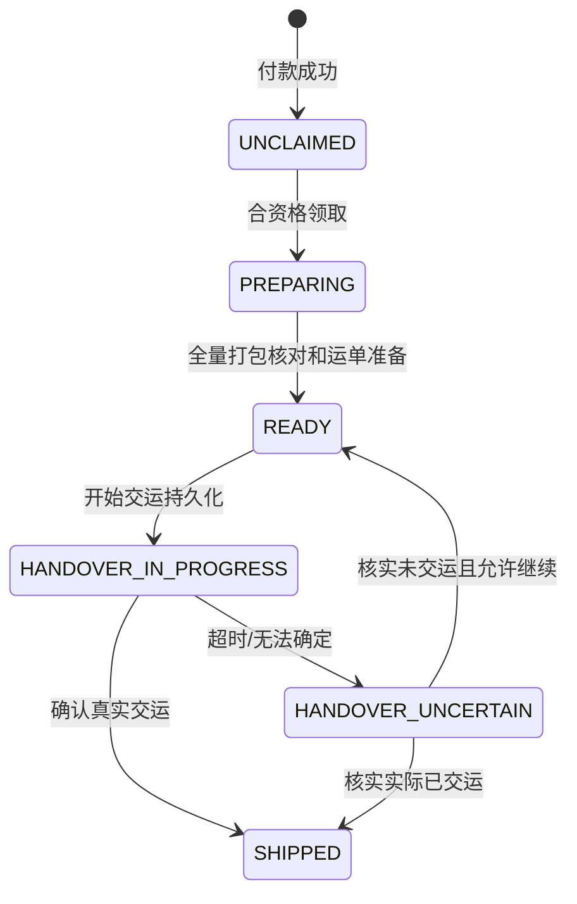
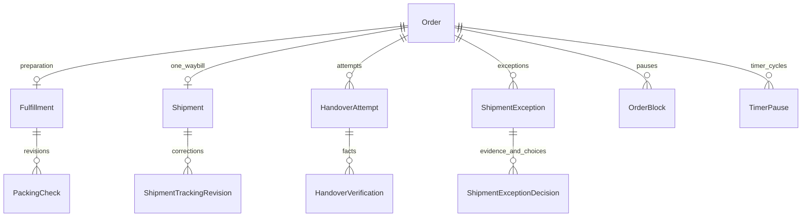

# 板块10：领取、打包、交运、运单与收货开发文档

> 一致性审查：2026-11-10。跨板块约定、修订清单及未交付项见开发进度文档根目录《文档一致性审查记录.md》；本标记不代表软件已实现或测试通过。

| 项目 | 说明 |
|---|---|
| 所属里程碑 | M2：购买闭环 |
| 文档编号 | M2-10；文件序号09（板块8＋9已合并） |
| 编写日期 | 2026-11-10 |
| 依赖 | 板块1～9实际实现，特别是Payment、Order、Task、库存异常、OrderBlock/TimerPause与事务审计 |
| 对应需求 | FR-25、35、54～55、60～66、70、73、90～98；BR-01～05；TD-07、10～15；AC-08～09、15～17、20、24、26、28相关部分 |
| 交付目标 | 唯一经办整单发货、真实交运可恢复、运单可追溯、主动/自动收货、完整M2正常购买演示 |
| 文档状态 | 待实施设计和验收要求，不代表代码已实现或测试通过 |

## 1. 功能范围和实现边界

### 1.1 本板块必须实现

1. 待发货查询、任务领取、拣货打包核对、运单准备、开始交运和确认交运。
2. 一单一次整单真实发货、一个当前原始运单，不拆包/部分发货。
3. 交运中/未知的持久动作、同动作重试、超时核实、事实补录。
4. 发货异常：原因/照片、独立暂停、仓储与客服分别领取任务，齐货与顾客意见分开记录。
5. 运单修正及管理员历史纠错，旧/新值留痕；补发/转寄不能伪装成改单号。
6. 顾客查看本人运单、主动确认收货、正常交运10自然日自动收货。
7. 接通真实OrderBlock/TimerPause：多阻塞冻结一次、最后解除才恢复至少3天、完成/退款不降级。
8. 确认收货固化完成时间和售后申请窗口，顾客累计净消费开始产生真实完成订单数据。
9. 工作台、交运核实、异常和收货页面，事务/并发/重试/扫描恢复测试。

### 1.2 后续模块边界

本板块不实现售后审核/退货验收/退款。售后申请及对应阻塞在板块11真实接通，退款与未交运实物核实版本在板块12；板块13完善完整跨岗异常、争议和线下工单。

但是当前不能省掉阻塞基础：已有库存异常和本板块发货异常都是真实业务，可验证暂停。尚无AfterSale时通过测试专用领域适配器验证售后阻塞；不发布假售后成功接口。AfterSale模块安装后必须注册真实查询器，不能仍返回“没有售后”。

不接电子面单/快递API/实时物流、不新增补发订单、不改订单地址快照。额外补发/转寄记录先以追加式内部沟通保存事实，完整OfflineCase在板块13补齐，不声称补发已经有自动库存或交易功能。

## 2. 前置衔接与权限设计

### 2.1 复用对象

| 已有能力 | 本板块如何使用 |
|---|---|
| Order.fulfillment_stage | 履约阶段唯一权威，不能在新表再维护另一个矛盾status |
| Payment和SHIPMENT_PROCESS | 只有成功付款订单可发货；复用支付已生成任务，不重复新增第1轮 |
| Task/TaskBusinessSource | 领取、暂停、转交、阶段重入及多来源核实，同stage有效唯一 |
| OrderBlock/TimerPause | 接通真实交运/收货，来源归属明确，不能清一个阻塞就清全部 |
| stock_physical_version/StockIncident | 打包及交运前重验版本；已付损耗不再扣A/R |
| FileAsset、Communication、StateHistory、AuditLog | 私有发货证据、追加沟通、阶段历史与同事务审计 |
| StoreSettingVersion/Clock | 首次记录交运时快照收货规则，完成时快照售后窗口 |
| CustomerConsumptionReader | 完成订单计消费，未收货支付不计；后续退款扣回 |

新增0010_fulfillment_shipments_handover迁移，不重建Order/Payment/TimerPause。不修改历史已应用迁移。

### 2.2 动作权限与经办

| 操作 | 权限 | 额外前提 |
|---|---|---|
| 履约查询 | order.fulfillment.read | 字段按岗位裁剪 |
| 领取发货 | shipment.claim及SHIPMENT_PROCESS阶段完整资格 | OPEN任务、ACTIVE且已改密 |
| 拣货打包/运单准备 | shipment.pack | 本人是当前发货任务经办 |
| 开始/确认交运 | shipment.handover | 当前发货经办或明确核实任务经办，分场景校验 |
| 核实交运结果 | shipment.handover及HANDOVER_VERIFY资格 | 已领取核实任务 |
| 常规运单修正 | shipment.tracking.correct | 非完成/退款且符合当前操作范围；不等于重新发货 |
| 历史运单纠错 | shipment.history.correct | 管理员，完成/退款后仍需原因和证据 |
| 发货异常/齐货核实 | shipment.exception.manage | 当前对应仓储任务经办 |
| 顾客沟通/继续履约意见 | shipment.customer-confirm、communication.service.write | 当前CUSTOMER_CONTACT经办 |
| 已付实物损耗 | inventory.order-exception.manage及对应查询 | 复用真实库存异常命令，不重复扣A |
| 顾客确认收货 | 本人有效顾客会话 | 无员工Task要求，归属与状态/阻塞校验 |
| 自动收货 | SYSTEM | 同一领域服务，不伪装员工或强制领取 |

管理员也要显式领取/转交；有权查看不等于可以抢别人的包裹处理。仅获“改运单”额外权限的客服不能因此领取全套发货任务。

## 3. 业务状态与核心规则

### 3.1 主状态与履约阶段

付款后主状态WAIT_SHIPMENT、履约UNCLAIMED。领取进入PREPARING；打包检查和运单准备完成后READY；开始交运HANDOVER_IN_PROGRESS；超时未决HANDOVER_UNCERTAIN；确认真实交运才把主状态/履约均置SHIPPED。



有售后/其它阻塞而核实未交运时保持停止作业，不自动READY可交包；界面以原履约阶段+阻塞+Task状态组合表示，不增加万能“异常订单主状态”。主状态仍WAIT_SHIPMENT，真实交运事实明确后才变SHIPPED。

### 3.2 整单打包

pack请求逐OrderItem确认数量，必须与快照全部商品/全部数量一致，拒绝少行、多行、重复行、部分数量。不使用当前商品启停/下架阻止已付履约；实物不足/损坏则登记StockIncident/发货异常，不擅自少发。

打包保存checkedPhysicalVersion=Order.stock_physical_version。损耗、物品移动、撤回打包、更正核实递增实物版本，旧打包确认失效；开始交运再次校验当前版本一致。版本失效须重新检查，不能只靠网页曾勾选过。

本板块发货不再减A/R：建单已减A，支付已减R，真实交运只是实物和履约事实变化。不得出库再扣一次可售库存。

### 3.3 准备单号与开始交运

准备运单只保存承运人和单号，并让符合条件订单进入READY，不写shippedAt、不启动收货计时。承运人首期为文本，单号无实时校验；长度/字符控制见数据/API节。

开始交运必须锁内核验：唯一成功Payment、主状态WAIT_SHIPMENT、READY、当前经办/权限、全量打包版本有效、已准备运单、无进行中售后/任何发货阻塞、无未决交运动作/已真实发货。

成功事务先建HandoverAttempt=IN_PROGRESS并保存动作号，更新履约HANDOVER_IN_PROGRESS，提交后页面才提示“可进行本次实物交接”。实际交包是线下作业，数据库不能代替人员确认。

开始交运失败/响应不明：先按原commandKey查询/重试取回动作，不生成新动作、更不能在不知是否允许的情况下反复交包。只有开始动作已持久化并确认允许后才交实物。

### 3.4 确认实际交运与响应丢失

确认要求attemptId、commandKey、actualHandoverAt。操作类型为“登记已发生事实”，不再以当前无阻塞作为拒绝事实登记的理由：若交包后顾客申请售后，仍须如实记已交运，并保留售后阻塞。

但仍核验最新员工权限、对应业务范围、核实/发货经办资格、该动作属于订单、未被判定为另一个结论、不曾真实交运；不能利用补录接口绕过一般发货前置。

成功一次事务：attempt=HANDED_OVER、Shipment确认、Order=SHIPPED、actual_handover_at、规则快照/收货基础截止、完成相关任务/历史/审计、按现有阻塞决定计时是否暂停。A/R不变。

确认响应丢失：原attemptId+原commandKey重试返回原事实与订单当前状态，不再次创建Shipment/延长收货时间。已失去操作权者不可新登记，但有合法读取资格可通过订单查询已提交事实；不能为幂等绕过停用会话。

### 3.5 未决核实与未交运

IN_PROGRESS超过5分钟（技术默认，配置由服务端环境控制，不擅自变成顾客处理期限）扫描转UNCERTAIN，增加HANDOVER_UNCERTAIN阻塞并创建HANDOVER_VERIFY任务。未决期间禁止再次start、禁止按“未发货”直接退款，不能仅因扫描超时自动判NOT_HANDED_OVER。

核实结论：HANDED_OVER、NOT_HANDED_OVER、STILL_UNCERTAIN。最后一种追加原因/证据并继续保留未决与任务，不清空暂停、不重复新轮。

确认未交运必须记录货物仍在手/位置、全量商品、是否打包版本仍有效；无其它阻塞且有效可回READY，但原任务经办不自动继承。旧SHIPMENT_PROCESS结束，生成新轮OPEN，下一经办重新领取（READY可保留有效打包，不强制再减库存）。若打包版本失效则回UNCLAIMED并重新检查。

有售后/其它暂停则保持停止作业和必要核实事实，当前核实结案不代表可交运；后续解除时由领域规则明确新轮。售后未退款结案且确定未交运必须回UNCLAIMED新轮，不恢复原领单。交运未知绝不能用UNCLAIMED掩盖。

原attempt已NOT_HANDED_OVER后重新交运必须新commandKey/新attemptNo；同一原动作重试只返回原结论，不能重新交一次。

## 4. 任务、异常与跨岗衔接

### 4.1 任务之间的关系

| 阶段 | 来源/结束 | 说明 |
|---|---|---|
| SHIPMENT_PROCESS | Payment成功创建；真实交运完成/被核实流程替代/业务终结结束 | 当前经办负责拣货到正常确认 |
| HANDOVER_VERIFY | 未决超时、主动声明不确定 | 独立领取；原发货任务暂停清经办，不能同时允许两人交包 |
| SHIPMENT_EXCEPTION_VERIFY | 缺货/破损/错款等发货异常 | 仓储核实实物/齐货 |
| CUSTOMER_CONTACT | 相同异常的顾客选择/继续履约意见 | 客服沟通，不修改实物结论 |
| PHYSICAL_VERIFY/STOCK_EXCEPTION_VERIFY | 原板块8＋9库存异常 | 复用，不建另一套损耗账户 |

未决核实建立时原任务SUSPENDED且清经办，确认事实由已领取HANDOVER_VERIFY人员操作；若尚未转核实且仍IN_PROGRESS，原SHIPMENT_PROCESS经办可直接确认。

确认HTTP入口接受两种合法任务上下文之一，必须在锁内由服务端定位并验证；客户端不能传“我有某任务所以放行”。原任务已暂停但原人未领核实任务，不可直接补录新事实。管理员接手也要领核实任务。

同一Order同stage最多一个有效任务，多异常通过TaskBusinessSource共用；完成当前来源之前核对其余来源。确认已交运后结束实际交运动作及相关发货/核实任务，不误结束仍在处理的售后/其它异常任务。

### 4.2 发货异常初版必须真实可用

shipment exception记录原因、图片/说明、当前货物位置和关联OrderItem；新增SHIPMENT_EXCEPTION阻塞，暂停发货任务，分别建仓储核实和客服沟通任务。

等待补货路径：仓储确认实物齐货（带physicalVersion），客服记录顾客仍同意继续（与当前异常及核实版本关联）。两项都完成且交运事实明确，才可解除本异常来源阻塞并消费其任务来源；解除本来源不要求其它来源已经解除。仍有其它阻塞时继续停止作业，不开放发货领取/交运，也不恢复收货计时；最后一个来源解除后，统一放行函数才校验全部业务前提并安排合法新轮领取。需求FR-65“无其他阻塞才能解除”在此指整体履约暂停解除，不把它实现为每个来源互相等待的前置条件。

客服意见WAIT/REQUEST_REFUND/CONTINUE履约分开。REQUEST_REFUND只是顾客意愿记录，不自动退款或关已付单；正式售后在板块11建立并交其规则处理，当前界面提示待售后能力接入/人工跟进，不能显示已退款。

损耗调用既有库存异常领域服务，已付款备货不扣A；仅保存发货异常照片不等于已做损耗记账。补齐后physicalVersion变动会使旧打包确认/旧齐货意见失效，必须核验当前版本。

### 4.3 释放、转交和撤权

PREPARING/READY且货物位置明确时，可以按Task规则安全转交；需记录交接与实物核对，不凭备注换经办。IN_PROGRESS/UNCERTAIN不能普通release当回普通待发货；管理员可把核实任务显式转交合资格人。

员工停用/撤权按板块4回池，其已创建HandoverAttempt不能删除或自动NOT_HANDED_OVER。无人接手提示管理员，实物事实需新合资格经办核实。

## 5. 运单规则与纠错

承运人carrierName 1～60字符；trackingNumber 1～100字符，仅ASCII字母数字及连字符，trim后保存，保留原样大小写或统一规则但前后端一致。首期不通过快递API判断真伪，不强制所有不同订单单号全库唯一（现实合包/承运商规则不是本系统新增约束），但可提示重复。

当前Shipment一单最多一条，准备阶段可编辑；首次prepare保存初始值，后续prepare实际变更承运人或单号时，必须同事务追加ShipmentTrackingRevision（is_historical_correction=false、旧/新值、原因与commandKey），不能静默覆盖；同key重放不重复追加，无实际变化不造修改历史。IN_PROGRESS/UNCERTAIN时单号冻结，先核实本动作使用哪张运单，不允许改完掩盖实际交包信息。

SHIPPED且未完成/退款，可由shipment.tracking.correct更正承运人/单号，必填reason，历史旧/新值不可改。完成/退款后只允许shipment.history.correct管理员纠错。

实际补发/重新寄送不是单号拼错，不能调用correction覆盖旧单；保存追加线下说明及补发运单文本，首期不新建自动发货/扣库存。修正运单不重新创建交运事实、付款记录或收货截止；实际交运时间纠错不属于普通改号API，需单独受控业务设计，不在本板块给出任意改时接口。

## 6. 收货与暂停计时

### 6.1 首次实际交运快照

首次成功登记真实交运时，从当前StoreSettingVersion读取autoReceiptDays并快照（默认10自然日），计算基点是actualHandoverAt，不是页面录入时间；记录“规则登记版本”和实际发生时间，不回写旧已生成期限。

正常actualHandoverAt≤now且不得早于该单付款事实；若actual<attempt.startedAt，不能为了通过校验虚填时间：走核实入口、填写过程违规/补录原因与证据，标procedureViolation，保留真实时间及审计。未来时间拒绝，不靠前端时区猜测。

若补录发生时实际交运已过10天，无阻塞则基础截止已过，后续自动收货可按真实条件执行；不能擅自把录入后再等10天。仍有售后/收货阻塞则先冻结当前remaining=max(基础截止−核实登记时刻,0)，最后解除至少再留3天。

### 6.2 主动/自动收货

顾客本人有效会话，Order.status=SHIPPED、真实Shipment已确认、无进行中售后/任意收货暂停，才可confirm-receipt；限制交易可操作，冻结不能本人操作。SYSTEM自动收货还要求now≥生效autoReceiptDueAt，不需要员工任务权限或领取。

同一服务锁Customer→Order及所需附属，主动与自动竞争只一次SHIPPED→COMPLETED。保存completedAt=实际确认时刻、完成来源CUSTOMER/SYSTEM，固化完成时当前afterSaleWindowDays和afterSaleDeadline。自动扫描晚运行时completedAt取实际处理时间，不追溯伪造成旧截止，避免顾客的7天申请窗口已被停机吃掉。

已COMPLETED合法重复确认返回原完成事实不延长售后窗口；WAIT_SHIPMENT不能收货，REFUNDED不能恢复履约。确认成功累计净消费查询自然计入，不另记虚构资金收入。

### 6.3 BR-05精确规则

第一收货阻塞保存remaining=max(原生效截止−暂停时刻,0)，清生效截止；同周期新增其它阻塞只关联原因。部分解除不生成新截止；最后一个解除时newDueAt=实际最后解除时刻+max(remaining,3自然日)。重试不重复延长，新暂停新周期。

例：原11月20日10:00截止，18日10:00暂停剩2天，19日再加一个阻塞；20日售后解除但另一个还在，无新截止；25日10:00全部解除，新截止28日10:00。若原剩5天保留5天。完成仍完成，退款不恢复。

没有实际交运就没有收货倒计时。OrderBlock按blocksShipment/blocksReceipt区分，进行中售后同时拦发货及收货；不能把库存付款阻塞缓存当成所有动作通用规则。

## 7. 数据库表设计

### 7.1 ER图



Task/历史/文件引用复用现有表与真实领域解析器，必要枚举通过本次迁移扩展。没有因一单多个尝试而建多个实际Shipment。

### 7.2 Fulfillment / PackingCheck

| 表/字段 | 类型/约束 | 说明 |
|---|---|---|
| fulfillment.id、order_id | uuid PK、UUID UNIQUE FK | 每订单一条准备信息，可支付后/首次领取幂等建 |
| current_packing_check_id | uuid可空FK | 当前有效打包检查 |
| version | integer≥0 | 内部并发；前端统一以orderVersion和taskVersion校验 |
| created_at、updated_at | timestamptz | 不重复存另一份履约status |
| packing_check.id、fulfillment_id | uuid PK/FK | 每次重新核对追加 |
| checked_physical_version | integer≥0 | 校验订单当前stock_physical_version |
| checked_items | jsonb白名单 | 全部orderItemId/确认数量，不存当前SKU价格替代快照 |
| checked_by_id、checked_at、command_key | 员工FK、时间、UUID | UNIQUE(fulfillment_id,command_key)；实际人员 |
| invalidated_at、invalidated_reason | 可空 | 实物变化不能覆盖旧检查 |

PackingCheck当前指针必须属于同Fulfillment，可复合FK或服务锁内验证；orderItemId归属/齐货由服务和集成测试保证。只追加检查与失效标记，不改历史checkedItems假装当时齐货。

### 7.3 Shipment（shipment）

id uuid PK、order_id uuid UNIQUE FK RESTRICT、carrier_name、tracking_number、status PREPARED/CONFIRMED、confirmed_attempt_id uuid可空UNIQUE FK、actual_handover_at可空、prepared_by_id FK、confirmed_by_id可空FK、created_at/updated_at、version≥0。

CHECK CONFIRMED时attempt/time必填；PREPARED时实际时间空。与Order.actual_handover_at及SHIPPED状态同事务保持一致，不让某接口单独PATCH成为已发货。

### 7.4 HandoverAttempt（handover_attempt）

| 字段 | 类型/约束 | 说明 |
|---|---|---|
| id、order_id、shipment_id | uuid PK/FK | 归属一致 |
| attempt_no | integer>0 | 锁Order后递增，UNIQUE(order_id,attempt_no) |
| start_command_key | UUID | UNIQUE(order_id,start_command_key) |
| request_fingerprint | char(64) | 开始动作版本/打包/运单语义，不含requestId |
| status | IN_PROGRESS/UNCERTAIN/HANDED_OVER/NOT_HANDED_OVER | STILL_UNCERTAIN是核实事件，不额外造新尝试 |
| carrier_snapshot、tracking_snapshot | 文本 | 开始当时运单，不因后续修正覆盖 |
| packing_check_id、physical_version | FK/非负整数 | 开始时实物确认 |
| started_by_id、started_at、uncertain_after | 员工FK、时间 | 默认5分钟，技术规则快照 |
| resolved_by_id、resolved_at、actual_handover_at | 可空FK/时间 | 已交/未交结论 |
| procedure_violation、resolution_reason | boolean、文本 | 补录早于start等留原因 |
| version | integer≥0 | 竞争/核实版本 |

部分唯一(order_id) WHERE status IN ('IN_PROGRESS','UNCERTAIN')，以及(order_id) WHERE status='HANDED_OVER'。确保最多一个未决、一次真实交运；应用同时验证Shipment/Order一致。唯一与CHECK进入migration，不仅写在代码。

确认/核实成功命令结果使用HandoverVerification记录commandKey和fingerprint，原key重放返回原事实；不同语义不能用同key把HANDED_OVER改NOT_HANDED_OVER。

### 7.5 HandoverVerification（handover_verification）

id uuid PK、attempt_id FK、command_key uuid、fingerprint char(64)、conclusion HANDED_OVER/NOT_HANDED_OVER/STILL_UNCERTAIN、actual_handover_at可空、goods_location varchar(200)可空、reason varchar(500)、evidence_note varchar(2000)可空、actor_employee_id FK、request_id、created_at。

UNIQUE(attempt_id,command_key)，索引(attempt_id,created_at,id)。NOT_HANDED_OVER需货物位置/当前全量检查依据，HANDED_OVER需真实时间，STILL_UNCERTAIN需下一步说明。附图通过FileReference新owner_type=HANDOVER_VERIFICATION，purpose=FULFILLMENT_EVIDENCE，始终PRIVATE。

### 7.6 ShipmentTrackingRevision（shipment_tracking_revision）

id uuid PK、shipment_id FK、old_carrier/old_tracking、new_carrier/new_tracking、reason、actor_employee_id FK、is_historical_correction boolean、command_key UUID、request_id、created_at；UNIQUE(shipment_id,command_key)。变化前后都保留，无删除编辑接口。每次真实修改更新Shipment和Order.version，不改实际交运时间/收货截止。

### 7.7 ShipmentException / ShipmentExceptionDecision

shipment_exception：id uuid PK、order_id FK、type SHORTAGE/DAMAGED/WRONG_VARIANT/OTHER、status OPEN/RESOLVED、incident_key varchar(128) UNIQUE、reason、goods_location、physical_version_at_open、current_verified_physical_version可空、version≥0、created_by_id/created_at/resolved_at。与库存StockIncident可空FK关联，避免同一损耗两次登记。

shipment_exception_decision：id uuid PK、exception_id FK、kind WAREHOUSE_READY/CUSTOMER_WAIT/CUSTOMER_CONTINUE/CUSTOMER_REQUEST_REFUND、physical_version、description、actor_employee_id FK、command_key UUID、request_id、created_at；UNIQUE(exception_id,command_key)。决定追加不可覆盖，当前有效意见由最新合法版本解析。

WAREHOUSE_READY和CUSTOMER_CONTINUE必须针对同异常的当前核实版本；实物版本变化旧齐货/继续结论不自动沿用。照片绑定FileReference owner_type=SHIPMENT_EXCEPTION，purpose=FULFILLMENT_EVIDENCE；顾客侧只见公开处理说明，不直接公开内部照片/位置。

### 7.8 Order和期限扩展

复用现有actual_handover_at、auto_receipt_due_at、completed_at、after_sale_deadline；新增receipt_rule_snapshot、receipt_setting_version_id FK、receipt_source CUSTOMER/SYSTEM可空、after_sale_rule_snapshot、completion_setting_version_id FK。

记录completedAt不可原地改为重新收货，afterSaleDeadline在完成时固化，后续修改全局7天不回写。OrderBlock/TimerPause/TimerPauseBlock按板块8＋9真实表复用，周期来源和唯一有效约束必须存在。

索引handover(status,uncertain_after,id)、order(status,auto_receipt_due_at,id)、shipment(order_id)、exception(order_id,status)。JSON打包/意见字段均白名单，不用自由JSON绕过归属和数量约束。

## 8. 事务、锁、幂等和历史

### 8.1 锁序

员工主体（操作者、原/目标经办按ID）→Customer（涉及该单）→Order→Product/SKU（只有确需）→库存/来源（确需）→Fulfillment/Shipment/Handover/Task/其它附属，沿用TD-11及前序附属稳定顺序；需设置Head读锁则放领域附属的约定顺序，不反取上游锁。

系统扫描不先锁HandoverAttempt/Order再反向取Customer；先只读候选ID，按标准顺序进入单单事务。若定位经办/任务候选已变需回滚重试，不在持锁时逆序补员工。

所有动作Guard后事务内重验会话/最新权限、主状态、经办、版本及阻塞。开始交运检查无阻塞；登记已交运事实允许仍有阻塞，但不是无条件跳过所有权限。

### 8.2 commandKey和版本

pack、prepare、start、confirm、resolve、改单号、异常核实等需稳定commandKey（UUID）。业务范围+动作+key唯一，存规范化指纹，成功重试先按归属/读取资格返回原结果，不重复状态/Task/期限。新增commandKey不能把已结案动作重做一遍。

命令DTO包含expectedOrderVersion、expectedTaskVersion及涉及attemptVersion/exceptionVersion。版本只在首次执行前置校验，成功同key重放不能因旧version再报错。关键语义指纹包含动作目标和首次确认的版本/内容，排除requestId和前端重新获取的传输信息。

尚无独立命令表的pack/prepare等，新增FulfillmentCommandResult：id、order_id FK、action、command_key、fingerprint、result_reference、created_at，UNIQUE(order_id,action,command_key)。同领域事务内只存成功结果，失败回滚；不能仅凭响应日志实现重放。已有HandoverAttempt/Verification/TrackingRevision等自带结果的动作不重复建两份权威。

### 8.3 落账与历史

| 命令 | 订单/任务变化 | 库存变化 | 记录 |
|---|---|---|---|
| 领取/打包/准备运单 | 履约阶段/经办 | 无A/R变化 | TaskHistory、PackingCheck、状态历史、AuditLog |
| start | HANDOVER_IN_PROGRESS | 无 | Attempt、成功命令结果、状态/审计 |
| confirm已交 | SHIPPED、真实时间、计时/暂停、任务结束 | 无 | Shipment、Verification、期限快照、审计 |
| resolve未交 | 结束原尝试，按阻塞/实物事实新轮领取 | 无 | 原结论、任务轮次、货物位置 |
| 运单纠错 | 当前单号与Order.version | 无 | TrackingRevision新旧值，期限不变 |
| 货物损耗 | 实物版本/库存异常阻塞 | 已付款备货A/R不变 | 原库存领域事实，不重复损耗 |
| 确认收货 | COMPLETED、完成/售后窗口 | 无 | 来源、状态历史、审计 |

注入任一历史/任务/审计失败必须整事务回滚。实际包裹已交而数据库失败则Attempt仍未决，不能声称包裹退回；前端引导原动作重试/核实。

## 9. API设计

路径省略/api/v1，Bearer、错误外壳和requestId沿用。所有专用员工命令还需reason（无必要原因的正常pack可使用明确操作说明）、commandKey和相应version，不能让客户端直接PATCH status。

### 9.1 正常履约API

| 方法/路径 | 请求字段（除通用commandKey/version） | 权限/行为 |
|---|---|---|
| GET /admin/orders | fulfillmentStage、assigneeId、unresolvedHandover等筛选 | 复用列表，按履约查询权限 |
| GET /admin/orders/:id/fulfillment | 无 | 准备/运单/尝试/任务/阻塞及allowedActions，字段裁剪 |
| POST /admin/orders/:id/claim | expectedOrderVersion、expectedTaskVersion | shipment.claim；复用SHIPMENT_PROCESS，不另建领取表 |
| POST /admin/orders/:id/pack | items[{orderItemId,checkedQuantity}]、goodsLocation、expectedPhysicalVersion | shipment.pack、当前经办，全量一致 |
| POST /admin/orders/:id/prepare-shipment | carrierName、trackingNumber | shipment.pack、已打包，保存PREPARED运单 |
| POST /admin/orders/:id/start-handover | shipmentId、packingCheckId、expectedPhysicalVersion | shipment.handover，先持久化动作 |
| POST /admin/orders/:id/confirm-handover | attemptId、actualHandoverAt、expectedAttemptVersion、note? | shipment.handover，登记实际已交事实 |
| GET /admin/orders/:id/handover-attempts | page/pageSize | 授权查看尝试历史，不向顾客暴露内部位置 |

正常领取可不要求commandKey，因同一任务已领取本人在语义一致时返回原结果；若工程统一要求则沿Task命令约定，不重复创建轮次。其它表中动作按第8节要求稳定key，成功结果含orderVersion/taskVersion及各实体ID，便于后续步骤。

### 9.2 核实、异常与运单API

| 方法/路径 | 输入 | 要求 |
|---|---|---|
| POST /admin/orders/:id/resolve-handover | attemptId、conclusion、actualHandoverAt?、goodsLocation?、reason、evidenceNote/图片、commandKey、版本 | 已领HANDOVER_VERIFY；STILL_UNCERTAIN保留任务 |
| POST /admin/orders/:id/handover-uncertain | attemptId、reason、commandKey、版本 | 原经办声明无法确定，进入核实，不自动未交 |
| POST /admin/orders/:id/exceptions | incidentKey、type、orderItemIds、reason、goodsLocation、evidenceNote/图片、版本 | shipment.exception.manage，创建真实阻塞与双任务 |
| POST /admin/shipment-exceptions/:id/warehouse-ready | currentPhysicalVersion、reason、证据、commandKey、版本 | 仓储核实任务经办；齐货结论不直接清全部阻塞 |
| POST /admin/shipment-exceptions/:id/customer-confirmations | choice WAIT/CONTINUE/REQUEST_REFUND、physicalVersion、description、commandKey、版本 | 客服沟通任务经办，追加记录 |
| POST /admin/shipment-exceptions/:id/resolve | reason、commandKey、版本 | 仓储核实经办，服务端检查双确认同版本及其它条件 |
| POST /admin/orders/:id/tracking-corrections | carrierName、trackingNumber、reason、commandKey、expectedOrderVersion | shipment.tracking.correct；进行中/未知不可随意改 |
| POST /admin/orders/:id/historical-tracking-corrections | 同上 | shipment.history.correct，完成/退款后历史纠错 |

resolve本来源不清其它异常/售后。WAREHOUSE_READY/CUSTOMER_CONTINUE记录后任务可保留CLAIMED待resolve消费，或领域标完成并由合资格管理员显式接手；本板块选择保留核实任务直到resolve，避免“需要当前经办却任务已完成”的死路。客服任务在保存有效意见后可完成，之后实物版本变化需新沟通轮重新领取。

### 9.3 顾客和SYSTEM

| 方法/路径 | 输入 | 行为 |
|---|---|---|
| GET /store/orders/:id | 无 | 增加本人承运人/运单、actualHandoverAt、receiptDueAt、公开暂停说明、售后截止 |
| POST /store/orders/:id/confirm-receipt | 无体或{} | 本人真实SHIPPED无阻塞，成功200 completedAt/afterSaleDeadline/replayed |
| SYSTEM autoConfirmReceipt(tx, orderId) | 内部 | 另要求当前生效截止到期，无对外人工强制收货API |

confirm-receipt不接受顾客指定completedAt/afterSaleDeadline。afterSaleDeadline在板块11申请时按now<deadline校验，等号到期。

### 9.4 请求示例

开始交运示例，ID与版本必须用实际刚读取结果替换：

```json
{
  "commandKey":"82b52b8b-42f3-48a1-951f-d65a83956576",
  "shipmentId":"01644bc4-ea59-4c65-9f08-a6378293ac59",
  "packingCheckId":"db51bd77-e157-48a5-90da-e35085de3ae0",
  "expectedPhysicalVersion":0,
  "expectedOrderVersion":4,
  "expectedTaskVersion":1,
  "reason":"已核对整单，准备本次实际交运"
}
```

核实仍不明确示例：

```json
{
  "commandKey":"664024bb-233d-4eb5-bf91-e949a03ce675",
  "attemptId":"6cfd63b9-00cf-4084-9bce-bb5f9eb8f2d",
  "conclusion":"STILL_UNCERTAIN",
  "reason":"正在核对交接记录，暂不能确认包裹是否已交出",
  "evidenceNote":"继续联系经手人员核对实物与交接凭据",
  "evidenceFileIds":[],
  "expectedOrderVersion":6,
  "expectedAttemptVersion":1,
  "expectedTaskVersion":1
}
```

实际时间字段ISO UTC，示例文案不是可直接套在真实异常上的证据。照片用FULFILLMENT_EVIDENCE，最多5张为本板块单次核实附件上限（补充实现约定），历史版本保留，不增加到商品公开图。

### 9.5 主要错误码

| HTTP/code | 场景 |
|---|---|
| 400 VALIDATION_FAILED | 非全量打包、重复/非法行、非法单号/时间/未知字段 |
| 401/403既有码 | 会话/角色/强制改密/权限不符 |
| 404 ORDER_NOT_FOUND / HANDOVER_NOT_FOUND | 不存在或无对应业务访问权 |
| 409 VERSION_CONFLICT / TASK_NOT_ASSIGNEE | 页面过期/非经办 |
| 409 ORDER_NOT_READY_TO_SHIP / ORDER_BLOCKED | 未付/阶段不符/有发货阻塞 |
| 409 PACKING_CHECK_STALE | 实物版本变化须重检 |
| 409 HANDOVER_ALREADY_PENDING / ORDER_ALREADY_SHIPPED | 未决或已有真实交运不能再开始 |
| 409 HANDOVER_RESULT_CONFLICT / COMMAND_PAYLOAD_CONFLICT | 原动作结论/相同key不同语义冲突 |
| 409 HANDOVER_VERIFICATION_REQUIRED | 原发货任务暂停，须先领取核实任务 |
| 409 SHIPMENT_EXCEPTION_UNRESOLVED | 双确认/版本/其他必要前提未满足 |
| 409 TRACKING_CHANGE_BLOCKED | 未决冻结或历史需管理员 |
| 409 ORDER_NOT_RECEIVABLE / RECEIPT_BLOCKED | 不是已发货或收货受阻 |

正常成功重放返回原动作事实和当前订单状态，不再推进一次。明文位置、员工个人资料、内部照片/原因不进入顾客错误details。

## 10. 调度、恢复和前端流程

### 10.1 交运未决扫描

job=handover-uncertain-scan，建议每分钟。扫描IN_PROGRESS且uncertain_after≤now，按标准锁序变UNCERTAIN、建唯一HANDOVER_UNCERTAIN来源阻塞、暂停原任务、建/关联有效HANDOVER_VERIFY，历史/审计同事务。

重复/双实例只一次转换，不重复Task round；STILL_UNCERTAIN不每分钟再造新任务。原confirm与扫描同时执行按Order锁仲裁：confirm先成功则扫描跳过，扫描先成功则confirm必须满足新核实任务资格，不能按旧任务越权。

### 10.2 自动收货扫描

job=order-auto-receipt，每分钟批量100，筛SHIPPED、有生效dueAt、dueAt≤now且无阻塞。锁后复核真实Shipment/AfterSale及全部来源，调用同一收货命令。

只读候选→Customer/Order标准锁；失败单不饿死后续。重启补扫历史到期未完成，SchedulerRun/Failure记录成功/待核实/失败，不能把未决交运当10天计时。与顾客主动确认竞争只一份完成事实，重复扫描不延长售后窗口。

### 10.3 页面

发货工作台：待领/本人备货/READY/交运中/待核实/异常分组，原主状态和暂停提示分别显示。领取与每步返回版本刷新，不让前端任意本地推进阶段。

交运页面先“开始交运并锁定动作”再“确认实际交运”；显示动作号。网络结果不明引导原key查询/重试，不能新增按钮“按未发货退款”。核实页要求已交/未交/仍不明，后两者录位置/下一步，不能默认选择未交。

异常页显示仓储齐货和客服意见两个独立进度、当前实物版本、当前经办/超期跟进；一方确认不自动解除全部暂停。客服REQUEST_REFUND明确仅为意见，等售后流程。

顾客详情只显示真实运单与实际交运/收货期限，不在准备单号时显示已发货；有暂停时显示公开原因和服务电话，无在线聊天；确认收货在适用时开放，退款/未发不可确认。

## 11. Swagger详细测试

### 11.1 环境和测试数据

http://localhost:3000/api/docs。准备已付款WAIT_SHIPMENT订单、仓储甲/乙、客服、管理员、顾客甲/乙；通过板块6真实入账、板块7加购、板块8＋9真实支付产生订单，不直接SQL写已支付。

短交运超时、收货时钟、售后模拟只在独立test应用/数据库通过可控Clock和测试适配器运行；正式AppModule不加“改系统时间/伪售后/强制已发”接口。记录每次ID/version/requestId及动作key，不截图真实token。

### SW-01：唯一领取与阶段

仓储甲GET履约详情取OPEN Task/version，POST claim后PREPARING且本人经办。仓储乙再领409；甲有权查询但未领的其它订单不能pack。客服默认无发货权限403，管理员接手也必须显式转交。

库存A/R与支付后相同，不因领取再扣。

### SW-02：整单打包和运单准备

甲pack全部行/数量，少一行/数量不符/重复行400；正常检查保存currentPackingCheck。prepare-shipment填承运人/单号，履约READY但Order仍WAIT_SHIPMENT、actualHandoverAt/收货dueAt为空。

顾客查看不显示“已发货”。正常商品下架不阻止已付款正确打包，真实实物不足必须走异常。

### SW-03：开始交运与同key重放

甲start-handover带稳定key/打包/运单/版本，200返回attemptId/attemptNo，状态IN_PROGRESS。重复同key同请求原attempt，不新增尝试；不同key再start409 HANDOVER_ALREADY_PENDING。

没有READY、有任何发货阻塞、旧physicalVersion、非经办均拒绝。不能通过填写单号直接写SHIPPED。

### SW-04：确认真实交运与响应丢失

甲按实际交运时间confirm同attempt，预期Order/Shipment SHIPPED/CONFIRMED、真实时间、规则快照/基础截止、发货Task结束，A/R不变。

同commandKey重放相同事实，Shipment只有一条、dueAt不再次向后延。相同key改时间/结论409；顾客只读运单、内部交接照片不可公开。

### SW-05：交运超时与三种核实结论

另单start后不confirm，测试超时扫描转UNCERTAIN，HANDOVER_UNCERTAIN阻塞及核实任务仅一条。原任务暂停清经办，甲未领核实任务直接补录409 HANDOVER_VERIFICATION_REQUIRED。

合资格人员领取核实：STILL_UNCERTAIN保留未决/Task；NOT_HANDED_OVER须位置/全量依据，无阻塞且检查有效回READY并新发货轮OPEN；HANDED_OVER须真实时间并完成实际发货。各结论使用独立单/动作，不能把已定结论的同动作改回。

核实未交之后若重新交运，新key/attemptNo；同旧key只返回旧未交结论。

### SW-06：发货异常和双确认

仓储发现缺货登记异常，发货Task暂停、独立阻塞、仓储/客服两个阶段。客服WAIT不自动放行；仓储确认齐货但客服未CONTINUE仍不能start；双方针对同physicalVersion确认后resolve本来源，安排新轮领取。

实物版本变化后旧齐货/客服意见失效；存在第二异常不能解除第一项后放行。客服REQUEST_REFUND仅记录意见，不改REFUNDED也不自动回补。

### SW-07：打包版本与已付款损耗

正常pack后通过真实StockIncident记录已付备货损耗/移动，physicalVersion递增，旧packingCheck开始交运409 PACKING_CHECK_STALE；A/R不重复扣减。

补齐/核实后重新pack再准备/交运；不能只点“解除异常”沿用旧实物版本。

### SW-08：运单修正与历史边界

PREPARED正常修正/准备变化保留历史；IN_PROGRESS/UNCERTAIN普通改号409。SHIPPED未完成允许授权改号，旧/新值与原因可查，实际交运和收货截止不变。

COMPLETED后仓储普通改号拒绝，管理员historical-tracking-corrections可留痕纠错。补发意图不能覆盖原单当作改单号，无第二次真实发货/额外库存流水。

### SW-09：顾客主动收货

甲本人SHIPPED无阻塞confirm-receipt，200 COMPLETED、completedAt、afterSaleDeadline及快照；重复确认返回原完成时间，不延后窗口。

乙访问/确认甲订单404；WAIT_SHIPMENT不能确认；限制交易顾客可收货；冻结旧token401。累计净消费从真实0增加本完成单实付，不加一笔新Payment。

### SW-10：自动收货、停机补扫与竞争

独立测试Clock推进到真实交运基础截止等号，扫描完成；无阻塞才成功。停机跨截止后恢复补扫，completedAt取实际处理时刻，售后窗口从完成算。

主动与系统同时收货只有一份完成事实和一次窗口固化，重复扫描不延长。多实例真实竞争见IT-04。

### SW-11：真实多阻塞计时

对SHIPPED单通过本板块真实异常/库存合法路径形成收货阻塞（仅允许对应业务确有影响的来源），或独立test适配器准备售后阻塞。首阻塞冻结remaining，多来源不重复冻结；解除一个仍无生效dueAt，最后一个在实际时刻恢复max(remaining,3天)。

剩余2天→至少3天，剩5天→保留5天；已完成订单不变回SHIPPED。若所选真实发货异常只允许未交运创建，则不强行让该API作用于已发单，使用真实已发库存异常的领域允许路径或测试适配器，后续SW-L01真实售后补验。

### SW-12：权限变更与未决事实保留

甲start后被停用/撤权，旧token不能继续；Attempt仍未决，任务回合资格池，管理员显式安排乙核实。不能因甲离职自动NOT_HANDED_OVER/回普通未发货退款。

有权限者补录已交运即使存在其它收货暂停也要成功记事实，并保持暂停；具体AfterSale真实阻塞在SW-L01补验。

### SW-L01：板块11真实售后与交运竞争

备货阶段申请售后→真实暂停；start先成功随后售后→进入交接待核实；实际包裹已交但响应失败→售后不能按未交直接退款，合资格核实已交并补录，计时冻结。

售后拒绝/撤销/允许关闭只解除自身；最后阻塞解除才恢复至少3天；未交运且结案明确回UNCLAIMED新轮，未知保留核实，已完成不降级。

### SW-L02：板块12退款及历史纠错

退款成功保持REFUNDED不恢复收货/发货；最终验收已回补/已退款尝试后不得随意关闭售后。退款后管理员只能纠正历史运单文本，不重发/改金额；净消费扣回完成后全额退款。

## 12. 自动化、数据库与端到端验证

### IT-01：唯一约束与整单不变量

PostgreSQL16验证一单一个Shipment、一未决/一真实交运的部分唯一、commandKey/结论唯一，attempt/order/shipment所属一致。全行打包、错订单item/quantity、物理版本、真实时间界限及规则快照校验。

任何客户端amount/status/actorId/actualTime非法字段不能绕过命令DTO。零库存不影响已付履约，但缺实物不能假齐货。

### IT-02：20人抢领及交运动作竞争

20人同订单领取仅一人成功。两个start不同key最多一个未决；同key并发返回同动作；confirm/扫描/resolve先后用屏障控制，合法先提交事实决定结果，不能出现真实交运两次。

NOT_HANDED_OVER后再start新attempt，已HANDED_OVER再start拒绝。旧UI在任务暂停/转交后不能继续用旧经办身份登记新事实。

### IT-03：事务失败与物理事实恢复

在Attempt、Shipment、Order状态、Task完成、TimerPause、历史、审计各点注入失败全部回滚。模拟“实际包裹已交但confirm事务失败”，未决记录保留，原动作重试/核实恢复，不能伪装货仍在手。

磁盘凭证失败沿用板块3补偿；旧图片/运单/尝试不能被删。幂等结果与副作用同事务，不能先提交命令成功表。

### IT-04：收货、扫描和期限

Customer主动/系统自动并发一次完成；deadline等号到期；系统晚补扫完成时间及7天窗口正确。双实例扫描/进程重启、批次>100、单条失败不饥饿后续、不重复Task/收货/期限。

交运超时只变未知不判未交。扫描锁序Customer→Order→附属，无先锁Attempt再反向取Order。SchedulerRun/Failure记录真实结果。

### IT-05：暂停周期与补录

剩余0/2/5天，重叠阻塞、中间解除后再等5天、重复解除、新周期、实际交运补录晚于基础截止，检查最后解除才算新dueAt且至少3天。

COMPLETED不降级、REFUNDED不恢复。未实际交运无计时，阻塞中已交运事实可登记。真实AfterSale在板块11替换测试查询器重跑，测试模块不进入生产。

### IT-06：异常双任务与实物版本

仓储齐货+客服继续同版本才resolve；只一方不行，多个来源不清其它阻塞。增加双异常正例：E1/E2同时阻塞，各自双方确认齐备；先resolve E1应成功且E2仍有效、不能发货，再resolve E2才允许统一判断恢复；不能两次都因“还有其它阻塞”而409。实物损耗/移动令打包及旧意见失效，A/R不二次扣减；请求退款意见不写Refund/Payment/回补。

核实完成→新轮领取，释放/转交不增轮次，原经办不自动继承；撤权同步回池失败要回滚员工修改。核实物品位置记录与客服内部信息按权限隔离。

### IT-07：运单、字段与权限

普通修正/管理员历史纠错边界、IN_PROGRESS冻结、同key不同内容冲突；改号不改actualTime/dueAt，不制造补发。顾客只见公开运单与说明，不含员工/内部位置/附件；私有证据匿名/他人404。

权限变更与敏感发货命令事务内仲裁；管理员接手必须领取，SYSTEM不套员工任务权限。

### IT-08：完整购买端到端与工程

合法来源入账→上架→加购→报价→建单→模拟支付→领取→打包→准备→开始交运→确认交运→本人收货；复算A/R无发货二扣、唯一Payment、完成净消费与售后窗口。

执行pnpm lint、pnpm typecheck、pnpm test、pnpm test:integration、pnpm build、pnpm openapi:export、pnpm api-client:generate。空库/旧库迁移、Compose冷启动、图片/历史/Task持久化、两个前端深层路由和前序权限回归；保存命令退出码和证据。

## 13. Agent执行说明与建议开发顺序

### 13.1 可直接使用的任务

> 请实现板块10。先阅读需求v2.0及前序文档和当前仓库，复用Order/Task/Block/TimerPause/库存异常/文件审计，完成唯一经办领取、整单打包、运单准备、先持久化开始交运再实物交接、原动作确认/超时核实与重试、异常双确认、运单修正和历史纠错、主动/自动收货及售后窗口。填单号不等于交运，实际事实登记与允许继续交包分开校验，未知不得自动当未交运。管理员也须领单，发货不重复扣A/R。真实AfterSale尚未建立时仅用隔离测试适配器验证接口契约，不开放假售后/退款成功。完成相关页面、迁移、Swagger、真实PostgreSQL并发/回滚/恢复/端到端，并报告证据和板块11/12补验；发现冲突同步设计。

### 13.2 推荐步骤

1. 检查前序Order/任务/锁序，落0010和真实领域解析器。
2. 领取/全量pack/prepare，商品下架和实物版本规则测试。
3. start/Attempt唯一/command结果、confirm/事实补录和回滚。
4. 核实任务/超时扫描/未交新尝试/停用接手恢复。
5. 发货异常基础、私有证据、仓储/客服同版本双确认。
6. 普通/历史运单修正，明确无补发交易。
7. 实际交运规则快照/BR-05/主动自动收货及完成窗口。
8. 工作台/核实/顾客运单收货页面，完整端到端/工程检查。

### 13.3 衔接必查

- [ ] Order.fulfillment_stage唯一权威，Shipment与Attempt互相一致。
- [ ] 支付已建发货Task不重复生成，暂停/重入轮次按规则。
- [ ] 开始交运与事实确认分开，未知不清空动作、不自动退款回补。
- [ ] 撤权/离职保留实物事实，接手显式领取核实任务。
- [ ] 真实交运/收货不再次扣库存或增Payment。
- [ ] 运单改号保留旧/新，不改变实际时间和收货期限。
- [ ] 最后收货阻塞解除才算新截止，完成/退款不恢复。
- [ ] 未安装售后测试端口默认安全，安装后强制真实注册。

## 14. 验收追踪与M2完成门槛

| 规则 | 验收关联 | 本阶段验证 | 后续补验 |
|---|---|---|---|
| 唯一经办/整单发货 | AC-08、FR-60～62 | SW-01～04、IT-01～02 | 真实售后抢占 |
| 交包成功登记失败/待核实 | AC-09、FR-63～64 | SW-05、12、IT-02～03 | SW-L01 |
| 发货异常双任务/版本 | FR-65、AC-24相关 | SW-06～07、IT-06 | 板块12/13退款路线 |
| 运单历史/不改址 | FR-55、66、AC-16 | SW-08、IT-07 | 退款后历史纠错 |
| 收货和暂停恢复 | AC-15、20、28 | SW-09～11、IT-04～05 | SW-L01真实售后 |
| 轮次/接手/权限 | AC-02、26、29相关 | SW-01、05、12、IT-02、06～07 | 跨模块持续回归 |

### 14.1 交付清单

- [ ] 0010迁移、Fulfillment/Packing/Shipment/Attempt/核实/运单历史/发货异常及命令结果约束。
- [ ] 真实领取打包交运/恢复/超时核实、Task/实物版本/审计同事务。
- [ ] 异常双任务/双确认基础、私有证据和受控解除。
- [ ] 主动/自动收货、BR-05与完成时售后窗口真实接通。
- [ ] 工作台/核实/运单/异常及顾客收货页面，公开模拟说明保持。
- [ ] OpenAPI/客户端/README与真实数据库/端到端测试。
- [ ] docs/verification/M2-10.md：SW-01～12、IT-01～08逐项记录日期、环境、命令/响应、requestId、证据、问题及复测；SW-L01～02待补验。

### 14.2 完成判断

板块10完成需证明正常整单发货/收货闭环、交运失败可恢复且不误当未发、任务与权限真实仲裁、运单可追溯、暂停计时与完成窗口正确，相关异常/并发/回滚/扫描及工程检查通过。

M2只有板块7、8＋9、10实际通过且完整购买演示可复现才能标完成；这些文档产出不等于实现完成。首期仍需M3售后/退款/异常协作和M4全量验收部署，不能把售后留作可选优化。

