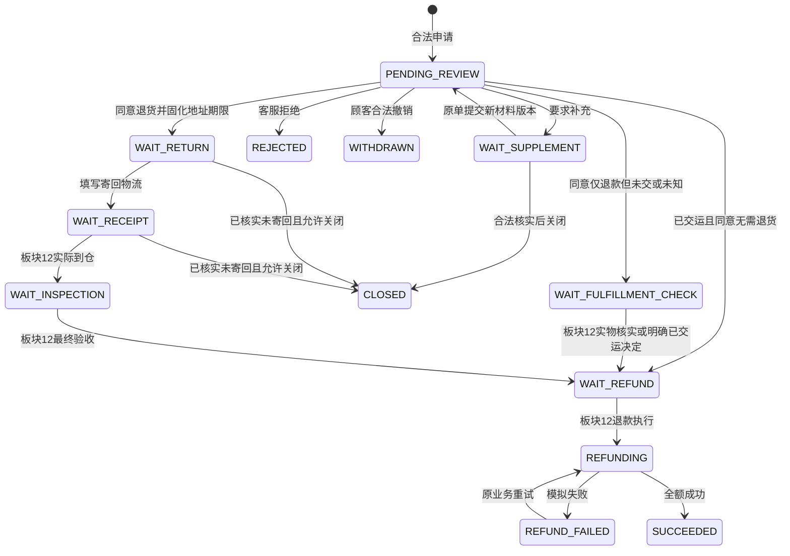
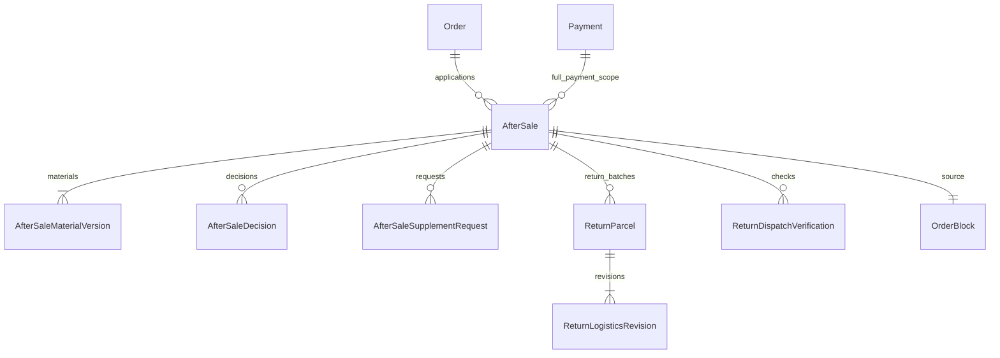

# 板块11：售后申请、审核、材料与暂停恢复开发文档

> 一致性审查：2026-11-10。跨板块约定、修订清单及未交付项见开发进度文档根目录《文档一致性审查记录.md》；本标记不代表软件已实现或测试通过。

| 项目 | 说明 |
|---|---|
| 所属里程碑 | M3：售后闭环 |
| 文件序号 | 10；业务板块编号11（板块8＋9合并导致文件序号不同） |
| 编写日期 | 2026-11-10 |
| 依赖 | 板块3～4、8～10；认证、个人授权、文件、沟通、Task、真实订单/支付、交运和暂停计时已实现 |
| 业务依据 | 通俗版后台售后模块及前台售后模块；需求v2.0 FR-70～74、90～94、98，BR-02、05、07；关联FR-63～64、78～80 |
| 验收关联 | AC-09、11、14～17、19、24～26、28相关部分 |
| 当前交付 | 售后申请与材料、审核、寄回物流、受限关闭、真实阻塞及期限/任务重入 |
| 文档状态 | 待实施设计与验收要求；不代表功能已开发或测试通过 |

## 1. 范围与前后板块分工

### 1.1 本板块必须完成

1. 顾客申请整单仅退款或退货退款，校验本人、成功支付、类型、完成后申请窗口及进行中唯一。
2. 客服显式领取后同意、拒绝或要求补材料；仓储不能用默认权限代替客服审核。
3. 当前材料最多5图、版本替换与历史保留；补充在原售后提交，重新进入审核新轮。
4. 创建售后同事务暂停发货及主动/自动收货，结束只解除自身来源；真实接通板块10预留售后查询器。
5. 仅退款根据实际交运事实分流；未知进入核实，不能因没有单号或订单仍待发货就认定未交运。
6. 同意退货时保存退货地址和寄回期限快照，顾客填运单及实际寄出声明/证据，客服人工核实与跟进。
7. 待审撤销、补材料阶段关闭、未寄回关闭的权限与BR-07守卫；管理员争议决定入口与后续板块有明确边界。
8. 审核2工作日、补充7自然日、寄回7自然日的期限、超期事件与提醒，不自动拒绝或关闭。
9. 顾客申请/详情/材料/寄回页面，后台售后队列、审核、公开/内部说明和版本历史。

### 1.2 板块12和13负责什么

板块12实现实物到仓、逐行实收/可售/损耗、少件补寄、最终验收/一次性回补、未交运仅退款实物核实及模拟退款业务/失败重试。板块13完成异常争议、管理员受限结案、冻结顾客身份核实代录及超期OfflineCase。

本板块可以真实进入WAIT_FULFILLMENT_CHECK、WAIT_REFUND、WAIT_RETURN、WAIT_RECEIPT，但不能宣称已经退款或验收。没有板块12时不发布refund/received/inspection假成功接口；待退款页明确“待办理模拟退款”，保留任务和阻塞。退款执行能力未安装不影响真实审核通过，但阻塞不能因此解除。

本板块不新增聊天、自动物流查询、部分退货/退款、换货、补发交易、额外赔付付款、动态岗位或多商家数据域。超期特殊诉求展示店铺电话并交后续线下工单，不修改已固化的在线窗口。

## 2. 复用、权限与数据可见性

### 2.1 复用对象与迁移

新增迁移0011_after_sales_review_material_return。复用Order/Payment、Shipment/HandoverAttempt、OrderBlock/TimerPause、Task/TaskStageCursor/TaskBusinessSource、StoreSettingVersion、FileAsset/FileReference、Communication、AuditLog/BusinessStateHistory。

关闭安全检查同时使用Inspection/Refund领域事实读取器：板块12尚未安装时，由正式模块注册“能力未安装、该模块从未产生事实”的受控实现，且相关写入口不存在；板块12一旦安装必须换成真实验收/回补/退款尝试查询器，缺失或查询失败拒绝关闭，不能继续使用空事实实现。该契约由启动检查和IT-04/09验证。

真实AfterSaleReader注册为板块10交运、主动收货、自动收货的领域查询器。正式App启动应检查注册，缺失时报启动错误或拒绝相关业务，不能保留“没有售后”的默认假结果。测试专用查询器不进入正式AppModule。

Order.afterSaleOnly筛选改查真实进行中记录，不把售后中增为订单主状态。迁移不重写旧已执行脚本，不把原订单强行改成COMPLETED或SHIPPED以适配售后。

### 2.2 权限矩阵

| 动作 | 权限/身份 | 经办与边界 |
|---|---|---|
| 本人申请、材料、撤销、寄回信息 | 有效顾客会话 | 锁内校验订单归属；TRADE_RESTRICTED可售后，LOGIN_FROZEN旧token不可用 |
| 客服售后列表/详情 | after-sale.service.read | 含所需材料，不默认含商品成本、员工个人信息 |
| 领取审核及审核 | after-sale.review＋after-sale.service.read | 当前AFTER_SALE_REVIEW经办；管理员也须领取或显式转交 |
| 补充要求/补充跟进 | after-sale.review | 当前审核/补充跟进经办，按实际动作阶段区分 |
| 寄回人工核实、跟进 | after-sale.return.follow | RETURN_FOLLOW当前经办；无权验收实物或执行退款 |
| 普通允许阶段关闭 | after-sale.close | 当前对应跟进任务经办，退货关闭另需return.follow，满足BR-07 |
| 内部沟通追加 | communication.service.write | 业务访问权与当前允许动作一并检查 |
| 交运结果核实 | shipment.handover及HANDOVER_VERIFY资格 | 复用板块10已领取核实任务 |
| 停止备货/实物核实 | order.physical.check及对应查询 | PHYSICAL_VERIFY经办；逐行售后实物核实在板块12完成 |
| 仓储退货信息 | after-sale.inspection.read | 仅验收所需物流、订单行和允许证据，不全部开放客服内部材料 |
| 管理员争议结案 | after-sale.dispute.decide | 不可额外授予；板块13接通完整决定，仍不能越过BR-07 |
| 延期/转交 | deadline.extend/task.transfer | 复用管理员专属动作和历史；不改变售后在线申请窗口 |

默认客服可以审核/跟进/符合条件关闭；默认仓储不能审核、关闭或退款。个人额外授权必须满足固定依赖权限，并按真实当前任务资格处理；不能仅因“能看订单”就执行售后动作。

### 2.3 对外与内部字段

顾客可读本人申请、当前和历史本人材料、公开要求/结果、退货地址快照、运单与自己寄出记录、公开处理说明、退款实际进度及店铺联系方式。顾客不可读内部意见、核实货物位置、员工姓名/手机/邮箱、管理员内部决定理由、成本、内部凭据。

Communication按板块3的public_text与内部result/next_step分离，客服内部备注不自动复制公开。公开结论必须由服务端组装白名单DTO，不序列化整个Prisma对象。文件内容授权走真实材料/物流证据归属，其他顾客或匿名404。

## 3. 申请资格、金额与状态

### 3.1 在线申请资格

锁内检查唯一成功模拟Payment，Order主状态为WAIT_SHIPMENT、SHIPPED或COMPLETED且未全额退款。WAIT_PAYMENT、CLOSED、REFUNDED拒绝。订单必须属于当前顾客，越权统一404。

WAIT_SHIPMENT且未确认真实交运：只能REFUND_ONLY（仅退款），包括交运中/未知；此时允许登记诉求，但不能直接执行未交运退款。SHIPPED/COMPLETED可REFUND_ONLY或RETURN_REFUND。交运与申请竞争以Order锁后事实为准，不相信客户端传的isShipped。

COMPLETED需now < Order.after_sale_deadline；等号到期。使用板块10完成时快照的截止，不读当前全店7天重新计算；WAIT_SHIPMENT/SHIPPED尚未完成没有凭空的完成后7天限制。已提交售后不因窗口届满失效，可继续补充/寄回/退款；拒绝、撤销、关闭后重新申请必须重新检查原窗口。

全单全部OrderItem自动形成申请范围，客户端不传选择行、数量、退款金额、成本、状态、操作者。展示拟退款金额=该单唯一成功Payment.amount_cents（DTO为amountCents，含原运费），整数分，只读；不写新Payment、不计退款额或回补库存。

### 3.2 状态图与终态



终态REJECTED/WITHDRAWN/CLOSED/SUCCEEDED；其余均进行中，包括REFUND_FAILED、WAIT_FULFILLMENT_CHECK及后续INSPECTION_EXCEPTION/FINAL_INSPECTION。不能只把PENDING_REVIEW当进行中。图中跨板块迁移只是集成契约，本板块不造退款成功。

### 3.3 审核与真实交运变化

同意前再次读取实际Shipment及未决Attempt。REFUND_ONLY：已确认真实交运且客服明确同意“无需退货全额退款”时进WAIT_REFUND；未交运或交接未决进WAIT_FULFILLMENT_CHECK。没有动作记录并不等于仓储已核实可售；即使从未领单也需要板块12逐行核实。

若审核后核实实际已交运，先以板块10登记事实，再由有权限且显式领取对应售后跟进任务的客服追加NO_RETURN_REFUND_CONFIRM决定，记录已知交运事实、接受无需退货的公开说明及顾客沟通依据，进入WAIT_REFUND。不得监听到SHIPPED就静默放退款，也不得自动改type为RETURN_REFUND。

本板块使用AFTER_SALE_REVIEW新轮承接上述事实变化后的再次决定：reason=HANDOVER_FACT_CHANGED；旧同意记录保留，不开放再次拒绝/顾客撤销。新任务允许的动作仅确认无需退货或转管理员协调，不能把状态冒充PENDING_REVIEW。逐行实物核实已完成则由板块12推进，不混用此再次决定。

RETURN_REFUND仅在已交运/完成事实下同意，保存退货地址；类型创建后不可普通PATCH改写。若顾客要求换路径，走后续受控决定，当前不提供任意类型切换API。

## 4. 命令、任务与期限

### 4.1 业务命令表

| 命令 | 前置/主体 | 状态与任务 | 资金/库存与审计 |
|---|---|---|---|
| apply | 本人、合法已付款、窗口内、无进行中 | PENDING_REVIEW；AFTER_SALE_REVIEW新任务；新增售后阻塞 | 无资金/库存；材料v1/申请历史/审计 |
| request-supplement | 待审当前审核经办 | WAIT_SUPPLEMENT；完成审核轮，建SUPPLEMENT_FOLLOW | 要求/当前材料指针不乱改；新期限快照 |
| supplement | 本人WAIT_SUPPLEMENT | 新材料版本；结束补充轮，新AFTER_SALE_REVIEW OPEN | 不重建售后；历史要求/逾期保留 |
| approve-refund-only | 当前审核经办 | 按交运事实分WAIT_FULFILLMENT_CHECK或WAIT_REFUND | 只同意，不退款、不回补 |
| approve-return | 当前审核经办、真实已交运 | WAIT_RETURN；RETURN_FOLLOW OPEN | 固化地址/寄回期限；不回补 |
| reject | 当前待审经办，必填公开理由 | REJECTED；结束本售后任务/来源阻塞 | 不撤销支付或损耗事实 |
| withdraw | 本人当前待审、未有同意/拒绝决定 | WITHDRAWN；任务/自身阻塞结束 | 原材料/历史保留 |
| return-logistics | 本人已批准退货且未终结/未验收 | WAIT_RECEIPT；保留RETURN_FOLLOW，建RETURN_RECEIVE | 记录单号/寄出声明，非到仓/验收 |
| verify-return | 当前RETURN_FOLLOW经办 | 追加未寄/在途/不明的核实 | 不改成实收到仓，不自动关闭 |
| close | 允许阶段当前经办且BR-07满足 | CLOSED；结束自身任务/阻塞 | 不冲正资金、库存、物流事实 |
| confirm-no-return-refund | 交运事实变化后限定审核任务经办 | WAIT_REFUND，建REFUND_PROCESS | 留明确决定，仍无退款成功 |

### 4.2 任务轮次与领取

AFTER_SALE_REVIEW：首次申请第1轮，补材料后第2/3轮，新进入时从当前设置快照reviewWorkdays，默认2工作日。旧经办不继承，同一人也重新领取；同key重试不再增轮。正常审核任务不允许被“额外同意”请求重复完成。

SUPPLEMENT_FOLLOW：提出补充时即建，截止默认7自然日，是员工跟进外部等待的任务，不要求顾客领取。客服可先领取记录联系，但到期只记逾期提醒，不自动关单。顾客提交后即便任务已被客服领取仍可依法补充，锁内结束该轮；客服旧页面再关闭409。

RETURN_FOLLOW：同意退货时即建，dueAt为同意时起7自然日，填单号或声称已寄不重置。寄出经客服核实后可结束本次寄出跟进任务；RETURN_RECEIVE负责等包裹，无新增运输SLA。未核实寄出的保留跟进，不因填单号自动完成跟进任务。

RETURN_RECEIVE在首次物流提交生成真实等待任务，板块12接实际到仓/验收；无物流而包裹真实到仓也须允许板块12按事实登记并补齐来源，不要求顾客先编单号。板块11可真实建任务，不能替仓储确认收货。

WAIT_FULFILLMENT_CHECK：未决交运关联ORDER/HANDOVER_VERIFY的真实任务，不另造第二个交运动作。明确未交运创建/关联PHYSICAL_VERIFY来源afterSaleId，核实归属与数量约束由板块12完成；现有任务多来源复用TaskBusinessSource，不能解决一个来源就完成其他来源。

WAIT_REFUND：真正条件满足才建REFUND_PROCESS，默认1工作日，复用板块4候选权限。板块12未装不提供执行按钮，但待办真实保留。仅审核进入WAIT_FULFILLMENT_CHECK时不能提前计算退款SLA。

### 4.3 期限规则

采用统一Clock、UTC存储、Asia/Shanghai计算，周一至周五工作日，不接节假日/调休。例周五10:00+2工作日为下周二10:00；周六10:00+1工作日为周一10:00。自然日保留本地时分。

到期now≥dueAt，审核/补充/寄回到期仅标记跟进；逾期后合法补充、审核、填写真实寄回仍可提交。管理员延期用板块4接口，领域适配器同事务同步本轮业务截止与Task，不重新生成round，不抹掉旧逾期。延期不能修改完成后在线售后申请窗口。

补充后新审核期限读此时当前设置；旧补充/寄回/审核期限与快照不随全店设置改变。扫描前已超期、但完成命令先执行的，也由通用期限服务补记真实历史逾期，不能依赖扫描抢先记录。

## 5. 材料版本、附件与说明

### 5.1 当前版本规则

申请原因reasonCode使用固定实现枚举NOT_WANTED/QUALITY/WRONG_ITEM/DAMAGED/OTHER，description去首尾后1～2000字符。枚举是提交分类，不自动决定责任/同意/拒绝。每版currentEvidenceFileIds为0～5个去重UUID；文字必填，凭证可无，审核可要求补充。

首次申请生成MaterialVersion.versionNo=1；补充提交完整的新描述和当前有效图片列表（不是“再加5张”），生成下一版并移动current_material_version_id。可保留上一版部分图、替换或全部删除；历史材料和FileReference保留，不物理删旧文件。

补充要求不是同意/拒绝决定：保存独立SupplementRequest，包含具体要求/公开说明、当时材料版本、截止与规则快照。顾客补充只能回应当前未完成要求，不并发响应两个旧要求；提交成功记录respondedMaterialVersionId，不能覆写旧要求为已同意。

### 5.2 附件绑定

顾客POST /files，purpose=AFTER_SALE_EVIDENCE，真实JPEG/PNG/WebP且≤5MB，沿用板块3像素等规则。新绑定图必须为本人有效未过期STAGED资源，或已属于本售后历史材料且仍合法可引用；不能拿其他售后/其他顾客或商品公开图来绑定。

新图与重复沿用图统一在本次材料版本创建FileReference，owner_type=AFTER_SALE_MATERIAL，ownerId为真实MaterialVersion.id；重用本单历史图不再次当新上传处理。文件引用和售后状态同事务，失败不把上传资源错误标为已绑定。PRIVATE永久保持，历史图不可被未引用清理任务删掉。

员工代录上传AFTER_SALE_EVIDENCE仍按板块3 customer.frozen.proxy，板块13接身份核实，不在本板块绕过。客服核实寄出/关闭的内部凭据用COMMUNICATION_EVIDENCE，上传需communication.service.write或offline-case.manage，绑定另查本动作权限、当前任务和新owner解析器，与顾客公开凭据分离；不把内部核实图并入顾客最多5张当前申请图。

### 5.3 公开结果

拒绝、要求补充、合法关闭都必填publicExplanation 1～1000字符，内部internalNote可选≤2000字符；返回顾客时只投影公开说明。审核/关闭的内部理由不能作为系统默认公开错误详情。材料和公开说明是表单交互，无聊天发送/已读/在线状态。

## 6. 退货地址、寄回与关闭边界

### 6.1 同意退货快照

approve-return锁内读取当前设置版本，验证退货联系人、电话、完整地址可用，同事务存returnAddressSnapshot、returnSettingVersionId、approvedAt、returnDueAt及returnRuleSnapshot。地址缺失则409 RETURN_ADDRESS_NOT_CONFIGURED，不能同意后给顾客空地址。

以后管理员改全店退货地址不改该单，详情仍返回批准时地址；后续补寄沿用原快照。实际需要改收件安排由受控沟通/后续决定留痕，不能后台静默覆盖快照。原订单收货地址同样不改。

退款固定包含原运费；寄回运费责任记录CUSTOMER/MERCHANT/UNDETERMINED及说明。无理由通常顾客承担，质量/错发由客服核实，不因reasonCode自动一律顾客承担；额外费用只记录线下协商，不计系统退款金额。

### 6.2 填物流与实际寄出分开

承运人1～60字符、单号1～100 ASCII字母/数字/连字符，trim后存储；与板块10验证一致。ReturnParcel为首个寄回包裹，revision保存每次改单历史。初始approved return不强制用户当天填写物流。

物流输入支持dispatchDeclaration=NOT_YET_SENT/DECLARED_SENT；DECLARED_SENT必须actualDispatchedAt≤now及说明，可附本人寄出凭据（最多5张/次）；时间不得早于本次售后创建，批准前已寄可记录真实时间但标unapprovedDispatch，人工核实，不伪造批准时间。NOT_YET_SENT不接受实际寄出时间。

填单号会进入WAIT_RECEIPT但不证明实际寄出，更不证明已到仓。后续补报真实寄出使用同ReturnParcel新revision。改号不重新起7天期限。已经声明寄出或上传寄出证据后，普通顾客改号不能把历史“已寄出”清成“未寄”，只能追加更正说明等待人工核实。

客服追加核实outcome=NOT_SENT/IN_TRANSIT/UNCERTAIN，记录核实时间、渠道、来源、结果、下一步和物流revisionNo；不是实时物流接口。IN_TRANSIT阻止仅凭超时关闭，UNCERTAIN继续跟进。实际到仓只由板块12实物命令写receivedAt，不提供客服“凭查询已签收直接验收”。

### 6.3 BR-07关闭判定

| 当前场景 | 本板块是否允许普通close | 必须满足 |
|---|---|---|
| PENDING_REVIEW | 否 | 客服reject或顾客符合FR-71 withdraw，不能用close混淆 |
| WAIT_SUPPLEMENT | 可 | 当前SUPPLEMENT_FOLLOW经办、after-sale.close、核实/联系说明及公开理由，无实物/退款禁区 |
| WAIT_RETURN/WAIT_RECEIPT、确未寄回 | 可 | RETURN_FOLLOW经办、close＋return.follow；核实未寄、联系结果、理由，不能只凭超时 |
| 顾客声明已寄/有寄出凭据/运输中/部分到仓 | 否 | 普通close拒绝；争议交管理员完整决定/物品去向，板块13实现 |
| WAIT_FULFILLMENT_CHECK或未交运已核实的WAIT_REFUND | 否 | 管理员停止退款并使本售后核实失效；板块12/13接通完整命令 |
| 已寄出后退款等待、验收异常、其他争议 | 否 | 管理员受限决定，不允许客服普通关闭 |
| 已最终验收/已回补/任意实际退款尝试 | 任何角色都不可直接close | 包括REFUNDING/REFUND_FAILED；只能完成必要核实、退款或重试 |
| REJECTED/WITHDRAWN/CLOSED/SUCCEEDED | 不得新变更结论 | 只同key合法重放或只读 |

NOT_SENT核实必须绑定当前ReturnParcel revision和本次物理事实版本；顾客随后新填寄出信息使旧核实不再可用于关闭。历史有声明寄出/凭据即便被更正，也不能由普通close绕过争议决定。无ReturnParcel的WAIT_RETURN允许核实“尚未寄出”，绑定空包裹状态与afterSaleVersion；之后任何新寄回输入使其失效。

补充超时不自动关闭。顾客在WAIT_SUPPLEMENT要求结束应联系店铺，由当前跟进客服按上述close记录处理，不强制另建申请。联系不上不能等同“确定未寄回”；UNCERTAIN保留跟进或交管理员。

## 7. 暂停与恢复的真实集成

### 7.1 创建售后的一个事务

锁内插AfterSale及材料→新增OrderBlock(type=AFTER_SALE，sourceAfterSaleId真实FK，blocksShipment=true、blocksReceipt=true)→冻结已有有效自动收货剩余时间→暂停SHIPMENT_PROCESS并清经办→创建审核任务→历史/审计。任一步失败全部回滚，不出现“申请成功但仍能发货”。

HANDOVER_IN_PROGRESS申请售后保留Attempt，停止新作业并进入HANDOVER_VERIFY待核实（复用板块10未知转换服务），不能把动作改NOT_HANDED_OVER。HANDOVER_UNCERTAIN已有核实则关联来源、不重复轮次。售后不能暂停用于确认已发生交运事实的核实任务；未知期间不放未交运退款。

PREPARING/READY申请停止作业，保留历史打包但当前打包资格按实物变化失效；必要仓储确认货仍在手。真实交运补录允许售后阻塞存在，建立基础收货截止后冻结当前remaining；没有真实交运不启动10天计时。

### 7.2 拒绝、撤销和允许关闭

同事务置售后终态、结束本售后阶段、失效本售后未消费核实引用（后续板块真实接通）、解除本AfterSale来源的OrderBlock，并调用统一恢复服务。不能批量清除order所有阻塞或所有Task。

确定未交运：旧发货轮结束，履约回UNCLAIMED、新SHIPMENT_PROCESS OPEN，旧经办不继承；若其它阻塞仍在，新轮SUSPENDED/不可领取，最后阻塞解除才OPEN，同一恢复entryKey不再加轮。不能一结案就把READY旧打包/旧经办自动恢复。

交运未知：仍保留原Attempt、HANDOVER_UNCERTAIN阻塞和核实任务，绝不回普通UNCLAIMED。已真实交运：主状态SHIPPED；COMPLETED保持完成，不降级；REFUNDED不恢复任何发货/收货。当前售后结束不撤销历史损耗或支付。

### 7.3 BR-05多阻塞算例

首个收货阻塞保存remaining=max(旧dueAt−暂停时刻,0)，清生效截止；第二个只关联同周期。只解除售后时若另有来源仍在，不计算新截止。最后来源在实际解除时刻t解除，新dueAt=t+max(remaining,3自然日)。

例11月18日10:00暂停，原20日10:00截止剩2天；20日售后关闭但另一阻塞仍在，直到25日10:00最后解除，截止28日10:00。剩5天则保留5天。重复请求不再加3天，新周期才重新冻结。COMPLETED/REFUNDED不恢复。

## 8. 数据库与唯一约束

### 8.1 ER关系



OrderBlock为该售后一条来源记录，终态解除而不删除；图中的1对1需要sourceAfterSaleId唯一保证。Task、文件引用与历史复用已有真实领域关联解析器。

### 8.2 AfterSale（after_sale）

| 字段 | 类型/约束 | 用途 |
|---|---|---|
| id、after_sale_no | uuid PK、varchar(40) UNIQUE | 内部ID及展示编号，编号服务生成不允许客户端指定 |
| order_id、customer_id、payment_id | UUID FK RESTRICT | 归属与唯一成功支付锁内验证，禁止串单 |
| type | REFUND_ONLY/RETURN_REFUND | 创建后普通API不可修改 |
| status | 本文及BR-02完整枚举 | 后续异常/退款状态本次枚举可预留，不伪造动作 |
| reason_code、application_description | 枚举、varchar(2000) | 原始申请快照，不随补材料覆盖 |
| current_material_version_id | UUID可空FK；提交成功的售后必须非空 | 同事务先插AfterSale（指针暂空）、插v1材料、再回填；必须属于本单，复合FK或锁内归属校验 |
| requested_refund_amount | integer CHECK >0且≤100000000 | 成功Payment金额服务端快照，不接受前端金额 |
| review_round、version | integer≥0 | task轮次以TaskStageCursor权威；本字段可作校验投影不自增两套 |
| return_address_snapshot、return_setting_version_id | jsonb白名单、UUID FK可空 | 同意退货时固化；退货时地址完整 |
| approved_at、closed_at、created_at、updated_at | timestamptz可空/非空 | 同意/终结事实，完成不重写原申请时间 |
| return_due_at、return_rule_snapshot | timestamptz/jsonb可空 | 本次批准寄回截止与规则；延期同步，不改原规则来源 |
| return_freight_responsibility、responsibility_note | 枚举、文本 | 原因分类不等于责任已确定 |
| last_public_explanation | varchar(1000)可空 | 最近公开结果投影，权威是追加Decision |

上述空指针仅为同事务构造中间态，服务提交前断言非空，任一步失败全回滚；如要求数据库在提交边界也强制非空，使用自定义DEFERRABLE约束触发器，不使用普通NOT NULL或CHECK伪称可延迟。ReturnParcel与首条revision同样先建父、插revision、回填指针，0011允许构造暂空、服务提交前验证；0012明确支持无物流实包时可持久为空，不能与“已提交物流却无当前revision”混同。

进行中唯一必须落自定义SQL：

```sql
CREATE UNIQUE INDEX uq_after_sale_one_active_order
ON after_sale(order_id)
WHERE status NOT IN ('REJECTED','WITHDRAWN','CLOSED','SUCCEEDED');
CREATE INDEX ix_after_sale_status_created
ON after_sale(status, created_at, id);
```

新加终态或更名必须迁移索引谓词与代码同版；不能只列当前三个非终态导致退款失败时允许新申请。订单锁仍必需，索引只是最后防线。可通过(order_id,customer_id)/(order_id,payment_id)复合FK增强归属，或明确服务锁内验证和IT-01覆盖。

### 8.3 AfterSaleMaterialVersion / SupplementRequest

material_version：id UUID PK、after_sale_id FK、version_no>0、description varchar(2000)、submitted_by_customer_id或submitted_by_employee_id互斥、proxy_context_id可空（板块13）、created_at；UNIQUE(after_sale_id,version_no)。文件从FileReference查询，按位置展示，(ownerType,ownerId,fileId)唯一，单版本最多5图由事务内校验。不得把原版JSON原地更新当新材料。

supplement_request：id PK、after_sale_id FK、request_no>0、based_material_version_id FK、requirement varchar(1000)、public_explanation、requested_by_id FK、requested_at、due_at、rule_snapshot、setting_version_id FK、follow_task_id FK、responded_material_version_id可空FK、responded_at/closed_at可空。UNIQUE(after_sale_id,request_no)，部分唯一after_sale_id WHERE responded_at IS NULL AND closed_at IS NULL。请求完成/关闭原子清有效条件，不删除历史。

### 8.4 AfterSaleDecision

decision：id PK、after_sale_id FK、kind REQUEST_SUPPLEMENT/APPROVE_REFUND_ONLY/APPROVE_RETURN/REJECT/WITHDRAW/CLOSE/NO_RETURN_REFUND_CONFIRM、from_status/to_status、based_material_version_id FK、actor_customer_id或actor_employee_id互斥、public_explanation、internal_note、related_handover_attempt_id可空FK、related_dispatch_verification_id可空FK、reason varchar(500)可空、communication_id可空FK、created_at、request_id。

同意/拒绝不可更新删除。REQUEST_SUPPLEMENT不算FR-71的同意/拒绝；WITHDRAW必须查询从未有批准/拒绝决定，而非只看current status。NO_RETURN_REFUND_CONFIRM必须绑定真实交运事实及沟通依据。Decision与状态历史/审计同事务，重复key不追加第二条。

### 8.5 ReturnParcel / ReturnLogisticsRevision

return_parcel：id PK、after_sale_id FK、batch_no>0、current_revision_id FK、created_at；UNIQUE(after_sale_id,batch_no)。本板块只创建batchNo=1；板块12批准补寄后才允许后续批次，不能拿普通改号API无限造补寄。

return_logistics_revision：id PK、parcel_id FK、revision_no>0、carrier_name varchar(60)、tracking_number varchar(100)、dispatch_declaration、actual_dispatched_at可空、unapproved_dispatch boolean默认false、description、actor_customer_id/employee_id互斥、created_at；UNIQUE(parcel_id,revision_no)。当前指针所属一致，历史声明不覆盖。每版寄出凭据通过FileReference新owner_type=AFTER_SALE_RETURN_LOGISTICS绑定，purpose=AFTER_SALE_EVIDENCE、PRIVATE，最多5张/版；新图本人上传/同包裹历史图沿用，不能占用其他售后资源。

实际receivedAt及收包/验收表在板块12新增，不能当前预填“客服核实已收”。本单材料/寄出/内部核实图各有不同owner解析器和业务上限，不混成一个无权限自由文件夹。

### 8.6 ReturnDispatchVerification

id PK、after_sale_id FK、parcel_id可空FK、based_logistics_revision_id可空FK、based_after_sale_version、based_physical_version（订单当前stock_physical_version）、outcome NOT_SENT/IN_TRANSIT/UNCERTAIN、verified_at、channel PHONE/OTHER_OFFLINE、source_description、contact_result、next_step、public_explanation、actor_employee_id FK、created_at。NOT_SENT至少填写联系/核实依据；IN_TRANSIT记录凭据或可核实说明；UNCERTAIN填写下一步。

内部证据owner_type=AFTER_SALE_RETURN_VERIFICATION，purpose=COMMUNICATION_EVIDENCE；上传沿板块3用途权限，绑定/读取另查after-sale.return.follow或after-sale.close对应动作权限、业务访问范围和当前任务。不要求客服获得仓储实物核实权限。内部图不返回顾客原始文件；公开说明单列。核实是追加事实，物流有新revision后原核实不再可支撑普通close。

### 8.7 AfterSaleCommandResult与公共表扩展

command_result：id PK、customer_id FK、order_id FK、after_sale_id FK、action、command_key UUID、fingerprint char(64)、result_reference jsonb白名单、created_at。UNIQUE(customer_id,order_id,action,command_key)；apply结果永久随业务保留。其它命令同时验证afterSaleId属于scope，防相同key串用。只存成功结果，与所有副作用同事务；不单独提交永久PENDING。

OrderBlock新增source_after_sale_id真实FK UNIQUE；类型AFTER_SALE要求该字段有值且不能混入其他来源字段。已有类型/来源CHECK迁移同步扩展，不能绕过原来源互斥规则。

Task新增AFTER_SALE真实解析器/归属；必要附属FK遵循已落地Schema。FileReference扩展物流/核实owner白名单并注册真实授权器；Communication(scope=AFTER_SALE)接真实归属。按(customer_id,created_at,id)、afterSale(order_id,created_at,id)、parcel(after_sale_id)、decision(after_sale_id,created_at,id)建索引。

## 9. 事务、幂等、并发与失败恢复

### 9.1 TD-11统一锁序

员工主体（涉及时、原/目标经办ID排序）→顾客主体→既有Order按ID→确需Product/SKU/库存/来源→AfterSale及材料/物流/阻塞/Task等附属。不用的跳过，不先锁售后/任务再反取Order。管理员设置Head读锁放既有附属约定位置，不反向取上游主体。

创建售后先只读orderId用于定位，锁Customer/Order后重新验证归属、支付、窗口、当前状态及唯一进行中。审核、关闭、延期、补充、寄回与后台撤权均锁同一聚合仲裁；关键命令事务内重验最新会话/权限和经办，不只依赖Guard。

死锁/Serializable冲突整个命令最多重试3次、沿用commandKey；业务无权、窗口已过、状态冲突不盲重试。单单边界事务，不跨HTTP保持数据库锁。

### 9.2 成功重放优先级

所有变更使用稳定UUID commandKey；先验证有效身份/归属和允许读旧结果，再查成功记录。相同scope/key/指纹返回原afterSaleId、原动作结果和当前业务状态，早于当前窗口/进行中/状态/旧expectedVersion检查；同key不同载荷409 COMMAND_PAYLOAD_CONFLICT。

apply同key即使原单已撤销或窗口已过，也只返回原售后，不新建。真正重新申请必须新key并重新校验窗口。重放不恢复过时经办，不泄露失权员工敏感结果；停用/冻结会话不能借幂等绕过认证。

首次执行校验expectedAfterSaleVersion、expectedTaskVersion、物流revision等；成功请求原样重试不因旧版本拒绝。指纹保存首次业务内容和版本，排除requestId；客户端不得同key刷新版本后改语义重试。并发同key经Order锁后新读结果，返回相同成功；有界等待超时返回REQUEST_IN_PROGRESS，不能留永久占坑。

### 9.3 必须原子处理的竞争

- apply vs start-handover：售后先提交则start被阻塞；start先提交则售后保留Attempt并进核实，不能抹掉实物动作。
- apply vs 自动/主动收货：Order锁决定先后，收货先完成则按已固化窗口判新申请；申请先则收货被拦。
- supplement/withdraw vs review/close：仅一个按锁后前置成功，另一个409，不出现已同意还撤销或新材料提交被旧关闭吞掉。
- return-logistics vs verify/close：新寄出事实先提交使旧未寄核实失效；关闭先合法完成后新输入拒绝，若现实已寄交管理员追查，不能宣称数据库锁能阻止线下寄件。
- 结案 vs 第二阻塞解除：同Order锁，只有最后来源解除实际时刻生成一次新dueAt。

任何材料绑定、Task切换、暂停/恢复、历史或审计失败整事务回滚；已上传未绑定文件仍按24小时过期规则处理，不误删历史引用。

## 10. API与OpenAPI契约

路径省略/api/v1；沿用Bearer、统一错误壳/requestId、分页和严格白名单DTO。Swagger列明枚举、最大长度、字段公开性、所需权限/任务、409场景。所有金额字段以分说明，顾客不可提交amount/status/actorId/customerId。

### 10.1 顾客接口

| 方法/路径 | 请求 | 成功行为 |
|---|---|---|
| POST /store/after-sales | orderId、type、reasonCode、description、evidenceFileIds、commandKey | 201新建；200同key重放，返回id/status/version/当前材料和拟退款金额 |
| GET /store/after-sales | status?、orderId?、page/pageSize | 仅本人，status严格枚举 |
| GET /store/after-sales/:id | 无 | 公开白名单详情/历史、当前材料/要求、地址快照、实际进度、allowedActions |
| POST /store/after-sales/:id/supplements | supplementRequestId、description、evidenceFileIds、expectedAfterSaleVersion、commandKey | 原单新材料版本，回待审新轮 |
| POST /store/after-sales/:id/withdraw | expectedAfterSaleVersion、commandKey | 当前合法待审撤销，不接受伪造客服决定 |
| POST /store/after-sales/:id/return-logistics | parcelId?、carrierName、trackingNumber、dispatchDeclaration、actualDispatchedAt?、description、dispatchEvidenceFileIds、expectedAfterSaleVersion、expectedParcelRevision?、commandKey | 首次建包裹/后续追加revision；不重置寄回截止 |

物流首次parcelId及expectedParcelRevision不传；更新必须用本单当前parcelId和revisionNo，防旧页面覆盖。declared sent时间使用ISO UTC；一单普通首包裹，不接受batchNo任意指定。

### 10.2 员工接口

| 方法/路径 | 请求 | 权限与结果 |
|---|---|---|
| GET /admin/after-sales | status/type/assigneeId/overdue/orderNo/page/pageSize | 服务或验收权限按投影分流；仓储不读全量客服材料 |
| GET /admin/after-sales/:id | 无 | 按服务/验收投影，返回Task/期限和allowedActions |
| POST /admin/tasks/:id/claim | 沿板块4Task DTO | 按本stage资格原子领取，不新建专用领单表 |
| POST /admin/after-sales/:id/review | decision APPROVE/REJECT/REQUEST_SUPPLEMENT、publicExplanation、requirement?、internalNote?、责任字段?、commandKey、expectedAfterSaleVersion、expectedTaskVersion | 当前审核经办，APPROVE按type及真实交运分流 |
| POST /admin/after-sales/:id/return-verifications | outcome、parcelId?、basedLogisticsRevisionId?、channel、verifiedAt、sourceDescription、contactResult、nextStep、publicExplanation、evidenceFileIds、commandKey、版本 | 当前RETURN_FOLLOW经办，追加核实，不关闭 |
| POST /admin/after-sales/:id/close | dispatchVerificationId?、reason、publicExplanation、contactRecordId?、commandKey、版本 | 当前相应跟进经办，BR-07锁内守卫 |
| POST /admin/after-sales/:id/confirm-no-return-refund | relatedHandoverAttemptId、communicationId、publicExplanation、reason、commandKey、版本 | 已交运事实变更后的限定审核新轮，WAIT_FULFILLMENT_CHECK→WAIT_REFUND |
| GET /admin/after-sales/:id/history | page/pageSize | 材料/决定/任务/期限按判别类型合并展示，保留历史 |
| POST /admin/communications | 板块3DTO，scopeType=AFTER_SALE | 真实业务授权，公开与内部字段分离 |

版本统称字段为expectedAfterSaleVersion/expectedTaskVersion，核实还校验当前物流revision；关闭不接受客户端hasRefundAttempt=false之类结论字段。requirement只允许REQUEST_SUPPLEMENT；责任字段仅允许批准适用路径；REJECT必须公开理由，不允许附带退款成功标志。

现有SYSTEM期限扫描只标逾期；不新增对外“解除阻塞”“强制退款成功”“任意设置售后status”接口。管理员争议决定/实物/退款等接口在后续实现前不写入当前OpenAPI为可执行成功动作。

### 10.3 请求示例

申请仅退款（示例ID需替换为真实已付款本人订单）：

```json
{
  "orderId": "5663ed5a-63ed-46fb-848b-5f2c88c41261",
  "type": "REFUND_ONLY",
  "reasonCode": "NOT_WANTED",
  "description": "订单尚未交运，希望取消本次购买并申请整单退款。",
  "evidenceFileIds": [],
  "commandKey": "8ca43877-80ef-46e7-9ecd-c5c658cb0c34"
}
```

客服要求补充（先领取当前审核任务，版本用真实GET结果）：

```json
{
  "decision": "REQUEST_SUPPLEMENT",
  "publicExplanation": "请补充商品问题的具体位置及相关凭证，便于核实。",
  "requirement": "说明问题发生时间，并提供能看清问题部位的图片；没有图片时请补充详细文字。",
  "internalNote": "补充后重新审核，尚未作同意或拒绝决定。",
  "commandKey": "b6336a07-7229-49a2-805e-be0fe3b19773",
  "expectedAfterSaleVersion": 0,
  "expectedTaskVersion": 1
}
```

### 10.4 主要错误

| HTTP/code | 场景 |
|---|---|
| 400 VALIDATION_FAILED | 未声明字段、非法类型/字符/时间、超长度、凭证多于5或重复ID |
| 401/403既有码 | 冻结/失效会话、岗位/权限/强制改密不满足 |
| 404 AFTER_SALE_NOT_FOUND / ORDER_NOT_FOUND | 不存在或无权访问，不泄露归属 |
| 409 AFTER_SALE_ALREADY_ACTIVE | 另一个进行中售后；同key合法重放不报此错 |
| 409 ORDER_NOT_ELIGIBLE_FOR_AFTER_SALE | 未成功付款、关闭、已退款等 |
| 409 AFTER_SALE_WINDOW_EXPIRED | 完成后固化窗口已到，包括等号 |
| 409 AFTER_SALE_TYPE_NOT_ALLOWED | 未实际发货申请退货退款 |
| 409 VERSION_CONFLICT / TASK_NOT_ASSIGNEE | 旧版本/非本轮当前经办 |
| 409 COMMAND_PAYLOAD_CONFLICT / REQUEST_IN_PROGRESS | 同key异载荷/有界并发等待未结束 |
| 409 AFTER_SALE_ACTION_NOT_ALLOWED | 阶段不符、已批准再撤销等 |
| 409 RETURN_ADDRESS_NOT_CONFIGURED | 当前退货地址不完整，拒绝批准退货 |
| 409 RETURN_VERIFICATION_STALE / RETURN_IN_TRANSIT | 核实落后于新物流/已寄在途，不得普通关闭 |
| 409 AFTER_SALE_CLOSE_FORBIDDEN | 最终验收/回补/退款尝试或需管理员决定 |
| 409 HANDOVER_VERIFICATION_REQUIRED | 交接事实尚不明确，不允许按未交运放退款 |
| 沿用文件错误码 | 用途/归属/有效期/状态不符；详情不含内部路径 |

返回409时保留用户表单并提示刷新事实/版本，不自动换新key重发审批。按钮allowedActions只帮助界面，服务端不信任其缓存。

## 11. 页面、提醒与实施注意

顾客申请页从订单进入，整单商品/金额只读，按真实状态限制类型，完成单显示原申请截止。提供原因、文字、最多5图，提交结果不明按原key查询/重放，不新建重复单。

详情分别显示订单主状态、售后状态、公开暂停提示及处理时间线。WAIT_SUPPLEMENT展示具体要求、剩余/超期提示和完整替换式凭证编辑；补充后显示“待重新审核”，不沿用旧同意/旧审核人。

同意退货后展示批准时地址、截止、费用责任和物流表单，明确“填写单号不代表已寄出”。公开提示超期先核实跟进，不出现自动关闭倒计时。已提交的申请过在线窗口仍可正常补充/寄回。

后台队列按待审核/补充跟进/待寄回/待核实/待退款等组合显示Task状态与本人经办；单据详情审核按钮必须先领取，转交仍显式管理员动作。内部说明与顾客公开说明分开输入和预览，仓储页面使用验收所需投影。

超期扫描复用板块4，不另起自动拒绝调度；记录SchedulerRun/Failure、每轮DeadlineEvent，重复多实例不重复事件。刷新/重新进入展示更新，无推送、短信或聊天需求。

## 12. Swagger详细测试

### 12.1 环境、顺序与证据

主应用Swagger：http://localhost:3000/api/docs。准备顾客甲/乙、客服甲/乙、仓储、管理员。用前序真实接口生成至少：未付款单、付款未领单、备货READY单、交运中单、SHIPPED单、COMPLETED单。每条售后破坏性分支用独立订单，不拿同一已拒绝售后继续测试批准。

登录后在Authorize填当前Bearer token；切身份前清旧token。测试图通过POST /files上传，不伪造数据库fileId。记录orderId/afterSaleId、Task id/version/round、材料版本、物流revision、commandKey、requestId和UTC时间；截图和日志脱敏，不存明文token。

普通Swagger只能检查顺序请求；并发、故障和Clock边界用IT真实数据库验证。短期限/模拟后续状态仅在隔离test应用与数据库，不能给正式Swagger增加改时间或改status接口。

### SW-01：申请资格、类型与金额

1. 顾客甲对本人已付款未交运单POST /store/after-sales，用第10节仅退款示例替换orderId/key；预期201 PENDING_REVIEW，显示全单所有商品和唯一支付全额。
2. 独立未交运单改type=RETURN_REFUND，409；未付款/CLOSED/REFUNDED不允许，禁止通过传status/amount/customerId/部分itemIds绕过（未知字段400）。
3. 真实SHIPPED和COMPLETED窗口内分别可两种类型；TRADE_RESTRICTED甲可申请，冻结旧token401；乙对甲订单404。
4. 查询库存/支付：A/R无变动、Payment仍唯一、无退款流水；审核前不显示已退款。

### SW-02：同key重放与进行中唯一

1. SW-01原请求原key原样再Execute，200且同afterSaleId/材料v1/原审核轮，不新增Task或冻结周期。
2. 同key改description/type，409 COMMAND_PAYLOAD_CONFLICT；另key申请同订单，409 AFTER_SALE_ALREADY_ACTIVE。
3. 在旧单合法撤销后原申请key重放仍返回旧单，不能自动新建；用新key且窗口内才可新售后。真实并发100次见IT-01。

### SW-03：私有凭据、5图与替换历史

1. 甲上传5张AFTER_SALE_EVIDENCE，申请绑定5张成功。6张/重复ID/商品图/乙图/过期STAGED分别拒绝。
2. 客服提出补充后，甲提交完整列表：保留2张旧图＋1张新图，共3张；GET当前v2只有3张，v1仍5张且历史可读。
3. 匿名/乙读取当前或历史内容404；甲和有售后服务权限客服可读；默认仓储不能借履约读取所有内部服务证据。
4. 调清理任务后已绑定历史图仍存在，不因当前版移除被删；失败提交不残留半绑定。

### SW-04：领取、审核权限与并发页面

1. 客服甲GET详情获取AFTER_SALE_REVIEW OPEN任务，POST /admin/tasks/:id/claim，读取新版本；再POST review。
2. 乙未领取或旧页面提交409 TASK_NOT_ASSIGNEE/VERSION_CONFLICT；默认仓储403；管理员也要先领取/转交。
3. 暂不审核的单给甲撤权/停用，旧token不能继续操作，任务按板块4回池；记录历史经办不被抹除。
4. 审核返回原动作结果后用同key旧版本重试不重复决定/轮次；改公开结论再用旧key409。

### SW-05：补充两轮、期限与晚提交

1. 客服甲REQUEST_SUPPLEMENT必填requirement/publicExplanation；缺具体要求400。成功WAIT_SUPPLEMENT，旧审核任务完成，SUPPLEMENT_FOLLOW截止7自然日，材料版本不变。
2. 甲提交supplementRequestId、description、完整图片列表和当前version；回PENDING_REVIEW，材料v2，审核round+1、OPEN、无原经办，2工作日起算。
3. 客服重新领取，再要求补充、再提交形成v3和第三审核轮；每个原key重放不加材料/round。
4. 隔离Clock跨7天后仅标逾期仍可补充，历史逾期保留。管理员改全局审核期限只影响之后新轮，旧轮截止不变。

### SW-06：撤销与拒绝边界

1. 初次PENDING_REVIEW顾客withdraw成功WITHDRAWN；补充后重新待审且从未批准/拒绝也可撤销。
2. WAIT_SUPPLEMENT顾客withdraw409，界面提示联系店铺走允许关闭；已APPROVE/实物到仓/退款处理中不能自行撤销。
3. 客服待审REJECT须公开原因，成功REJECTED且顾客可见理由，无内部意见/员工资料；不能对已同意单再拒绝。
4. 旧窗口内新key可重申请；已完成原窗口到期后即使前单撤销也不能重新申请。既有申请继续处理见SW-13。

### SW-07：真实备货暂停与新轮领取

1. 仓储已领PREPARING/READY单，顾客申请售后；GET履约：SHIPMENT_PROCESS暂停并清经办，Order仍WAIT_SHIPMENT。
2. 旧经办start-handover被真实AFTER_SALE阻塞，不因旧打包勾选或已填单号放行。
3. 合法拒绝/撤销后，事实明确未交运回UNCLAIMED，新发货round OPEN，原经办不自动恢复，重新领取后继续。
4. 尚有另一真实库存/发货阻塞时新轮不可作业；该来源解除才开放，不得一拒绝售后就全清。

### SW-08：交运中申请与已交事实补录

1. 独立订单start-handover持久化后甲申请REFUND_ONLY，允许登记售后但保留Attempt/核实任务，不可当未交直接退款。
2. 核实人员按板块10已领HANDOVER_VERIFY填写STILL_UNCERTAIN，售后仍阻塞；不能客服猜货在手或超时自动NOT_HANDED_OVER。
3. 实际已交包但确认响应失败的单按原动作补录HANDED_OVER：即使售后阻塞也记录SHIPPED真实时间，并冻结当前收货剩余。
4. 若售后已同意且停在WAIT_FULFILLMENT_CHECK，交运事实变化创建限定审核新轮；客服领取后confirm-no-return-refund明确无需退货才进WAIT_REFUND。不自动换退货路线或自动退款。

### SW-09：同意仅退款的两条路线

1. 未交运仅退款APPROVE后WAIT_FULFILLMENT_CHECK，仓储核实来源真实可见，无退款成功/库存回补；无领单不代表免实物核实。
2. 已真实SHIPPED仅退款APPROVE且公开明确无需退货，WAIT_REFUND/REFUND_PROCESS，金额全额且不回补；Task截止按条件满足时+1工作日。
3. 无板块12时页面不开放refund成功按钮，接口没有假200；状态等待后续真实退款。核实失效/退款失败在SW-L01补验。

### SW-10：同意退货、地址及物流版本

1. 对SHIPPED的RETURN_REFUND，客服领取审核APPROVE，预期WAIT_RETURN、地址快照、7自然日截止/RETURN_FOLLOW。
2. 管理员改全店退货地址，原单仍原地址；缺有效退货地址独立单APPROVE409且不产生半同意状态。
3. 顾客POST return-logistics填承运人/单号和NOT_YET_SENT：WAIT_RECEIPT但并未实际寄出，RETURN_FOLLOW仍未结束，RETURN_RECEIVE待包裹。
4. 新key补报DECLARED_SENT＋真实时间/凭据，revision+1；旧revision重试不能覆写，新单号不重算寄回dueAt。填写未来寄出时间400。
5. 有已寄声明/凭据不可用普通改号清除历史，再让客服用超时直接关闭。

### SW-11：寄回超期、在途与核实失效

1. 隔离Clock推进到returnDueAt等号，预期仅逾期跟进，不自动CLOSED/REJECTED，已有售后阻塞仍有效。
2. 当前RETURN_FOLLOW客服追加IN_TRANSIT核实及凭据，close409；UNCERTAIN继续待办，不能把联系不上当未寄。
3. 另一真实未寄回单记录NOT_SENT，保存verificationId；顾客随后提交新物流revision/寄出声明，旧verificationId close应409 RETURN_VERIFICATION_STALE或更严格禁止关闭。
4. 核实记录不写仓储receivedAt、不回补库存；默认客服不能调用后续仓储验收动作。

### SW-12：合法关闭与BR-07守卫

1. WAIT_SUPPLEMENT由当前跟进客服核实原因并公开说明，close成功；无领取/无close权限/缺理由均拒绝。
2. 无任何寄出事实的WAIT_RETURN或WAIT_RECEIPT，经当前跟进客服核实NOT_SENT并联系说明后允许close；单有“超时”不充分。
3. 已寄凭据/在途/部分到仓、WAIT_FULFILLMENT_CHECK、受限WAIT_REFUND普通close拒绝，提示管理员受控处理，不能给管理员通用force=true按钮。
4. 隔离适配器构造最终验收/回补/退款尝试事实，任何角色close均409；板块12安装后必须SW-L01用真实数据重跑，不把夹具当退款实现。

### SW-13：申请窗口、设置与已完成不降级

1. Clock在COMPLETED原afterSaleDeadline前1毫秒申请成功；等号/之后新申请409，管理员改全局售后天数不重开旧窗口。
2. 前1毫秒已提交单在截止后继续补充、审核、寄回成功，不因申请窗口过期强制终止。
3. 对COMPLETED单拒绝/撤销/关闭后Order仍COMPLETED，completedAt/afterSaleDeadline不变，不恢复10天自动收货。
4. 商户原支付金额/商品价格/订单地址变化不修改售后原支付额及历史订单/批准退货地址快照。

### SW-14：多阻塞与最后解除时刻

1. 真SHIPPED单原剩2天时申请售后，检查首TimerPause.remaining；另一个领域合法阻塞随后加入，不重复冻结。
2. 售后拒绝/撤销/合法关闭仅移除自身，另一个来源仍在，dueAt仍空且本人confirm-receipt被拦。
3. Clock再过5天解除最后来源，dueAt=此刻+3自然日；剩5天案例恢复5天，重复解除不再延期。
4. 同期主动/自动收货均受真实AfterSaleReader拦；REFUNDED成功不恢复的真实路径在SW-L01补验。

### SW-L01：板块12真实实物/退款补验

未交运核实1可售1损耗→损耗变化旧核实失效→退款失败不回补→原业务重试成功只回补1；已交仅退款不回补。退货部分到仓、最终验收/回补、实际退款尝试均真实阻止close（含管理员）。成功置REFUNDED/SUCCEEDED，结束自身任务/阻塞但绝不恢复履约/计时；100次并发退款最多一次成功。不能用本板块夹具替代。

### SW-L02：板块13争议、代录与线下单补验

已寄/部分到仓结案需管理员真实决定、去向/保管/寄还安排及公开理由，且无最终验收/回补/退款尝试；冻结顾客身份核实代录不绕过类型/窗口/验收/金额；超期线下诉求不伪造系统退款。补寄任务重入与共享来源不误结束，公开/内部证据隔离。

## 13. 自动化、数据库与工程验收

### IT-01：唯一、幂等及约束

PostgreSQL16同单100并发申请不同key最多一个进行中，同key返回同售后；PENDING_REVIEW/WAIT_SUPPLEMENT/WAIT_REFUND/REFUND_FAILED等全部进行中受唯一索引覆盖。终态后原key不新建，新key重验窗口。相同key异载荷、串订单/文件/材料/物流归属均拒绝。空库及从0010升级迁移约束一致。

### IT-02：交运、售后、收货仲裁

用屏障控制apply/start/confirm/超时扫描/主动自动收货各先后。售后先阻断新交运，start先保留待核实；实包已交允许补录且冻结；核实未交有售后仍停止。申请先收货失败、收货先按新窗口申请；无万能status、无发货二扣A/R。

### IT-03：审核、补充、撤销与关闭竞争

两客服抢领只一人；approve/withdraw、supplement/close、同key重复approve分别最多一次合法迁移。两轮补材料每次新Task round/期限/无经办，旧页面不执行，重复请求不增轮；原逾期/要求/版本可追溯。事实变更限定审核新轮不允许再拒绝或顾客撤销已批准单。

### IT-04：BR-07及物流核实版本

普通close所有允许/禁止阶段表驱动验证；顾客寄出声明/证据不可被后续改单清掉。NOT_SENT与物流新revision竞争、close与实际收包竞争按Order锁仲裁。最终验收、回补、任意退款尝试禁止管理员直接关闭；板块12未装时真实适配器契约fail-closed，安装后真实回归。

### IT-05：暂停周期与恢复

remaining=0/2天/5天、多来源、部分移除、5天后最后解除、重试、新周期覆盖。未交运结案UNCLAIMED新轮不继承经办，其他阻塞仍不可领；未知保留核实，SHIPPED最后解除再算dueAt，COMPLETED不降级、REFUNDED不恢复。结案与其他来源解除并发只一次恢复。

### IT-06：期限、快照与扫描

北京时间周五/周六加工作日、自然日/UTC、毫秒等号；旧全局配置不回写、新审核轮读新配置、批准退货地址稳定、补寄沿旧快照。多实例/重启/扫描晚运行不重复逾期事件；补充/寄回超时不自动拒绝，晚提交仍合法。延期同步业务/Task且保留历史，不延在线窗口。

### IT-07：事务失败、授权和附件

在材料/文件绑定、Decision、Task、OrderBlock、TimerPause、命令结果、历史/审计逐点注入失败整事务回滚；重试不漏阻塞、不留永久PENDING、不多轮。员工撤权与审核/close锁内竞争，冻结顾客token即时失效；越权订单、内部字段/图片、他人附件与未知DTO字段覆盖。历史凭据清理不丢。

### IT-08：端到端和前序回归

真实购买→备货售后暂停→补材料两轮→拒绝→重新领取发货→交运→退货申请→批准地址→寄回物流→人工跟进。另测已发仅退款待退款、完成窗口内申请、交包响应失败核实路径。核对A/R无审核回补、支付销量不倒扣、没有退款成功就无退款统计；保存页面与响应证据。

### IT-09：工程与真实模块替换

执行pnpm lint、pnpm typecheck、pnpm test、pnpm test:integration、pnpm build、pnpm openapi:export、pnpm api-client:generate，保存实际退出码。空库/旧库迁移、Compose冷启动、私有文件卷、两个前端深层路由、任务历史/审计重启持久化回归。生产App无伪售后/改时间/改状态测试路由，原板块10默认售后适配器被真实查询器替换，板块12接口未实现不返回假成功。

## 14. Agent执行、追踪与交付门槛

### 14.1 可直接交给Agent的任务

> 请实现板块11，先阅读通俗版、需求v2.0与板块3/4/8＋9/10/11及当前仓库。复用真实订单支付、交运动作、权限、Task、材料文件、OrderBlock/TimerPause和审计。完成整单售后申请唯一性/窗口、材料版本最多5图、领取审核/补充两轮、待审合法撤销、批准地址与寄回物流/人工核实、BR-07允许阶段关闭、真实暂停恢复及前后端页面。申请/审核不代表退款成功，不回补库存；交运未知保留事实与核实任务，已交事实可在阻塞中补录。真实售后查询器替换前序测试端口。板块12/13尚未实现的验收退款/争议代录不提供假成功，仅保留明确待办和受控衔接。按TD-11、稳定key与成功重放、同事务任务/历史/审计实施，完成Swagger和真实PostgreSQL并发/回滚/期限测试并报告证据。发现前序Schema/接口冲突同步文档，不另建一套订单或万能status。

### 14.2 推荐开发顺序

1. 对照实际Schema/权限码和Task适配器，添加0011迁移、进行中部分唯一、来源FK和材料/物流文件授权器。
2. 真实申请资格/幂等/材料v1/售后阻塞，替换板块10查询器并跑apply与交运/收货竞争。
3. 审核领取、同意分流/拒绝、补充要求/材料版本及新轮期限。
4. 顾客撤销、终结统一服务、发货新轮与BR-05多阻塞恢复。
5. 批准退货地址/截止快照、物流revision、人工核实/允许关闭、BR-07守卫。
6. 已批准仅退款交运事实变化的限定决定、后续实物/退款契约和fail-closed适配器。
7. 前后端页面、公开投影/私有证据、超期扫描/延期适配。
8. Swagger/自动化/真实数据库/端到端、工程命令与前序补验，登记后续待验。

### 14.3 规则追踪表

| 通俗版业务 | FR/BR/TD | 板块11交付 | 验收与后续 |
|---|---|---|---|
| 整单申请、两个方式、7天窗口 | FR-70、BR-02、TD-10 | 资格/类型/支付全额快照/进行中唯一 | AC-11、SW-01～02/13、IT-01 |
| 审核、要求补充、当前5图与历史 | FR-71～72、90～93 | 材料版本/新轮/撤销边界 | AC-11、26、SW-03～06、IT-03 |
| 备货暂停、交包失败待核实 | FR-63～64、73 | 真阻塞/保留Attempt/明确无需退货决定 | AC-09、SW-07～09、IT-02 |
| 寄回地址、实际寄出与超期跟进 | FR-74、81、91、94 | 地址快照/物流revision/核实 | AC-14、16、SW-10～11、IT-04/06 |
| 拒绝撤销关闭后恢复 | FR-73、BR-05 | 仅自身来源、最后解除至少3天 | AC-15、28、SW-14、IT-05 |
| 关闭受限、实物不能随便冲正 | BR-07、FR-77～80 | 普通允许关闭/禁区守卫/后续契约 | AC-24～25、SW-12、SW-L01～02 |
| 岗位分工、隐私、无聊天 | FR-71～72、93、98、TD-11 | 任务经办/公开投影/附件授权 | AC-17、19、SW-03～04、IT-07 |

### 14.4 交付清单与完成判断

- [ ] 0011及真实表/索引/约束，AfterSale领域查询器替换前序默认端口。
- [ ] 申请/审核/材料/撤销/地址物流/核实/受限关闭API及OpenAPI与生成客户端。
- [ ] 同事务任务/期限/阻塞/恢复/文件引用/历史/审计，标准锁序和稳定幂等结果。
- [ ] 顾客与后台真实页面，公开与内部说明隔离，无假退款/验收成功。
- [ ] 14项SW、9项IT逐项证据，SW-L01～02登记后续补验。
- [ ] docs/verification/M3-11.md记录日期、环境、实际请求/响应、requestId、命令退出码、截图、问题与复测；未执行标未执行，不写“设计通过”代替功能通过。

板块11完成需真实证明同单唯一进行中、两轮材料重入、备货售后阻断交运、交运未决不误判、寄回超期不误关、合法结案只解除自身、最后阻塞才恢复截止，以及权限/回滚/历史隐私都满足要求。

本板块文档产出不等于代码已实现。即使板块11实际验收完成，M3仍需板块12实物验收与退款、板块13异常协作；当前停在WAIT_REFUND的单不能作为完整退款闭环完成。

