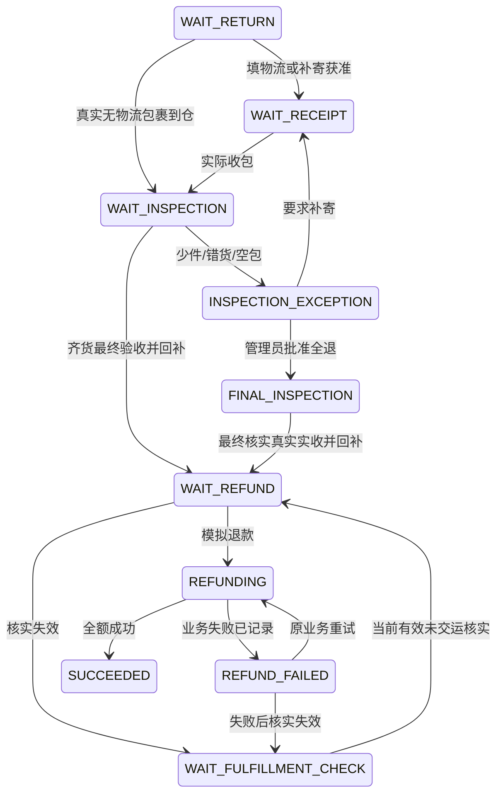
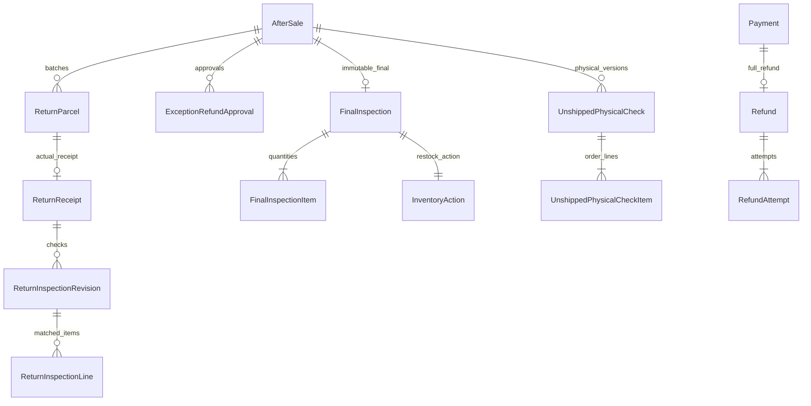

# 板块12：退货实收、验收与退款开发文档

> 一致性审查：2026-11-10。跨板块约定、修订清单及未交付项见开发进度文档根目录《文档一致性审查记录.md》；本标记不代表软件已实现或测试通过。

| 项目 | 说明 |
|---|---|
| 所属里程碑 | M3：售后闭环 |
| 文件序号 | 11；业务板块12（板块8＋9合并） |
| 编写日期 | 2026-11-10 |
| 依赖 | 板块6、8＋9、10、11；权限、Task、文件、审计、设置与期限内核 |
| 业务依据 | 通俗版售后模块；需求v2.0 FR-75～81、90～98，BR-02～07，TD-10～15 |
| 验收关联 | AC-10、12～13、15、18～19、24～26；关联AC-09、14、16、28 |
| 交付目标 | 两类整单全额售后、分批验收、实物核实、失败重试与唯一回补 |
| 文档状态 | 待实施设计与验收要求，不代表功能已实现或测试通过 |

## 1. 范围与核心不变量

### 1.1 必须交付

1. 仓储真实收包、逐行验收草稿与版本、少件/错货/空包异常、补寄批次及累计去重。
2. 正常齐货最终验收：一次性回补可售量、完成验收任务、进入客服待退款。
3. 管理员异常全额退款批准及仓储独立最终核实，保留真实实收，不虚填齐货。
4. 未交运仅退款逐行可售/损耗核实，绑定本售后、订单行及实物版本；损耗/移位使旧核实失效。
5. 一个支付一个全额Refund业务，每次RefundAttempt独立，支持模拟失败、重试、并发防重、重启及响应丢失恢复。
6. 接通板块11真实关闭安全查询器，最终验收（含0回补）或实际退款尝试后，任何角色均不能直接关闭。
7. 仓储收包/验收/异常/核实、客服退款、管理员异常批准、顾客公开进度页面及真实测试。

### 1.2 三条路线的回补时点

| 路线 | 实物依据 | 回补时点 | 退款失败时 |
|---|---|---|---|
| 未交运仅退款 | 当前核实逐行s+d=q | 退款成功事务A+s，R不变 | 不回补，仍为订单备货 |
| 已交运仅退款 | 真实交运及客服明确无需退货决定 | 不回补 | 保留失败待办，不编造退货 |
| 退货退款 | 正常齐货最终验收或批准后最终核实 | 最终验收事务A+s，R不变 | 已回补不撤回，重试不再回补 |

全额退款不等于全量回补。可售为0仍可按责任全额退款；不能仅因质量问题导致不可再售而拒绝退款。收包、草稿、管理员批准、退款失败不能重复扣A/加R。

### 1.3 后续边界

本板块必须真实实现少件补寄、异常全退批准及最终核实，不能全部留到板块13。板块13完善争议关闭、物品保管/寄还安排、冻结顾客核实代录、OfflineCase及跨异常协调。

不新增真实支付网关/回调、部分金额退款、换货/补发交易、额外赔付付款、多仓或聊天。本期无撤销最终验收、隐式库存冲正、管理员万能force-close。所有交易页注明“模拟交易，不发生真实资金流转”；线下费用不混入系统退款。

## 2. 复用、迁移与权限

### 2.1 复用与替换

新增0012_return_inspection_physical_checks_refunds迁移。复用AfterSale、ReturnParcel/LogisticsRevision、AfterSaleDecision/CommandResult、Order/Item/Payment、Shipment/HandoverAttempt、Task/TaskStageCursor/TaskBusinessSource、InventoryAction/Ledger、StockIncident及stock_physical_version、OrderBlock/TimerPause、文件/沟通/审计/设置版本。

不能重建另一套订单/库存/售后状态。板块11ReturnParcel表示首包和补寄批次，真实收包新增ReturnReceipt，不把填物流时刻当receivedAt。关闭安全查询器替换为真实FinalInspection、回补、RefundAttempt读取器；模块安装后缺失或查询失败必须拒绝关闭，不能继续返回空事实。

### 2.2 动作权限与任务

| 动作 | 权限 | 当前经办 |
|---|---|---|
| 仓储退货资料 | after-sale.inspection.read | 按验收投影裁剪 |
| 实际到仓 | after-sale.receipt.record | RETURN_RECEIVE |
| 草稿/异常/两种最终核实 | after-sale.inspection.confirm及依赖 | RETURN_INSPECT |
| 未交运实物核实 | order.physical.check＋order.fulfillment.read | ORDER/PHYSICAL_VERIFY，关联本售后来源 |
| 备货损耗/移动 | inventory.order-exception.manage及依赖 | 复用原异常命令，不随意改版本 |
| 补寄/异常沟通 | after-sale.return.follow＋after-sale.service.read | INSPECTION_EXCEPTION_CONTACT；写沟通另需communication.service.write |
| 异常全额退款批准 | after-sale.dispute.decide | 管理员专属ADMIN_DISPUTE |
| 首次退款 | after-sale.refund.execute＋after-sale.service.read | REFUND_PROCESS |
| 失败重试 | 另需after-sale.refund.retry | 同退款任务，含retry资格 |
| 转交/延期 | task.transfer/deadline.extend | 管理员显式动作 |
| 顾客进度/补寄物流 | 本人有效会话 | 无员工Task，按获准批次 |

仓储不能默认审核/退款，客服不能默认实物验收，管理员也显式领取/转交。个人额外授权不绕过实物和状态要求。限制交易顾客仍可售后，冻结旧token不可用；员工可继续处理既有合法售后，代录顾客输入仍按板块13身份核实。

## 3. 状态、命令与期限

### 3.1 状态图



重新核实后，已有失败Refund则AfterSale恢复REFUND_FAILED、沿原业务和retry权限；从未尝试才WAIT_REFUND。不得通过回待核实抹掉失败历史。REFUNDING在模拟单事务内经过即可，无需提交长期处理中状态。

### 3.2 命令与副作用

| 命令 | 前置 | 状态/任务 | 库存/资金 |
|---|---|---|---|
| receive | 当前到货经办、真实实包 | Receipt、WAIT_INSPECTION、新验收轮 | 无回补 |
| save-draft | 当前验收经办/版本 | 当前包追加完整核对版本 | 无回补 |
| report-exception | 数量/款式异常 | INSPECTION_EXCEPTION、客服异常任务 | 无部分回补 |
| request-reshipment | 异常客服/明确缺失 | 新补寄授权/批次、待收任务 | 无变化 |
| approve-exception-refund | 管理员争议经办 | FINAL_INSPECTION、最终核实新轮 | 不回补、不退款 |
| finalize-normal | 全单齐货且检查完成 | 唯一最终验收、WAIT_REFUND | 一次A+s |
| finalize-exception | 有效批准/当前实物 | 唯一真实最终核实、WAIT_REFUND | 一次A+s，缺失不虚填 |
| confirm-physical | 已同意仅退款、未交/无未决 | 本售后当前核实、待退款 | 不回补 |
| invalidate-physical | 损耗/移动/更正 | 核实失效、新核实轮、暂停退款任务 | 备货损耗A/R不变 |
| refund/retry | 当前退款经办/前置齐全 | 同业务独立尝试、成功或失败 | 按三路线处理 |

### 3.3 期限与轮次

真实receivedAt起算2工作日验收，UTC存储、北京时间周一至周五计算，不接节假日/调休。周五10:00收包默认下周二10:00截止；晚录保存真实时刻，可能已逾期，补记事件，不伪造刚收到。receivedAt≤now，不早于本售后创建；批准前已到仓的特殊事实须说明并核实。

同验收轮又收到包裹不延长原最早收包截止、不重复有效Task；RETURN_RECEIVE采用TaskBusinessSource关联各包裹来源，收完一个包只结束该来源，其余待收来源仍保留；无待收来源才结束该轮，后续新授权再进入新轮。报异常结束本轮，补寄真实到仓才新RETURN_INSPECT轮/新期限/重新领取。旧逾期保留。异常批准进入FINAL_INSPECTION新建RETURN_INSPECT轮，默认批准时刻+2工作日为本版最终核实约定，快照起算类型APPROVAL，不冒充实际收包SLA。

退款条件满足才建REFUND_PROCESS，默认1工作日。失败同轮、保留原dueAt/逾期，候选增加retry、不合资格经办回池。未交运核实失效暂停清经办，重核后恢复同退款轮OPEN、原截止、重新领取；首次无退款Task则满足条件才新建。扫描到期只跟进，不自动验收/退款/关闭；管理员延期有原因和历史。

## 4. 实收、分批去重与草稿

### 4.1 真实收包

仓储实际拿到物品才receive，保存receivedAt、人员、来源、保管位置；顾客已寄/客服查签收不能代替实物。无顾客物流可prepare-receipt-source记录实包来源，创建ReturnParcel及RETURN_RECEIVE OPEN，显式领取后receive。准备来源不写receivedAt、不默认验收。

无物流包裹可不编carrier/tracking；ReturnParcel.current_revision_id需允许空并在0012扩展约束。实包sourceNamespace＋normalizedSourceReference稳定去重，normalize沿NFC/trim/ASCII大小写规则；无外部单号使用内部保管标签，同包重复必须复用标签。全库裸运单号不唯一。数据库不能自动识别同一物品换了编号，需真实交接/标签核实和审计。

### 4.2 按包核对，不累计历史版本

每包草稿是完整替换当前包核对列表的追加revision。每行orderItemId、matchedReceivedQty、sellableQty、unsellableQty、原因。未检查完s+不可售≤实收；检查完成必须等号。matchedReceived只计吻合订单款式的应退物，错款/无关物/超额用ReturnUnmatchedItem单列照片与保管，不凑齐货、不回补本单。

跨包按各包当前有效revision聚合，0≤各行累计实收≤购买数；超出仍记录真实额外物品，不删除事实。首包实收1、补寄实收1，应退2，累计2；补寄不能把累计2再填成该包2而变3。相同SKU多订单行仍按OrderItem归属，不只按SKU判断齐货。

### 4.3 异常与暂存

少件/错货/空包/数量不明保存真实记录并report-exception，进入INSPECTION_EXCEPTION、结束本验收轮、生成客服异常任务。部分可售也不回补，暂存品不能同时人工到货入账。未最终验收前更正用新revision/原因/历史；实物移动或损坏递增returnPhysicalVersion，旧检查基线失效。

### 4.4 补寄

异常客服领取后记录缺失项/顾客沟通，request-reshipment创建授权及后续ReturnParcel批次，快照剩余量和原批准退货地址，不建新AfterSale/部分退款。补寄默认7自然日，取板块4当前deadlines.returnShipDays（数据库return_ship_days）规则单独快照，是本版实现约定，不改原首寄截止。

新RETURN_FOLLOW轮负责提醒，RETURN_RECEIVE待实包；顾客只可对授权parcel填写物流，扩展板块11DTO时不能允许随意指定新batchNo。在途不按超时关闭；补寄到仓新验收轮，再次少件可再次异常/补寄，轮次与旧逾期可追溯，同key不多建批次。

## 5. 最终验收与异常批准

### 5.1 正常最终验收

finalize-normal须当前RETURN_INSPECT经办、RETURN_REFUND/WAIT_INSPECTION、所有行累计实收=应退、全部检查完成、当前包revision和returnPhysicalVersion有效。服务端聚合最终数量，不信任前端finalSellableTotal。

一次事务写不可变FinalInspection/Item，库存动作RESTOCK_FINAL_INSPECTION:{afterSaleId}按可售量聚合SKU增加A，R不变；流水/任务/状态历史/审计一起提交，AfterSale=WAIT_REFUND，客服REFUND_PROCESS新任务。最终验收与退款成功独立。

s=0也允许最终验收/全额退款：保留最终结果和唯一InventoryAction零影响摘要，内核支持effects空集合，不修改余额、不造无意义+0回补流水；这是板块6已定义的零回补契约，需IT验证；成功未交运退款s=0同样保留唯一动作摘要。即使未加库存也已经最终验收，不能直接close。板块6已付备货损耗零事实流水规则不因此改变。

### 5.2 异常全额退款批准

异常客服提交理由/沟通创建ADMIN_DISPUTE；管理员领取approve-exception-refund，记录真实缺失/错货、责任、全额批准原因、公开说明、returnPhysicalVersion/各包revision基线。进入FINAL_INSPECTION、新独立验收轮；批准不加A、不直接退款。

仓储重新领取，finalize-exception引用有效批准并最终检查所有实物。逐行r≤q、s≤r，missing=q−r，不能少件填齐货。按真实s一次回补，FinalInspection.mode=EXCEPTION_APPROVED，进入WAIT_REFUND。新增实包、检查数量/品相更正、损坏/移动等实物变化同事务递增returnPhysicalVersion；纯文字说明不递增。正常最终提交也须确认全部当前包revision仍反映现存实物：受影响包必须重新检查并生成新revision，不要求未受影响包仅因全局版本变动无意义重填；提交时锁内确认当前总基线及所有引用。批准后新增包裹/损坏/移动令基线失效，必须退异常跟进并重新管理员确认，不能用旧批准静默提交。

### 5.3 BR-07

FinalInspection存在（含s=0）、任何回补或任何RefundAttempt存在，任何角色都不可直接CLOSED；REFUNDING/REFUND_FAILED只能必要核实后继续退款/重试。无最终验收/尝试的已寄/部分到仓争议关闭需管理员完整物品去向决定，板块13接通，当前普通close拒绝。

未交运核实后、尚未退款尝试，也不是客服可关闭；管理员后续受控停止退款并失效本售后核实。不得删除失败Attempt或FinalInspection给close放行。本期无最终验收撤销和隐式冲正。

## 6. 未交运仅退款核实与版本

### 6.1 当前核实

仅已同意REFUND_ONLY/WAIT_FULFILLMENT_CHECK、真实未交且无IN_PROGRESS/UNCERTAIN动作。PHYSICAL_VERIFY经办确认停止作业、货仍在手/位置，逐条OrderItem记录sellableQty、damagedQty，s+d=q，全行覆盖、未知未清不允许完成。

UnshippedPhysicalCheck绑定afterSaleId/orderId/当前stock_physical_version、人员/时间/证据，不回补A，货仍是订单专属备货。损耗关联真实StockIncident，已付备货A/R不变；发现新损耗先走正式损耗命令递增版本，再基于新版本核实，不能表单写d却无损耗事实。成功退款结算损耗归属，不重复扣A。若发生补齐，当前d按板块8＋9原损耗减已分配量核对，不能SUM历史damaged_quantity当作当前损耗；补齐同事务递增实物版本并失效旧check。新的s/d须逐行实际核实，不因历史损耗存在就把替换后的可售实物排除。

### 6.2 失效和重核

损耗、移动、更正、交运事实变化、原售后关闭使旧check失效；正式命令同事务先失效/递增实物版本，不靠定时器事后补救。WAIT_REFUND/REFUND_FAILED回WAIT_FULFILLMENT_CHECK，退款Task暂停清经办、核实新轮，保留Refund/Attempt、原退款dueAt/逾期。重核后恢复同退款轮OPEN；失败业务仍需retry权限。

退款锁内复核check归属/当前版本/有效性/逐行数量、真实未交/无未决。过期409 PHYSICAL_CHECK_STALE，不能执行模拟器或回补。若该命令需要补写失效/回池，领域返回已持久化前置失败结果，事务提交后HTTP映射409；不能throw回滚后声称任务已保存。

此类前置失败无RefundAttempt，可在RefundPreconditionRejection记录key/指纹/原结果，原key重放409；重核后新动作新key，不将旧拒绝偷偷变成退款。旧售后check不能新申请复用。

### 6.3 损耗竞争

退款与损耗共用Order/SKU锁：损耗先则旧核实退款拒绝；退款先成功回A后，之后实际损耗走可售损耗−A，不能继续旧备货损耗0。服务锁后重判库存所属，不能照请求到达前旧分配执行。退款失败不释放/转卖/人工再次入账，重试先重验版本。

## 7. 唯一退款、尝试与恢复

### 7.1 业务与执行

首次真正满足条件时，同事务建Refund，payment_id/order_id/after_sale_id唯一，amount_cents=唯一成功Payment.amount_cents含原运费，channel=SIMULATED。重试不换refundNo/id、不撤销原成功Payment。首次AfterSale须WAIT_REFUND；失败重试须REFUND_FAILED及retry资格。

模拟器可单事务执行：锁主体/Order/SKU/附属，重验最新权限/经办/状态/版本及路线→原成功结果重放→新attemptNo→执行模拟→保存结果/库存/主单/任务/历史/审计一起提交。不外调真实资金，不跨HTTP持锁，不人为sleep。

成功：Refund/Attempt=SUCCEEDED，未交运按当前check一次回补并消费check；退货只引用已最终回补动作；已交仅退款无回补。Order=REFUNDED、AfterSale=SUCCEEDED，结束本交易退款/售后任务和来源，终止收货/发货，不恢复计时，历史交运/完成/支付仍保留。

失败：Refund=FAILED、Attempt=FAILED、AfterSale=REFUND_FAILED；订单保持原WAIT_SHIPMENT/SHIPPED/COMPLETED。未交运不回补，退货已回补不撤销；退款Task同轮/原截止，候选增加retry，不合资格者回池。技术异常（断连、审计失败）全部回滚，不伪记已提交模拟失败。

### 7.2 HTTP与幂等

已持久化模拟失败HTTP200，data.attemptOutcome=FAILED/refundStatus=FAILED及公开failureCode/retryAllowed；前端不能任意200当成功。前置409无Attempt；技术5xx无半成功事实。

同commandKey/原请求先校验身份/读取资格，再重放原Attempt和当前业务状态，早于旧版本/当前阶段检查；失败key永远是原失败，即使后续别的key成功。真正重试新key/当前RefundVersion/TaskVersion，同key改内容409。

成功响应丢失原key取回同成功，不再Attempt/回补；不同key对已成功业务409 REFUND_ALREADY_SUCCEEDED。100请求不同key/同版本只一个执行，失败后旧页面排队请求不能自动串行形成99次重试。

### 7.3 模拟开关与重启

开发/隔离测试注入Simulator，脚本按refund/命令布置SUCCESS/FAIL_ONCE/ALWAYS_FAIL；不把simulateFailure写进生产DTO。生产强制关闭测试控制、无夹具HTTP路由。FAIL_ONCE以已提交Attempt判定，重启读数据库，不靠内存计数。

模拟失败码可SIMULATED_TEMPORARY_FAILURE，公开不含堆栈/秘密。REFUNDING仅单事务中间态，不先提交永久占坑；进程中断按事务提交事实恢复。首期无外部回调/分布式支付对账需求。

## 8. 数据库表与约束

### 8.1 ER图



Refund首次执行事务就有首Attempt，不单独提交空业务。FinalInspection包括零回补时也有唯一Action成功摘要。文件、Task及沟通复用真实解析器。

### 8.2 ReturnParcel扩展、ReturnReceipt

ReturnParcel增加origin CUSTOMER_LOGISTICS/WAREHOUSE_UNANNOUNCED/RESHIPMENT_AUTHORIZED、reshipment_request_id可空FK、source_namespace/source_reference_normalized。来源完整时联合唯一，不对全库裸trackingNumber唯一；无物流来源允许current_revision_id空，约束/DTO同步扩展。

ReturnReceipt：id UUID PK、parcel_id UNIQUE FK、after_sale_id FK、received_at、received_by_id员工FK、goods_location varchar(200)、source_note varchar(1000)、recorded_at、version≥0、current_inspection_revision_id可空FK。receivedAt≤recordedAt，归属与当前revision必须同包/售后，可复合FK或锁内验证。引用历史RESTRICT。prepare-source不建此行。

如上传收包检查图沿INSPECTION_EVIDENCE资格；仅receipt.record而无inspection.confirm员工可文字登记，不为照片擅自获得验收权限。

### 8.3 草稿版本、匹配行、未匹配品

ReturnInspectionRevision：id PK、receipt_id FK、revision_no>0、based_return_physical_version≥0、inspection_complete boolean、reason、actor_employee_id FK、created_at；UNIQUE(receipt_id,revision_no)。追加不可删除，当前指针同Receipt。

ReturnInspectionLine：id PK、revision_id FK、order_item_id FK、matched_received_qty/sellable_qty/unsellable_qty整数≥0、condition_note、loss_reason可空；UNIQUE(revision_id,order_item_id)，CHECK以BIGINT算sellable+unsellable≤matchedReceived，完成检查要求等号。全单跨包总量和父表模式等跨表规则锁内验证/IT，不能声称普通CHECK可跨表读取。

ReturnUnmatchedItem：id PK、revision_id FK、description、quantity>0、kind WRONG_VARIANT/EXCESS/UNRELATED/UNKNOWN、custody_location、disposition_note可空。真实额外物品不凑订单齐货/回补，照片按白名单owner/权限绑定，历史保留。

### 8.4 补寄授权与异常批准

ReturnReshipmentRequest：id PK、after_sale_id FK、round>0、missing_items JSON白名单(orderItemId/remainingQty)、reason、communication_id FK、return_address_snapshot、due_at、rule_snapshot、setting_version_id FK、created_by_id/created_at、status OPEN/RECEIVED/CANCELLED；UNIQUE(after_sale_id,round)，部分唯一after_sale_id WHERE status='OPEN'。

一个授权可明确关联多个真实包裹，但每包来源去重；不能因第一包收到就标整个授权RECEIVED，须确认该授权剩余物均已到齐/进入下一明确异常处理，再关闭授权。新补寄轮前结束旧授权并留欠件事实，不删旧批次。

ExceptionRefundApproval：id PK、after_sale_id FK、approval_no>0、based_return_physical_version、based_revision_refs JSON白名单、reason、public_explanation、responsibility_note、approved_by_id FK、approved_at、invalidated_at/reason可空。UNIQUE(after_sale_id,approval_no)，同售后最多一未失效批准；服务重验管理员专属权限，不能填前端退款金额。

### 8.5 FinalInspection / Item

final_inspection：id PK、after_sale_id UNIQUE FK、mode NORMAL/EXCEPTION_APPROVED、approval_id可空FK、return_physical_version、source_revision_refs、inventory_action_id可空UNIQUE FK（仅同事务构造时暂空，成功提交必须非空）、confirmed_by_id FK、confirmed_at、command_key UUID、request_id。异常模式必须批准，普通模式无批准。

构造顺序固定：已取得Order/SKU等上游锁并校验数量→插FinalInspection/Item（action指针暂空）→调用板块6内核，真实FinalInspection此时可被业务解析器查到→回填inventory_action_id→保存状态/任务/历史/审计→提交前断言指针非空。后续不可修改最终数量，首次事务内回填指针不属于重新验收。s=0同样有唯一动作。任一步失败全部回滚，不先提交无动作的最终验收；需要数据库提交时强制完整可用DEFERRABLE约束触发器，不使用普通NOT NULL假称可延迟。

item：id PK、final_inspection_id FK、order_item_id FK、purchased_qty/received_qty/sellable_qty/unsellable_qty/missing_qty整数≥0；UNIQUE(final_inspection_id,order_item_id)，CHECK sellable+unsellable=received、received+missing=purchased；NORMAL必须missing=0（父模式关系锁内/约束触发策略验证）。保留真实缺失，不虚填实收。

最终结果无PATCH/DELETE，action_key=RESTOCK_FINAL_INSPECTION:{afterSaleId}全局唯一。按SKU聚合余额但保留OrderItem明细，s=0也保留FinalInspection和零影响Action。

### 8.6 UnshippedPhysicalCheck / Item

check：id PK、after_sale_id FK、order_id FK、physical_version≥0、check_no>0、status VALID/INVALIDATED/CONSUMED、goods_location、stopped_at、checked_at/by_id FK、invalidated_at/reason、consumed_refund_id可空FK、command_key UUID、request_id；UNIQUE(after_sale_id,check_no)，部分唯一(after_sale_id) WHERE status='VALID'。

item：id PK、check_id FK、order_item_id FK、purchased_qty>0、sellable_qty/damaged_qty≥0；UNIQUE(check_id,order_item_id)，CHECK sellable+damaged=purchased。实物损耗关联用physical_check_item_incident(item_id,incident_item_id)真实FK/联合唯一，不只放任意UUID JSON。全行覆盖、q等于购买快照、损耗归属锁内/IT验证。

退款成功才CONSUMED，失败仍VALID除非实物变化；关闭则INVALIDATED。范围afterSaleId＋Order.stock_physical_version，不是永久“已检查”。库存action_key=RESTOCK_UNSHIPPED_REFUND:{refundId}，与退货验收路径按type/路线互斥，不允许同实物两路径加A。

### 8.7 Refund / RefundAttempt

| 表/字段 | 类型与约束 | 说明 |
|---|---|---|
| Refund.id、refund_no | UUID PK、展示号UNIQUE | 同业务不换号 |
| payment_id、order_id、after_sale_id | UUID FK，各UNIQUE | 一成功支付/订单一个全额退款业务，归属一致 |
| amount_cents、currency、channel | integer>0且≤100000000、支付币种、SIMULATED | 全额含运费，服务等于成功Payment |
| status、version | FAILED/SUCCEEDED，事务中可REFUNDING；integer≥0 | 不永久先提交占坑 |
| succeeded_at、successful_attempt_id | 可空时间、UUID UNIQUE FK | 成功时必填，Attempt属于本Refund |
| created_at、updated_at | timestamptz | 业务历史 |
| Attempt.id、refund_id、attempt_no | UUID PK/FK、整数>0；UNIQUE(refund_id,attempt_no) | 独立尝试，锁内递增 |
| command_key、fingerprint | UUID、char(64)；UNIQUE(refund_id,command_key) | 原动作重放/异载荷冲突 |
| outcome | SUCCEEDED/FAILED | 提交必须明确结果 |
| actor_employee_id、task_id | FK | 实际经办，不接前端actor |
| physical_check_id、final_inspection_id | 可空FK | 按路线引用，已交仅退款可均空但需批准依据 |
| failure_code、public_explanation | 可空/白名单文本 | 失败公开说明不含技术秘密 |
| started_at、finished_at、request_id | 时间/varchar | 每次尝试独立留痕 |

退款成功部分唯一(refund_id) WHERE outcome='SUCCEEDED'。refund.amount_cents等于payment.amount_cents及指针归属等跨表校验锁内/IT保证，不声称单表CHECK会读别表。Payment保持成功，支付销量不倒扣。

### 8.8 其它扩展、索引与附件

AfterSale增加return_physical_version≥0、final_inspection_id可空唯一FK、active_unshipped_check_id可空FK、refund_id可空唯一FK；指针必须本售后，失效原子清指针。returnPhysicalVersion与未交运Order.stock_physical_version用途不同，不能用互相替代；修改前者不在每次纯文字备注时随意递增。

RefundPreconditionRejection：id PK、after_sale_id FK、action、command_key、fingerprint、code、public_result白名单、created_at；UNIQUE(after_sale_id,action,command_key)。保存已提交PHYSICAL_CHECK_STALE前置结果，不冒充Attempt；所有退款入口在同Order锁下先查本表与Attempt/成功结果，统一验证key/指纹；同key不能跨该表和成功结果复用为新执行。其它成功命令复用AfterSaleCommandResult。

索引Receipt(after_sale_id,received_at,id)、Revision(receipt_id,revision_no)、AfterSale(status,updated_at,id)、Refund(status,updated_at,id)、Attempt(refund_id,attempt_no)、Check(order_id,physical_version,status)。部分索引/CHECK/约束全部进migration，不能只在个人数据库。

到仓及验收图片purpose=INSPECTION_EVIDENCE。新增RETURN_RECEIPT owner明确解析真实ReturnReceipt，绑定需after-sale.receipt.record及当前RETURN_RECEIVE经办（提交时校验、完成后按业务读权读取）；RETURN_INSPECTION只解析真实草稿/最终验收记录且绑定需after-sale.inspection.confirm及当前验收经办，不能用到仓权限绑定验收。两个owner均按真实包裹/售后/订单归属裁剪读取；未交运核实用FULFILLMENT_CHECK、FULFILLMENT_EVIDENCE。每次检查最多5张为默认上限，历史引用保留；顾客只读公开说明，不自动读内部照片/位置。原文件owner只支持一种实体时需新增明确枚举，不用同UUID猜表。

## 9. 锁序、事务、终态与统计

### 9.1 TD-11与边界

员工主体按ID（操作者、原/目标经办）→Customer→Order按ID→Product（确需）→SKU/Balance按ID→来源行按ID（确需）→AfterSale/Receipt/Check/Refund/Task等附属。不能先锁Refund/Task再反取主体/Order。只读定位后按序锁并重验，候选变化回滚；死锁/Serializable整个命令最多重试3次、沿原key。

最终验收/退款回补与购买、损耗共用Balance锁。A+s按BIGINT校验后落INTEGER，超界整个事务回滚，不出现已最终验收未入账。旧商品下架/停用不阻止历史回补，SKU/账户不可物理删；回补后能否买仍取商品状态和其它购买阻塞。

### 9.2 审计、重放与失败

各变更稳定commandKey，规范化指纹含业务目标/首次内容及版本、排除requestId。成功重放先校验身份/归属，再查原结果，旧expectedVersion不使合法重放失败；新真实动作新key。同key异内容409。

Task、余额/Action/Ledger、主单、文件引用、历史/审计、命令结果同事务；审计失败必须全回滚，不先入账再异步补审计。管理员批准/仓储最终核实分别真实本人操作，不能备注写管理员姓名冒充批准。

### 9.3 成功结束与口径

Refund成功Order=REFUNDED/AfterSale=SUCCEEDED，结束本售后/退款与履约任务、释放自身来源，TimerPause终止不恢复dueAt。其他来源尚需调查可保留必要任务，不批量删除历史或清全部SKU购买阻塞；订单终态本身禁止新发货/收货。

成功退款额按Refund.succeededAt北京时间计今日，历史订单今日退也计今日，净收款可负；失败不计退款。支付记录/支付销量保持历史。累计净消费仅完成单贡献，完成后成功全退扣回，未完成单退款不先加后扣虚构消费；completedAt不清空。累计统计BIGINT按前序字符串JSON。

## 10. API与OpenAPI契约

路径省略/api/v1，沿Bearer、错误壳/requestId、严格白名单DTO。员工变更含commandKey、reason、expectedAfterSaleVersion、expectedTaskVersion；需要的包裹/实物/Refund版本另列。正常操作可明确操作说明，不接受actor/amount/status/force/skipPhysicalCheck/simulateFailure。

### 10.1 收包、验收与异常

| 方法/路径 | 请求要点 | 权限/行为 |
|---|---|---|
| GET /admin/after-sales/:id/inspection | 无 | inspection.read；按包/行/当前版本聚合、任务/最终结果 |
| POST /admin/after-sales/:id/prepare-receipt-source | parcelId?或sourceNamespace/sourceReference、sourceReason | receipt.record；准备来源/待收任务，无receivedAt；无Task时不传TaskVersion |
| POST /admin/after-sales/:id/received | parcelId、receivedAt、goodsLocation、sourceNote、版本 | 当前RETURN_RECEIVE经办，唯一收包 |
| POST /admin/after-sales/:id/inspection/drafts | receiptId、items、unmatchedItems、inspectionComplete、expectedReceiptVersion、expectedReturnPhysicalVersion | 当前RETURN_INSPECT经办，完整替换式追加版本 |
| POST /admin/after-sales/:id/inspection/exception | currentRevisionRefs、exceptionTypes、publicExplanation、版本 | 当前验收经办，异常无回补 |
| POST /admin/after-sales/:id/reshipment-requests | missingItems、communicationId、publicExplanation、版本 | 当前异常客服，新授权/批次/期限 |
| POST /admin/after-sales/:id/exception-refund-requests | communicationId、reason、publicExplanation、版本 | 当前异常客服，建管理员任务，不批准 |
| POST /admin/after-sales/:id/exception-decision | decision=APPROVE_FULL_REFUND、basedReturnPhysicalVersion、currentRevisionRefs、reason、publicExplanation、版本 | 管理员当前ADMIN_DISPUTE |
| POST /admin/after-sales/:id/inspection/finalize | currentRevisionRefs、expectedReturnPhysicalVersion、版本 | 正常齐货最终验收，服务端聚合s |
| POST /admin/after-sales/:id/inspection/finalize-exception | approvalId、currentRevisionRefs、expectedReturnPhysicalVersion、版本 | 专用批准后最终核实，实收可不足 |
| POST /store/after-sales/:id/return-logistics | 沿板块11，补寄带获准parcelId | 本人有效授权，不能自行新batchNo |

items每行为orderItemId/matchedReceivedQty/sellableQty/unsellableQty/conditionNote；每包最多100订单行，与最大订单行一致。exceptionTypes=SHORTAGE/WRONG_ITEM/EMPTY_PACKAGE/UNKNOWN_QUANTITY/DAMAGED；损坏但齐货可正常最终验收，不一律拒绝。

异常批准当前只实现APPROVE_FULL_REFUND，不偷偷支持缺物品去向的CLOSE；完整争议关闭由板块13受控命令扩展。批准失败不顺带改实收/库存。

### 10.2 核实和退款

| 方法/路径 | 请求要点 | 行为 |
|---|---|---|
| GET /admin/after-sales/:id/physical-check | 无 | 适当履约/服务读取权限，位置按投影裁剪 |
| POST /admin/after-sales/:id/physical-check | stoppedAt、goodsLocation、items[{orderItemId,sellableQty,damagedQty,incidentItemIds}]、expectedPhysicalVersion、版本 | order.physical.check、当前PHYSICAL_VERIFY，全行等式 |
| POST /admin/after-sales/:id/refund | physicalCheckId?/expectedPhysicalVersion?、expectedFinalInspectionId?、commandKey、版本 | 首次execute，金额取成功Payment |
| POST /admin/after-sales/:id/refund-retry | refundId、expectedRefundVersion、路线引用/版本、commandKey、版本 | execute＋retry，同业务新尝试 |
| GET /admin/after-sales/:id/refund | 无 | 服务查询业务/尝试/公开失败和操作项 |
| GET /store/after-sales/:id | 无 | 扩展公开收包/验收/退款进度，隐藏内部证据/位置/员工信息 |

首次Refund不存在不需RefundVersion，使用AfterSale/Task版本；重试必须当前RefundVersion。已交仅退款引用真实无需退货决定，不编FinalInspection。HTTP200结果必须含attemptOutcome和当前业务状态，客户端明确区分失败。

### 10.3 JSON请求示例

未交运买2、真实已记录损耗1的核实；ID/时间/版本替换为真实读取值：

```json
{
  "stoppedAt": "2026-11-10T02:00:00.000Z",
  "goodsLocation": "备货暂存区A，已停止交运",
  "items": [
    {
      "orderItemId": "bdc653f0-6f57-4109-9ad9-a74bd79d7648",
      "sellableQty": 1,
      "damagedQty": 1,
      "incidentItemIds": ["992a78a8-95b0-49bc-b42d-966ef750904a"]
    }
  ],
  "expectedPhysicalVersion": 2,
  "expectedAfterSaleVersion": 3,
  "expectedTaskVersion": 1,
  "commandKey": "a068cb05-dd6f-4c8f-a2fd-83a05a41bed6",
  "reason": "逐行核对可售1、损耗1，货物仍在手"
}
```

失败后重试，示例未交运路线且当前核实仍有效：

```json
{
  "refundId": "fffcdf6c-b5f1-420f-933d-a847e858231c",
  "physicalCheckId": "f0287d54-b14d-49eb-9536-9c4296b91a3c",
  "expectedPhysicalVersion": 2,
  "expectedRefundVersion": 1,
  "expectedAfterSaleVersion": 5,
  "expectedTaskVersion": 2,
  "commandKey": "59945680-c1f4-4970-96cd-ac8879798331",
  "reason": "核实版本未变，沿原模拟退款业务重试"
}
```

业务失败200至少返回data.attemptOutcome=FAILED、refundStatus=FAILED、afterSaleStatus=REFUND_FAILED、refundId/attemptId/attemptNo、公开failureCode、retryAllowed、当前versions。字段存在refundId不代表成功。

### 10.4 错误码

| HTTP/code | 场景 |
|---|---|
| 400 VALIDATION_FAILED | 非法数量/时间/重复行/未知字段/客户端金额 |
| 401/403/404沿用 | 无效会话/权限/归属，附件遵循相同404策略 |
| 409 VERSION_CONFLICT / TASK_NOT_ASSIGNEE | 旧版本/非当前经办 |
| 409 RECEIPT_ALREADY_RECORDED / RECEIPT_SOURCE_CONFLICT | 新动作重复实际包裹/来源，原key可重放 |
| 409 INSPECTION_INCOMPLETE / INSPECTION_QUANTITY_MISMATCH | 未检查完或普通验收不齐货/跨包数量不符 |
| 409 FINAL_INSPECTION_ALREADY_EXISTS | 新key二次最终验收 |
| 409 EXCEPTION_APPROVAL_REQUIRED / EXCEPTION_APPROVAL_STALE | 无批准/实物基线变化 |
| 409 PHYSICAL_CHECK_STALE / PHYSICAL_CHECK_INCOMPLETE | 核实失效/不全，尚未执行退款 |
| 409 HANDOVER_VERIFICATION_REQUIRED | 存在未决交运 |
| 409 REFUND_PRECONDITION_FAILED / REFUND_ALREADY_SUCCEEDED | 条件不符/已成功不得再执行 |
| 409 COMMAND_PAYLOAD_CONFLICT / REQUEST_IN_PROGRESS | 同key异语义/有界等待超时 |
| 409 AFTER_SALE_CLOSE_FORBIDDEN | 最终验收/回补/尝试后关闭 |
| 409 INVENTORY_BALANCE_OVERFLOW | A+s超过整数上界，整个事务回滚 |
| 200＋attemptOutcome=FAILED | 模拟业务失败已记录，不等于技术故障 |
| 5xx统一技术错误 | 数据库/审计异常，事务回滚，原key可重试 |

## 11. 页面与恢复提示

仓储待收页分开显示顾客声明、物流和实际到仓，先领再登记。验收页按订单行/每包/累计显示应退、实收、可售、不可售、缺失/错货暂存，不能把累计数回填单包。普通最终验收与批准后最终核实不同按钮/请求，弹窗显示本次A回补及不可随意撤销的最终事实；s=0也明确完成验收后须继续退款。

异常页显示客服沟通/补寄授权/管理员批准/仓储最终核实的独立进度。未交运核实页显示afterSaleId、实物版本、s+d=q、停止作业与位置；过期check提示重核，后端仍锁内验证。

客服退款页显示原支付全额含运费、模拟说明、路线、验收/核实依据、原退款号及每次尝试。失败保留原任务、用新key重试；响应不明用原key重放。撤权提示重新安排，不新建无资格尝试。

顾客只见公开进度、补寄缺失项、批准地址、退款失败/成功说明；内部照片/保管位置/员工个人信息/成本不自动公开。无实时物流/聊天，联系使用全店电话。

## 12. Swagger详细测试

### 12.1 环境和记录

Swagger：http://localhost:3000/api/docs。准备仓储甲/乙、客服甲/乙、管理员、顾客甲/乙。经真实入账→购买→支付→交运/收货→板块11申请审核生成独立测试订单，包含多SKU、一行购买2件及运费非0。正常/少件/异常批准/未交运/已交仅退款各用独立售后，不SQL改status造成功。

Authorize切身份先清旧token。记录Order/AfterSale/Payment/Refund/Attempt、包裹/Receipt/revision、Task/round/version、库存A/R、实物版本、commandKey/requestId。失败由隔离服务端脚本布置Simulator，生产Swagger无失败开关。顺序Swagger不证明并发通过，故障/并发/Clock另见IT。

### SW-01：权限、任务与真实收包

1. 已批准退货单顾客填物流，客服调用received应403；仓储未领RETURN_RECEIVE应409。
2. 仓储甲领取待收任务，POST received填真实receivedAt/位置，预期Receipt一条、WAIT_INSPECTION、RETURN_INSPECT新轮OPEN及实际收包起2工作日截止。
3. 甲须再领新验收轮才能draft/finalize；乙不能用旧页面抢处理。A/R/Payment/Refund均不变。
4. 同key重放原Receipt；不同key重复同parcel/来源拒绝，不再起轮或延长截止。

### SW-02：无单号实际到仓

1. 已同意退货但未填物流，仓储prepare-receipt-source记录真实包裹标签/原因，只生成来源和待收任务，不自动已收到。
2. 显式领取后received成功，无需顾客编单号；之后补充物流关联原实包，不重建包裹。
3. 未来receivedAt、错售后parcel、重复标签拒绝。顾客已寄/客服查签收不能代替仓储实收。

### SW-03：正常最终验收与一次回补

1. 逐包draft完整登记多SKU订单行，实收=应退，s+不可售=实收且inspectionComplete=true，GET核对当前聚合。
2. finalize正常路径，预期唯一FinalInspection、A按s增加/R不变、唯一Action/流水、WAIT_REFUND/客服新任务；支付未变且未显示退款成功。
3. 同key重放不重复回补；不同key再finalize409；最终记录无普通修改/删除API。
4. 商品下架/停用不阻止历史售后回补，下架商品回补后不自动可购买。

### SW-04：齐货但全不可售

1. 真实质量问题且齐货，所有行sellable=0、unsellable=实收，客服已同意退货、仓储检查完成。
2. finalize成功WAIT_REFUND，A/R不变但FinalInspection/零影响Action摘要存在，不能凭“没加库存”允许close。
3. 客服仍可全额模拟退款含运费，不能因不能再卖自动拒绝或只退部分金额。

### SW-05：少件、错货、空包不回补

1. 应退2，首包匹配1，错款放unmatchedItems，不凑实收2；保存真实草稿。
2. 正常finalize409，report-exception进入INSPECTION_EXCEPTION/客服任务，A/R不变。
3. 空包独立单实收0仍保存真实Receipt/异常，不可填0可售就直接完成整单；部分可售1也不能先人工入库再最终回补。

### SW-06：两轮补寄与累计去重

1. 客服领取异常任务，记录缺失项/顾客沟通，request-reshipment新授权/批次；顾客只对获准parcel填物流，地址沿原批准快照。
2. 首包1＋补寄实际1、应退2，累计2；补寄将累计2填成本包2会聚合超应退，拒绝或要求把额外物单列。
3. 同包草稿新revision替代当前核对量，旧新两版不能相加；重复收包/原key不重复。
4. 另一多件单补寄仍少→再次异常→第二次补寄，到仓验收round再+1、新经办/截止；旧逾期保留，最终一次按s回补。

### SW-07：管理员异常批准与最终核实

1. 少件异常由客服申请异常全额退款，创建ADMIN_DISPUTE；客服/仓储默认不能自己批准。
2. 管理员领取exception-decision批准，预期FINAL_INSPECTION及独立最终核实轮，A/R不变、无退款成功。
3. 仓储领取finalize-exception，引用approval/当前版本，保留received<应退与missing，真实s一次回补。
4. 批准后新增包裹/损坏移动令旧基线失效，409 EXCEPTION_APPROVAL_STALE并重新核对批准，不能虚填齐货或客户端指定部分退款。

### SW-08：未交运可售/损耗核实

1. 已付款未交运买2，同意仅退款后WAIT_FULFILLMENT_CHECK。仓储领PHYSICAL_VERIFY，正式记录备货损耗1，A/R不二扣。
2. physical-check全行s=1/d=1、关联真实incidentItemId及当前version，成功WAIT_REFUND/退款任务；A仍不回补。
3. 少行/重复/错归属/合计不等于购买数/未知未清拒绝；客服默认不能代核实。从未领单不等于可免核实。
4. 交运IN_PROGRESS/UNCERTAIN独立单直接核实/退款均拦，先按板块10核实交运事实。

### SW-09：核实后变化、失效与重核

1. 独立单核实后正式损耗/移动，physicalVersion递增、check失效、回WAIT_FULFILLMENT_CHECK，退款任务暂停清经办。
2. 旧check退款409 PHYSICAL_CHECK_STALE，无Attempt/回补；若该409提交失效/回池，GET必须可查真实结果，不能事务已回滚却说任务生成。
3. 仓储重核新版本，恢复同退款轮OPEN及原dueAt、重新领取；旧check不能因同SKU自动沿用。
4. 失败退款后重核仍沿原Refund/retry资格；原售后受控关闭后新申请必须新check，管理员完整关闭路径SW-L01补验。

### SW-10：未交运失败后原业务重试

1. 脚本布置FAIL_ONCE，客服领取退款任务POST refund；预期HTTP200但attemptOutcome=FAILED、AfterSale=REFUND_FAILED、Refund=FAILED、原订单状态保留。
2. 买2核实1可售1损耗：失败A不增加，Task同轮/原截止，Attempt1失败可查。
3. 原失败key重放仍Attempt1，不触发再次执行；新key/当前版本refund-retry成功Attempt2、同Refund，A只+1/R不变、Order=REFUNDED/AfterSale=SUCCEEDED。
4. 原成功key不重复回补；不同key再执行409。Payment仍成功，固定退全额含运费。

### SW-11：退货退款失败不再回补

1. 正常最终验收已A+s，再布置模拟失败refund。
2. 失败不撤原A+s、不将最终验收改回草稿、不生成第二验收入库，保留失败待办。
3. 新key重试只增加成功Attempt/退款结果，A/R与最终验收后相同；顾客看到失败后成功，审核/验收不能提前显示退款成功。

### SW-12：已交运仅退款及事实补录

1. SHIPPED/COMPLETED仅退款，客服明确无需退货批准后WAIT_REFUND，不要求退货验收。
2. 成功A/R不变，无伪Receipt/FinalInspection/未交运check；金额含原运费，完成后退款扣回净消费。
3. 交包响应失败单在售后暂停中补录实际已交运，再按板块11限定决定确认无需退货；未知期间不能走未交运回补。

### SW-13：BR-07任何角色禁止关闭

1. 正常最终验收（含s=0）、异常批准后最终核实、失败Attempt三类真实单，普通close及管理员直接close均拒绝。
2. 删除失败Attempt/撤销最终验收/force=true没有绕过入口，失败只必要重核后继续退款。
3. 无最终验收/尝试但部分到仓也不能客服关闭，转管理员完整去向决定，SW-L01补验。关闭安全查询器须读本次真实事实，不能用空实现或假夹具代替。

### SW-14：撤权、retry资格与公开隔离

1. 仅额外获execute未获retry的员工首次失败，资格更新回池，不可重试；有retry员工重新领同轮。
2. 停用/撤权旧token不可验收/退款，管理员接手也显式领/转交，失败历史不清空。
3. 乙查甲售后/私有图404；顾客只看公开进度/失败说明，不读内部照片、位置、员工个人信息/成本；仓储不能借验收查询全量客服材料。

### SW-15：期限、结束及统计

1. Clock验证周五收包+2工作日、退款条件满足+1工作日、截止等号仅提醒；改全局设置不改旧轮，延期保留旧逾期。
2. 成功REFUNDED不恢复发货/收货，其他来源调查事实保留，不全清SKU购买阻塞。
3. 失败不计退款；成功按succeededAt北京时间计，历史订单今日退算今日，净收款可负、支付销量不倒扣、完成后退款扣净消费。看板完整界面板块14补验，当前真实查询/数据核对。

### SW-L01：板块13争议与代录补验

无最终验收/尝试的受限关闭须管理员决定、物品保管/寄还去向和公开理由；未交运停止退款失效核实，新申请重核。冻结顾客代录须身份核实，不跳过数量/金额/权限。补寄/超期无人接手靠真实Task协调；最终验收/尝试后管理员仍不可关闭。

### SW-L02：板块14～15看板与交付补验

用真实成功/失败/跨日退款、完成后退款、0回补核对退款额/净收款/净消费/支付销量；多实例并发、Compose冷启动/持久化、全链路与全量验收。尚未实现的图表不能声称已交付。

## 13. 自动化、数据库与故障验证

### IT-01：约束与归属

真实PostgreSQL16验证一支付Refund、一成功Attempt、一FinalInspection、一包Receipt、来源去重、有效check部分唯一、库存action_key唯一。边界/随机数量0≤s≤r≤q、s+不可售=r、未交运s+d=q；跨售后OrderItem/Parcel/Approval/Check/Payment拒绝。空库/0011升级库索引/CHECK/FK一致。

### IT-02：100并发退款

同key100请求只一个Attempt/成功，不同key同版本最多一个执行；失败后旧页面排队不串行重试。成功key原成功/失败key原失败、同key异载荷冲突；重启同Refund/Attempt可查/重放，不依赖内存锁或FAIL_ONCE计数。

### IT-03：验收、补寄与0回补

多SKU/多订单行、多包当前revision聚合，同包编辑/重复收包不累加、错款超额隔离、少件无部分回补；两轮补寄任务/期限重入。普通/异常最终验收竞争只有一FinalInspection/Action；s=0仍最终化并禁止close，退货不得再人工入库。

### IT-04：核实版本与损耗竞争

核实→损耗/移动/更正使旧check失效，旧退款409无Attempt/回补，持久化前置拒绝与HTTP一致、旧key不悄悄成功。屏障控制损耗先/退款先：前者旧核实拒绝，后者后续损耗走可售−A。新售后不复用旧check，已交/未决不能借核实退款。

### IT-05：事务和业务失败

Receipt/Revision/FinalInspection/Balance/Ledger/Action/Refund/Attempt/Task/Block/TimerPause/历史审计/命令结果逐点故障，全部原子回滚。模拟失败正常提交Attempt，未交运不回补、退货保留已回补。区分FAILED 200、前置409、技术5xx，不吞失败历史、不审计失败仍提交退款。

### IT-06：响应丢失与重启

提交后丢HTTP原key取同结果，不重复包裹/授权/验收/尝试/回补。技术回滚原key可重执行，无永久PENDING/REFUNDING。进程中断事务回滚，FAIL_ONCE根据已提交Attempt判定，不编外部回调恢复。

### IT-07：任务、期限和权限

抢领/撤权与验收退款仲裁、管理员显式接手、retry资格更新回池。两轮补寄/验收新轮不继承经办，失败/重核仍原退款轮/截止。周末/等号/晚录收包/多实例晚扫描只一次逾期，批准最终核实起算类型明确。

### IT-08：BR-07、终态与隐私

FinalInspection有回补/0回补、Attempt失败/成功及REFUNDING等，任何角色直接close拒绝；真实查询器替换空实现。REFUNDED不恢复计时/履约，不清完成/支付历史；来源调查按需保留。顾客/仓储/客服/管理员投影和私有图、未知DTO/金额/force字段覆盖。

### IT-09：边界和统计

金额固定等于Payment全额含运费且≤100000000，拒绝前端金额。A+s以BIGINT验INTEGER边界，超界退款/最终验收全回滚。按成功日期统计、失败不计，净收款负值/完成后扣净消费/支付销量不倒扣可复算，累计BIGINT字符串契约不丢精度。

### IT-10：端到端与工程

真实购买→未交运1可售1损耗→失败重试；真实交运→退货验收→失败重试；少件两轮补寄；不齐货管理员批准→真实最终核实→全退；已交仅退款；0可售全退。逐步核对页面/A/R/流水/任务。

执行pnpm lint、pnpm typecheck、pnpm test、pnpm test:integration、pnpm build、pnpm openapi:export、pnpm api-client:generate并保存真实退出码。空库/升级迁移、Compose四服务冷启动、私有卷/历史重启持久化、两前端深层路由及前序权限回归。正式构建无失败控制/改状态/造收包测试接口。

## 14. Agent执行、追踪与完成门槛

### 14.1 可交给Agent的任务

> 请实现板块12，先阅读通俗版、需求v2.0与板块6/8＋9/10/11/12及当前仓库。复用真实售后/包裹/订单/支付、Task、库存内核、实物版本和文件审计，完成实际收包、按包追加草稿/去重、少件异常/两轮补寄、正常最终验收、管理员异常全退批准及仓储独立最终核实。实现未交运本售后逐行核实/失效重核、唯一Refund/独立Attempt、模拟失败/原业务重试。未交运成功才回补、退货最终验收即回补、已交仅退款不回补；最终验收（含0回补）或退款尝试后任何角色不可直接关闭。真实关闭安全读取器替换空实现。按TD-11/14、稳定key/当前版本、任务库存状态历史审计同事务完成前后端、Swagger、真实数据库并发/故障/端到端，报告证据与后续补验。无真实支付/部分退款/万能force-close，不把200业务失败当成功。

### 14.2 推荐顺序

1. 核对实际Schema/权限/Task，落0012约束与真实关闭安全读取器。
2. 收包来源/唯一Receipt、按包草稿版本/数量、验收轮和截止。
3. 异常/补寄授权/顾客物流扩展、两轮分批去重。
4. 正常最终验收一次回补（含0）和待退款。
5. 管理员批准/基线失效/仓储独立最终核实。
6. 未交运check/损耗关联/版本失效重核/并发。
7. Refund/Attempt、三路线失败成功/重放恢复。
8. 页面隐私、BR-07真实回归、统计/全链路和工程检查。

### 14.3 追踪表

| 通俗版业务 | FR/BR/TD | 本板块产出 | 验收 |
|---|---|---|---|
| 实际收到/逐行检查 | FR-75/90、BR-02 | Receipt/草稿/实际收包截止 | SW-01～03、IT-01/03 |
| 少件错货补寄 | FR-75/92 | 异常/批次去重/任务重入 | AC-12/26、SW-05～06 |
| 正常/异常最终核实回补 | FR-76～77、BR-03～04 | FinalInspection/批准/唯一Action | AC-12/25、SW-03～07 |
| 未交运核实和失效 | FR-78、BR-04、TD-11 | 本售后全行check/损耗仲裁 | AC-10/24、SW-08～09 |
| 唯一退款失败重试 | FR-79～80、BR-06、TD-10/14 | Refund/Attempt/模拟器恢复 | AC-13、SW-10～12、IT-02/05～06 |
| 受限结案 | BR-07、FR-77～80 | 真实守卫，无最终验收撤销 | AC-25、SW-13、IT-08 |
| 费用/统计/岗位隐私 | FR-81/93/95～98 | 固定金额/投影/成功口径 | AC-18～19、SW-14～15 |

### 14.4 交付与完成判断

- [ ] 0012实际表/唯一/FK/CHECK/索引，真实关闭安全查询器注册。
- [ ] 收包/草稿/补寄/两类最终核实/check及失效重核的真实API/页面。
- [ ] 三路线唯一全额模拟退款/独立尝试/失败重试，业务/技术失败区分。
- [ ] Task/期限/库存/阻塞/历史审计/幂等原子、标准锁序与金额库存边界。
- [ ] Swagger/OpenAPI/生成客户端/README和测试夹具，生产无失败开关入口。
- [ ] 15项SW、10项IT逐项证据，SW-L01～02后续补验登记。
- [ ] docs/verification/M3-12.md记录日期环境、实际请求响应、requestId/版本/库存前后、命令退出码、截图、问题及复测；未执行标未执行。

完成需真实证明少件不提前回补、补寄不重复、批准不虚填齐货、0可售仍全退、核实后损耗拒绝旧版本、未交运失败不回补、退货失败不重复回补、100并发最多一次成功、最终验收/尝试后管理员也不能直接关闭。

本份文档产出不等于实现或测试通过。板块12实际完成仍需板块13跨岗争议/代录/线下协作及M4全量验收部署，不能直接认定M3或整个项目完成。

