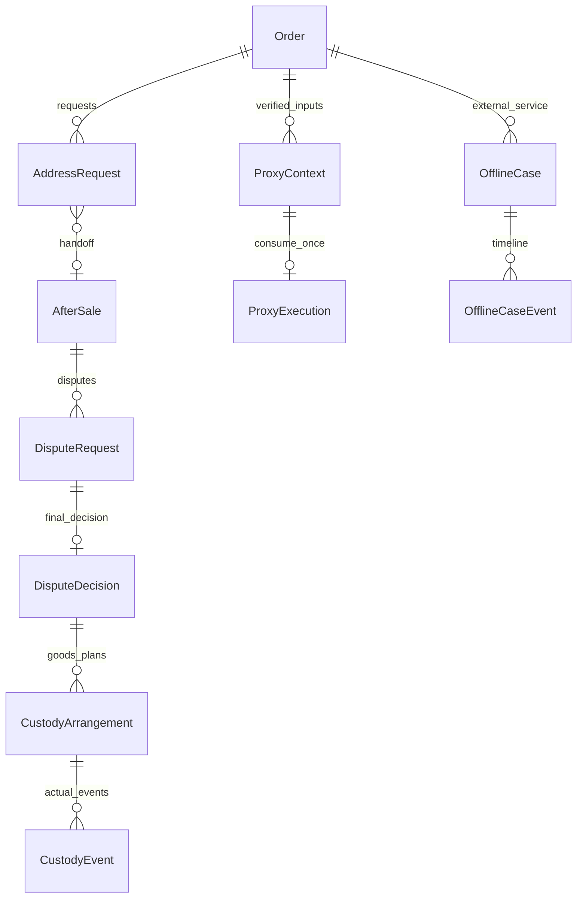

# 板块13：异常协作、争议、线下处理与任务闭环开发文档

> 一致性审查：2026-11-10。跨板块约定、修订清单及未交付项见开发进度文档根目录《文档一致性审查记录.md》；本标记不代表软件已实现或测试通过。

| 项目 | 说明 |
|---|---|
| 所属里程碑 | M3：售后闭环 |
| 文件序号 | 12；业务板块13（板块8＋9合并） |
| 编写日期 | 2026-11-10 |
| 依赖 | 板块2～4、6、8＋9、10～12实际实现 |
| 业务依据 | 通俗版权限、库存、订单、售后与顾客模块；需求v2.0 FR-04、14、35、55、63～66、74～81、90～98；BR-02～07、TD-10～15 |
| 主要验收 | AC-02、09～17、19、21、24～26、28相关部分 |
| 本阶段目标 | 异常有人负责、实物去向可查、争议合规结案、冻结代录和线下结果真实留痕 |
| 文档状态 | 待实施设计与验收要求，不代表代码已实现或测试通过 |

## 1. 范围和前序衔接

### 1.1 必须完成

1. 发货异常等待/退款的跨岗完整操作：仓储实物、客服顾客意见、同版本双确认、正式售后与最后阻塞解除。
2. 改址诉求按未付、已付未交运、已交运分别处理；不允许编辑订单收货地址快照。
3. 受损待付的付款阻塞/核实/安全关闭及已付备货损耗的真实回归和工作台衔接。
4. 退货争议的管理员受限关闭、物品保管/寄还安排与后续责任；复用异常全退批准/最终核实。
5. 冻结顾客经身份核实代录原单售后、材料、寄回物流、线下结果，不能冒用顾客身份或绕过规则。
6. OfflineCase记录超期诉求、转寄、额外补发/费用等线下实际处理，不写系统退款/库存。
7. 所有阶段转交、回池、无人候选、超期协调、公开/内部说明及前后端页面。
8. 完成/退款后历史运单纠错仍管理员专属，补发/转寄不能覆盖原运单。

### 1.2 复用而非重做

新增0013_exception_coordination_proxy_offline迁移。复用ShipmentException/Decision、StockIncident、OrderAddressSnapshot、AfterSale/Decision、Receipt/Inspection/Approval/PhysicalCheck、Refund/Attempt、OrderBlock/TimerPause、Task/Source/History/DeadlineEvent、Communication和FileReference。

板块10已有交运核实/发货异常，板块11已有材料/普通允许关闭，板块12已有补寄/异常批准/最终核实/退款。当前补齐受限管理员关闭、代录、改址诉求、线下工单和跨来源衔接，不另建一套“异常订单status”或退款引擎。

不开发新岗位/动态角色、多商家、聊天/消息已读、真实物流/支付、部分退款、订单内改址、自动补发订单或自动额外赔付。线下记录不是上述功能的替代交易实现。

未交运备货使用Order.stock_physical_version，退货暂存使用AfterSale.return_physical_version；请求和决定引用正确版本范围，不能拿其中一个替代另一个。

### 1.3 六个必答问题

任一异常详情应能说明：货在哪里；当前哪个Task、谁经办；下一步和责任岗位；截止/是否逾期；本步A/R是否变化及原动作；退款是否真实成功及原Refund/Attempt。未知就明确未知和核实任务，不能用备注“已处理”代替事实。

## 2. 权限、工作台与任务内核

### 2.1 动作权限

| 动作 | 权限 | 经办要求/边界 |
|---|---|---|
| 发货异常实物/齐货 | shipment.exception.manage及查询依赖 | SHIPMENT_EXCEPTION_VERIFY |
| 顾客等待/继续/退款意见 | shipment.customer-confirm＋communication.service.write | CUSTOMER_CONTACT，关联本来源 |
| 损耗/受损待付核实 | inventory.order-exception.manage及依赖 | STOCK_EXCEPTION_VERIFY/原核实任务 |
| 未交运货在手核实 | order.physical.check及order.fulfillment.read | PHYSICAL_VERIFY |
| 交运已交/未交/仍不明 | shipment.handover及依赖 | HANDOVER_VERIFY，不能普通客服猜测 |
| 售后协助申请（限定异常/改址） | after-sale.review＋order.service.read＋communication.service.write | 当前关联CUSTOMER_CONTACT；有顾客明确同意，不自动批准 |
| 冻结顾客身份核实/代录 | customer.frozen.proxy及依赖 | 本文PROXY_INPUT任务，不能获取顾客token |
| 线下工单处理 | offline-case.manage及order.service.read | OFFLINE_FOLLOW；涉及争议决定另需管理员 |
| 普通允许关闭 | after-sale.close | 沿板块11，不扩权限范围 |
| 受限管理员结案/异常批准 | after-sale.dispute.decide | ADMIN_DISPUTE，管理员专属不可下放 |
| 转交/延期/未付手动关闭 | task.transfer/deadline.extend/order.unpaid.close | 各管理员专属，互不替代 |
| 历史运单纠错 | shipment.history.correct | 仅管理员，沿板块10接口 |

管理员不豁免领单/BR-07/库存和金额规则；个人授权按固定依赖补齐。代录权限不隐含审核、验收、退款、顾客解冻或订单付款权。

### 2.2 新阶段与共用来源

新增PROXY_INPUT，businessType=ORDER，候选customer.frozen.proxy＋customer.read＋after-sale.service.read，无新增默认SLA；身份核实上下文创建时建立来源，每个订单此阶段最多一个有效任务，多份尚未消费上下文通过TaskBusinessSource关联。创建人不自动领取。上下文失效/消费只结束自身来源，全部结束才结束该轮。顾客状态变化/员工失权钩子失效未消费上下文；到期扫描仅失效过期Context并消费其任务来源，不结束售后，重复扫描无新轮，提交入口仍独立检查到期。

新增CUSTODY_EXECUTE，businessType=CUSTODY_ARRANGEMENT，候选after-sale.inspection.read＋after-sale.inspection.confirm，无默认SLA；有实际保管交接/寄还待执行安排时生成OPEN，仓储显式领取后记录实物事件。custodian_employee_id表示实际保管人，不替代本阶段Task经办。售后终态不取消仍有效的此类任务；纯客服沟通由关联工单负责。

新增OFFLINE_FOLLOW，businessType=OFFLINE_CASE，候选offline-case.manage＋order.service.read，无默认SLA；登记后OPEN、处理前显式领取。需要管理员决定时同工单可有ADMIN_DISPUTE任务，其候选仅after-sale.dispute.decide；扩展真实业务解析器，不给普通客服管理员能力。

原ORDER/PHYSICAL_VERIFY、CUSTOMER_CONTACT、HANDOVER_VERIFY与AFTER_SALE各阶段复用TaskBusinessSource。同stage有效唯一，不能为每来源造同时有效Task。一个来源解决只消耗本来源，其他来源仍在则不能结束整个任务。

### 2.3 转交、回池和无人接手

复用板块4原子claim/transfer/release/延期，不新建“负责人姓名”字段替代Task。转交/回池仍当前round、dueAt不变；真正补材料/补寄/重新发货才新round。停用/撤权/调岗同事务锁主体重验资格，回池不合资格任务并留历史；已交运/验收/付款/失败Attempt事实不删除。

无人候选记录reassignNeeded和原因，管理员工作台可见；管理员显式接手或调整合资格人员。无新默认响应SLA、无自动给任意人加权限；超期标记和列表提醒不要求推送/短信。失败退款候选包含retry，不能回给只有execute的人。

## 3. 发货异常的等待与正式退款

### 3.1 等待路线

复用板块10exceptions→warehouse-ready→customer-confirmations→resolve。仓储确认当前physicalVersion实物齐货，客服同版本记录CONTINUE；两者缺一不能解除本来源。WAIT只是意见，不等于继续；实物变化使旧齐货/继续记录失效并新待办，不自动继承旧决定。

多个异常可分别满足并解除自身来源，仍有其它来源时不得放行发货/收货。与板块10统一：resolve只验证并解除本来源；统一放行函数在最后来源解除后才安排合法继续。双方来源同事务处理和TaskBusinessSource消费，不一键清全部。

补齐备货沿板块8＋9第7.4节唯一实现：新增实物先真实到货入A，或取现有A，再POST stock-incidents/:id/replenishments以A−x/R不变分配给原未交订单，保存StockReplenishment与唯一动作并失效旧核实/打包。原损耗保留，当前未补齐量按原核实损耗减已分配量复算。不得只写REPLENISHED或仓储齐货就让同货既算A又算订单备货，也不重复扣原订单A。

### 3.2 正式售后路线

CUSTOMER_REQUEST_REFUND仅顾客意见，不能显示REFUNDED。顾客正常且可操作时可自行申请；本板块也提供限定来源的员工协助申请：当前CUSTOMER_CONTACT经办、有申请所需权限，引用本ShipmentException或AddressRequest和追加式Communication中的明确整单退款同意，创建真实AfterSale。

若板块10保存意见已完成旧沟通Task，须先以同来源follow-up命令重入新CUSTOMER_CONTACT轮、显式领取，再协助申请，不能利用历史经办越权。新售后创建与新增AFTER_SALE阻塞、来源移交同事务；原发货异常可标HANDED_TO_AFTER_SALE投影/决定，实物调查仍需跟进的来源不清除。移交不是退款成功，也不默认审核批准。

协助申请复用板块11领域服务，验证支付、类型、全额、完成后原窗口、进行中唯一/幂等；已有进行中返回409并提供有权读取的现有id，不再造单。冻结顾客必须另有有效APPLY_AFTER_SALE ProxyContext，并同时已领取PROXY_INPUT及本来源CUSTOMER_CONTACT；协助入口调用第6节同一代录执行服务，原子消费Context/写ProxyExecution/结束自身来源，不另做一套跳过消费的分支。正常顾客协助申请仍记录实际员工主体、顾客明确同意来源和representedCustomer，不冒用顾客身份。

### 3.3 交运事实不明

交包成功页面失败保留原Attempt，未知不按未发退款；合资格仓储领取HANDOVER_VERIFY。STILL_UNCERTAIN继续核实，NOT_HANDED_OVER确认货仍在手，HANDED_OVER即使售后阻塞也补真实事实。若仅退款已同意但后来确认已交，按板块11限定再次决定明确无需退货，不静默换路线。

## 4. 改址诉求与受损待付协作

### 4.1 改址请求

新增AddressRequest只是处理诉求，不改Order地址。客服依据顾客联系登记reason、沟通、原orderId、拟议地址可选私有快照、顾客意见；顾客自行仅修改地址簿不会改变旧单。

| 订单事实 | 路线 | 阻塞与后续 |
|---|---|---|
| WAIT_PAYMENT | 顾客取消重下；管理员必要时安全close-unpaid | 不单因地址请求增加付款/释放阻塞；原期限不延长 |
| 已付真实未交 | ADDRESS_REQUEST暂停，仓储核实停止/货在手，再正式仅退款重下 | 原地址不改，未交运核实按本售后新建 |
| IN_PROGRESS/UNCERTAIN | 保留原Attempt/核实，暂停新作业 | 不凭未登记就退款或改地址 |
| 已交运/完成 | 线下协商转寄/记录，必要售后仍另走原规则 | 不覆盖原运单/地址，不自动新发货 |
| CLOSED/REFUNDED | 历史说明或OfflineCase | 不重开旧单/恢复履约 |

已付未交创建请求同事务新增ADDRESS_REQUEST来源OrderBlock、blocksShipment=true/blocksReceipt=true、暂停发货任务；若随后补录已交，统一计时服务按真实事实/阻塞冻结。确认已交后移交OfflineCase时可解除地址来源，仍有售后等阻塞不恢复；是否收货按领域事实，不以“有线下工单”永久冻结。

AddressRequest状态OPEN/HANDED_OFF/RESOLVED/CANCELLED。HANDED_OFF表示已移交真实AfterSale或OfflineCase，不表示退款/转寄已成功；详情投影关联进度。取消诉求需顾客明确继续原地址及仓储事实清楚，解除自身来源；仍有其它阻塞不能作业，已暂停发货按合法新轮重新领取。

### 4.2 移交前置

退款重下创建AfterSale同时加售后阻塞，再解除本地址阻塞并标HANDED_OFF，整个事务无放行空隙。原地址请求关联核实不能代替板块12绑定afterSaleId的逐行可售/损耗check。库存回补和退款必须真实成功，员工不能告诉顾客“已退款”但仅有申请。

已交转寄新建OfflineCase，保存拟议地址/承运商联系/结果私有记录；不调用普通tracking-corrections把转寄单号覆盖原单，不创建自动库存动作。

### 4.3 受损待付回归

复用stock-incidents/verify/resolve、pay/cancel/close-unpaid和超时补扫，不另做释放按钮。未知d先保守阻止候选受影响单付款/自动释放及SKU新买，仓储实物核实、客服沟通、管理员ADMIN_STOCK_REVIEW协调。客服不能手动关闭。

确认d后安全关闭同事务A+(q−d)/R−q、损耗归属/历史；不能先A+q提交再扣d。支付先于异常则锁后走已付款备货损耗0，不扣A/R；异常先则pay返回ORDER_STOCK_BLOCKED，无关旧单不一律禁付。恢复不延原付款截止，过期只能关闭。

已付核实后损耗使旧check失效；退款先成功后实际损耗则按可售库存损耗−A。补齐/解决某异常只解除自身来源，其余SKU购买阻塞保留。页面显示原受损分配/未知/已知、当前经办和下一步，不靠备注代替处理。

## 5. 管理员受限结案与物品去向

### 5.1 统一BR-07守卫

| 场景 | 可用动作 |
|---|---|
| PENDING_REVIEW | 客服reject或顾客合法withdraw，不用管理员close替代 |
| WAIT_SUPPLEMENT、确定未寄回的WAIT_RETURN/WAIT_RECEIPT | 沿板块11普通允许关闭，联系/核实/公开理由 |
| 已寄出/在途争议、部分到仓、WAIT_INSPECTION/INSPECTION_EXCEPTION | 管理员受限决定，必须物品去向/证据、无最终验收/回补/退款尝试 |
| FINAL_INSPECTION但尚无最终结果/回补/尝试 | 可受限管理员关闭，先失效未消费异常批准、记录去向，不假造验收 |
| WAIT_FULFILLMENT_CHECK或未交运核实后WAIT_REFUND | 管理员停止退款并失效核实，且无Attempt/未决交运 |
| 已交仅退款WAIT_REFUND但无尝试 | 本版不开放任意管理员关闭，退受控争议确认，不用状态名推断可关 |
| FinalInspection存在（含s=0）、任意回补/RefundAttempt、REFUNDING/REFUND_FAILED/SUCCEEDED | 任何角色都不可直接CLOSED，只继续必要核实/退款/重试 |

检查真实表/Action/Attempt，不信任前端hasRefundAttempt=false；核实失效回WAIT_FULFILLMENT_CHECK但曾失败Attempt仍禁止关闭。关闭安全读取器异常fail-closed。交运未知须先核实，不能为了结束单据把未知当未交。

### 5.2 争议提请与决定

客服当前异常/跟进经办提交DisputeRequest，引用沟通、事实版本、拟议处理和公开说明，创建/关联ADMIN_DISPUTE；管理员领取后专用close-decision命令锁内重新判定BR-07，不沿用请求时旧资格。

与板块12APPROVE_FULL_REFUND并列两条独立命令：异常批准继续仓储最终核实；受限关闭必须无禁止事实、完整物品安排。不能一个decision=ANY_STATUS和force参数覆盖所有状态。若有未消费异常批准，关闭同事务失效并取消其尚未执行任务，保留批准历史。

### 5.3 物品安排不是库存回补

CustodyArrangement逐实物来源记录谁保管/位置、数量、匹配/未匹配项、去向KEEP_IN_CUSTODY/RETURN_TO_CUSTOMER/IN_TRANSIT_UNRECEIVED/NO_GOODS、执行责任/计划和证据。无法确定在哪里须继续核实，不可填NO_GOODS。实物在途可记当前在途凭据与后续收件安排，不假填已寄还完成。

管理员结案时必须有可执行安排/顾客公开说明；尚需实际寄还/后续到仓核实则同事务生成OfflineCase(type=CUSTODY_FOLLOW)/OFFLINE_FOLLOW，售后可按BR-07关闭但后续任务持续，不能随售后结束被批量取消。客服协调，仓储实际确认货物交接；普通客服不能凭备注更改实收。

关闭不使暂存退货可售、不自动回补、不撤支付/损耗；寄还顾客只记录真实线下运单/时间/凭据，不借原Shipment再发一次。安排更正追加事件，执行后不可覆盖原去向。后续实物处理如需可售入账，必须先明确权属/合法库存业务，本期不提供“关闭后直接入库”快捷接口，不允许手工到货伪造来源重复计货。

### 5.4 原子终结与恢复

关闭事务写DisputeDecision/AfterSaleDecision=CLOSE、物品安排/后续工单、核实/批准失效、AfterSale=CLOSED、结束本售后来源任务、解除自身AFTER_SALE阻塞、审计历史及幂等结果。其他OrderBlock/TaskBusinessSource保留。

明确未交运回UNCLAIMED新发货轮/原经办不继承，其它阻塞仍在则不可领取；未知保留Attempt/核实；已交保持SHIPPED，COMPLETED不降级。收货最后来源实际解除时dueAt=t+max(remaining,3自然日)，部分解除不重算；REFUNDED不恢复。

## 6. 冻结顾客身份核实与代录

### 6.1 原则与核实上下文

身份核实不是解除冻结、短信验证或正式实名认证。客服有customer.frozen.proxy及依赖，在原订单中记录线下渠道、联系时刻、核实方式/摘要、来源和顾客本次明确诉求。不得要求保存无关身份证件/密码或伪造顾客token；没有确实核实则不得标VERIFIED，无法核实继续跟进。

创建ProxyContext绑定customerId/orderId、目标action、可选afterSaleId/parcelId/supplementRequestId、当前customer.status_version、核实员工及Communication。默认30分钟有效为技术实现约定，可配置但不改变原售后期限；单次动作消费，跨员工不共用。核实成功创建PROXY_INPUT来源，员工显式领取后才能提交。

action限定APPLY_AFTER_SALE/SUPPLEMENT/RETURN_LOGISTICS/OFFLINE_RESULT，不代付、不代确认收货、不代撤销、不自动审核/退款。每动作单独核实上下文；恢复登录/再次冻结等status_version变化使未消费上下文失效，新执行前重核。身份核实记录仍保留。

### 6.2 同一领域服务、不同真实主体

代录入口actor=EMPLOYEE，representedCustomerId仅表明原单顾客，proxyContextId真实关联；不得actor=CUSTOMER。调用与顾客相同的Apply/Supplement/ReturnLogistics领域规则，复用原Order锁/唯一进行中/期限/类型/当前版本/5图/物流revision，不把frozen校验简单关闭后绕过其它规则。

顾客本人输入入口仍拒绝冻结token。代录新申请原完成窗口到期则409，转OfflineCase；已在窗口内提交的售后仍可过窗口后继续补材料/物流。没有“管理员延长售后申请窗口”接口。

客服代录顾客输入只需PROXY_INPUT资格/领取，不要求其已是审核/仓储Task经办；后续审核、验收、退款各自独立领取。代录不等于批准；同一人有其它权限可随后显式领取合法执行，不新增岗位分离审批要求。

### 6.3 附件与幂等

员工POST /files purpose=AFTER_SALE_EVIDENCE沿原权限上传，绑定时必须是当前代录员工上传、有效STAGED或本售后合法历史图，校验ProxyContext/顾客/业务范围；不能绑定其他员工/顾客材料。单版当前图≤5，历史保留，PRIVATE不转公开。

提交事务包含领域结果、ProxyExecution、Context消费、PROXY_INPUT自身来源结束、文件引用/任务/历史/审计。失败回滚不消费上下文，图仍可按有效期重用；成功响应丢失原key先重放再校验“已消费/过期”，不能重复材料/申请/包裹。身份/当前读取权仍必须有效，停用员工不能借幂等读敏感数据。

消费上下文后同key异载荷409；新key不能再执行相同已消费上下文。技术失败回滚原key可重试；新的实际顾客输入须新Context/key。期限届满/未消费失效只取消本PROXY_INPUT来源，不自动结束售后。

## 7. OfflineCase与线下结果

### 7.1 用途和边界

支持EXPIRED_AFTER_SALE/FORWARDING/EXTRA_RESHIPMENT/EXTERNAL_COMPENSATION/CUSTODY_FOLLOW/OTHER_SERVICE。必须关联本店真实顾客和原Order，AfterSale/AddressRequest/DisputeDecision可选但同归属。不是第二个售后交易引擎：超期质量诉求可记录并由管理员协调，不重新开放已过期在线窗口。

额外补发/转寄可记录线下运单、渠道、发生时间、责任、凭据和结果；不覆盖原Shipment、不新增模拟Payment/Refund、不自动库存出入库。线下额外运费/赔付可记录reportedAmountCents、支付时间/凭据、核实状态，字段明确“线下记录金额”，不计系统支付/退款/净消费/热销，不接付款按钮。

线下实物实际移动仍由员工负责记录和合法库存处理，不能把工单写“补发完成”误当系统已自动扣库存。已有货物暂存和去向记录必须衔接，原退货不因OfflineCase结束自动可售。

### 7.2 状态和任务

OfflineCase状态OPEN/IN_PROGRESS/WAIT_EXTERNAL/RESOLVED/CLOSED，和Order/AfterSale完全独立。create后OFFLINE_FOLLOW OPEN，显式领取begin后IN_PROGRESS；等待外部保存下一步/责任/跟进时刻，当前任务可继续CLAIMED并显示等待，不因WAIT_EXTERNAL自动结案。

处理结果resolve必须写实际结果、公开说明/内部说明分离；有未完成物品安排或仍在途且未定保管责任时不能虚填全部完成。管理员争议决定仍需ADMIN_DISPUTE；普通客服可提交建议，不能通过OfflineCase.resolve代替管理员关闭AfterSale。

无需业务继续的工单close须原因，若涉及未完成货物安排/争议决定则409继续处理或管理员受控决定，不提供一键跳过。RESOLVED/CLOSED不重新打开原AfterSale；确有新进展可追加补充事件或新关联跟进工单，保留原结束历史。

### 7.3 追加事件与可见性

OfflineCaseEvent记录CONTACT/PROGRESS/EXTERNAL_RESULT/CORRECTION/RESOLUTION/CLOSURE及前事件引用，更正追加不覆盖。包含occurredAt、channel、result/nextStep、publicText、证据、实际actor。线下退款文字不能写成系统Refund成功投影。

员工需offline-case.manage及业务访问权；仓储默认不因履约权限看全部顾客线下讨论。顾客订单/售后详情仅输出该单明确公开的case摘要/事件publicText，不返回内部核实方式、额外支付账号、完整员工个人资料/内部图片；无需新增聊天或顾客工单管理后台。

## 8. 数据库、ER与唯一约束

### 8.1 ER图



多请求可移交同一合法已有AfterSale，实际handoff关联不强制AfterSale只被一个来源引用；ER用于示意，数据库由以下FK/唯一规则权威。当前地址/售后/线下工单指针不保存两份相互矛盾状态。

### 8.2 AddressRequest

id UUID PK、order_id/customer_id FK、status OPEN/HANDED_OFF/RESOLVED/CANCELLED、reason、communication_id FK、proposed_address_snapshot可空私有JSON白名单、physical_version_at_open、version≥0、handoff_after_sale_id/handoff_offline_case_id可空FK、resolution_kind CANCEL_REORDER/REFUND_REORDER/OFFLINE_FORWARD/CONTINUE_ORIGINAL可空、created_by_id/created_at/resolved_at。

部分唯一(order_id) WHERE status='OPEN'；同一订单可历史多个请求，新key重复OPEN返回409。HANDED_OFF必须有准确一个移交目标，不把拟议地址写回Order。OrderBlock新增source_address_request_id UNIQUE FK，AFTER_SALE/ADDRESS_REQUEST等来源互斥CHECK同步迁移。

AddressRequestEvent：id PK、request_id FK、kind、old/new事实白名单、reason、communication_id、actor_employee_id、created_at；只追加。顾客公开投影不自动包含拟议地址等私密细节。

### 8.3 ProxyContext / ProxyExecution

context：id PK、customer_id/order_id FK、after_sale_id/parcel_id/supplement_request_id可空FK、action枚举、customer_status_version、verified_by_id FK、verified_at、method PHONE_CALLBACK/ORDER_INFORMATION_CROSS_CHECK/OTHER_OFFLINE、verification_summary、source_communication_id FK、expires_at、status VERIFIED/CONSUMED/INVALIDATED、invalidated_reason、created_at。

这些method只是人工核实方式标签，不宣称技术验证手机号所有权。上下文创建只允许顾客当前LOGIN_FROZEN，主体归属/状态版本锁内重验；过期无消费即不能新用。CHECK expiresAt>verifiedAt，action与目标字段匹配由DTO/服务/IT验证。

execution：id PK、proxy_context_id UNIQUE FK、actor_employee_id FK、customer_id/order_id FK、action、command_key UUID、fingerprint char(64)、result_after_sale_id/material_version_id/parcel_revision_id/offline_event_id可空FK、request_id、created_at。UNIQUE(actor_employee_id,order_id,action,command_key)，按action结果互斥。成功一次消费，两人不能同用；重放结果按当前权限投影。

补充AfterSaleMaterialVersion.proxy_context_id真实FK；AfterSale原申请、物流revision和线下事件也记录proxy_context_id/represented_customer_id，真实submitted_by_employee_id与customer提交者互斥。不填假的customer actor，不从JWT伪造顾客身份。

### 8.4 DisputeRequest / Decision

request：id PK、after_sale_id FK、kind CLOSE_WITH_CUSTODY/STOP_UNSHIPPED_REFUND/OTHER_DISPUTE、based_after_sale_version、based_order_physical_version/based_return_physical_version可空、communication_id FK、proposal、public_explanation、created_by_id/created_at、status OPEN/DECIDED/WITHDRAWN；同afterSale同kind最多一OPEN，来源Task关联真实request。

decision：id PK、request_id UNIQUE FK、after_sale_id FK、decision CLOSE_BEFORE_FINAL_INSPECTION/STOP_UNSHIPPED_REFUND、from_status、reason、public_explanation、evidence_summary、decided_by_id FK、decided_at、checked_physical_version/checked_return_physical_version、related_check_id/approval_id可空FK、command_key、request_id_trace。只有成功受限结案才写；当前事实不满足整事务拒绝，不消费争议任务。

同事务追加既有AfterSaleDecision(kind=CLOSE)并真实FK关联dispute_decision_id；管理员结案不能只写孤立DisputeDecision却不更新AfterSale/阻塞/任务。FINAL_INSPECTION阶段未消费批准在关闭时记失效，不删除原批准。

### 8.5 CustodyArrangement / Event

arrangement：id PK、dispute_decision_id FK、after_sale_id FK、order_item_id可空FK、return_receipt_id/unmatched_item_id可空FK、description、quantity整数≥0、disposition KEEP_IN_CUSTODY/RETURN_TO_CUSTOMER/IN_TRANSIT_UNRECEIVED/NO_GOODS、custodian_employee_id可空FK、location、planned_action、next_follow_at可空、status PLANNED/IN_PROGRESS/COMPLETED/EXCEPTION、follow_offline_case_id可空FK、version≥0。

匹配商品按真实Receipt当前revision/OrderItem核对，未匹配品引用真实UnmatchedItem；同一实物来源不能安排超实际数量，跨多行分配锁Receipt父记录累计验证。NO_GOODS只能有核实依据且quantity=0，不能掩盖部分到仓；位置/人员/计划按disposition完整校验。此表不作库存可售来源。

event：id PK、arrangement_id FK、kind HANDOVER/RETURN_DISPATCH/RECEIPT_CONFIRMED/LOCATION_CHANGED/EXCEPTION/CORRECTION、occurred_at、quantity、carrier/tracking可空、actor_employee_id FK、evidence_note、public_text、corrects_event_id可空FK、created_at。追加不可覆盖，寄还单号不改原Shipment。

### 8.6 OfflineCase / Event

case：id PK、case_no UNIQUE、customer_id/order_id FK、after_sale_id/address_request_id/dispute_decision_id可空FK、type、status、subject varchar(100)、description varchar(2000)、public_summary varchar(1000)、version≥0、next_follow_at可空（人工跟进时刻投影，非新增自动SLA）、created_by_id/created_at、resolved_at/closed_at可空。owner/assignee以Task权威，不另一个自由负责人字段。

event：id PK、offline_case_id FK、kind、occurred_at、channel、result varchar(2000)、next_step、next_follow_at可空、public_text、reported_amount_cents可空integer≥0且≤100000000、external_payment_at可空、external_verification DECLARED/VERIFIED可空、carrier/tracking可空、actor_employee_id FK、proxy_context_id可空FK、corrects_event_id可空FK、command_key、request_id、created_at；UNIQUE(offline_case_id,command_key)。金额字段仅为线下记录，不FK Payment/Refund或InventoryAction为自动动作。

金额不支持前端浮点元，显示转换为元仅UI；额外赔付凭据不公开账号/无关个人信息。case和事件时间UTC，occurredAt≤now，历史事实晚录不伪造当前发生。

### 8.7 协作命令结果、任务和文件

CoordinationCommandResult：id PK、order_id FK、action、command_key UUID、fingerprint char(64)、result_type、result_id、created_at；UNIQUE(order_id,action,command_key)。只存成功，同事务；旧AfterSale/Shipment已有结果表的动作沿用，不重复保存两份权威。服务协助申请另存source_type/source_id＋after_sale_id关联，唯一(source_type,source_id,semantic_apply_key)防重复移交，Order进行中索引仍校验。

Task新增OFFLINE_CASE/CUSTODY_ARRANGEMENT解析器、PROXY_INPUT/OFFLINE_FOLLOW/CUSTODY_EXECUTE阶段与真实来源；ADMIN_DISPUTE允许AFTER_SALE/OFFLINE_CASE的明确资格，不随意任意businessType。索引case(status,created_at,id)、request(order_id,status)、context(customer_id,order_id,status,expires_at)、decision(after_sale_id,decided_at)、arrangement(status,next_follow_at)、event(case_id,created_at,id)。

FileReference新增明确PROXY_VERIFICATION/DISPUTE_DECISION/CUSTODY_EVENT/OFFLINE_CASE_EVENT owner解析器。内部核实/工单凭据purpose=COMMUNICATION_EVIDENCE，上传需原communication.service.write或offline-case.manage，绑定仍需本动作权限/任务；仓储实物证据INSPECTION_EVIDENCE或FULFILLMENT_EVIDENCE按原资格，不自动给客服仓储权限。每次提交最多5图为默认约定，历史保留/PRIVATE。代录顾客材料沿AFTER_SALE_EVIDENCE，不能把内部核实图混进公开材料。

## 9. 事务、幂等、锁与恢复

### 9.1 统一锁序

员工主体（操作者/原目标经办ID排序）→Customer（多个按ID）→既有Order按ID→Product（确需）→SKU/Balance按ID→来源行按ID→AfterSale/请求/核实/工单/Task等附属。TD-11不变，不先锁OfflineCase/Task/ProxyContext再反向取Order/员工。

只读定位候选后按序锁并重验，候选订单集合变化回滚重试，最多3次死锁/Serializable全命令重试沿原key。涉及权限/顾客状态的命令事务内复核，不只Guard；管理员账号变更仍沿原最后可用管理员保护前缀，不引入反向锁。

### 9.2 原子边界与稳定key

申请移交=真实AfterSale＋新阻塞＋旧来源移交＋任务＋历史审计一次提交；受限关闭=BR-07最新检查＋决定/物品安排＋必要OfflineCase任务＋核实失效＋终态/恢复一次提交；代录=领域动作＋Context消费＋来源结束＋文件引用/审计一次提交。

任一审计/任务/文件/库存失败全回滚。成功重放先有效身份/读取权、归属，再查原key/指纹，早于旧版本/已消费/当前窗口检查；同key异语义409。新业务动作新key，不靠requestId当幂等。结果只引用真实业务并按当前权限返回，不永久保存包含私密字段的全量响应。

### 9.3 关键竞争

- 争议关闭vs最终验收/退款：同Order锁，先提交的真实事实决定后者资格；最终验收/Attempt先则关闭禁止。
- 代录vs解冻/再次冻结：同Customer锁，version不符的新执行拒绝；已成功事实保留，原key仍按当前读取资格重放。
- 地址请求vsstart/confirm：先请求阻止新交包，start先保留原未决核实；confirm补录真实事实不被地址阻塞拒绝。
- 物品安排vs新增包裹/品相变化：旧事实版本拒绝关闭，不能关闭决定漏掉新到实物。
- 多来源解除：同Order锁，最后实际解除才恢复一次dueAt；线下工单关闭不擅自解除真实售后/库存来源。

进程重启从数据库Task、Context、Case、Attempt恢复，不靠内存经办/超期标记。外部联系/线下寄还不可由数据库自动保证发生，记录真实结果和下一步，未知保持待办。

## 10. API与请求契约

路径省略/api/v1，复用Bearer、requestId、统一错误壳和严格DTO。所有变更commandKey UUID、reason及所需expectedOrderVersion/AfterSaleVersion/TaskVersion/CaseVersion/实物版本；新建尚无Task不要求假TaskVersion。客户端不传actor/status/库存delta/退款amount/force。

### 10.1 协作、地址与争议

| 方法/路径 | 主要输入 | 权限/结果 |
|---|---|---|
| GET /admin/orders/:id/coordination | 无 | 按履约/服务权限裁剪六个必答问题/来源/任务/下一步 |
| POST /admin/orders/:id/address-requests | communicationId、reason、proposedAddress?、commandKey、expectedOrderVersion | order.service.read＋communication.service.write；登记诉求/按事实暂停 |
| POST /admin/address-requests/:id/continue-original | communicationId、physicalVerificationId、版本/key | 当前CUSTOMER_CONTACT、shipment.customer-confirm；顾客明确继续原地址，事实有效 |
| POST /admin/address-requests/:id/handoff-offline | caseType=FORWARDING、communicationId、版本/key | 当前沟通经办＋offline-case.manage，真实已交运才线下转寄路线 |
| POST /admin/orders/:id/coordination-followups | sourceType/sourceId、reason、版本/key | 对应来源业务权限；旧沟通已完成且确需后续时新轮，不抢现有有效任务 |
| POST /admin/orders/:id/after-sales/from-exception | exceptionId、communicationId、type/reasonCode/description、proxyContextId?、版本/key | 当前CUSTOMER_CONTACT，限定来源顾客整单同意，创建正式售后未批准 |
| POST /admin/address-requests/:id/handoff-after-sale | communicationId、reasonCode/description、proxyContextId?、版本/key | 同协助申请权限；创建仅退款并原子移交，无改地址 |
| POST /admin/after-sales/:id/dispute-requests | kind、communicationId、proposal、publicExplanation、版本/key | 当前相应客服跟进/异常任务，创建管理员争议任务 |
| POST /admin/after-sales/:id/close-decision | disputeRequestId、decision、custodyItems、physicalCheckId?/approvalId?、publicExplanation、证据/版本/key | 管理员dispute.decide＋当前ADMIN_DISPUTE，BR-07受限关闭 |
| POST /admin/custody-arrangements/:id/events | kind、occurredAt、实际数量/位置/运单、证据、版本/key | 实物执行按CUSTODY_EXECUTE资格/经办，纯沟通走关联OfflineCase |

正常发货异常/库存异常/交运/普通关闭/异常批准/最终核实/退款继续用板块8＋9、10～12原API，不增加一套同义端点。coordination-followups仅合法阶段重入，不每点一次就加round；同来源有效任务已有时返回原Task或409，不重复造任务。

close-decision.decision仅CLOSE_BEFORE_FINAL_INSPECTION/STOP_UNSHIPPED_REFUND，custodyItems完整对应当前实物；不允许用户自填已经FinalInspection=false。未交运STOP须无交运未决，实际check/损耗版本最新。

### 10.2 冻结代录

| 方法/路径 | 输入 | 行为 |
|---|---|---|
| POST /admin/customers/:id/proxy-contexts | orderId、action、对应目标id、method、verificationSummary、sourceCommunicationId、版本/key | frozen.proxy，当前冻结/归属/状态版本；建一次上下文和PROXY_INPUT来源 |
| GET /admin/proxy-contexts/:id | 无 | 有资格核实员工/管理员按权限读，非顾客公开 |
| POST /admin/proxy-contexts/:id/after-sales | 复用顾客申请DTO＋版本/key | 已领PROXY_INPUT；同领域校验、真实员工主体 |
| POST /admin/proxy-contexts/:id/supplements | 原单当前supplementRequestId/描述/完整图列表/版本/key | 单版≤5，原申请继续、材料新版本 |
| POST /admin/proxy-contexts/:id/return-logistics | 获准parcel/物流/实际寄出声明/凭据/版本/key | 同顾客物流规则，不代验收 |
| POST /admin/proxy-contexts/:id/offline-results | offlineCaseId、真实线下结果/版本/key | 另需offline-case.manage及当前OFFLINE_FOLLOW，不能写系统退款成功 |

上下文中已有order/action/目标时请求再携带必须完全匹配，未知字段400。不代理任意用户、不接受actorCustomerId/token/skipWindow。冻结客户已有售后审核/退款由员工原接口继续，不要求每次员工处理都创建代录Context，只有代填顾客输入才用。

### 10.3 OfflineCase和通用任务

| 方法/路径 | 输入 | 行为 |
|---|---|---|
| POST /admin/offline-cases | orderId、type、可选关联id、subject、description、publicSummary、key | offline-case.manage，建OPEN/OFFLINE_FOLLOW |
| GET /admin/offline-cases | type/status/assigneeId/orderNo/page/pageSize | 业务访问/字段脱敏，不给仓储默认全店客服记录 |
| GET /admin/offline-cases/:id | 无 | 案件/公开与内部事件/物品安排/任务 |
| POST /admin/offline-cases/:id/begin | 版本/key | 当前已领OFFLINE_FOLLOW，IN_PROGRESS |
| POST /admin/offline-cases/:id/events | kind、occurredAt、result/nextStep/publicText、线下金额/运单/凭据可选、版本/key | 当前经办，追加事件/等待记录，不写资金库存 |
| POST /admin/offline-cases/:id/resolve | actualResult、publicExplanation、版本/key | 真实完成/依赖已处理才结束 |
| POST /admin/offline-cases/:id/close | reason、publicExplanation、版本/key | 无未处理物品/争议阻挡，不终止AfterSale |
| 现有Task claim/transfer/release/deadline | 沿板块4DTO | 新业务解析器/候选权限真实接通 |
| 现有historical-tracking-corrections | 沿板块10DTO | 完成/退款后管理员历史纠错，非补发 |

线下Case不提供refund/stock-adjust端点；店铺顾客订单/售后详情仅投影明确公开摘要，不新增在线聊天。当前超期列表、无人候选和Task历史复用工作台，不把全店审计查询提前伪造成已交付，完整审计检索在板块14。

### 10.4 JSON示例

冻结顾客补充材料的身份核实上下文：全部ID必须替换为真实已存在同归属对象，示例不构成实际身份核实凭据。

```json
{
  "orderId": "1c79532c-3df6-4cf6-a408-062a12531c6c",
  "action": "SUPPLEMENT",
  "afterSaleId": "7701d98a-4ee6-4249-a8f2-c1fc9e01463f",
  "supplementRequestId": "09ee42c1-02b1-471a-996f-75e20ab5521f",
  "method": "ORDER_INFORMATION_CROSS_CHECK",
  "verificationSummary": "经线下联系交叉核对原订单信息，确认本次补充意愿；不记录密码或无关证件。",
  "sourceCommunicationId": "a8147b35-4e52-482a-8220-c563dd4b3d24",
  "expectedCustomerStatusVersion": 3,
  "expectedOrderVersion": 8,
  "commandKey": "41be4369-e6b2-46df-85c5-8cd583380dd3",
  "reason": "冻结顾客请求补充原售后材料，已完成本次人工核实"
}
```

管理员验收前结案：仍有待寄还物品，因此生成后续保管/寄还工单和任务，不宣称已寄还。

```json
{
  "disputeRequestId": "a52e699b-257f-4147-885f-b92a456e0834",
  "decision": "CLOSE_BEFORE_FINAL_INSPECTION",
  "custodyItems": [
    {
      "returnReceiptId": "605ea290-e92f-4f66-97f9-ea5104c7e267",
      "orderItemId": "d491909c-5f47-4ab3-9c8d-43c8504be462",
      "quantity": 1,
      "disposition": "RETURN_TO_CUSTOMER",
      "location": "退货暂存区B，尚未转为可售",
      "plannedAction": "客服确认寄还安排，仓储按实物交接登记线下寄还凭据"
    }
  ],
  "publicExplanation": "本次售后按已核实的争议结果结束，已收到物品将按沟通结果安排寄还；尚未退款或寄还完成。",
  "evidenceFileIds": [],
  "expectedAfterSaleVersion": 6,
  "expectedReturnPhysicalVersion": 2,
  "expectedOrderVersion": 10,
  "expectedTaskVersion": 1,
  "commandKey": "2377de3f-5cad-4f14-96cc-d65bc76230da",
  "reason": "依据沟通和真实实收，在最终验收及退款尝试前受限结案"
}
```

### 10.5 主要错误

| HTTP/code | 场景 |
|---|---|
| 400 VALIDATION_FAILED | 非法类型/时间/数量/未知字段，禁止直接status/force/amount |
| 401/403/404沿用 | 会话/权限/强制改密/归属，私有对象避免泄露 |
| 409 VERSION_CONFLICT / TASK_NOT_ASSIGNEE | 旧版本或非当前Task经办 |
| 409 COMMAND_PAYLOAD_CONFLICT / REQUEST_IN_PROGRESS | 同key异内容/并发有界等待 |
| 409 ADDRESS_REQUEST_ALREADY_OPEN | 新请求重复未处理诉求 |
| 409 HANDOVER_VERIFICATION_REQUIRED | 交运未知，不准按未交路径关闭/退款 |
| 409 AFTER_SALE_ALREADY_ACTIVE / AFTER_SALE_WINDOW_EXPIRED | 正式售后沿原规则，不因代录/协助绕过 |
| 409 AFTER_SALE_CLOSE_FORBIDDEN | 最终验收/回补/尝试或当前路线不允许 |
| 409 CUSTODY_PLAN_INCOMPLETE / CUSTODY_FACT_STALE | 物品去向不完整或事实版本改变 |
| 409 PROXY_CONTEXT_EXPIRED / PROXY_CONTEXT_CONSUMED | 新执行使用过期/已消费上下文，原key可合法重放 |
| 409 PROXY_CONTEXT_MISMATCH / CUSTOMER_STATUS_CHANGED | 目标/核实员工/冻结状态版本不符 |
| 409 OFFLINE_CASE_HAS_PENDING_ACTIONS | 仍有未完成物品/争议，不能假完成 |
| 409 TRANSFER_TARGET_INELIGIBLE | 目标无实际资格，原Task不能被静默替换 |

技术5xx事务全回滚；若前序PHYSICAL_CHECK_STALE持久化了回池再返回409仍沿板块12专用结果契约，不把普通错误都当成功提交。公开错误不包含内部位置、身份核实摘要、敏感附件地址或员工个人资料。

## 11. 页面与超期工作台

异常详情并列订单主状态、履约阶段、售后、独立阻塞、Task和物品事实时间线，展示六个必答问题。员工当前未领取时只显示领取/查询，旧页面动作仍服务端重验。多来源分别显示，不把“已解决一个”绘成全部结束。

改址页明确原收货快照不可改，分别引导取消重下/核实退款重下/线下转寄；地址簿编辑提示不影响历史订单。协助申请页面先展示顾客明确意愿和来源沟通，创建后只显示已申请而非已退款。

管理员争议页并列真实实收/暂存/批准/最终验收/回补/退款尝试，禁区操作不提供force按钮。结案确认包含公开原因和物品去向/后续工单，计划与已执行分开。仓储物品执行页记录真实交接，不通过普通客服备注改变数量。

冻结顾客页只对授权客服显示核实、创建上下文、领取代录任务、提交指定输入；不显示“登录为顾客”。上传/提交失败保留表单和fileId，成功原key可查；过期/解冻变版本提示重新核实，不自动换key重复提交。

线下工单显示“线下记录，不计系统交易”，独立状态/待办和公开预览，金额与系统Refund分栏。超期工作台覆盖材料未补/未寄回/到货未验收/验收后未退款/失败退款/无人候选，保留历史延期与逾期；到期不自动拒绝，延期不能重开在线申请窗口。

## 12. Swagger详细测试

### 12.1 环境、夹具与证据

Swagger：http://localhost:3000/api/docs。准备仓储甲/乙、客服甲/乙、管理员、正常/限制交易/冻结顾客。经真实接口生成已付备货、交运中、SHIPPED、COMPLETED、受损WAIT_PAYMENT、少件未最终验收、已最终验收及REFUND_FAILED等独立样本。

所有管理员专属动作和普通额外授权分别测试；Authorize切换先清旧token。保存业务ID、Task/version/round、实物版本、阻塞、A/R、Refund/Attempt、Context和commandKey/requestId；截图脱敏。Clock/并发/故障用隔离测试应用及真实PostgreSQL，不增生产改状态/造核实端点。

### SW-01：发货异常双确认和多来源

1. 仓储登记两项真实异常，确认两个独立来源及仓储/客服TaskBusinessSource。
2. 仅仓储齐货或客服WAIT均不能继续；同physicalVersion仓储齐货＋客服CONTINUE后resolve一来源成功，但另一来源仍阻发货。
3. 两来源均实际满足/解除后才新轮领取继续。核实后损耗/移动使旧意见失效，旧version409；原key重放不增轮/重复解除。

### SW-02：顾客同意退款到真实售后

1. 当前沟通客服记录REQUEST_REFUND及明确同意Communication，此时无Refund/回补、订单不REFUNDED。
2. 有协助申请权限且当前经办from-exception创建真实AfterSale，状态PENDING_REVIEW、审核任务OPEN/AFTER_SALE阻塞；不能自动APPROVE。
3. 旧沟通轮已结束需follow-up新轮重新领取；另有进行中售后409。失权/非经办/无明确同意不能创建。
4. 冻结顾客无有效ProxyContext拒绝，原完成窗口到期仍拒绝并指向OfflineCase。

### SW-03：未付改址取消重下

1. 客服登记WAIT_PAYMENT地址请求，原Order地址快照/付款截止不变，无额外付款或释放阻塞。
2. 顾客取消后新地址重新下单，原订单CLOSED，原快照保持；客服close-unpaid403，管理员按原权限可安全关闭。
3. 编辑顾客地址簿不改变旧订单，未知受损单仍按原库存规则先核实，不为改址强制释放。

### SW-04：已付未交改址暂停和移交

1. 已领READY订单登记改址，生成ADDRESS_REQUEST阻塞、发货暂停清经办，旧start被拦。
2. 仓储核实停止/货在手后，客服顾客明确全退同意，handoff-after-sale同事务创建仅退款/新增售后阻塞、移交地址来源，无放行空隙。
3. 未交核实仍需板块12新afterSaleId逐行check，不复用普通地址确认。退款成功才显示已退，顾客新地址另下单。
4. 顾客改回继续原地址须有效意见/实物确认，只解除地址来源；其他异常仍在不作业。

### SW-05：交运未知和已交转寄

1. start后提出改址/售后，保留原Attempt并HANDOVER_VERIFY，不能直接改地址或按未交退款。
2. STILL_UNCERTAIN继续跟进；实际已交在暂停中补录，保留真实时间/运单。
3. 已交转寄handoff-offline创建FORWARDING工单，记录关联新线下运单；原Shipment/地址/Payment/A/R不变。
4. 完成/退款后普通tracking-corrections拒绝，管理员historical-tracking-corrections留新旧原因；不能用其模拟补发。

### SW-06：受损待付安全关闭与支付竞争回归

1. SKU10买2，A8/R2；登记受影响d未知，SKU新购暂停、pay被拦、取消/超时不能盲释放，管理员任务可跟进。
2. 核实d=1后安全关闭，净A+1/R−2，即A9/R0，并记录损耗/释放同动作，不把损坏物变可售。
3. 未到期补齐可恢复相关付款；已到期只可关闭、原截止不延。无关旧单不能被SKU暂停一律禁付。
4. 支付先则备货损耗0、异常先pay拒绝；真实并发见IT-04。客服不能替管理员手动关闭。

### SW-07：异常全退批准路线回归

1. 少件客服提请异常全退、管理员领取批准，仓储新轮最终核实真实不足数量，不虚填齐货。
2. 批准不回补/退款，最终核实按真实s一次回补；退款失败重试不重复回补。
3. 相同争议不能用close-decision跳过最终事实；批准后收到新包裹使旧基线失效，重新核对。

### SW-08：部分到仓管理员受限结案

1. 独立少件单尚无FinalInspection/回补/Attempt，客服dispute-request，管理员显式领取ADMIN_DISPUTE。
2. close-decision缺物品去向/证据说明/公开理由拒绝；完整CustodyArrangement提交后AfterSale=CLOSED，自身阻塞结束，A/R及支付不变。
3. 有待寄还物品同事务生成CUSTODY_FOLLOW工单/实物任务，售后结束后任务仍在，不能宣称已寄还。
4. 真实交接后追加CustodyEvent/线下凭据，完成安排后才允许工单resolve，原Shipment不改。

### SW-09：关闭禁区及停止未交运退款

1. 已FinalInspection（含s=0）、有回补、任何失败/成功Attempt，管理员close-decision均409，不能force/delete历史绕过。
2. 失败后check失效回WAIT_FULFILLMENT_CHECK也仍禁止关闭，不能只看当前status放行。
3. 另一未交运已核实、从未Attempt的单，管理员STOP_UNSHIPPED_REFUND须事实明确且无未决，关闭失效check/取消退款待办、不回补。
4. 原窗口内新售后必须新check；旧key仅重放旧关闭，不再结束新申请。

### SW-10：身份核实、冻结代录申请

1. 冻结顾客旧token和新登录拒绝，订单不取消。客服无frozen.proxy403，有权限创建ProxyContext记录实际核实来源。
2. 当前冻结/原order/action正确，建PROXY_INPUT OPEN，未领不能提交；领取后代录APPLY_AFTER_SALE产生真实售后且actor为员工/representedCustomer明确。
3. 同原key响应丢失重放同售后，即使Context已消费；新key再用已消费Context409。同key异载荷409。
4. Context不能改order/customer/员工/动作；不能代付款/验收/退款。代录不自动同意。

### SW-11：代录材料、物流及期限边界

1. 原售后WAIT_SUPPLEMENT，为冻结顾客核实SUPPLEMENT上下文；员工上传AFTER_SALE_EVIDENCE并领取PROXY_INPUT，原单补充回待审新轮、图≤5/历史保留。
2. 不同上下文RETURN_LOGISTICS只对已批准首包/补寄parcel填写，保留原地址/截止和物流revision，不代收包。
3. 完成窗口过期的新申请即代录也409，转线下单；窗口内已提交的售后过期后仍可合法补充/寄回。
4. 员工他人图/他顾客图/公开商品图拒绝，匿名/其他顾客看代录私有证据404。

### SW-12：上下文失效、解冻及撤权

1. Clock超过Context.expiresAt新执行拒绝；当前顾客解冻/重新冻结使statusVersion变化，旧未消费Context拒绝，任务自身来源取消但不结束售后。
2. 核实员工停用/撤权/调岗原输入Task回池，旧token不能提交；新员工需重新核实自己的Context，不继承他人验证。
3. 已成功原key按当前合法读取资格重放不重复材料/任务；技术回滚不消费Context，原key可重试。

### SW-13：超期线下诉求独立状态

1. 已完成原在线窗口到期，新建EXPIRED_AFTER_SALE工单，AfterSale申请仍按原规则拒绝，原截止不延。
2. OFFLINE_FOLLOW显式领取、begin、事件/等待外部/真实结果resolve，工单状态不改Order/AfterSale。
3. 超期问题管理员协调用独立ADMIN_DISPUTE，不授普通客服争议决定权。工单close不能把进行中正式售后一起关闭。

### SW-14：额外补发/赔付只记录

1. 建EXTRA_RESHIPMENT或EXTERNAL_COMPENSATION，当前经办追加线下运单/金额/凭据，页面标线下记录。
2. 检查Payment/Refund/InventoryAction/余额/销量/净消费均不因该记录变化，不能把线下“退款”显示为系统成功。
3. 更正追加CORRECTION引用旧事件，原金额/运单留历史。顾客只见明确publicText，无账号/员工个人信息/内部证据。

### SW-15：任务转交、回池和无人候选

1. 仓储/客服任务分别显式领取；管理员transfer到合资格人，同round/dueAt，旧人提交409。
2. 撤权/调岗清额外权限并回池不合资格Task，retry任务不能分给仅execute员工；已成功事实不变。
3. 无候选显示reassignNeeded/管理员协调，管理员仍领单后处理，不备注姓名假完成。
4. 多来源任务只完成一来源其余保留；Context/售后结束不能误取消仍需物品寄还任务。

### SW-16：超期、最后阻塞恢复与隐私

1. 材料/寄回/验收/退款期限等号只跟进，管理员延期留原因/原逾期，改全局配置不重算旧截止。
2. SHIPPED剩2天售后暂停、另来源重叠，售后关闭后另来源5天后解除，此时再留3自然日；剩5天保留5天、重复不延期。
3. COMPLETED不降级、REFUNDED不恢复；交运未知不启动计时。Case结束不随便解除真实阻塞。
4. 顾客乙访问甲请求/工单关联摘要/私有图404；默认仓储仅实物所需投影，不读全部客服核实/内部沟通。

### SW-L01：板块14～15统一验收补验

用本板块真实线下金额/系统退款区别核对看板、净消费/审计检索与脱敏；多实例/重启/Compose持久化、前后端所有深层路由和全量AC回归。线下金额永不计系统退款，文档已有用例不等于已执行。

## 13. 自动化、数据库与端到端验证

### IT-01：唯一、归属与幂等

PostgreSQL16验证OPEN地址请求唯一、Context只一次消费、代录key/指纹、重复协助申请受进行中唯一保护、争议请求/决定、同stage有效任务和来源去重。跨order/customer/AfterSale/Parcel/Receipt/沟通/证据的所有引用拒绝，空库和0012升级约束一致。

### IT-02：争议关闭与验收/退款竞争

屏障控制管理员close vs普通/异常最终验收、首次退款/重试：先有FinalInspection/Attempt关闭失败，关闭合法先提交后验收/退款状态失败。s=0最终化、失败后核实回退也不放关闭。安排数量与真实实物一致，新增包裹/品相变化旧版本拒绝。

### IT-03：代录与状态/权限竞争

Context创建/消费与解冻、再次冻结、员工撤权并发共用主体锁，最多一次合法输入；未消费版本变化拒绝，已成功原key不重复。代理actor真实员工，售后窗口/5图/物流revision/进行中唯一全部复用。单key并发不多申请/材料/Task。

### IT-04：受损待付、支付/取消仲裁

异常先pay拒绝，支付先备货损耗不二扣；取消先释放后实物损耗按真实可售/其它分配重判，不重复释放。未知d不盲释放，确认d净A+q−d/R−q，候选订单集合变化回滚重试不SKU反锁Order；无关旧单不被误禁、截止不延。

### IT-05：改址、交运与移交

请求/start/confirm竞争保持真实Attempt/地址/运单；申请移交整个事务无阻塞空隙，已有售后不新建。已交补录允许暂停，线下转寄不覆盖原Shipment。顾客地址簿与订单快照隔离；未交退款必须本售后逐行核实。

### IT-06：物品安排和线下事件

部分到仓/未匹配物数量覆盖、NO_GOODS需证据且0、保管/寄还计划和真实执行区分；售后关闭后必要任务继续，尚有未处理安排Case不可假resolve。所有OfflineCase金额/运单/补发事件无Payment/Refund/库存副作用，CORRECTION追加保留历史。

### IT-07：任务、轮次、延期和多来源

显式领取/转交/回池资格锁内重验，转交不加轮/延期；补寄/补材料/重新发货真重入新轮、幂等不加轮。多来源只消耗自身，不误完其他Task；retry候选更新，无候选管理员协调。期限周末/等号/重叠阻塞/最后解除5天/0或2或5天余量覆盖。

### IT-08：事务故障与重启

AfterSale移交、关闭决定/物品安排/OfflineCase、Context消费、文件引用、Task/Block/TimerPause、命令结果/历史审计逐点失败全回滚。提交丢响应原key重放；未提交不留永久占坑/消费。重启恢复实际经办/事件/Context过期、扫描多实例不重复提醒/任务/恢复截止。

### IT-09：信息隔离与错误契约

顾客/仓储/客服/管理员各投影、私有图、内部核实方式/员工个人信息/外部账号脱敏；他人资源404。输入force/status/actor/退款额/库存effects/跳过窗口均拒绝。身份核实标签不宣称实名认证/短信所有权证明，正式App无伪核实/改时间/造状态测试路由。

### IT-10：异常端到端与前序补验

实际执行：双异常等待→双确认继续；退款意见→真实售后→核实→退款；改址未交退款重下/已交转寄；少件补寄两轮/异常批准全退/验收前受限关闭寄还；冻结代录申请/材料/物流；失败退款撤权回池重试。逐步回答货/经办/下一步/期限/库存/退款六问，并重跑板块10 SW-L01～02、板块11 SW-L01～02、板块12 SW-L01中本板块相关项。

### IT-11：工程与迁移

执行pnpm lint、pnpm typecheck、pnpm test、pnpm test:integration、pnpm build、pnpm openapi:export、pnpm api-client:generate，保存实际退出码；空库/0012升级迁移、Compose四服务冷启动、证据/历史/Task卷持久化、前端深层路由及前序权限回归。未执行不标通过；正式模块全用真实领域适配器，测试夹具隔离。

## 14. Agent执行、追踪与M3完成门槛

### 14.1 可交给Agent的任务

> 请实现板块13，先阅读通俗版/需求v2.0、板块4/6/8＋9/10～13和当前仓库。复用真实订单、交运、库存异常、售后验收退款、Task/来源、阻塞/计时和文件审计，完成发货异常双确认/正式售后、改址暂停核实退款重下或线下转寄、受损待付安全关闭回归、管理员BR-07受限结案/物品去向及持续后续任务、冻结顾客核实代录和OfflineCase。代理必须真实员工主体、单动作上下文，不绕过窗口/材料/物流/验收/退款。最终验收含0回补或任何退款尝试后管理员也不可直接close；线下金额/运单不产生系统交易库存动作。所有关键步骤显式Task/当前权限、TD-11、稳定key、同事务历史审计，完成前后端/Swagger/真实数据库并发回滚端到端并补验前序。不得万能force/status接口、订单内改地址或假线下退款成功，报告真实证据与未完成项。

### 14.2 推荐顺序

1. 核对已有Schema/阶段/权限/来源和关闭安全读取器，0013落真实约束/解析器。
2. 复用发货异常等待/退款移交，细化单来源解除与全局放行。
3. AddressRequest三路线与交运竞争、受损待付完整工作台回归。
4. DisputeRequest/管理员受限决定/物品安排及结束后持续任务。
5. ProxyContext/PROXY_INPUT/真实员工代理和附件、原领域规则复用。
6. OfflineCase/事件/线下金额运单/持续跟进，公开与内部投影。
7. 全阶段转交回池/无人候选/超期/历史运单纠错回归。
8. 页面联调、Swagger、数据库故障/竞争、前序补验和工程检查。

### 14.3 追踪表

| 通俗版业务 | FR/BR/TD | 本板块交付 | 验收 |
|---|---|---|---|
| 两岗发货异常/顾客意见 | FR-63～65/93、BR-02 | 同版本双确认/真实售后移交 | AC-09、SW-01～02、IT-05/10 |
| 改址/转寄/历史运单 | FR-55/66 | 原地址不改、暂停退款重下/线下单 | SW-03～05、IT-05 |
| 待付受损/已付损耗 | FR-35、BR-03～04、TD-11 | 原子阻付/安全释放/版本仲裁 | AC-21/24、SW-06、IT-04 |
| 退货争议/结案去向 | FR-74～78、BR-07 | 受限决定/实物安排/持续任务 | AC-12/14/25、SW-07～09、IT-02/06 |
| 冻结身份核实代录 | FR-14、70～74 | 单动作Context/员工主体/原规则 | AC-17/19、SW-10～12、IT-03/09 |
| 超期特殊诉求/费用补发 | FR-70/81、业务范围 | OfflineCase/线下事件，无交易副作用 | SW-13～14、IT-06 |
| 权限任务/超期与恢复 | FR-04/90～93、BR-05 | 转交回池/来源/最后解除恢复 | AC-02/15/26/28、SW-15～16、IT-07 |

### 14.4 交付清单

- [ ] 0013迁移、请求/核实/代录/争议决定/物品安排/线下工单真实FK、唯一、索引和Task/File解析器。
- [ ] 异常等待/正式售后移交、改址三路线、受损待付与已付损耗完整回归。
- [ ] 管理员受限结案/物品去向、BR-07禁止边界及售后结束后持续责任。
- [ ] 冻结顾客真实核实代录、稳定key/版本/附件/员工主体，无token冒用。
- [ ] OfflineCase独立状态与追加事件/公开说明，线下金额不计系统交易。
- [ ] 所有阶段显式领取/转交/回池、无人候选/延期/逾期，前后端页面和历史纠错。
- [ ] 16项SW、11项IT逐项证据；SW-L01明确板块14～15补验，前序相关SW-L完成真实补验登记。
- [ ] docs/verification/M3-13.md记录环境日期、实际请求响应/requestId/版本/Task/实物与库存前后/退款事实、命令退出码、截图、问题和复测；未执行标未执行。

### 14.5 M3完成判断

必须能随机抽异常单回答六问，并真实演示两类全额售后、少件补寄/异常全退、退款失败重试、交包响应失败核实、验收前受限结案及物品后续、冻结代录、地址和受损待付保护、多来源不误解锁。板块11～13实际功能和验证全部满足才可标M3完成。

本份文档写完不等于功能或M3已经完成；M4仍需板块14看板/净消费/审计查询和板块15全量验收部署。不得将线下记录金额、未执行Swagger或测试夹具视为真实系统退款/验收通过。


