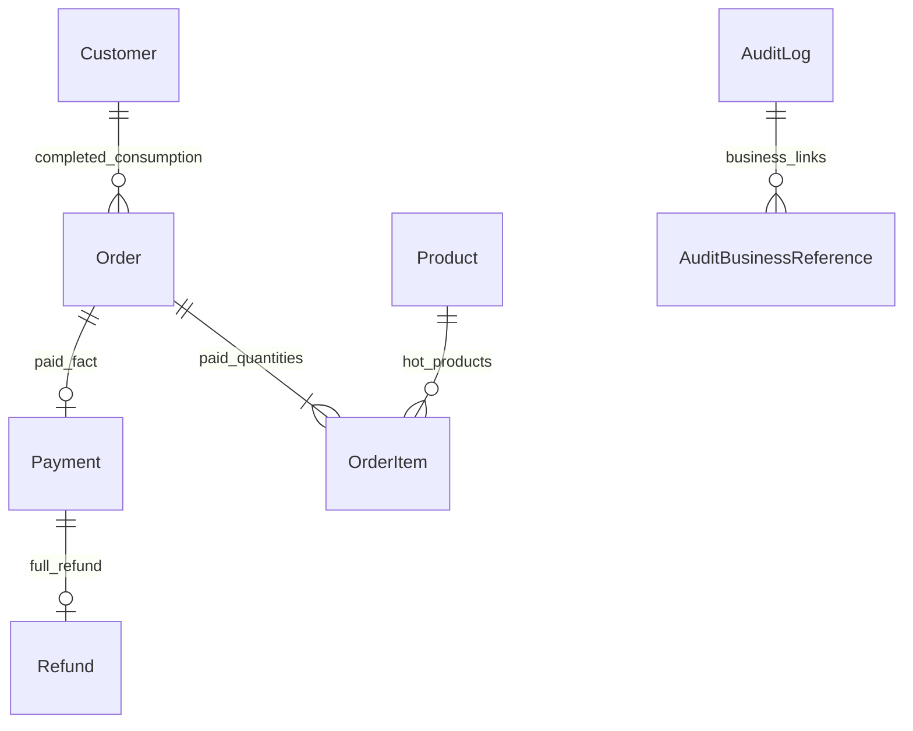

# 板块14：经营看板、净消费与审计查询开发文档

> 一致性审查：2026-11-10。跨板块约定、修订清单及未交付项见开发进度文档根目录《文档一致性审查记录.md》；本标记不代表软件已实现或测试通过。

| 项目 | 说明 |
|---|---|
| 所属里程碑 | M4：可验收交付 |
| 文件序号 | 13；业务板块14（板块8＋9合并） |
| 编写日期 | 2026-11-10 |
| 依赖 | 板块9～13真实支付、退款、完成、库存、任务和审计事实；板块2～7权限/公共查询 |
| 业务依据 | 通俗版经营看板、顾客管理、操作记录；需求v2.0 FR-95、FR-96、FR-97、FR-98、BR-01～07、TD-10～14、NFR-04/07/09 |
| 主要验收 | AC-18～19；关联AC-02、16、20、29 |
| 交付目标 | 可复算经营指标、真实净消费、按权限的业务历史与全店审计检索 |
| 文档状态 | 待实施设计与验收要求，不代表功能已开发或测试通过 |

## 1. 范围与实施原则

### 1.1 本板块必须完成

1. 今日订单数/新顾客/支付额/退款额/净收款，7/30天每日趋势，30天热销支付件数。
2. 待发货、因售后履约暂停、待审、失败退款和库存预警的当前聚合，不将重叠卡片相加。
3. 顾客详情/列表按真实已完成未全额退款订单计算累计净消费，完成后退款扣回。
4. 管理员全店审计分页、人员/对象类型/业务号/动作/时间检索、脱敏和必要索引。
5. 岗位可读的单据内历史页签：状态、任务、期限、沟通、交运、库存/验收/退款等真实事实。
6. 后台图表、空数据/错误/刷新状态、权限控制、查询无明显N+1、可手算样本及Swagger/自动化验证。

### 1.2 不新增业务

不实现利润/毛利会计、经营预测、营销归因、财务结算、真实支付对账、导出报表平台、数据仓库/Redis缓存、推送聊天或审计修改删除。商品成本不因有经营看板就自动返回；线下金额不计系统交易。

本板块优先读取事实表做有界聚合，不维护一套可人工修改的日统计余额，也不通过AuditLog、Task数量、页面按钮点击次数当支付/退款账本。先SQL/手算样本，再接口/图表；不先画图再猜口径。

### 1.3 与前序衔接

新增0014_reporting_audit_query_indexes迁移，主要是必要索引和审计业务引用，不重建Payment/Refund/Order/Customer/InventoryBalance。复用CustomerConsumptionReader、Product.paid_sales_count、AuditLog/BusinessStateHistory、TaskHistory/DeadlineEvent、Communication与业务真实查询器。

板块7已有consumption接口、板块8＋9已装真实订单查询器、板块10/12有完成退款事实，当前核对并批量优化，不能把已存在的真实能力又退回NOT_READY/永远0。板块13线下Case/代录/争议事实接入允许的业务历史，不算系统收退款。

## 2. 权限、字段与入口

### 2.1 权限矩阵

| 接口/页面 | 权限 | 限制 |
|---|---|---|
| 全店看板聚合/趋势/热销/看板预警摘要 | dashboard.read | 默认管理员/商品与仓储，默认客服403 |
| 顾客详情/地址/净消费 | customer.read | 默认客服/管理员，仓储默认403 |
| 全店审计列表/详情/筛选选项 | audit.read | 管理员专属、不可额外授予 |
| 履约订单历史 | order.fulfillment.read | 仓储所需事实，不能读全量客服资料/成本 |
| 客服订单历史 | order.service.read | 不默认含成本/内部仓储照片 |
| 售后服务历史 | after-sale.service.read | 原单权限和公开/内部白名单 |
| 验收历史 | after-sale.inspection.read | 仅验收所需资料 |
| 库存流水/来源详情 | inventory.read | 复用前序，不因看板摘要放行全量库存来源 |
| 线下事件/代录上下文 | offline-case.manage/customer.frozen.proxy及原依赖 | 沿板块13，不在通用历史页绕过 |

实际权限仍为固定岗位默认∪个人额外权限；看板目录dashboard.read是普通业务权限，若管理员明确额外授予客服则可读聚合，不硬编码岗位名否定合法授权。授予看板不顺带customer.read/audit.read/成本或所有列表权限。管理员专属审计仍不能下放。

### 2.2 聚合与明细分开授权

仅dashboard.read可读看板需要的计数、商品标识/名称、可售量A和预警线摘要；不返回顾客ID/电话/地址、R/来源凭据、成本、具体失败退款内部说明。看板卡片点击业务明细时检查相应order/after-sale/inventory权限，无权限显示无权查看明细而不是借看板API吐全部数据。

仓储默认看板能看到待审/失败退款数量，不代表可查看所有客服售后材料或执行退款。客服有顾客/售后资料不代表可看全店看板或审计。

### 2.3 隐私与最新授权

每次请求沿前序会话/账号/最新权限验证，撤权后新请求不得继续读。读请求不为统计锁库存/订单，不长时间FOR UPDATE；保护权限仲裁沿现有认证约定，已开始的合法只读请求不承诺追溯撤回已发给客户端的数据。

顾客仍只能通过本人订单/售后公开投影读取历史，不提供全店AuditLog接口。管理员审计只提供工作所需操作者标识/账号/显示名，不批量展示密码哈希、JWT、手机号/地址原文或私有文件storage_key。

## 3. 时间、金额与指标定义

### 3.1 时间窗口

所有事实timestamptz存UTC，统计时区固定Asia/Shanghai。按北京时间本地日期定义日区间[startOfDay,nextStartOfDay)，下界包含、上界不含。例如北京时间2026-11-10区间UTC为[2026-11-09T16:00:00Z,2026-11-10T16:00:00Z)。不能用数据库/容器默认时区或浏览器本地日期。

7天/30天都包含今日：D−6～D、D−29～D，今日是未结束日。每次读事务获取统一asOf（从统一Clock读取一次，真实运行使用服务端UTC当前时刻，测试Clock仅隔离应用可注入），今日事实截断到min(nextDayStart,asOf)，半开区间，不读取未来时间；恰好asOf发生的事件在下一查询纳入。历史日完整统计，缺失日期补0。

overview、趋势、榜单可独立请求，各响应有自己的asOf/date范围；相同时段UI请求不宣称跨HTTP共享快照。需要同响应内卡片一致时overview在短REPEATABLE READ只读事务中完成多聚合，使用同MVCC快照；不把asOf当可复用历史快照token或数据库提交水位。

### 3.2 今日与趋势指标

| 指标 | 事实与公式 | 不应混入 |
|---|---|---|
| createdOrderCount | Order.created_at落窗口的订单条数，所有主状态 | CheckoutQuote、幂等重试次数 |
| newCustomerCount | Customer.created_at落窗口 | 员工账号、登录次数、代录次数 |
| paidAmountCents | SUM Payment.amount_cents，Payment.status=SUCCEEDED且paid_at落窗口 | 当前订单状态过滤、线下金额、再次支付重放 |
| refundAmountCents | SUM Refund.amount_cents，Refund.status=SUCCEEDED且succeeded_at落窗口 | 申请金额、批准/验收、失败Attempt、线下赔付 |
| netReceiptsCents | paidAmountCents−refundAmountCents，可负 | 库存金额、未收货消费、利润 |

今天退上周支付单，计今天退款而非把上周支付额改小。已退款订单成功Payment仍计原支付日，不因Order.status=REFUNDED排除。Refund只按业务成功事实，一业务多Attempt不能重复SUM退款。

单笔金额number整数分沿前序界限；SUM/COUNT/件数采用PostgreSQL BIGINT或NUMERIC安全聚合，API累计金额/数量一律十进制整数字符串，包括0和负净收款。不要先转JS Number再string。UI金额格式化用BigInt/十进制字符串，不用浮点累计。

### 3.3 三种容易混淆的销售指标

| 指标 | 定义 | 退款影响 |
|---|---|---|
| 30天热销paidQuantity | 30天成功Payment关联OrderItem.quantity，按productId聚合 | 不追溯扣减支付件数 |
| 商品累计paidSalesCount | 全历史成功支付件数，前序支付同事务维护Product.paid_sales_count | 不倒扣；不是30天榜单数据源 |
| 顾客累计净消费 | 当前COMPLETED且未全额成功退款订单的实付总和 | 完成后成功全退扣回；失败不扣 |

热销SPU维度、同产品多个SKU/OrderItem合并，排序paidQuantity DESC、productId ASC稳定；默认Top10，上限20。本版榜单只需件数，不新增成本/利润/运费分摊。名称显示当前产品名并标明，历史快照仍可在原订单读；下架/归档产品的真实区间支付仍进榜，不能因当前商品不可售抹去历史。SKU/产品历史不得物理删除。

## 4. 当前业务卡片与净消费

### 4.1 当前状态计数

卡片取同请求读快照下的当前事实，不是“今天新发生的事件”；与今日金额分区显示。

| 字段/标签 | 精确口径 | 明细入口 |
|---|---|---|
| waitingShipmentOrderCount/待发货 | Order.status=WAIT_SHIPMENT，包含备货/交运未决/暂停 | 现有订单列表合法筛选 |
| afterSalePausedOrderCount/因售后履约暂停 | WAIT_SHIPMENT或SHIPPED订单，有进行中AfterSale且自身AFTER_SALE有效阻塞实际拦发货/收货，按订单去重 | 订单售后中/暂停组合筛选，需原查询权限 |
| pendingReviewAfterSaleCount/待审核售后 | AfterSale.status=PENDING_REVIEW，包括补充后回待审 | 售后列表，需service.read |
| failedRefundCount/失败未成功退款 | Refund.status=FAILED，业务级去重；含核实失效回待核实但仍未成功的失败业务 | 退款/售后服务查询 |
| lowStockSkuCount/库存预警SKU | InventoryBalance.available≤warning_threshold，含等号 | 前序inventory lowStock=true |

COMPLETED正在售后仍属进行中售后，但没有待恢复履约/收货，不计“因售后履约暂停”；可在售后列表查，不能为了卡片回退COMPLETED。失败退款不用只看AfterSale=REFUND_FAILED，避免回待核实时漏掉已失败业务。

低库存范围沿板块6库存列表：所有保留余额账户，不偷偷按ON_SALE或SKU启用筛除；摘要标下架/停用/归档情况，和明细lowStock筛选一致。A是可售而非A+R，不表示仓库实物总量；R不在仅看板资格摘要输出。

以上计数可能重叠，不能相加当总订单。售后多来源/多轮Task不多计订单或售后。点击业务列表的数据可能因随后状态变化不同，页面标刷新时间，不假装同时静态账本。

### 4.2 顾客净消费

复用GET /admin/customers/:id/consumption：availability=AVAILABLE、amountCents字符串、currency=CNY、asOf、definitionVersion。公式按CustomerConsumptionReader实际聚合：Order.status=COMPLETED，唯一成功Payment，且不存在成功Refund。退款事务已置REFUNDED，NOT EXISTS成功Refund作为防错条件，若事实不一致应技术诊断，不静默靠缓存粉饰。

未发/已发未收支付不计，完成后售后进行中/退款失败仍计，成功全额退款扣回；冻结/限制交易不清消费历史。已装真实模块但查询异常返回统一技术错误，不能悄悄AVAILABLE/0或退NOT_READY。

顾客列表页如果显示净消费，只对本页customerIds一次GROUP BY批量聚合，不逐行调用详情API或每顾客一个SQL；资料详情/地址/订单关联仍沿customer.read。首期不新增Customer余额字段、不随支付加消费/退款再异步减。

## 5. 可手算基准样本

### 5.1 样本构成

D为隔离测试Clock的北京时间当天，均为人民币分，成功金额包含原运费。C1/C2在D前注册，C3在D注册。P1/P2为两个稳定productId，所有时点明确UTC与北京日期映射。

| 订单 | 顾客 | 创建/支付日 | 实付 | 支付件数 | 完成与退款事实 |
|---|---|---|---|---|---|
| O1 | C1 | D−7/D−7 | 10000 | P1×2 | D−6完成，D成功退款10000 |
| O2 | C1 | D/D | 15000 | P1×1 | D完成，无成功退款 |
| O3 | C1 | D/D | 5000 | P2×1 | SHIPPED未完成，PENDING_REVIEW售后及有效收货阻塞 |
| O4 | C3 | D/未付 | 无 | 无成功支付 | WAIT_PAYMENT |
| O5 | C2 | D−2/D−2 | 20000 | P2×2 | D−1完成，D成功退款20000 |
| O6 | C2 | D−31/D−31 | 7000 | P1×1 | 已完成，无成功退款 |

另库存账户B1：A10/threshold10，B2：A11/threshold10，无其他账户；故预警1。测试库隔离，前序产生的其他订单/账号不能混进该夹具口径；不直接SQL造“支付成功”，用真实领域服务和可控Clock构造，少量10万数据性能夹具另行隔离。

### 5.2 期望结果

- D今日创建订单3（O2/O3/O4），新顾客1（C3）。支付20000、退款30000、净收款−10000。
- 7天D−6～D：支付40000、退款30000、净10000；O1支付D−7不在7天，退款D仍在。
- 30天D−29～D：支付50000、退款30000、净20000，O6支付不在30天。
- 30天热销P1=3、P2=3，同分按productId；累计P1=4、P2=3，不能直接拿累计当30天值。
- C1净消费15000，C2=7000，C3=0；O3已付未完成不计，O1/O5成功退款不计。
- 当前待发货0、因售后履约暂停1（O3）、待审1、失败退款0、库存预警1。另加失败退款/待发货样本时单独记录预期变化，不改基准后仍沿旧答案。

### 5.3 边界样本

为午夜边界另建独立数据集：D 00:00北京时间事件必须属于D，D+1 00:00不属于D；UTC前一天16:00对应D下界。跨日创建/支付、失败后次日退款成功、完成后次日退款分别验证，不把createdAt/updatedAt替paidAt/succeededAt。

图表无数据日补0，空库所有金额/计数为字符串0，趋势仍7/30个日期；净收款−10000显示−100.00元，不显示0/红色错误或无意义利润标签。

## 6. 统计查询设计与一致性

### 6.1 支付、退款分别聚合

先分别按成功事实和时间聚合，再按北京日期合并；不能Payment JOIN RefundAttempt JOIN OrderItem后直接SUM金额，行乘积会重复。例如支付10000含2订单行、退款失败再成功2尝试，错误JOIN可能把10000加多次。

今日汇总分支各自产出一行再CROSS JOIN，或独立有界查询在同读快照合并。7/30天趋势分别GROUP BY本地日期，generate_series补日期，COALESCE为0。退款只查Refund业务，不JOIN多Attempt参与金额聚合。

示意SQL（表/列以实际Prisma映射为准，参数用绑定变量，不拼用户SQL）：

```sql
SELECT
  (paid_at AT TIME ZONE 'Asia/Shanghai')::date AS business_date,
  SUM(amount_cents::bigint)::text AS paid_amount_cents
FROM payment
WHERE status = 'SUCCEEDED'
  AND paid_at >= $1::timestamptz
  AND paid_at < $2::timestamptz
GROUP BY business_date;
```

日期转换只用于投影/GROUP BY，WHERE用原始paid_at范围以利用索引，不在每行WHERE上套DATE导致范围索引失效。退款用succeeded_at和amount_cents；Payment/Refund物理列统一amount_cents、Prisma/单笔DTO统一amountCents，统计输出仍为十进制整数字符串。SUM bigint在PostgreSQL可能返回NUMERIC，必须整数精确转换为text，不能驱动转浮点。

### 6.2 热销和净消费

热销查询Payment成功/paid_at区间JOIN本订单OrderItem，只SUM item.quantity；每单唯一Payment，按product_id聚合，随后批量取产品名/公开标识，不逐榜单行查Product。退款不参与该JOIN，商品当前上下架不作为事实筛选条件。

净消费示意：

```sql
SELECT o.customer_id,
       COALESCE(SUM(p.amount_cents::bigint), 0)::text AS amount_cents
FROM "order" o
JOIN payment p ON p.order_id = o.id AND p.status = 'SUCCEEDED'
WHERE o.customer_id = ANY($1::uuid[])
  AND o.status = 'COMPLETED'
  AND NOT EXISTS (
    SELECT 1 FROM refund r
    WHERE r.order_id = o.id AND r.status = 'SUCCEEDED'
  )
GROUP BY o.customer_id;
```

无行的顾客由查询服务补字符串0，不把GROUP BY漏行当查询失败。列表先取本页≤100个Customer，再一次聚合，禁止N+1。查询器只读，无Customer消费字段自增/自减、库存动作或退款副作用。

### 6.3 读快照、刷新和错误

每个聚合响应返回asOf/timeZone/definitionVersion；overview内部卡片在同REPEATABLE READ只读短事务，不能一半取旧缓存一半读新表。默认不缓存，不安装定时重算日表；跨请求变化以asOf解释，不返回伪snapshotId承诺历史重放。

数据库失败应统一技术错误和可重试刷新提示，不返回全0成功，避免“今日收款0”掩盖故障。空数据是成功查询后COALESCE的真实0。前端刷新不执行任何领域写命令，不对GET加库存/任务锁；必要的认证查询与统计SQL总量有界。

## 7. 全店审计查询与安全投影

### 7.1 复用AuditLog

沿板块2/3原audit_log：id、actor_type/actor_employee_id/actor_customer_id、action、target_type/target_id、reason、before_data/after_data、request_id、created_at。支持EMPLOYEE/CUSTOMER/SYSTEM，SYSTEM没有伪员工ID。

本板块补查询/索引/业务号关联，不重写旧审计payload，不用日志倒推支付金额。审计只追加，无PUT/PATCH/DELETE、删除按钮或客户端写审计接口。密码改动只标passwordChanged=true等，不保存新旧密码/哈希/token。

### 7.2 筛选与业务号解析

支持actorType、actorEmployeeId、actorCustomerId（与type匹配）、action精确白名单、targetType、targetId、businessType/businessNo、requestId、from/to、page/pageSize。from包含/to不含；ISO必须明确时区、from<to。

默认最近7个北京日期到当前asOf，时间窗口最大366天、pageSize默认20最大100、page默认1、最大定位10000条（page×pageSize≤10000）作为本版交互容量约定；更早可另选范围，不新增无限导出。非法/过宽查询400 QUERY_RANGE_TOO_LARGE，不能偷偷截断。业务号精确trim/既有规范化，首期不做无限前后模糊JSON全文搜索。

Actor筛选选项由audit.read专用最小DTO返回员工id/账号/显示名/当前停用标记，不要求前端有employee.read再绕路拉全员工资料。停用/调岗员工历史仍可查，展示当前身份并保留事件原actorId，不伪造事件当时岗位。

### 7.3 多对象关联和旧历史

一条审计target可能是Refund/Task/ProxyContext，但管理员按OrderNo也要找到相关记录，不能只检AuditLog.target_id。新增AuditBusinessReference指向Order/AfterSale/Refund/InventoryAdjustment/OfflineCase等稳定业务标识，允许一条审计多关联。

新关键写动作在原事务append审计时同时写引用，重复引用唯一；失败与业务全回滚。现有历史通过有界幂等backfill脚本按真实外键/稳定业务号补引用，不改AuditLog原字段/时间/原因；无法确定关系不猜测，记录缺失数/样本供诊断，搜索页面不宣称覆盖未补齐的历史。此脚本是索引投影补齐，不伪造业务操作审计。

按业务号筛选用EXISTS引用匹配，避免一条日志多引用JOIN后重复列表/count。允许按原targetId精确查对象，requestId用于技术关联不作为业务幂等键。

### 7.4 展示白名单

action级展示转换器决定必要前后差异，默认拒绝未知payload结构；未知历史action只显示元数据和“该动作暂无安全详情展示”，不能退回原始JSON。账号权限变化可显示岗位/权限码，库存显示必要数量差，付款退款显示合法金额/状态，不吐完整实体。

reason和操作者展示文案也通过同一安全转换器，不能只清before/after却原样泄露理由中的个人信息。电话/地址/身份核实摘要、外部账号等按展示目的遮罩；无必要不展示。密码/哈希/token/storage_key/原始HTTP体永远不返回，即使管理员。审计中的文件只显示允许的业务引用，下载仍走真实文件授权，不返回磁盘路径或带JWT的URL。私有证据不得因为audit.read变成公开静态图。

业务失败/拒绝请求走脱敏技术日志，不伪造成功审计；模拟退款失败是已提交业务尝试，保留真实RefundAttempt和相应业务审计。普通读查询不追加“修改成功”审计；无需每读审计再造一条审计造成递归。

## 8. 单据内业务历史页签

### 8.1 统一展示，权限分别判断

复用已有order/after-sale历史路径，不另造“任意entityType/entityId读取全库”接口。按领域归属与权限查询不同来源，服务端先裁剪来源和字段再计数分页，不能把全部内部历史查到前端后隐藏。

事件判别类型可统一为STATE_CHANGE/TASK_CHANGE/DEADLINE_EVENT/COMMUNICATION/PAYMENT/REFUND_ATTEMPT/INVENTORY_ACTION/HANDOVER/INSPECTION/OFFLINE_EVENT；板块4已有TASK_CHANGE/DEADLINE_EVENT枚举语义保留，客户端按kind明确渲染，不用任意JSON万能卡片。

履约岗位可看所需交运/库存/验收/暂停与任务事件，客服可看服务沟通/审核/退款/公开履约摘要，顾客仅现有公开历史，不见内部原因/员工个人资料。全店AuditLog和单据历史不是互为别名，有业务查询权不获得audit.read。

### 8.2 稳定分页与真实发生时间

跨表时间线按recordedAt DESC、kind ASC、id DESC稳定分页，occurredAt单列显示实际发生时刻；晚录历史不能靠发生时刻插入旧页后造成含糊。可用白名单UNION ALL/批量来源查询，列表/count同快照，禁止每条事件再查询员工/单号。

状态历史不替代Payment/RefundAttempt/InventoryLedger，去重按kind＋原记录id，不按文案相同删除失败重试。多来源Task事件只展示授权业务关联，不从共享任务泄露其他顾客来源材料。

## 9. 表设计、索引与性能验证

### 9.1 ER与来源表



统计直接读上述事实和InventoryBalance/AfterSale/OrderBlock，不建可编辑DashboardDailyTotal/CustomerBalance。实体均已有真实FK；AuditLog原target_id是varchar历史对象标识，不强行转UUID破坏旧数据。

### 9.2 AuditBusinessReference

| 字段 | 类型/约束 | 作用 |
|---|---|---|
| audit_log_id | UUID FK AuditLog RESTRICT | 原不可变审计 |
| business_type | 固定枚举ORDER/AFTER_SALE/REFUND/INVENTORY_ADJUSTMENT/OFFLINE_CASE等 | 代码白名单 |
| business_id | varchar(100) | 保留已有UUID或稳定历史标识，不随意parse |
| business_no | varchar(100)可空 | 实际展示业务号，来源真实对象，不让浏览器指定 |
| created_at | timestamptz | 投影引用建立时刻，非审计发生时刻 |
| 主键 | (audit_log_id,business_type,business_id) | 一日志同对象唯一，多对象不重复审计行 |

引用是受控多态关联，不能声称一个通用business_id已有对所有业务表的物理FK；解析器/事务验证真实对象。AuditLog FK真实存在，业务表历史不可物理删；需要更强特定FK时按现有表扩列但不能两份引用冲突。无公共引用CRUD；backfill幂等仅追加确定关系。

### 9.3 必要索引候选

| 表 | 索引/用途 |
|---|---|
| payment | (paid_at,order_id)，必要INCLUDE(amount_cents)支持30天范围；原order_id唯一保留 |
| refund | 成功部分索引(succeeded_at,order_id) WHERE status='SUCCEEDED'，原payment/order唯一保留 |
| order | (created_at,id)；(customer_id,status,id)，覆盖消费与当前列表，已有等价索引不重复建 |
| customer | (created_at,id)，原手机号/状态索引保留 |
| order_item | (order_id,product_id)，必要含quantity；外键不等于PostgreSQL自动建索引 |
| after_sale/order_block | status/order关联与来源活跃索引沿前序，暂停计数用EXISTS |
| audit_log | (created_at DESC,id DESC)，必要(actor_type,actor_employee_id,created_at DESC,id DESC)/(actor_customer_id,created_at DESC,id DESC)，原action/target/request_id索引复用 |
| audit_business_reference | (business_type,business_no,audit_log_id)、(business_type,business_id,audit_log_id) |

低库存A≤threshold是同一行两列比较，不宣称普通available索引必然优化；先EXPLAIN，必要条件相同的部分索引(available,sku_id) WHERE available≤warning_threshold，考虑余额更新写成本，不能把预警卡慢直接加缓存掩盖。索引DDL须以真实列名/计划为准，不机械全部叠加。

### 9.4 查询预算与性能证据

今日/趋势/热销/预警分别有界SQL；顾客列表净消费固定批量查询、历史/审计actor和业务号批量联查，SQL条数不随列表20→100线性增长。总数查询COUNT也要单独检查计划，不只优化items。稳定排序索引与筛选条件一起看，不用前端全量排序分页。

按NFR-04在记录硬件/DB配置的数据集10万订单、100并发查询验证，列表建议p95≤500ms、常规写入≤1s（不含上传，原业务写入回归），不能只Markdown检查就声称达标。看板聚合记录实际p95/错误率、SQL耗时/扫描行数/锁等待，发现慢查询先定位再优化，不擅自引入物化缓存和新的最终一致性口径。

EXPLAIN(ANALYZE,BUFFERS)仅隔离测试环境运行，审计筛选/趋势/热销/净消费/lowStock分别保存计划和数据规模。统计/读历史不新增库存/退款事务锁，无明显N+1是有日志/查询计数证据的结论。

## 10. API与OpenAPI契约

路径省略/api/v1，复用Bearer、{data,requestId}、分页{items,total,page,pageSize}。所有聚合count/amount/quantity字符串；分页total/page/pageSize沿原契约number（有最大定位范围），单SKU A/threshold number，不混淆。

### 10.1 看板和净消费

| 方法/路径 | 输入 | 输出/权限 |
|---|---|---|
| GET /admin/dashboard/overview | 无 | dashboard.read；今日事件金额/人数订单数、当前五卡片、asOf/timeZone/definitionVersion |
| GET /admin/dashboard/trends | days=7或30，默认7 | dashboard.read；严格7/30日期、支付/退款/净收款/创建订单/新顾客 |
| GET /admin/dashboard/hot-products | days仅30、limit默认10最大20 | dashboard.read；SPU支付件数、当前产品摘要、稳定排名/口径 |
| GET /admin/dashboard/low-stock | page/pageSize | dashboard.read；SKU/商品公开标识、A/threshold/启停归档摘要，不R/成本/来源 |
| GET /admin/customers/:id/consumption | 沿板块7 | customer.read；AVAILABLE/精确字符串/CNY/asOf/definitionVersion |
| GET /admin/customers | 沿板块7，若展示净消费则本页批量聚合 | customer.read；不逐人请求/未完成支付不计 |

不接受前端timeZone任意修改统计口径、refundOffset或SQL片段，不增全店任意金额修正入口。Dashboard metric definitionVersion如DASHBOARD_V1，净消费沿已有definitionVersion实现并记录口径兼容，不能随意换字段。

### 10.2 审计和历史

| 方法/路径 | 输入 | 输出/权限 |
|---|---|---|
| GET /admin/audit-logs | actorType/actorEmployeeId/actorCustomerId/action/targetType/targetId/businessType/businessNo/requestId/from/to/page/pageSize | audit.read；稳定createdAt DESC,id DESC分页、脱敏元数据/简要差异 |
| GET /admin/audit-logs/:id | UUID | audit.read；安全前后差异、原业务引用、必要actor，不原始payload |
| GET /admin/audit-logs/filter-options | actorKeyword?、limit默认20最大100 | audit.read；固定type/action和最小员工候选，不能无限加载全员工 |
| GET /admin/orders/:id/history | page/pageSize、kind? | 原履约/服务权限分别投影，多来源历史 |
| GET /admin/after-sales/:id/history | 沿板块11page/pageSize | 服务/验收按来源裁剪，不提升全店审计 |
| 顾客现有订单/售后详情历史 | 本人归属 | 仅公开记录，不暴露audit_log原始行 |

审计actorType与对应id不一致400，action/kind非白名单400；未知历史action仍可出现在无action筛选列表但详情安全降级，不能因此全查询失败。静态filter-options路由须先于/:id注册或采用互不冲突路径；UUID管道只作匹配后的参数校验，不能代替路由优先级。真实HTTP分别测试filter-options和合法/非法UUID。

### 10.3 响应示例

overview基准样本，数据为分，负净收款合法：

```json
{
  "data": {
    "definitionVersion": "DASHBOARD_V1",
    "timeZone": "Asia/Shanghai",
    "asOf": "2026-11-10T04:00:00.000Z",
    "businessDate": "2026-11-10",
    "today": {
      "createdOrderCount": "3",
      "newCustomerCount": "1",
      "paidAmountCents": "20000",
      "refundAmountCents": "30000",
      "netReceiptsCents": "-10000"
    },
    "current": {
      "waitingShipmentOrderCount": "0",
      "afterSalePausedOrderCount": "1",
      "pendingReviewAfterSaleCount": "1",
      "failedRefundCount": "0",
      "lowStockSkuCount": "1"
    },
    "overlapNotice": "当前业务卡片可能重叠，不能相加作为总订单数"
  },
  "requestId": "dashboard-example-001"
}
```

净消费复用现有契约，查询C1的正确示例：

```json
{
  "data": {
    "availability": "AVAILABLE",
    "amountCents": "15000",
    "currency": "CNY",
    "asOf": "2026-11-10T04:00:00.000Z",
    "definitionVersion": "COMPLETED_NET_V1"
  },
  "requestId": "consumption-example-001"
}
```

若前序代码definitionVersion字面量不同，保持既有兼容值并更新示例/生成客户端，不能只改展示文档导致两个实现口径分叉。响应asOf只表示本请求读快照/时间说明，不承诺多接口相同秒就是同MVCC快照。

### 10.4 错误和失败处理

| HTTP/code | 场景 |
|---|---|
| 400 VALIDATION_FAILED | days不是7/30、非法UUID/actor组合/时区/日期/pageSize/未知字段 |
| 400 QUERY_RANGE_TOO_LARGE | 审计超过366天或定位超过10000条，明确提示缩小范围 |
| 401/403沿用 | 失效会话/强制改密/缺dashboard.read、customer.read或audit.read |
| 404既有对象码 | 顾客或单据不存在/无对应对象权限，不通过历史接口泄露存在性 |
| 429沿用 | 查询限流沿工程配置，不用看板自动高频轮询冲击接口 |
| 5xx统一技术错误 | 数据库/真实查询器故障，不以0成功降级，不返回SQL/堆栈 |

GET统计/历史不创建资金/库存/Task，不需commandKey；前序交易写动作仍保留稳定幂等和同事务审计，不因“报表可重算”削弱原写一致性。

## 11. 前端页面与查询行为

看板首页分“今日事件”和“当前业务”两区，卡片写清支付/退款/净收款/当前数量口径及刷新时间。净收款可显示负值，不能截为0或叫利润；当前卡片标可能重叠，不相加当订单总数。

趋势切7/30天，X轴北京日期，支付/退款/净收款独立序列，缺日0、今日标截至当前；图表金额可显示元但原数据整数分精确。大金额用安全十进制格式化，不在组件里先Number再合计。切换筛选取消/忽略旧请求回包，不能30天按钮下渲染刚返回的7天数据。

热销标题“近30天支付件数，退款不追溯扣减”，SPU归并、同分稳定，当前下架/归档标识不抹历史销量。库存预警表写A为可售而非实物总量，展示启停/归档摘要，详细库存链接单独检查权限。

顾客详情显示“已完成未全额退款订单实付合计”，与历史订单/售后入口衔接；无权限不展示入口，后端仍403。查询失败显示加载失败/重试，真实空数据才显示0，不能隐藏错误装成无消费。

审计页面管理员专属菜单，筛选人员/动作/业务类型/单号/时间，页码/排序稳定；详情只展示安全差异和必要关联，未知action提示暂无安全详情，无原始JSON下载。没有编辑/删除/撤销审计按钮。业务历史页签按当前权限展示，不能把管理员审计组件原样挂给普通岗。

刷新只发GET、不自动高频轮询；各面板asOf不同则分别标时间。日期筛选客户端验证只是提示，后端独立校验范围/权限。空/加载/错误/无权限四种状态区分，人民币格式/长业务号/分页和深层路由可用。

## 12. Swagger详细测试

### 12.1 环境和基准准备

Swagger：http://localhost:3000/api/docs。准备管理员、仓储甲/乙、客服甲/乙、顾客甲/乙，完成前序真实模块。使用隔离Clock及真实领域命令构造第5节O1～O6/客户/商品/库存基准，并保存具体UTC时间、业务号、Payment/Refund/Attempt及真实结果；不得直接SQL造资金成功/改销量获得“通过”。

主基准D日所有参与今日统计的事件安排在overview示例asOf之前，边界/并发/大金额/性能夹具独立数据库或独立测试运行，不混进基准后仍照旧数值断言。性能批量数据生成脚本可直接构造合法关联数据但必须标性能夹具，不当作真实购买端到端证据。

Authorize切换前清旧token。记录接口/参数/requestId/asOf/definitionVersion、原始金额字符串、业务事实对照表、权限/错误响应。Swagger只证明人工顺序检查，并发/SQL计划/性能见IT，不以代码块格式检查当系统验收。

### SW-01：默认权限与个人额外授权

1. 管理员/仓储GET dashboard/overview 200，默认客服403；顾客token不能进入员工域。
2. 客服customer.read可读consumption但不因此能看dashboard；仓储看dashboard不能读/admin/customers或全店audit-logs。
3. 管理员给客服甲明确额外dashboard.read后，甲可读聚合，乙仍403；audit.read不能额外下放。
4. 撤回甲额外看板权限后原token新请求403；聚合不含顾客/成本/内部失败说明，点击无资格明细仍403。

### SW-02：今日基准与负净收款

1. GET overview，核对createdOrderCount="3"、newCustomerCount="1"、paidAmountCents="20000"、refundAmountCents="30000"、netReceiptsCents="-10000"。
2. 所有聚合值为十进制字符串、timeZone=Asia/Shanghai、asOf/definitionVersion存在；前端净收款显示−100.00元，不能0或利润。
3. O1/O5虽非今日付款但今日退款计今日；原Payment仍按支付日计，不因当前REFUNDED抹掉历史支付。

### SW-03：7/30天、补零与午夜边界

1. GET trends?days=7，日期严格D−6～D，支付合计40000/退款30000/净10000；days=30为50000/30000/20000。
2. 无事件日期仍一行0，无重复日期，今日标截至asOf；days=8或传任意timeZone等未知字段400。
3. 独立边界夹具，北京D 00:00属于D、D+1 00:00不属于D，UTC前日16:00映射正确，不随浏览器/容器时区改口径。
4. 创建/支付/退款分别跨日，按各自事件时间而非Order.updatedAt归组。

### SW-04：热销、累计销量与退款区分

1. GET hot-products?days=30，P1="3"、P2="3"；同分按productId稳定，无一订单多SKU重复计订单金额问题。
2. 原商品列表累计P1="4"、P2="3"，O6超30天不进榜但仍累计；退款不倒扣任一支付件数。
3. 下架/归档P1仍保留历史榜单值，标当前状态；limit默认10最大20，非法范围400，成本不返回。
4. 重复pay重放、失败支付/仅报价不增加热销，验证唯一Payment来源。

### SW-05：当前卡片与重叠

1. 基准current依次为待发货0、售后履约暂停1、待审1、失败退款0、低库存1，O3已发未完成仍在收货暂停。
2. 独立夹具已付待发+售后待审，同订单同时命中待发/暂停/待审，计数不能相加当总订单；两个有效阻塞/多Task不把订单计2次。
3. COMPLETED正在售后不计履约暂停、仍可在售后列表查；退款FAILED后核实失效回WAIT_FULFILLMENT_CHECK，失败退款卡仍计该Refund一次。
4. 后续真实重试成功后失败卡移除，新增失败Attempt不能把同业务计2次。

### SW-06：库存预警等号和权限

1. B1 A10/threshold10命中、B2 A11不命中；GET dashboard/low-stock与inventory?lowStock=true在相同事实范围一致。
2. 改B1 threshold=9后退出预警，只走原预警设置API，不产生数量流水；看板刷新只读。
3. 下架/停用/归档保留账户按原范围仍参与并标状态；A不是A+R。
4. 仅dashboard.read摘要不含R/来源/成本；明细inventory接口无inventory.read仍403。

### SW-07：顾客净消费真实口径

1. GET C1 consumption="15000"、C2="7000"、C3="0"，availability=AVAILABLE，订单模块已安装不能NOT_READY。
2. C1的O3未收货支付不计，O1/O5完成后成功退款扣回；进行中售后/退款失败但仍COMPLETED不提前扣。
3. 独立测试完成订单10000，净消费+10000；模拟失败保持，再成功全退扣10000；重复成功原key不再扣一次。
4. 冻结/限制状态不清消费历史，默认仓储consumption403；列表显示值与同快照详情一致，批量无N+1见IT。

### SW-08：线下事件、失败和重放不入统计

1. 从独立基准记录支付/退款/销量/消费值，创建OfflineCase赔付金额/补发运单，前述系统指标不变。
2. 正式售后审核、要求材料、异常批准、最终验收回补均不计退款成功金额；失败Attempt不计，真实成功Refund才计。
3. 原pay/refund成功响应丢失用原key重放，统计只原事实一次；不按审计条数/Task次数加钱。

### SW-09：审计筛选、系统主体和稳定分页

1. 管理员GET audit-logs默认最近7北京日期；按actorEmployeeId/action/target/businessNo/requestId/from/to组合缩小，核对实际动作、时间和reason。
2. 同createdAt多行按id稳定，翻页重复查询不因排序缺项；total不因多业务引用重复，pageSize最大100。
3. SYSTEM扫描事件actorType=SYSTEM且无伪员工；停用员工历史仍可查，选项只最小员工字段。
4. from包含/to不含；actorType/id不符、from≥to、超过366天/定位10000条、非法pageSize 400，不能静默截断。

### SW-10：按原单号追踪关联业务

1. 对真实订单支付→售后→退款/失败→成功、任务/代录/线下工单链，按OrderNo查可找到已写AuditBusinessReference的相关审计，不只Order target。
2. 同日志关联Order/AfterSale/Refund多个对象时只出一条，按AfterSaleNo/RefundNo也能定位；不存在业务号返回空非全表。
3. 对旧历史运行只追加引用的幂等backfill，再查原createdAt/action/reason不变，二次脚本新增0；缺失无法推断有诊断，不伪造关联。
4. SQL输入片段作为普通业务号参数处理，不拼执行；requestId仅技术关联不变成业务命令key。

### SW-11：审计安全差异与不可编辑

1. 管理员查看改密/授权/顾客冻结/退款/线下核实动作，必要差异可读，无密码/哈希/token/完整地址/外部账号/storage_key。
2. 未知历史action只返回元数据和安全提示，不能raw payload兜底；私有附件仍原业务授权，匿名不因审计展示可访问。
3. 默认仓储/客服列表及详情403，即使知道auditId；不存在修改/删除审计接口，尝试PUT/PATCH/DELETE不成功。
4. 查询审计本身不写虚构“业务修改成功”或递归审计，失败请求不伪造成功资金事实。

### SW-12：业务历史与全店审计隔离

1. 仓储订单历史见所需状态/交运/验收/暂停/任务，客服见服务沟通/审核/退款，二者都不因此拥有audit.read。
2. 顾客本人现有详情仅公开说明/物流/凭证，乙查甲404，不展示员工个人信息/内部原因。
3. 多表时间线按recordedAt/kind/id分页，实际occurredAt单列；失败Attempt不同id都保留，不文案相同就去重。
4. 共享Task多来源不得经一个授权订单历史泄露其他顾客材料；缺某来源权限时服务端不输出且分页总数不泄漏隐藏事件。

### SW-13：空数据、查询故障和大整数

1. 空隔离库overview真实0字符串，趋势仍7/30日，热销/预警空列表，消费无完成单为AVAILABLE/"0"。
2. 数据库/真实查询器故障返回统一技术错误，页面显示失败/重试，不装作0或NOT_READY。
3. 用独立数据库数值编码/序列化夹具（如SELECT 9007199254740993::numeric）及格式化单元测试验证超过JS安全整数仍保留完整字符串、不科学计数法丢位；这只证明数值管线，不伪装成单笔合法订单或真实资金事件。真实业务SUM另用合法金额样本/10万订单验证，不要求为了编码边界制造数千万订单。
4. 净收款负值合法，金额单位始终分；不是前端把每条元小数相加。

### SW-14：刷新、跨接口asOf和无写副作用

1. 快速7→30切换/刷新，迟到旧回包不覆盖当前选择，页面清楚标每面板asOf/日期。
2. 查询期间另员工真实支付/退款，单overview内部计数同读快照；下一请求可变化，不声称相同asOf秒值代表跨请求一致性。
3. GET看板/消费/历史前后InventoryAction/余额/Payment/Refund/Task无新增或更改，无长持订单/SKU写锁。
4. 审计筛选/业务详情深层路由刷新可用，页面权限入口与后端授权一致。

### SW-L01：板块15性能与交付补验

以本板块口径/样本为真值，结合10万订单/100并发查询的环境配置、p95/错误率/计划证据、Compose启动/迁移/私有证据持久化和备份恢复后数据复算，完成全量AC/NFR。没有运行压测不能声称达标，Markdown或Swagger响应示例不替代系统测试。

## 13. 自动化、数据库与性能验证

### IT-01：事件时间、金额和半开窗口

PostgreSQL16按第5节期望核算今日/7天/30天，午夜/UTC映射/边界asOf、缺日补0、晚成功退款、历史订单今日退款，净收款可负。禁止Order状态/updatedAt筛掉原支付；SUM/COUNT精确字符串、每单容量与累计超JS安全整数都覆盖。

### IT-02：热销与净消费

多SKU/同SPU多行只按唯一成功Payment累计件数；30天与累计区分、退款不倒扣、下架归档不漏历史、稳定同分排序。完成前支付不消费、完成+消费、完成后失败仍计/成功全退扣回，冻结保留；列表批量与详情同口径。

### IT-03：状态卡片与预警

WAIT_SHIPMENT各履约阶段/阻塞、SHIPPED售后收货阻塞、COMPLETED售后排除暂停、多AfterSale历史/多Block/多Task不重复；失败后待重核仍失败卡，成功移除。A≤threshold等号、账户范围、摘要与库存明细权限/字段一致。

### IT-04：防JOIN扇出和线下隔离

一Payment多OrderItem、多RefundAttempt、多AuditBusinessReference组合，支付/退款/件数/审计total不乘积放大；失败/审核/最终验收/OfflineCase金额不入成功退款。重复支付/退款命令重放不多计；读取没有写副作用。

### IT-05：审计筛选与引用迁移

actorType/id/action/对象/业务号/requestId/时间组合正确，COUNT与items同筛选/稳定排序；一日志多引用EXISTS不重复，历史backfill分批/幂等/断点重跑不改原审计。引用插入失败使新增关键业务原事务回滚，未知关联诊断不猜测。空库/0013升级约束索引一致。

### IT-06：权限、脱敏和历史

默认/个人额外dashboard权限、管理员audit不可下放、customer.read独立、仓储/客服字段矩阵及当前撤权。未知action安全降级、无秘密/内部payload兜底、私有附件仍授权。通用历史无越权源/隐藏事件count泄漏，无审计编辑删除接口，公共顾客历史仅本人公开投影。

### IT-07：MVCC快照、故障和边界

屏障控制支付/退款在overview多查询期间提交，REPEATABLE READ内同快照、下一请求见新值；跨请求无伪快照承诺。数据库故障/超时不0成功降级，asOf/时区/参数校验、最大范围/分页边界、静态filter-options路由覆盖。聚合不FOR UPDATE、不持业务写锁等待。

### IT-08：查询数量、计划与压力

日志/测试计数证明顾客列表/榜单/历史20→100行SQL次数不线性增长；COUNT、业务号引用、30天趋势、净消费、lowStock分别EXPLAIN(ANALYZE,BUFFERS)。10万订单/100并发记录机器/版本/数据分布/预热/p50/p95/错误率/慢SQL，列表目标p95≤500ms据实判定；未达先修慢查询/锁，不无证据加缓存。

### IT-09：端到端与工程

真实购买完成/售后失败重试/成功退款、线下事件→看板/净消费/审计/单据历史逐步一致，关联板块7 SW-L02、板块12 SW-L02、板块13 SW-L01相关统计查询补验。执行pnpm lint、pnpm typecheck、pnpm test、pnpm test:integration、pnpm build、pnpm openapi:export、pnpm api-client:generate并保存退出码；迁移/Compose/深层路由/重启不丢历史。演示数据脚本不覆盖真实库存/账号密码。

## 14. Agent执行、追踪和完成门槛

### 14.1 可交给Agent的任务

> 请实现板块14，先读通俗版/需求v2.0、板块2/3/6/7/8＋9/10～14和当前仓库。先用可手算样本验证北京时区半开窗口、成功支付/退款独立聚合、负净收款、7/30天补0、30天支付件数与累计销量、完成未退款净消费的差别，再实现API/图表。复用CustomerConsumptionReader和AuditLog，不新建可改统计余额。完成当前卡片去重/重叠提示、审计人员业务号动作时间筛选/安全差异、AuditBusinessReference及幂等历史补引用、按岗位单据历史。只读不修改库存资金任务，线下金额不计系统交易，未知审计action不返回原始payload。以当前实际权限区分看板/顾客/全店审计，批量联查避免N+1，短只读快照/索引/计划/真实数据库并发故障测试及前后端工程验证。报告实际证据和压测结果，未执行不声称达标，不新增真实支付/利润报表/缓存平台/审计编辑接口。

### 14.2 推荐顺序

1. 核对真实Schema/字段和权限，写口径/手算样本/UTC边界测试，确认已装真实消费查询器。
2. 支付/退款分支聚合、今日/7/30日补0，负净收款/大整数。
3. 热销/累计销量对照、批量净消费、当前卡片/预警摘要。
4. overview读快照/asOf和查询故障处理，落0014必要索引。
5. 审计业务引用/写事务接入/历史幂等backfill、筛选/安全详情。
6. 单据历史按岗位来源/字段投影，分页/总数/批量联查。
7. 前端图表/顾客详情/管理员审计/业务历史与权限/空错误状态。
8. Swagger/计划/查询预算/真实数据库和端到端，工程检查与板块15待验登记。

### 14.3 追踪表

| 通俗版业务 | FR/TD/NFR | 本板块产出 | 验收 |
|---|---|---|---|
| 今日订单/顾客/支付退款净收款 | FR-96、TD-14 | 事件独立聚合/负值/北京日期 | AC-18、SW-02～03、IT-01 |
| 趋势/热销/累计销量 | FR-26/96 | 7/30日补0、SPU支付件数/稳定排序 | SW-03～04、IT-02/04 |
| 业务卡片/库存预警 | FR-96、NFR-04 | 当前状态去重/重叠/等号 | SW-05～06、IT-03 |
| 顾客累计净消费 | FR-95 | 真实完成未退款/列表批量 | AC-18～19、SW-07、IT-02 |
| 全店操作记录 | FR-97～98、NFR-07 | 只读审计/引用/筛选/安全差异 | SW-09～11、IT-05～06 |
| 岗位业务历史/隐私 | FR-93/98 | 按来源权限投影，无全店越权 | AC-19、SW-01/12、IT-06 |
| 查询效率和交付 | NFR-04/09/10 | 索引/计划/N+1/工程证据 | SW-13～14、IT-07～09、SW-L01 |

### 14.4 交付清单与判断

- [ ] 0014必要索引/业务引用迁移，真实事实SQL/Prisma聚合和定义版本。
- [ ] 今日/趋势/热销/当前业务/库存预警、顾客净消费的正确接口和页面。
- [ ] 管理员审计分页/筛选/安全详情、历史引用补齐脚本与诊断，无编辑删除入口。
- [ ] 岗位单据历史/字段裁剪、权限/私有附件隔离，批量查询无明显N+1证据。
- [ ] 可手算基准/UTC边界/失败线下隔离/大整数/MVCC/查询计划及性能记录。
- [ ] Swagger/OpenAPI/生成客户端/README、14项SW和9项IT实际验证证据；SW-L01待板块15补验。
- [ ] docs/verification/M4-14.md记录环境日期、业务真值表、实际请求响应/requestId/asOf、命令退出码、SQL计划/查询计数/压力数据、截图、问题和复测，未执行标未执行。

完成需真实证明今日退款可以来自历史支付、净收款可负、支付件数不随退款倒扣、净消费只算完成未退款、线下金额与失败尝试不入账，当前卡片不重计，默认客服无看板/普通岗无全店审计且无敏感字段泄漏；性能结论须实际测量支持。

本份文档产出不等于功能实现或测试通过。板块14实际完成后仍需板块15完整AC/NFR、部署/备份恢复与交付验收，不能据看板演示直接认定M4或全项目完成。


