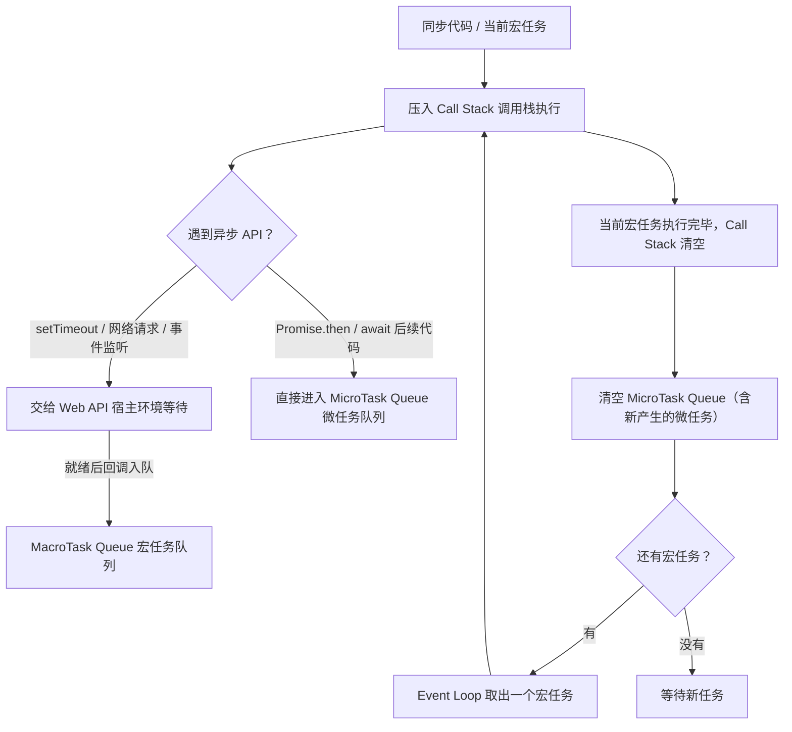

# JavaScript 异步编程笔记

>
> 学习目标：搞懂"异步"到底是什么、JS 为什么必须异步、三种异步写法如何演进，以及事件循环如何决定代码的真实输出顺序

---

## 一、什么是异步

### 1.1 一句话理解

==**异步：不用等一件事做完，先去干别的，等这件事好了之后再回来处理结果。**==

**同步：一件事做完，才能做下一件，排队等待。**

这两句话听着简单，但它们是理解整个 JavaScript 执行模型的地基——后面所有的回调、Promise、async/await、事件循环，都只是在回答一个问题：**"事情做完之后，怎么回来"**。

### 1.2 专业定义与英文原名

| 中文 | 英文原名 | 专业定义 |
| --- | --- | --- |
| 同步 | Synchronous | 调用发出后，必须等到结果返回才继续执行下一条语句；等待期间执行线程被占用，无法做别的事，即**阻塞（Blocking）** |
| 异步 | Asynchronous | ==调用发出后立即返回，不等待结果；结果在"将来的某个时刻"通过**回调、事件或 Promise** 等机制送达，等待期间线程可以继续执行其他代码，即**非阻塞（Non-blocking）**== |

用一句话概括二者的本质差别：**同步把等待的成本压在调用方身上，异步把等待的成本转移给了宿主环境。**

> 注意一个常见误解：**异步 ≠ 多线程**。==JavaScript 的执行线程自始至终只有一个，异步只是"把等待外包出去"，结果最终还是回到同一个线程上执行==。这一点第七章讲事件循环时会讲透。

### 1.3 生活比喻：烧水

**同步的做法**：你按下烧水开关，然后站在水壶旁边盯着。水不开，你就什么也不干，一直等。水开了才去关火倒水。

**异步的做法**：你按下烧水开关，转身去刷手机。水烧开后水壶响铃通知你，你再回来关火倒水。

映射到 JS 里：

| 生活中的元素 | JS 中的对应物 |
| --- | --- |
| 烧水 | 耗时任务（网络请求、定时器、读取文件、数据库查询） |
| 站在水壶边盯着，什么都不干 | 同步阻塞主线程（Blocking），页面卡住 |
| 转身去刷手机 | 主线程继续往下执行后面的同步代码 |
| 水壶响铃 | 回调函数 / `Promise.then` / `await` 之后的代码 |
| 厨房（另一个人帮你看着火） | 宿主环境（浏览器 / Node.js），真正的等待发生在这里 |

这个比喻里有个容易被忽略的细节：**帮你烧水的不是你，是厨房里的设备**。对应到 JS，就是"计时、发网络请求这些活儿不在 JS 引擎里干，而是交给浏览器（或 Node）来做"。这正是异步能成立的前提。

---

## 二、JS 为什么必须异步

### 2.1 前提：JS 是单线程的

==**单线程（Single-threaded）**：同一时刻只有一个调用栈，只能执行一段 JavaScript 代码。==

为什么设计成单线程？因为 JS 诞生时的主要职责是操作 DOM。如果多个线程同时改同一个 DOM 节点，就必须引入锁、死锁、竞态条件（Race Condition）这一整套复杂度，语言会变得非常难用。用单线程从根上回避了这个问题，代价就是——**它经不起耗时任务的拖累**。

> **DOM = Document Object Model，文档对象模型** 一句话：浏览器把 HTML 文档，转换成一个**树状的 JS 对象**，JS 通过这个对象，去操作页面（改内容、改样式、加元素、绑定点击事件）。

### 2.2 后果：一个耗时任务就能卡死页面

浏览器的渲染（负责绘制页面的 UI 线程）和 JS 执行（JS 引擎线程）是互斥的：JS 在跑，页面就不能重绘；页面在重绘，JS 就得等。

所以只要有一个长任务占住主线程，页面立刻"死"给你看：

```js
// 模拟一个耗时 3 秒的同步任务（真实场景如大数组排序、复杂计算、同步读大文件）
function longTask() {
  const start = Date.now();
  while (Date.now() - start < 3000) {
    // 空转，死死占住主线程 3 秒
  }
}

document.querySelector('#btn').addEventListener('click', () => {
  longTask(); // 点击后：页面无法滚动、按钮点不动、动画卡住 3 秒
  console.log('计算完成');
});
```

如果所有代码都是同步的，那么"发一个网络请求"就意味着：页面从发出请求那一刻起完全冻结，一直等到数据从服务器回来才能继续渲染和响应——这显然不能用。

### 2.3 解法：单线程 + 非阻塞 = 异步

既然线程不能多开，那就把"等待"这件事从主线程上挪走：

1. 主线程发起一个耗时任务（如 `setTimeout`、`fetch`），**把任务连同回调一起交给宿主环境**；
2. 主线程立刻返回，继续执行后面的代码，页面照常响应；
3. 宿主环境在后台把事办完，把回调**排进任务队列**；
4. 主线程空闲时，由事件循环把回调取回来执行。

一句话：**异步是单线程在"不能多线程"约束下，避免自己把自己堵死的唯一出路。**

---

## 三、同步与异步对比

| 对比维度 | 同步 Synchronous | 异步 Asynchronous |
| --- | --- | --- |
| 执行方式 | 一条语句执行完才执行下一条，==严格顺序== | ==发出调用后立即返回==，不等结果 |
| 是否阻塞 | 阻塞 Blocking，调用期间线程被占用 | 非阻塞 Non-blocking，主线程可继续执行 |
| 结果返回时机 | 调用返回时即拿到结果 | ==结果在"将来"通过回调 / `then` / `await` 拿到== |
| 书写顺序与执行顺序 | 一致 | ==**不一致**== |
| 典型 API | `console.log`、`for` 循环、数组方法、`fs.readFileSync` | `setTimeout`、`fetch` / `ajax`、事件监听、`fs.readFile` |
| 错误处理 | `try / catch` 直接捕获 | 回调里靠 `err` 参数、Promise 靠 `.catch`、async 靠 `try / catch` |
| 主要缺点 | 耗时任务会卡住主线程、冻结页面 | 流程被拆散，可读性差，调试与错误处理更麻烦 |
| 适用场景 | 纯计算、生命周期短的逻辑 | 网络请求、定时器、文件 / 数据库 I/O、用户交互 |

---

## 四、同步与异步代码的执行顺序

### 4.1 同步代码：从上到下，顺序执行

```js
console.log(1);
console.log(2);
console.log(3);
// 输出顺序：1 → 2 → 3
```

毫无疑问，写在第几行就第几个执行。

### 4.2 异步代码：后面的先跑

`setTimeout`（定时器）是最经典的异步 API：

```js
console.log(1);

// 异步任务：等 2 秒再执行（这里的 2 秒只是"最早可执行时间"）
setTimeout(() => {
  console.log(2);
}, 2000);

console.log(3);
```

**输出顺序：`1` → `3` →（约 2 秒后）`2`**

注意 `2` 是最后出来的。哪怕把延迟改成 `0`，结果依然是 `1 → 3 → 2`：

```js
console.log(1);
setTimeout(() => console.log(2), 0); // 延迟 0 毫秒也不行
console.log(3);
// 输出：1 → 3 → 2
```

### 4.3 为什么是 1 → 3 → 2

逐帧拆解：

1. 执行 `console.log(1)`，打印 **1**。
2. 遇到 `setTimeout`：JS 引擎**不在自己这里计时**，而是把"回调函数 + 2000 毫秒"交给浏览器的定时器模块（属于 Web API），然后立即返回一个定时器 ID，继续往下走。
3. 执行 `console.log(3)`，打印 **3**。
4. 到这里**同步代码全部执行完，==调用栈==（Call Stack）清空**，主线程空闲下来。
5. 2 秒时间到，浏览器把 `setTimeout` 的回调函数扔进**宏任务队列（MacroTask Queue）**排队。
6. **事件循环（Event Loop）**发现调用栈空了，就从宏任务队列取出这个回调压入调用栈执行，打印 **2**。

两个关键结论：

- ==**`setTimeout(fn, 0)` 不等于"立刻执行"**，它的真实含义是"把回调尽快放进宏任务队列"，必须等当前所有同步代码执行完、调用栈清空之后才轮到它。==
- ==**定时器的延迟时间是"最早可执行时间"，不是"精确执行时间"**。如果主线程一直忙着，回调会继续往后推迟。==

```js
const start = Date.now();
setTimeout(() => {
  // 实际延迟会明显大于 500ms，因为主线程先被空转占用了 1 秒
  console.log('实际延迟约', Date.now() - start, 'ms');
}, 500);

// 紧接着空转 1 秒，把主线程占满
while (Date.now() - start < 1000) {}
// 输出：实际延迟约 1000 ms 左右
```

---

## 五、JS 中常见的异步任务

| 类别 | 典型 API | 运行环境 | 回调进入的队列 |
| --- | --- | --- | --- |
| 定时器 | `setTimeout` / `setInterval` | 浏览器 / Node | 宏任务 |
| 网络请求 | `XMLHttpRequest`（ajax）、`fetch`、jQuery `$.ajax` | 浏览器 | 请求完成回调为宏任务；`fetch` 返回的 Promise 回调为微任务 |
| 文件 / 数据库 I/O | `fs.readFile`、`fs.promises.readFile`、数据库查询 | Node | 宏任务（I/O 完成后入队） |
| 用户交互事件 | `click`、`input`、`scroll`、`keydown` 监听 | 浏览器 | 宏任务 |
| Promise 回调 | `then` / `catch` / `finally` | 语言内置 | **微任务** |
| async 函数续跑 | `await` 之后的代码 | 语言内置 | **微任务** |
| 微任务 API | `queueMicrotask`、`MutationObserver` | 浏览器 / 语言 | **微任务** |
| 渲染相关 | `requestAnimationFrame` | 浏览器 | 渲染前回调（不属于宏任务） |
| 资源加载 | `<script>` / `` 的 `onload`、`onerror` | 浏览器 | 宏任务 |

> 判断一个操作"是不是异步"，看的是 **API 的设计**，不是耗时长短。`console.log` 再慢也是同步的，`setTimeout(fn, 0)` 再快也是异步的。

---

## 六、异步的三种写法

从 ES5 到 ES2017，JavaScript 的异步写法经历了三代演进，每一代都是为了解决上一代的可读性问题。

### 6.1 第一代：回调函数 Callback（ES5 及以前）

**通俗解释**：把函数 A 当作参数传给函数 B，B 在合适的时候反过来调用 A，A 就是"回调函数"——字面意思，"回头再调用的函数"。

```js
// 1 秒后执行传入的函数
setTimeout(function () {
  console.log('时间到了');
}, 1000);
```

**专业定义**：回调函数（Callback Function）是以参数形式传入另一个函数、由后者在特定时机调用的函数。它是 JavaScript 实现异步最早、最基础的机制——`setTimeout`、事件监听、Node 的 `fs.readFile` 全部基于此。

单独一个回调没有任何问题，问题出在**"串行依赖多个异步任务"**的时候。

假设需求是：登录 → 用用户 ID 查订单 → 用订单 ID 查详情 → 渲染。用回调写出来是这样：

```js
login(user, (err, userInfo) => {
  if (err) return handleError(err);
  getOrders(userInfo.id, (err, orders) => {
    if (err) return handleError(err);
    getOrderDetail(orders[0].id, (err, detail) => {
      if (err) return handleError(err);
      render(detail);
    });
  });
});
```

这就是臭名昭著的**回调地狱（Callback Hell）**，也叫**末日金字塔（Pyramid of Doom）**。它的四个致命缺点：

1. **嵌套层级随依赖链加深而横向扩张**，代码变成"向右生长"的三角形；
2. **错误处理分散在每一层**，漏写一处就吞掉异常；
3. **无法用 `return` / `throw` 组织流程**，控制流是反的（结果通过参数往外送，而不是通过返回值往外送）；
4. **难以组合**：并行、竞态、超时这类需求用回调写极其别扭。

### 6.2 第二代：Promise（ES6 / ES2015）

**通俗解释**：Promise 是一个"凭证"或"提货单"。你下单之后立刻拿到一张单子（Promise 对象），东西还没做好，但你知道它要么会送来（成功），要么会告诉你没货（失败）。等结果出来了，凭这张单子去取。

**专业定义**：Promise 是表示**异步操作最终完成或失败**的对象，有三种状态：

- `pending`：进行中（初始状态）
- `fulfilled`：已成功（`resolve` 被调用）
- `rejected`：已失败（`reject` 被调用，或抛出异常）

状态只能从 `pending` **单向**变更一次，一旦落定（settled）就不可逆转，且结果值不可再改。

```js
// 创建：executor 函数是同步立即执行的
const p = new Promise((resolve, reject) => {
  setTimeout(() => {
    resolve('拿到数据');   // 成功：状态 pending → fulfilled，值为 '拿到数据'
    // reject(new Error('出错了'));  // 如果失败，改为 rejected
  }, 1000);
});

// 消费：then 注册的回调是微任务，不会立即执行
p.then(res => {
  console.log(res);   // 1 秒后打印：拿到数据
  return '下一步';     // 返回值会被自动包装成新的 Promise，交给下一个 then
})
  .then(v => {
    console.log(v);   // 打印：下一步
  })
  .catch(err => {
    console.error('链上任意一环出错都会走到这里:', err);
  })
  .finally(() => {
    console.log('无论成功失败都执行');
  });
```

核心要点：

- **`then` 返回一个新的 Promise**，所以可以链式调用，把嵌套拍平成"流水线"——这是 Promise 解决回调地狱的根本手段；
- **`catch` 能捕获链上任意一环抛出的错误**，错误沿链向后传递，不必每层都写判断；
- **`then` 的回调是微任务**，不是立刻执行（这点在第七章决定输出顺序时非常重要）；
- 组合工具：`Promise.all`（全部成功才成功）、`Promise.allSettled`（等全部落定）、`Promise.race`（第一个落定者胜出）、`Promise.any`（第一个成功者胜出）。

用 Promise 重写前面的三层依赖：

```js
login(user)
  .then(userInfo => getOrders(userInfo.id))
  .then(orders => getOrderDetail(orders[0].id))
  .then(detail => render(detail))
  .catch(err => handleError(err));   // 一处兜底全部错误
```

对比回调版本：层次从"金字塔"变成"直列"，错误处理从"每层判断"收成一处。可读性提升是数量级的。

### 6.3 第三代：async / await（ES2017，Promise 的语法糖）

**通俗解释**：`async / await` 让你用"看起来完全同步"的写法去写异步代码。`await` 可以翻译成"等这个异步操作出结果再往下走"，但这个"等"只暂停当前这个函数，不会冻结整个页面。

**专业定义**：`async` 函数是**总是返回 Promise** 的函数；`await` 用于等待一个 Promise 落定，它把该函数后续代码挂起并注册为微任务，待 Promise 状态确定后恢复执行，并把结果值作为 `await` 表达式的返回值。

```js
// 最基础的用法
async function fn() {
  const res = await new Promise(resolve => {
    setTimeout(() => resolve('数据'), 1000);
  });
  console.log(res); // 约 1 秒后打印：数据
}
fn();
```

规则清单：

- `async` 函数**总是返回 Promise**：函数里的 `return 值` 会被 `Promise.resolve(值)` 包装；函数内部抛错会让返回的 Promise 变为 `rejected`；
- `await` 后面通常跟 Promise，但跟普通值也可以（会先被包一层 `Promise.resolve`）；
- **`await` 之后的代码会进入微任务队列**，不会立刻执行；
- 错误处理与同步代码完全一致，用 `try / catch`：

```js
async function getUser() {
  try {
    const res = await fetch('/api/user');
    if (!res.ok) throw new Error('HTTP ' + res.status); // 非 2xx 手动抛错
    const data = await res.json();
    return data;
  } catch (err) {
    console.error('请求失败：', err.message);
  } finally {
    console.log('请求结束');
  }
}
```

- **必须在 `async` 函数内（或模块顶层）使用 `await`**，否则语法报错。

一个实战中一定要知道的坑：`await` 是**串行**的，不小心就会把可以并行的请求写成串行等待。

```js
// ❌ 串行：总耗时约 2 秒
const a = await reqA(); // 等 1 秒
const b = await reqB(); // 再等 1 秒

// ✅ 并行：总耗时约 1 秒
const [a2, b2] = await Promise.all([reqA(), reqB()]);
```

### 6.4 三种写法对比

| 对比维度 | 回调函数 Callback | Promise | async / await |
| --- | --- | --- | --- |
| 出现版本 | ES5 及以前 | ES6（ES2015） | ES2017 |
| 代码外观 | 嵌套回调，异步风格 | 链式 `.then`，仍是异步风格 | 看起来就是同步代码 |
| 可读性 | 差（回调地狱） | 中（扁平但仍是链） | 好（最接近人的思维顺序） |
| 错误处理 | 每层判断 `err` 参数，或完全丢失异常 | `.catch` 统一捕获 | `try / catch`，与同步写法一致 |
| 是否解决回调地狱 | 否 | 是 | 是（进一步扁平化） |
| 本质 | 函数引用传递 | 状态机 + 微任务队列 | `async` 自动驱动的生成器 + Promise |
| 典型场景 | 老 API、事件监听、Node 风 API | 需要组合多个异步（`all` / `race`） | 日常业务逻辑的主流写法 |
| 调试体验 | 调用栈被拆断，难追 | 有 Promise 链，较好 | 调用栈接近同步，最好 |

### 6.5 与生成器 `yield` 的关系

**通俗解释**：`yield` 是生成器（Generator）里的"暂停键"，可以让一个函数执行到一半停下来，把控制权交出去，之后被人再叫一声才继续。这个"暂停—续跑"的能力，恰好是异步流程需要的。

```js
// 生成器示例：函数可以被"分段执行"
function* gen() {
  const a = yield 1;  // 第一次 next() 停在这里，yield 交出 1
  console.log(a);     // 第二次 next('A') 恢复，a 收到 'A'
  const b = yield 2;
  console.log(b);
}

const it = gen();
it.next();        // { value: 1, done: false } —— 执行到第一个 yield 暂停
it.next('A');     // 打印 A，继续到第二个 yield
it.next('B');     // 打印 B，函数结束
```

对应关系：

- **`yield` 能暂停函数执行，`next(value)` 能把值送回函数内部**。如果 `yield` 出来的是一个 Promise，再由外部代码等它 resolve 后自动调用 `next()`，异步流程就被"写成同步的样子"了——早期的 `co` 库、Babel 的 `regenerator` 走的正是这条路；
- **`async / await` 可以理解为这套模式的官方内置版**：`await` 就相当于"异步版本的 `yield`"，区别在于
  1. `await` 专门等 Promise 落定并**自动解包**结果值，不需要手动 `next(value)`；
  2. `async` 函数**自带执行器**，会自动驱动往下跑，不需要外部循环调用 `next`；
  3. `yield` 是通用控制流原语，`await` 是专门为异步而生的语法。

**一句话记忆**：`await ≈ yield + 自动执行器 + Promise 自动解包`。现状是：新代码一律用 `async / await`，生成器主要用于惰性序列、自定义迭代器等场景，不再用来写异步。

---

## 七、底层原理拓展：==事件循环==（Event Loop）

前面反复提到"把任务交给宿主环境""调用栈清空后取回调"。这套调度机制就是**事件循环（Event Loop）**。理解它，才能准确算出任意一段代码的输出顺序。

### 7.1 三个核心角色

| 角色 | 英文原名 | 作用 |
| --- | --- | --- |
| 调用栈 | Call Stack | 后进先出（LIFO），存放正在执行的函数帧。==栈空 = 主线程空闲。== |
| 宿主环境 API | Web API（浏览器）/ Node 底层 API | 定时器、网络请求、DOM 事件、文件 I/O。**真正的等待发生在这里**，不在 JS 引擎里。 |
| 任务队列 | Task Queue | ==存放"已经就绪、等待被主线程执行"的回调，分为宏任务队列与微任务队列。== |

### 7.2 宏任务与微任务

| 类别 | 英文原名 | 包含哪些 | 优先级 |
| --- | --- | --- | --- |
| 宏任务 | MacroTask | 整体 `script`、`setTimeout`、`setInterval`、`setImmediate`（Node）、I/O 回调、UI 事件回调、`MessageChannel` | 低 |
| 微任务 | MicroTask | `Promise.then / catch / finally`、`queueMicrotask`、`MutationObserver`、`await` 之后的代码；（Node 中还有 `process.nextTick`，优先级高于 Promise） | **高** |

**铁律：每执行完一个宏任务，都要把微任务队列彻底清空，才轮到下一个宏任务。**

### 7.3 事件循环示意图

文字版（ASCII）：

```
                    ┌─────────────────────────────────────────┐
                    │            JS 引擎主线程                 │
                    │  ┌───────────────┐   ┌───────────────┐  │
       同步代码  ───►│  │  Call Stack   │   │  Event Loop   │  │
                    │  │   调用栈       │◄──┤   事件循环     │  │
                    │  └───────┬───────┘   └───────▲───────┘  │
                    └──────────┼───────────────────┼──────────┘
                               │ ① 遇到异步 API     │ ④ 取任务压栈
                               ▼                   │
                    ┌─────────────────────┐        │
                    │      Web API        │        │
                    │ 定时器/网络/事件/DOM  │        │
                    └──────────┬──────────┘        │
                               │ ② 完成后回调入队   │
                               ▼                   │
                    ┌─────────────────────────────────────┐
                    │          任务队列 Task Queue          │
                    │  ┌──────────────────────────────┐   │
                    │  │ MicroTask Queue 微任务（优先） │───┘ ③ 栈空后先清空微任务
                    │  ├──────────────────────────────┤
                    │  │ MacroTask Queue 宏任务         │────► 再取一个宏任务
                    │  └──────────────────────────────┘   │
                    └─────────────────────────────────────┘
```

流程图版（Mermaid，支持 Mermaid 的编辑器可直接渲染）：



### 7.4 事件循环的一轮（简化版流程）

1. 从宏任务队列取出一个任务（页面加载时，可以理解为"整体 `script` 代码"就是第一个宏任务），压入调用栈执行；
2. 执行过程中，遇到的异步 API 把回调交给宿主环境；`then` / `await` 产生的回调进入微任务队列；
3. 该宏任务执行完毕、**调用栈清空**；
4. **清空微任务队列**：逐个执行，且执行过程中新产生的微任务也要继续执行，直到队列为空；
5. 浏览器可能在这个间隙执行渲染（`requestAnimationFrame` 回调在渲染之前执行）；
6. 回到第 1 步，取下一个宏任务，循环往复。


### 7.5 常见误区清单

| 误区 | 事实 |
| --- | --- |
| 异步就是多线程 | JS 只有一条主线程；异步是把等待外包给宿主环境，结果排队回到主线程执行 |
| `setTimeout(fn, 0)` 会立即执行 | 它是"尽快入队"，必须等同步代码与微任务全部执行完 |
| `new Promise(...)` 里的代码是异步的 | executor 函数**同步立即执行**；只有 `then / catch` 回调才是微任务 |
| `await` 会阻塞整个页面 | 只暂停当前 async 函数内部的后续代码，主线程继续运行 |
| 定时器延迟时间很准 | 那只是"最早可执行时间"，主线程繁忙时会顺延 |
| `then` 里 `return` 的值没用 | 会被包装成新的 Promise 传给下一个 `then` |
| 微任务和宏任务同时存在时按注册顺序执行 | 微任务整体优先，必须清空后才执行下一个宏任务 |

---

## 八、重点总结

**概念层**

- **同步（Synchronous）**：排队执行，一条做完才做下一条，会阻塞后面代码；
- **异步（Asynchronous）**：耗时任务交给浏览器 / 宿主环境，主线程继续往下走，任务完成后回来执行回调；
- **JS 是单线程（Single-threaded）**，异步的唯一目的就是**不卡死页面**、不阻塞主线程。

**顺序层**

- 输出顺序 **`1 → 3 → 2`** 的原因：`setTimeout` 的回调进入**宏任务队列**，必须等同步代码全部执行完、调用栈（Call Stack）清空后，才由**事件循环（Event Loop）**取出执行；
- 执行优先级：**同步代码 → 微任务（MicroTask）→ 宏任务（MacroTask）**，且"每执行完一个宏任务都要清空整个微任务队列"。

**语法层**

- 三代演进：**回调函数（Callback）** → **Promise（ES6，解决回调地狱 Callback Hell、链式调用）** → **async / await（ES2017，Promise 的语法糖，现在最常用）**；
- `async` 函数总是返回 Promise；`await` 之后的代码进入微任务队列，错误用 `try / catch` 处理；多个独立异步任务用 `Promise.all` 并行，避免误写成串行；
- 与生成器的关系：`await` 近似"异步版的 `yield`"，但自带自动执行器与 Promise 自动解包，所以 `async / await` 已经取代了 Generator 写异步的历史使命。

**原理层**

- 四个关键构件：**调用栈 Call Stack**、**宿主 API（Web API）**、**微任务队列 MicroTask Queue**、**宏任务队列 MacroTask Queue**；
- 事件循环的一轮 = 取一个宏任务执行 → 清空全部微任务 →（可能渲染）→ 取下一个宏任务。

