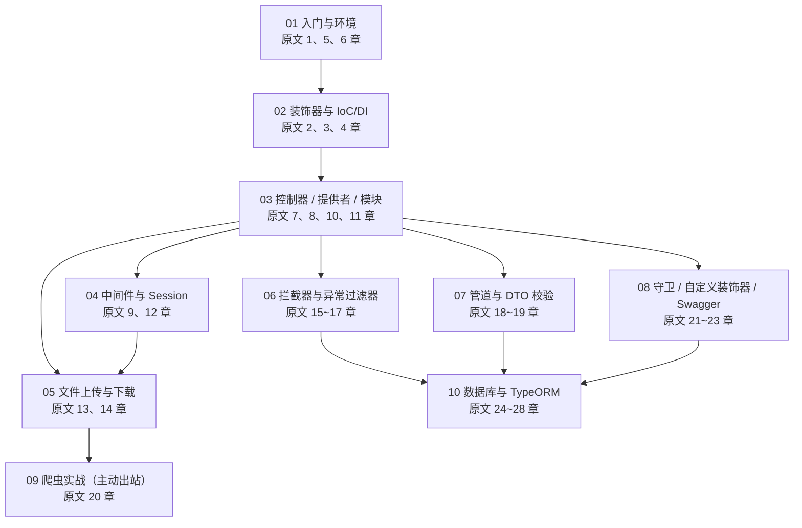

# NestJS 学习笔记 · 阅读指南与总目录

> 学习日期：2026-11-05
> 素材来源：小满 NestJS 系列（blog.csdn.net/qq1195566313，专栏 ID 11844396）
> 本篇对应：原文全 28 章的总索引
> 适合人群：NestJS 零基础

这是整套 NestJS 笔记的**入口页**。正文一共 10 篇，覆盖小满 NestJS 系列专栏的全部 28 章；本页负责回答四件事：**这套笔记是什么、该按什么顺序读、知识点之间谁依赖谁、原文 28 章分别落在哪一篇**。

建议把本页当作书签：读之前看「二、全部文档目录」定位置，卡住时看「四、知识点依赖关系图」找前置，忘了某章在哪篇就查「五、映射对照表」。

---

## 一、这套笔记是什么

### 1.1 来源与范围

本套笔记的内容来源是 CSDN 专栏 **小满 NestJS 系列**（作者：小满，主页 `blog.csdn.net/qq1195566313`，专栏 ID **11844396**），该专栏共 **28 篇**，从「NestJS 是什么」一路讲到「TypeORM 事务」。

| 项目 | 说明 |
| --- | --- |
| 原始素材 | 小满 NestJS 系列，共 28 章 |
| 专栏地址 | https://blog.csdn.net/qq1195566313/category_11844396.html |
| 专栏 ID | 11844396 |
| 笔记篇数 | 正文 10 篇 + 本索引 1 篇 = 11 个文档 |
| 覆盖情况 | 原文第 1 ~ 28 章全部覆盖，无遗漏章节 |
| 内容边界 | 只讲素材内的知识，不额外引入 Docker、微服务、GraphQL 等素材外主题 |

原文是「一篇一知识点」的连载式写法，适合查阅、不适合从头啃。本套笔记做了三件事：**把 28 篇按知识依赖重新归类成 10 篇**、**给每个概念补生活化比喻 + 专业定义 + 英文原名**、**把每段代码补成可直接运行的完整版并加中文注释**。

### 1.2 适合人群

这套笔记的目标读者画像很具体，先自查是否对得上：

| 你的情况 | 是否适合 | 建议 |
| --- | --- | --- |
| 会一点 JavaScript，但没写过后端框架 | ✅ 最匹配 | 从 01 篇顺序读 |
| 学过 Node.js，但没系统用过 Express | ✅ 适合 | 01、02 篇可略读，重点看 03 之后 |
| 完全没接触过 TypeScript 装饰器 | ✅ 适合 | 02 篇必须逐行敲一遍 |
| 已有 Spring / .NET 后端经验 | ✅ 适合 | 靠 02 篇抓 IoC/DI 的对照关系，其余快速过 |
| 完全不会 JavaScript | ⚠️ 偏难 | 先补 JS 的 `async/await`、`Promise`、模块化再回来 |
| 想找 NestJS 高级架构 / 微服务方案 | ❌ 不适合 | 原文与笔记都只到「单体应用 + 数据库」为止 |

一句话：**为「JS/Node 基础薄弱、要从零学 NestJS 的实习生」写的**，所以不怕啰嗦，但要求你至少能看懂 `function`、`import`、`async`。

### 1.3 总篇幅

| 统计项 | 数值 |
| --- | --- |
| 正文篇数 | 10 篇 |
| 正文总行数 | 9000 行 |
| 正文总体积 | 约 356 KB |
| 本索引行数 | 459 行 |
| 全部文档 | 11 个（含本索引） |
| 二级标题（H2）总数 | 58 章 |
| 代码块 | 291 段，全部带中文注释 |
| 预计通读耗时 | 纯读 6 ~ 8 小时；边读边敲 25 ~ 35 小时 |

篇幅分布很不均匀，这是有意的：**基础概念（03、08、10）篇幅最长**，因为它们是后面所有内容的支点；**工程技巧（05、06、07）偏短**，因为套路固定、会查即可。

### 1.4 全篇统一约定

11 个文档共用同一套写法，看懂这套约定，任何一篇都能无障碍阅读：

| 约定 | 具体形式 | 作用 |
| --- | --- | --- |
| 文档头 | 四行引用块：学习日期 / 素材来源 / 本篇对应章节 / 适合人群 | 一眼知道这篇从哪来、覆盖原文哪几章 |
| 二级标题 | `一、` `二、` `三、` 中文序号 | 每篇 3 ~ 9 章，就是这篇的骨架 |
| 三级标题 | `1.1` `2.3` 数字点数字，不越级、不用四级标题 | 便于 VS Code 大纲跳转 |
| 双视角讲解 | 先生活化比喻（收快递、保安、门卫），再给专业定义 + 英文原名 | 先建立直觉，再对齐术语 |
| 代码 | 一律可运行、带中文注释，标注文件路径 | 能直接粘贴到项目里验证 |
| 对比表格 | 用表格横向对比相近概念（如守卫 vs 中间件） | 防止概念混淆 |
| 错误三栏表 | `报错原文` → `原因` → `解决` | 照着抄就能排错 |
| 本篇小结 | 结尾固定一张「要点 \| 一句话说明」表 | 复习时只看这张表 |

> 代码说明：原文中的部分示例是以截图（`[图片]`）给出的，笔记里凡是能从上下文判断出写法的，都补成了完整可运行代码；判断不出来的**跳过不杜撰**，宁缺不错。

---

## 二、全部文档目录

### 2.1 文档一览表

下表是全套笔记的完整索引，11 个文档按「先总后分」排列。「对应原文章节」取自每篇文档头部的 `本篇对应`，「核心内容」取自各文档实际的一级/二级标题，未做任何虚构。

| 序号 | 文档名 | 对应原文章节 | 核心内容 | 篇幅行数 |
| :---: | --- | --- | --- | ---: |
| 00 | [00_阅读指南与目录.md](<D:\实习\实习生全栈学习笔记\Part3_NestJS\00_阅读指南与目录.md>) | 全 28 章总索引 | 来源与范围、适合人群、总篇幅、11 文档索引表、三条学习路径、知识点依赖图、请求生命周期、28 章映射表 | 459 |
| 01 | [01_NestJS入门与环境准备.md](<D:\实习\实习生全栈学习笔记\Part3_NestJS\01_NestJS入门与环境准备.md>) | 第 1、5、6 章 | NestJS 是什么、底层 HTTP 平台（Express 与 Fastify）、环境准备与创建项目、项目目录结构导读、CLI 常用命令 `nest g`、常见错误与排查 | 465 |
| 02 | [02_前置知识_装饰器与IoC-DI.md](<D:\实习\实习生全栈学习笔记\Part3_NestJS\02_前置知识_装饰器与IoC-DI.md>) | 第 2、3、4 章 | IoC 控制反转与 DI 依赖注入、TypeScript 装饰器基础、动手用装饰器实现一个 GET 请求、常见错误与排查 | 657 |
| 03 | [03_核心概念_控制器与模块.md](<D:\实习\实习生全栈学习笔记\Part3_NestJS\03_核心概念_控制器与模块.md>) | 第 7、8、10、11 章 | RESTful 风格设计、控制器 Controller 与参数装饰器、提供者 Provider 与自定义注入、模块 Module（共享模块与动态模块） | 1164 |
| 04 | [04_中间件与Session.md](<D:\实习\实习生全栈学习笔记\Part3_NestJS\04_中间件与Session.md>) | 第 9、12 章 | Session 会话机制与登录态、中间件 Middleware（拦截、日志、跨域） | 815 |
| 05 | [05_文件上传与下载.md](<D:\实习\实习生全栈学习笔记\Part3_NestJS\05_文件上传与下载.md>) | 第 13、14 章 | 文件是怎么传上来的、后端接收上传（Multer）、静态目录托管、文件下载 | 664 |
| 06 | [06_RxJS与响应异常拦截.md](<D:\实习\实习生全栈学习笔记\Part3_NestJS\06_RxJS与响应异常拦截.md>) | 第 15 ~ 17 章 | RxJS 是什么、RxJS 三个入门案例、响应拦截器统一成功格式、异常过滤器统一错误格式、三个组件串成完整请求链路 | 714 |
| 07 | [07_管道与参数校验.md](<D:\实习\实习生全栈学习笔记\Part3_NestJS\07_管道与参数校验.md>) | 第 18 ~ 19 章 | 管道是什么、参数转换（八个内置 Pipe）、DTO 校验（`ValidationPipe` + `class-validator`）、手写自定义 DTO 校验管道 | 757 |
| 08 | [08_守卫_自定义装饰器与Swagger.md](<D:\实习\实习生全栈学习笔记\Part3_NestJS\08_守卫_自定义装饰器与Swagger.md>) | 第 21 ~ 23 章 | 守卫 Guard 是什么、写第一个守卫、用元数据做角色控制、自定义装饰器、Swagger 接口文档 | 1158 |
| 09 | [09_爬虫实战.md](<D:\实习\实习生全栈学习笔记\Part3_NestJS\09_爬虫实战.md>) | 第 20 章 | 爬虫本质、准备环境、拆解页面结构、递归抓取所有分页、图片写盘、封装成 NestJS 接口、反爬与合规、常见错误 | 966 |
| 10 | [10_数据库与TypeORM.md](<D:\实习\实习生全栈学习笔记\Part3_NestJS\10_数据库与TypeORM.md>) | 第 24 ~ 28 章 | 数据库入门（数据该放在哪）、`TypeOrmModule.forRoot` 连接、实体 Entity、Repository 第一个完整 CURD、表关系（一对多与多对多）、事务 Transaction、知识地图与检查清单 | 1640 |

> 说明：序号 00 是本页；正文 01 ~ 10 共 9000 行。原始素材的章节顺序与笔记顺序**不一致**——比如原文第 9 章（Session）被并进了 04 篇，第 20 章（爬虫）被抽成 09 篇。这是按「知识依赖」而非「原文顺序」重排的结果，具体对照见第五节。

### 2.2 篇幅分布

各篇篇幅（每格约 100 行），可以看出重难点集中在哪：

```text
01 入门与环境        █████ 465
02 装饰器与 IoC/DI   ███████ 657
03 控制器与模块      ████████████ 1164
04 中间件与 Session  ████████ 815
05 文件上传与下载    ███████ 664
06 RxJS 与拦截       ███████ 714
07 管道与校验        ████████ 757
08 守卫与 Swagger    ████████████ 1158
09 爬虫实战          ██████████ 966
10 数据库与 TypeORM  ████████████████ 1640
```

三篇最长的（10、03、08）分别对应 **持久层、骨架层、安全层** —— 恰好是面试和实战中最容易被追问的三块。

### 2.3 每篇的固定结构

所有正文篇都按同一个骨架写，你可以按需跳读：

| 段落位置 | 内容 | 建议读法 |
| --- | --- | --- |
| 开头引用块 | 学习日期、素材来源、对应章节、适合人群 | 30 秒扫一眼 |
| 导语 | 这篇要解决哪几个具体问题、接续上一篇哪里 | 先读，建立目标感 |
| 一、二、三… | 主线知识，每章内部「比喻 → 定义 → 代码 → 对比表」反复循环 | 精读 |
| 常见错误篇 | 报错原文、原因、解决三栏表 | 遇到报错再查 |
| 本篇小结 | 「要点 \| 一句话说明」表 | 复习只看这张表 |

---

## 三、三条学习路径

同一套材料，不同目标该走不同的路。以下是三条经过权衡的路线，按你的目的选一条即可。

### 3.1 路径一：零基础顺序通读（推荐给第一次学 NestJS 的人）

**目标**：建立完整心智模型，能从零独立写完一个带数据库的 CRUD 后端。

**路线**：01 → 02 → 03 → 04 → 05 → 06 → 07 → 08 → 09 → 10（严格按序号）

| 阶段 | 篇目 | 要拿下的东西 | 建议节奏 |
| --- | --- | --- | --- |
| 打地基 | 01、02 | 项目能跑起来；明白 `@Controller()` 为什么能生效、为什么不用 `new` Service | 2 天，02 篇务必手敲 |
| 建骨架 | 03 | Controller / Provider / Module 三角关系，接口能收参、能返回 | 2 ~ 3 天，最不能跳 |
| 补外围 | 04、05 | 登录态、拦截请求、传文件 | 2 天，按需精读 |
| 统一出入口 | 06、07 | 响应统一、异常统一、参数校验 | 2 天，工程价值最高 |
| 加权限与文档 | 08 | 守卫、自定义装饰器、Swagger | 2 天 |
| 拓展与落库 | 09、10 | 主动出站抓数据、TypeORM 增删改查与事务 | 3 ~ 4 天，10 篇最难 |

> 顺序不能乱的原因：02 篇的装饰器和 DI 是 03 篇的前置，03 篇的 Controller 是 04 ~ 08 篇所有「请求链路上的组件」的挂载点。跳过 02 直接看 03，你会觉得语法全是魔法。

### 3.2 路径二：面试速查（推荐给准备面试 / 临时被问住的人）

**目标**：20 分钟内把某个具体问题讲清楚，能说出机制 + 代码 + 对比。

**用法**：不按顺序读，按「问题 → 篇目 → 章节」直接跳。

| 你被问到 | 去看 | 精确位置 |
| --- | --- | --- |
| NestJS 和 Express 有什么区别 | 01 篇 | 一、NestJS 是什么 / 二、底层 HTTP 平台 |
| 什么是 IoC 和 DI，为什么要依赖注入 | 02 篇 | 一、IoC 控制反转与 DI 依赖注入 |
| 装饰器原理是什么，`@Controller` 怎么生效 | 02 篇 | 二、TypeScript 装饰器基础 |
| Controller / Provider / Module 分别干什么 | 03 篇 | 二、三、四章 |
| `@Body` `@Query` `@Param` 区别 | 03 篇 | 二、控制器与参数装饰器 |
| 动态模块、共享模块怎么用 | 03 篇 | 四、模块 Module |
| Session 和 JWT 思路差在哪、怎么保持登录态 | 04 篇 | 一、Session 会话机制 |
| 中间件和守卫有什么区别 | 04 篇 + 08 篇 | 04 篇二、中间件；08 篇一、守卫是什么（含 6 维对比表） |
| 文件上传怎么实现、为什么用 Multer | 05 篇 | 二、后端接收上传 |
| 拦截器能做什么、AOP 怎么体现 | 06 篇 | 三、响应拦截器 |
| 全局异常怎么统一处理 | 06 篇 | 四、异常过滤器 |
| 参数校验怎么做、DTO 是什么 | 07 篇 | 三、DTO 校验 |
| 管道有哪几种、执行时机在哪 | 07 篇 | 一、管道是什么 / 二、参数转换 |
| 权限控制怎么做、`Reflector` 干什么 | 08 篇 | 三、用元数据做角色控制 |
| 怎么自动生成接口文档 | 08 篇 | 五、Swagger 接口文档 |
| 爬虫怎么做、怎么防封 | 09 篇 | 四、递归抓取 / 七、反爬与合规 |
| TypeORM 实体和表怎么对应 | 10 篇 | 三、实体 Entity |
| 一对多、多对多怎么写 | 10 篇 | 五、表关系 |
| 事务怎么用、什么场景必须用 | 10 篇 | 六、事务 Transaction |

**配套技巧**：每篇结尾的「本篇小结」表是最好的面试速记卡，30 条要点扫一遍，比通读全文快 10 倍。

### 3.3 路径三：上手写项目（推荐给「三天内要交个后端」的人）

**目标**：不考虑体系完整性，先让项目跑起来、接口能用、数据能存。

**路线（按写代码的真实顺序，不是按篇号）**：

```text
01 篇（三、环境准备与创建项目 + 五、nest g 命令）
        │  产出：一个能 nest start 跑起来的空项目
        ▼
03 篇（二、控制器 + 三、提供者）
        │  产出：GET /user、POST /user 两个能返回数据的接口
        ▼
07 篇（三、DTO 校验）
        │  产出：接口能挡住脏数据，不再 500
        ▼
10 篇（二、连接数据库 + 三、实体 + 四、Repository）
        │  产出：数据真的能存进 MySQL，重启不丢
        ▼
06 篇（三、响应拦截器 + 四、异常过滤器）
        │  产出：所有接口统一成 { code, data, message }
        ▼
04 篇（一、Session）→ 08 篇（一~三、守卫）
        │  产出：能登录，且未登录访问被 403 拦住
        ▼
05 篇（二、上传）        ← 有头像/附件需求才看
09 篇（六、封装成接口）  ← 有抓数据需求才看
```

**取舍原则**：02 篇的装饰器原理可以先当黑盒（会用 `@Controller()` `@Injectable()` 即可），但**03 篇的 Module 不能跳**——不注册 Provider，注入会直接报错，且报错信息很难懂。

### 3.4 三条路径对比

| 维度 | 路径一 顺序通读 | 路径二 面试速查 | 路径三 写项目 |
| --- | --- | --- | --- |
| 适用人群 | 零基础首次学习 | 准备面试 / 答疑 | 有交付压力 |
| 覆盖篇目 | 全部 11 篇 | 按需 1 ~ 2 篇 | 6 ~ 8 篇 |
| 预计耗时 | 25 ~ 35 小时 | 20 分钟 / 问 | 2 ~ 3 天 |
| 阅读方式 | 精读 + 手敲 | 跳读 + 抄结论 | 只读代码段 |
| 产出 | 完整心智模型 | 能讲清机制 | 一个能跑的接口服务 |
| 主要风险 | 中途放弃 | 知识碎片化 | 遇到没见过的问题卡住 |

---

## 四、知识点依赖关系图

### 4.1 整体依赖关系（ASCII）

箭头方向 = 「先学左边的，才能看懂右边的」。可以看出 **02 是全篇地基，03 是所有请求链路组件的挂载点**。

```text
                    ┌───────────────────────────────────────────┐
                    │ 01  NestJS 是什么 / 环境 / CLI 命令        │
                    │     （原文 1、5、6 章）                    │
                    └───────────────────┬───────────────────────┘
                                        │ 没有项目就无法验证任何代码
                    ┌───────────────────▼───────────────────────┐
                    │ 02  装饰器 + IoC / DI（全篇地基）          │
                    │     （原文 2、3、4 章）                    │
                    └───────────────────┬───────────────────────┘
                                        │ @Controller / @Injectable 的来源
                    ┌───────────────────▼───────────────────────┐
                    │ 03  Controller / Provider / Module         │
                    │     （原文 7、8、10、11 章）               │
                    └──┬────────┬─────────┬─────────┬───────────┘
                       │        │         │         │
        ┌──────────────▼─┐ ┌────▼──────┐ ┌▼────────┐ ┌▼──────────────┐
        │ 04 中间件      │ │ 06 拦截器 │ │ 07 管道 │ │ 08 守卫       │
        │    + Session   │ │  + 异常   │ │ + DTO   │ │ + 装饰器      │
        │ （9、12 章）   │ │（15~17）  │ │（18~19）│ │ + Swagger     │
        └──────┬─────────┘ └────┬──────┘ └────┬────┘ └────┬──────────┘
               │                │             │           │
               │  Session 有了  │  统一出入口 │  校验有了 │  权限有了
               │  才有"登录态"  │             │           │
        ┌──────▼────────────────▼─────────────▼───────────▼──────────┐
        │            05  文件上传与下载（13、14 章）                 │
        │            依赖 03 的控制器 + 04 的中间件层（Multer）      │
        └──────────────────────────────┬─────────────────────────────┘
                                       │ 出站方向的延伸
                    ┌──────────────────▼──────────────────────────┐
                    │ 09  爬虫实战（20 章）                       │
                    │  axios 发请求 + cheerio 解析 + 复用 03 控制器│
                    └──────────────────┬──────────────────────────┘
                                       │ 数据最终要落库
                    ┌──────────────────▼──────────────────────────┐
                    │ 10  数据库与 TypeORM（24~28 章）            │
                    │  依赖 02 的 DI、03 的 Provider、07 的 DTO   │
                    └─────────────────────────────────────────────┘
```

### 4.2 NestJS 请求生命周期与各篇位置

这是 NestJS 最核心的一张图，也是面试最高频的考点。**一个 HTTP 请求进来后，会依次穿过六个环节**，任何一环都能把你拦下来：

```text
 客户端发起 HTTP 请求
        │
        ▼
 ┌───────────────────────────────────────────────────────────┐
 │ ① 中间件 Middleware                                       │
 │    最早执行，能读写原始 req / res，看不到"路由处理函数"   │
 │    → 04 篇 二、中间件 Middleware                          │
 │    → 05 篇 的 Multer 上传解析也挂在这一层                 │
 └──────────────────────────┬────────────────────────────────┘
                            ▼
 ┌───────────────────────────────────────────────────────────┐
 │ ② 守卫 Guard                                              │
 │    决定"这个人配不配进来"，返回 true / false              │
 │    → 08 篇 一、守卫是什么 + 二、第一个守卫 + 三、元数据授权│
 └──────────────────────────┬────────────────────────────────┘
                            ▼
 ┌───────────────────────────────────────────────────────────┐
 │ ③ 拦截器 Interceptor（前置）                              │
 │    RxJS 流，可在控制器执行前后各插一刀，改写返回值        │
 │    → 06 篇 三、响应拦截器：统一成功返回格式               │
 └──────────────────────────┬────────────────────────────────┘
                            ▼
 ┌───────────────────────────────────────────────────────────┐
 │ ④ 管道 Pipe                                               │
 │    把参数转成目标类型，或校验不过直接抛异常               │
 │    → 07 篇 一、管道是什么 + 二、参数转换 + 三、DTO 校验   │
 └──────────────────────────┬────────────────────────────────┘
                            ▼
 ┌───────────────────────────────────────────────────────────┐
 │ ⑤ 控制器 Controller                                       │
 │    真正匹配路由、取出 @Body / @Query / @Param             │
 │    → 03 篇 二、控制器 Controller 与参数装饰器             │
 └──────────────────────────┬────────────────────────────────┘
                            ▼
 ┌───────────────────────────────────────────────────────────┐
 │ ⑥ 服务 Service / Repository                               │
 │    业务逻辑与数据访问，控制器只负责转发                    │
 │    → 03 篇 三、提供者 Provider                            │
 │    → 10 篇 四、Repository：第一个完整 CURD                │
 └──────────────────────────┬────────────────────────────────┘
                            ▼
              ③' 拦截器 Interceptor（后置，改写响应体）
                            │
              ┌─────────────┴─────────────┐
              ▼                           ▼
        正常返回响应                任一层抛出异常
                                  → 异常过滤器 ExceptionFilter
                                  → 统一错误格式
                                  → 06 篇 四、异常过滤器
```

一句话记住顺序：**中间件（能不能进大门）→ 守卫（有没有资格）→ 拦截器（进门前后都插手）→ 管道（带的材料合不合格）→ 控制器（柜台办事）→ 服务（后台查库）**。

### 4.3 为什么是这个顺序

| 环节 | 执行位置 | 能看到什么 | 拿不到什么 | 典型用途 |
| --- | --- | --- | --- | --- |
| 中间件 | 路由匹配**之前** | 原始 `req` / `res` | 不知道要进哪个 Controller、哪个方法 | 日志、CORS、Session、Body 解析 |
| 守卫 | 路由匹配**之后**、进入处理函数**之前** | 守卫生成时的 `ExecutionContext`、路由元数据 | 拿不到管道转换后的参数 | 登录校验、角色权限 |
| 拦截器 | 处理函数**前后各一次** | 整个调用上下文、返回值 RxJS 流 | 改不了参数本身 | 统一响应包装、耗时统计、缓存 |
| 管道 | 处理函数**参数注入时** | 单个参数的原始值 | 拿不到整个请求对象 | 类型转换、DTO 校验 |
| 控制器 | 处理函数本体 | 已校验过的参数 | — | 编排、调用 Service |
| 服务 | 控制器内部调用 | 业务入参 | HTTP 上下文 | 业务逻辑、数据库读写 |

这个「由外到内、逐层收窄」的设计就是 NestJS 相对 Express 的最大价值：**Express 只能靠一堆 `app.use` 排队，顺序靠自觉；NestJS 把每个关注点固定在一个层里，位置错了框架直接不生效。**

### 4.4 全篇知识地图（Mermaid）

同一张关系图的可视化版本，支持 Mermaid 的编辑器（VS Code 插件、Typora、GitHub）可直接渲染：



---

## 五、28 章 → 11 个文档 映射对照表

### 5.1 完整映射表

左列是原文 28 章的真实标题，右列是本套笔记的归入位置。**没有任何一章被丢弃**，也有若干章被拆分重组（见 5.2）。

| 原文章节 | 原文标题 | 归入文档 |
| :---: | --- | --- |
| 第 1 章 | 介绍 nestjs | 01 篇 |
| 第 2 章 | IOC 控制反转 DI 依赖注入 | 02 篇 |
| 第 3 章 | 前置知识装饰器 | 02 篇 |
| 第 4 章 | 前置知识装饰器 - 实现一个 GET 请求 | 02 篇 |
| 第 5 章 | nestjs cli | 01 篇 |
| 第 6 章 | nestjs cli 常用命令 | 01 篇 |
| 第 7 章 | RESTful 风格设计 | 03 篇 |
| 第 8 章 | nestjs 控制器 | 03 篇 |
| 第 9 章 | nestjs Session | 04 篇 |
| 第 10 章 | nestjs 提供者 | 03 篇 |
| 第 11 章 | nestjs 模块 | 03 篇 |
| 第 12 章 | nestjs 中间件 | 04 篇 |
| 第 13 章 | nestjs 上传图片 - 静态目录 | 05 篇 |
| 第 14 章 | nestjs 下载图片 | 05 篇 |
| 第 15 章 | nestjs 和 RxJs | 06 篇 |
| 第 16 章 | nestjs 响应拦截器 | 06 篇 |
| 第 17 章 | nestjs 异常拦截器 | 06 篇 |
| 第 18 章 | nestjs 管道转换 | 07 篇 |
| 第 19 章 | nestjs 管道验证 DTO | 07 篇 |
| 第 20 章 | nestjs 爬虫 | 09 篇 |
| 第 21 章 | nestjs 守卫 | 08 篇 |
| 第 22 章 | nestjs 自定义装饰器 | 08 篇 |
| 第 23 章 | nestjs swagger 接口文档 | 08 篇 |
| 第 24 章 | nestjs 连接数据库 | 10 篇 |
| 第 25 章 | nestjs 实体 | 10 篇 |
| 第 26 章 | nestjs 第一个 CURD | 10 篇 |
| 第 27 章 | nestjs typeOrm 关系 | 10 篇 |
| 第 28 章 | nestjs 事务 | 10 篇 |

### 5.2 合并与拆分说明

原文 28 章是按「发一篇讲一个点」写的，章节顺序与知识依赖并不完全一致。重组规则与理由如下：

| 处理 | 涉及章节 | 重组方式 | 为什么这么改 |
| --- | --- | --- | --- |
| 前置合并 | 第 2、3、4 章 | 合并为 02 篇 | 三章都在讲「装饰器 + DI」这一个地基，拆开读会重复三遍背景 |
| 环境前排 | 第 5、6 章 | 前移到 01 篇 | CLI 命令属于「装环境」的收尾，放在第 5、6 章位置会打断概念连贯性 |
| 会话前置 | 第 9 章 | 与第 12 章合并为 04 篇 | Session 和中间件都在「请求进入控制器之前」，同层组件合并讲清执行顺序 |
| 出站独立 | 第 20 章 | 单独拆为 09 篇 | 爬虫是唯一「服务端主动发请求」的场景，与入站链路无依赖，独立成篇不打断主线 |
| 权限后置 | 第 21 ~ 23 章 | 合并为 08 篇 | 守卫依赖元数据 + 自定义装饰器，三者必须一起讲才能跑通一个完整鉴权示例 |
| 持久化合并 | 第 24 ~ 28 章 | 合并为 10 篇 | 建库、实体、CURD、关系、事务是一条不可分割的链路，拆开看会不知道代码放哪 |

### 5.3 编号 vs 章节速览

想从「篇号」反查「原文范围」时看这张：

```text
01 篇 ──▶ 第 1、5、6 章
02 篇 ──▶ 第 2、3、4 章
03 篇 ──▶ 第 7、8、10、11 章
04 篇 ──▶ 第 9、12 章
05 篇 ──▶ 第 13、14 章
06 篇 ──▶ 第 15、16、17 章
07 篇 ──▶ 第 18、19 章
08 篇 ──▶ 第 21、22、23 章
09 篇 ──▶ 第 20 章
10 篇 ──▶ 第 24、25、26、27、28 章
合计   ──▶ 10 篇 / 28 章，无遗漏
```

---

## 六、本篇小结

最后一件事：怎么用这套笔记最省力。三条建议——

1. **第一次读，按 01 → 10 顺序，每篇的代码至少敲一遍。** NestJS 的坑几乎都在「注册与注入」上，看懂和敲过是两种完全不同的状态。
2. **读不懂某篇时，先回上一层的依赖篇补。** 比如 07 篇的 DTO 看不懂，八成是 02 篇的装饰器没吃透；10 篇的事务读不下去，通常是 03 篇的 Provider 作用域没理解。
3. **复习只读「本篇小结」表 + 本页的依赖图。** 280 条要点 + 一张生命周期图，足够在面试前 30 分钟内把整套知识捞回来。

| 要点 | 一句话说明 |
| --- | --- |
| 来源 | 小满 NestJS 系列 28 章，CSDN 专栏 11844396，全部覆盖无遗漏 |
| 规模 | 正文 10 篇共 9000 行、58 个二级章节，加本索引共 11 个文档 |
| 适合人群 | JS/Node 基础薄弱、从零学 NestJS 的实习生；不覆盖微服务等进阶主题 |
| 篇目排序依据 | 按知识依赖重排，不按原文顺序，故篇号 ≠ 章号 |
| 三条路径 | 顺序通读建体系、面试速查按问题跳转、写项目按代码顺序取最小集 |
| 地基两篇 | 01 让你有项目可验证，02 的装饰器与 DI 是所有后续内容的前提 |
| 请求生命周期 | 中间件 → 守卫 → 拦截器 → 管道 → 控制器 → 服务，异常最后进过滤器 |
| 生命周期各篇位置 | 04（中间件）、08（守卫）、06（拦截器/过滤器）、07（管道）、03（控制器/服务） |
| 最难三篇 | 10 数据库（1640 行）、03 骨架（1164 行）、08 权限（1158 行），面试高频区 |
| 映射完整性 | 10 篇 = 28 章，本页第 5.1 节可逐章核对 |
|||
