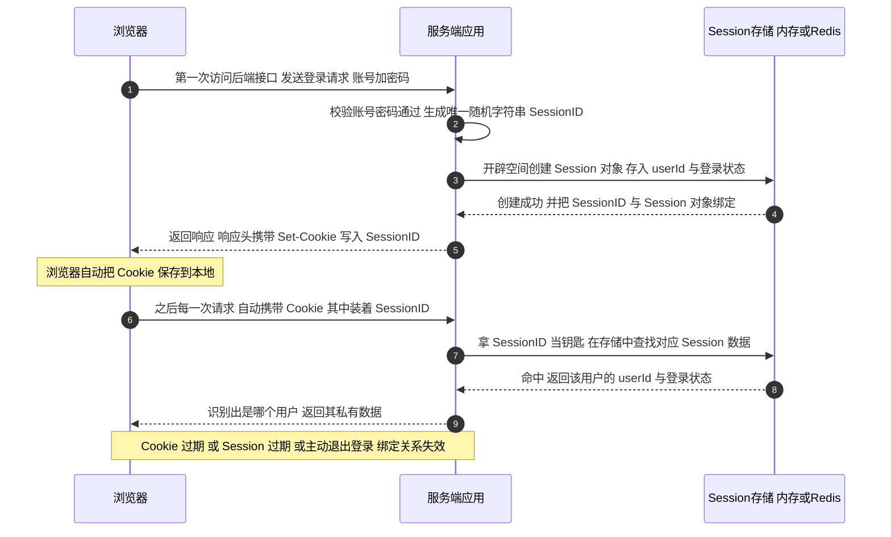
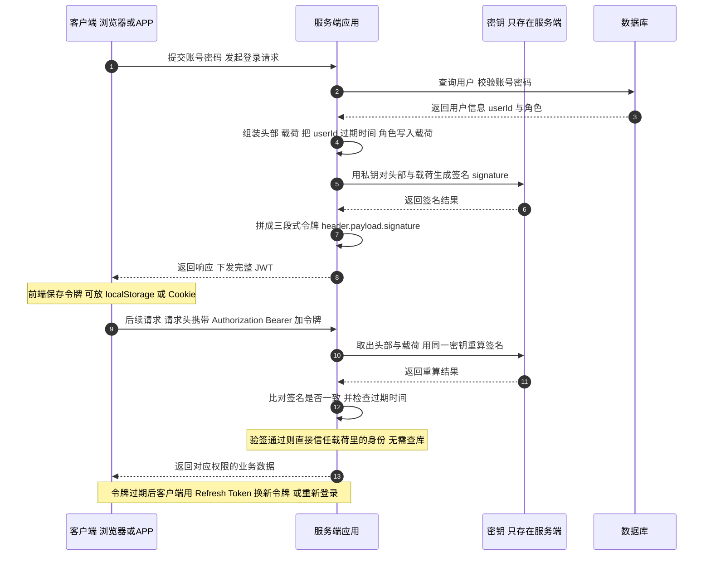
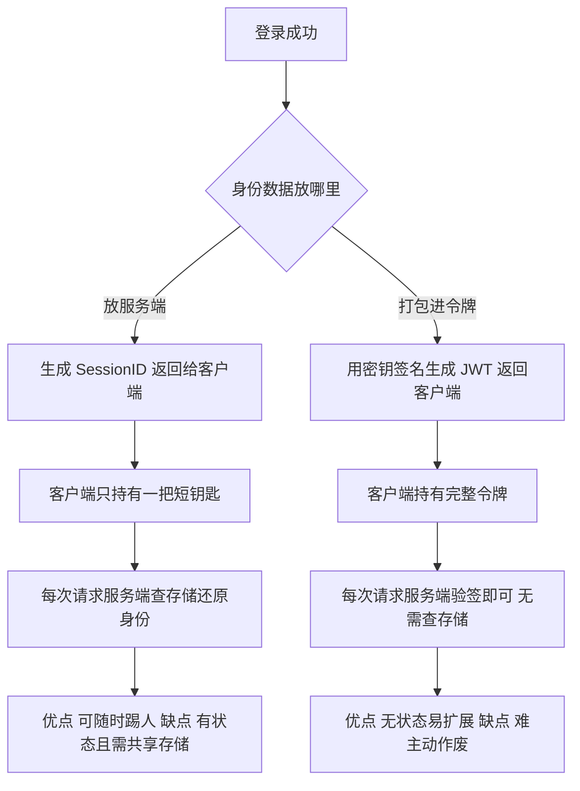

# Session 与 JWT 精简对比

> 认证要解决的问题只有一句话：**HTTP 本身不记人，如何让每次请求都能被认出是谁。**
>
> 前提：==HTTP协议本身是**无状态**的，服务器默认分不清两次请求是不是同一个用户。==

---

## 一、Session

1. 用户第一次访问后端接口（登录请求）
2. ==服务器==收到请求，==**生成唯一的随机字符串：SessionID**==
3. 在==服务器内存（或者Redis）==开辟一块空间，==创建Session对象==，用来存放这个用户的数据（userId、登录状态等），并且把==SessionID和这个Session对象绑定==起来
4. <u>服务器返回响应的时候，在响应头里带上 `Set-Cookie`，把 **SessionID 写入浏览器的Cookie**</u>
5. ==浏览器==收到响应，自动把这个==Cookie存到本地==
6. **之后这个浏览器每一次发请求，都会自动带上这个Cookie（里面装着SessionID）发给服务器**
7. 服务器拿到请求里的SessionID，拿着这个钥匙去服务器存储里查找对应的Session数据，识别出是哪个用户
8. 直到Cookie过期 / Session过期 / 退出登录，这个绑定关系失效

**一句话精简版**

==第一次访问：服务端生成Session+SessionID → 通过Set-Cookie把SessionID放到浏览器Cookie里； 后续请求：浏览器自动在Cookie携带SessionID传给服务端 → 服务端用SessionID查到保存在服务端的Session，进而识别出是哪一个用户==。

| 名词 | 一句话职责 | 存哪 |
|---|---|---|
| **Session** | 真正装用户数据的容器（userId、登录状态、权限） | 服务端内存或 Redis |
| **SessionID** | 打开容器的唯一钥匙，一串安全随机字符串 | 两端各一份 |
| **Cookie** | 浏览器存钥匙的盒子，每次请求自动带上 | 浏览器本地 |

> 设计哲学：**敏感数据留在服务端，只把钥匙交给客户端。**

---

## 二、JWT

1. 用户第一次访问后端接口（登录请求），提交账号与密码
2. ==服务器==收到请求，==**查询数据库校验账号密码**==，校验通过才继续
3. 组装 **header（头部）与 payload（载荷）**：header 声明令牌类型与签名算法，payload 写入 userId、角色、签发时间 iat、过期时间 exp
4. ==**用密钥对 header 与 payload 计算签名 signature**==（HS256 用同一把密钥，RS256 用私钥签、公钥验）
5. 把三段用点号拼成 ==**header.payload.signature 完整 JWT 字符串**==
6. <u>服务器返回响应时把完整令牌下发，可放响应体，也可放响应头 `Set-Cookie`</u>
7. ==客户端==收到响应，==把令牌保存到本地==（localStorage / Cookie / 内存均可）
8. **之后这个客户端每一次发请求，都在请求头里带上 `Authorization: Bearer 加令牌`** 发给服务器
9. 服务器取出令牌，==用同一密钥重算签名并比对==，同时检查 exp 是否过期；==**验签通过就直接信任载荷里的身份，不需要查库或查缓存**==，从而识别出是哪个用户
10. 直到令牌过期，这个令牌自动失效；因为服务端不存会话，签发后无法主动作废，只能由客户端用 **Refresh Token 换取新令牌**，或重新登录

**一句话精简版**

==第一次访问：服务端校验账号密码后，把用户信息与过期时间打包进 payload，用密钥签名生成三段式 JWT（即 令牌） 交给客户端保存； 后续请求：客户端在 Authorization 头里携带 Bearer 令牌发给服务端 → 服务端只验签并解析载荷就能识别出是哪一个用户，全程不需要查库==。

**JWT 三段结构职责**

| 段 | 内容 | 作用 | 是否明文可见 |
|---|---|---|---|
| **header** | `{"alg":"HS256","typ":"JWT"}` | 声明令牌类型与签名算法，决定服务端用哪种方式验签 | 是，Base64URL 解码即可读 |
| **payload** | `{"sub":"1001","name":"tom","iat":...,"exp":...}` | 存放身份数据与过期时间，即"自带的信息" | 是，Base64URL 解码即可读 |
| **signature** | **用密钥对前两段计算出的哈希签名** | 防篡改，篡改任何一段都会验签失败 | 否，没有密钥无法伪造 |

> 所以 payload 里**绝对不能放密码、手机号等敏感信息**——它不是加密，只是签名。

JWT工作的时序图

---

## 三、对比

**核心区别**

- **Session 是有状态认证**：会话数据存在服务端，客户端只拿一把短钥匙（SessionID），每次请求都要回服务端查存储才能还原身份。
- **JWT 是无状态认证**：身份数据全部打包在令牌里，服务端签完名就不再保存，每次请求只验签、解析，不查存储。

| 对比项 | Session | JWT |
|---|---|---|
| ==**数据存放**== | 用户数据在服务端内存或 Redis，客户端只有 SessionID | 用户数据打包在令牌内，存在客户端 |
| **存储压力** | 用户越多，服务端内存或 Redis 占用越高 | 服务端零会话存储，无压力 |
| **主动注销** | 容易，服务端删掉这条会话即刻失效，可随时踢人 | 难，签发后到期前无法作废，只能等过期或额外维护黑名单 |
| **传输方式** | 默认依赖 Cookie，浏览器自动携带，禁用 Cookie 即失效 | Cookie、请求头 Authorization 均可，移动端更友好 |
| **体积** | 每次只传很短的 SessionID，体积小 | 令牌字符串很长，每次请求都携带，增加请求体积 |
| **集群扩展** | 多节点必须做会话共享（Redis），否则换台机器就掉线 | 天然分布式，各节点只要密钥一致即可独立验签 |
| **安全风险** | Cookie 自动携带，主要风险是 CSRF | 存 localStorage 时 XSS 风险更高；若放 Cookie 则回到 CSRF，需配 SameSite 与 CSRF Token |

> **==重要纠偏：JWT 不是加密，只是签名。==** 它的 payload 只是 Base64URL 编码，任何人拿到令牌都能解码看到里面全部内容，只是无法篡改（改了签名就对不上）。==所以密码、手机号、身份证号这类敏感信息绝对不要放进 JWT。==

**一图看两条路线**

---

## 四、各自适用场景

| 选型 | 适用场景 | 关键理由 |
|---|---|---|
| **Session** | 后台管理系统、企业内部系统、需要随时强制下线的业务、同域传统 Web | ==服务端可即时吊销会话== |
| **JWT** | 移动端 APP、小程序、跨端服务、微服务与跨域 API | 无状态、易水平扩展 |
| **折中方案** | 短效 JWT（如 15 分钟）负责业务鉴权 + 长效 Refresh Token 存 Redis 负责续期 | 兼顾扩展性与可吊销能力 |

---

## 五、一句话记忆

> Session 把账本留在店里，只给你钥匙；JWT 把账本复印盖章交给你本人。
> 因此 **要能随时踢人就选 Session，要跨端跨服务扩展就选 JWT**。
